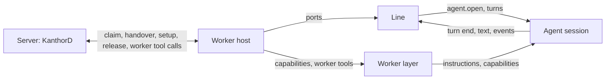

# L1: The model and its boundaries

Back to the [index](index.md). The terms follow the [glossary](index.md#glossary).

## Goals

1. **G1.** Each actor of the model has one role. A responsibility table states what each actor owns and does not own.
2. **G2.** The boundary between the agent and the worker lists each item that crosses it, in each direction, with the layer that specifies it.
3. **G3.** One tool ownership rule assigns each tool, hook, port and prompt part of today to the agent, the worker layer, another consumer or removal.
4. **G4.** "Stateless and runs without KanthorD" is a list of checks that a test can verify.
5. **G5.** For each actor, the page states which credential enters, who holds it and where it is never passed. Each credential rule of today keeps its strength or becomes stricter.
6. **G6.** Each item of today maps to one place in the model: `swe@1`, `re@1`, `env@1`, the three chains, `kanthord worker tasks run` and `kanthord serve worker`.
7. **G7.** Each point of the direction of Ulrich has a verdict with evidence. A point that does not fit has a suggestion. A point that fits has a fit rule.

## Evaluation of the direction

(G7)

The direction of Ulrich is his thinking, not a fixed specification. This section checks each point against the code of today and the pages. The mark **(Q<n>)** shows each place that depends on a ruling of an [open question](#open-questions-for-ulrich).

### E1. Role profiles `bee@1`, `fee@1`, `te@1` (fits, with a fit rule)

- **Verdict.** Fits. A teammate of Ulrich ran the dogfood on another machine. From that run, Ulrich concluded that `swe@1` alone is not specific enough: "During the dogfooding I realized that we need more specific agent than just use swe@1 for all in one" (2026-11-21).
- **Dogfood finding.** The tasks of the `apps` repository, a React app with Tailwind, did not follow the UI. The session lacked the React and Tailwind context.
- **Context mechanism of today.** A session loads no context file by itself (`engine/src/agent/agent-session.ts`, `sessionParts`, `noContextFiles: true`). A repository gives its context through layer 2, the Repository prompt, in two parts: the instruction file of its repository binding (`prompts.instruction_file`, absent by default) and the stored Repository prompt. Layer 3 is the Binding prompt of each agent name ([agent.md](../agent.md#prompt-composer)). The file `apps/AGENTS.md` exists in the `apps` repository.
- **Evidence for the fit.**
  - The pages already name a testing profile: `tdd@1` runs `swe@1`, `te@1` and `re@1` ([overview.md](../overview.md), section "Worked example: `tdd@1`"; [HANDOFF.md](../HANDOFF.md), item "Multi-agent workers").
  - The Role of `swe@1` holds no rule of a stack (`engine/static/prompt/swe@1.md`). A role adds the method of its stack.
- **Fit rule.**
  1. Add `bee@1`, `fee@1` and `te@1` as role profiles. Keep `swe@1`, name unchanged, as the generalist default profile and the evaluation baseline. A role profile that does not do better than `swe@1` on the same inputs, with the same repository context, leaves the catalog.
  2. `swe@1` is the configuration owner of the four implementation profiles. [Constraint C1](#e1-constraints) holds the scope.
  3. No automatic profile selection runs this round. `coder@1` runs `swe@1`, and `reviewer@1` runs `re@1`, as today.
  4. A role profile runs only through `kanthord run agent`, for the evaluation against `swe@1`. [L1-D20](#decisions) states the evaluation.
  5. The repository context of a role profile comes from the KanthorD prompt chain: the Standard, the Role, the stored Repository prompt and the Binding prompt. This round loads no `AGENTS.md`. The instruction file stays as today, absent by default.
  6. A later round designs a selection rule only after a role profile wins. The work unit that gets `te@1` goes with that selection. A worker that runs `te@1` in its own step is the worker `tdd@1`, which stays an example.
  7. The profile prompt holds one coding text that the coding profiles share. A Role holds only the role statement and its method. [L2](L2-agent.md#profile-prompts) writes the texts. Each method rule of a Role traces to one dogfood finding or to one evaluation result.
  8. The four implementation profiles hold the seven agent tools of today. A role gets another tool only for a need of today. [L2](L2-agent.md#coding-tools) applies the rule.
  9. Build in two layers. Layer 1 is the role profiles in the runtime catalog and the agent CLI. Layer 1 adds no server operation, no server record and no server view. Layer 1 does not change the composed prompt or the prompt references of a worker execution. The evaluation baseline is `swe@1` as `run agent` composes it. Layer 2 starts only after a role profile wins. It holds the selection rule, the session per profile, the execution setup and the shared coding text in the worker path.

#### E1 constraints

- **C1. One configuration owner.** A role profile has no enablement, agent provider, default configuration, fallback chain, cooldown, claim selection, pin, worker binding entry or Binding prompt of its own. It uses those of `swe@1`. Reason: the claim scans each name of `agent_names` and answers no work when one name cools (`engine/src/worker/agent-selection.ts`). `agent_names` of `coder@1` stays `["swe@1"]`. The claim, the inference authorization, the execution setup and the binding checks read `agent_names` (`engine/src/worker/agent-selection.ts`, `authorization.ts`, `execution-setup.ts`, `service.ts`).
- **C2. One LLM credential per execution.** All sessions of one execution use the one model selection and the one credential of `swe@1`, as today. No role has a model of its own in this round.
- **C3. One node can span repositories.** One node can span a backend and a frontend repository ([mission-service.md](../mission-service.md)). One session works from the checkouts root (`engine/src/agent/agent-port.ts`, `checkoutsRootOf`). A per-repository value has no single answer for such a node.
- **C4. Repository conventions stay in the Repository prompt.** The instruction file, `prompts.repository` and the Binding prompt carry them ([agent.md](../agent.md#prompt-composer)). A Role holds no convention of one repository.
- **C6. The server part lists only configuration owners.** A role profile is in the runtime catalog. It is in no enablement list, no row of the agent page and no `prompts.agents` key. Reason: `AGENT_NAMES` (`engine/src/agent/contract.ts`) keys `AGENT_DECLARATIONS` (`engine/src/agent/catalog.ts`) and one `prompts.agents` key per name (`engine/src/project/contract.ts`). The enablement and the agent page read the catalog ([agent.md](../agent.md#agent-catalog)). The shared coding text is a new value of the closed set `PromptPart` (`engine/src/agent/contract.ts`), and `engine/src/agent/prompt-files.ts` lists only the Standard and the Role. It changes the composed prompt and the references of each `swe@1` and `re@1` execution, so it ships in layer 2.

### E2. "Stateless" (fits, with a definition)

- **Evidence.** A pi session holds state inside one run. The worker host passes a session root, and pi writes a session file for the resume (`engine/src/agent/agent-port.ts`, `sessionManagerOf`; [agent.md](../agent.md#agent-session)). The line sends several turns to one session (`engine/src/worker/unit/native-agent-session.ts`, `prompt` and `instruct`).
- **Fit.** Only the agent is stateless. The pi session file is the single record of a session, and the consumer owns it. [L1-D11](#decisions) defines "stateless". [Statelessness](#statelessness) holds the checks.

### E3. Agent capability and worker capability (fits, with a rule)

- **Evidence.** A capability of D32 is one pi extension factory that registers tools (`engine/src/agent/capabilities/execution-evidence.ts`). The guards and hooks are also extension factories (`engine/src/agent/hooks/`).
- **Fit.** One mechanism, with the owner set by the [tool ownership rule](#tool-ownership-rule). A capability that needs a resource of a consumer belongs to the consumer that holds that resource ([L1-D7](#decisions)).

### E4. The worker "integrates deeply with KanthorD" (fits)

- **Evidence.** The line constructs no client and no transport. It makes a side effect only through a host tool ([design.md D32](../worker-execution-refactor/design.md#1-decisions)).
- **Fit.** The worker is stateful and needs a KanthorD server to run. Only the worker host talks to the server ([L1-D2](#decisions)).
- Change: the offline mode leaves the model. `kanthord worker tasks run`, `tasks seed`, `tasks compare` and the replay of D31 go (`engine/docs/cli/worker.md`, section "Local tasks runs"). [L1-D20](#decisions) replaces the replay.

### E5. Two CLIs (fits, with the root `run`)

- **Evidence.** `kanthord serve worker` starts one worker instance from its instance configuration and runs until it stops. The instance key is its only credential, and it refuses `--token` (`engine/docs/cli/other.md`, section `serve worker`). The direction pairs the worker CLI with an agent CLI that takes one input.
- **Fit.** Both CLIs are one-shot commands under a new global root `run`. The binary stays `kanthord`, and `serve` stays the long-running process.
  1. The agent CLI is `kanthord run agent`. It runs one agent profile from one input and exits ([L3](L3-agent-cli.md)). It holds only the LLM credential, from standard input or from its `--auth` file, and no KanthorD credential.
  2. The worker CLI is `kanthord run worker`. It claims one execution, runs it and exits ([L5](L5-worker-cli.md)). The instance key is its only start credential and its only credential toward the server, as `serve worker`. It reads the machine key and receives the handover as `serve worker` does. It refuses `--token`.
  3. Change: `run` joins the closed set of global root names. Today the set holds `config`, `upgrade`, `serve` and `auth` (`engine/docs/cli/other.md`, section "Closed root names and option scope").

### E6. Profile names `ops@1` and `comm@1` (fits)

- **Evidence.** The direction gives `ops@1` to Operation Setup and `comm@1` to the Communication agent "Yumi". The branch `origin/feature/workbench-v2` names Yumi `ops@1`: `git show origin/feature/workbench-v2:src/agent/catalog.ts` gives `"ops@1"` with `display_name: "Yumi"`. `env@1` sets up the environment of a repository binding (`engine/src/project/environment-agent.ts`).
- **Fit.** `env@1` is the Operation Setup agent. Yumi keeps `ops@1`. No name conflict remains. This round designs no Yumi profile.

### Points that fit with no rule

- `evidence-upload` and `link_update_list` belong to the worker layer. Both call the server through the worker host (`engine/src/apps/worker/execution.ts`, `hostToolsOf`). The [tool inventory](#tool-inventory) moves them.
- The agent runs on pi-coding-agent (`engine/src/agent/agent-session.ts`, `openSessionRuntime`).
- The worker adds a repository instruction to the system prompt. The Repository prompt does this today ([agent.md](../agent.md#prompt-composer)).
- Define only the coding tool set of today. [L2](L2-agent.md#coding-tools) applies the rule of this page.

## Roles

(G1)

The model has three actors: the agent, the worker and the server. A worker has three parts: the worker host, the line and the worker layer.

The diagram states these facts:

- The server and the worker host exchange the claim, the handover, the setup, the release and the calls of worker tools.
- The worker host gives ports to the line. It gives capabilities and worker tools to the worker layer.
- The line opens the agent session and sends turns to it.
- The worker layer gives instructions and capabilities to the agent session.
- The agent session gives the turn end, the text and the session events back to the line.

### Agent

- An agent is a person in the factory: one LLM working unit that runs one agent profile on pi-coding-agent.
- The agent profile fixes the profile prompt, the full tool set of the profile by name, the start preconditions and the confinement.
- The agent is stateless and runs without KanthorD. [Statelessness](#statelessness) holds the checks.
- The agent knows no worker, no execution, no claim and no node. [agent.md](../agent.md#boundary) states this for the input. Change: the code follows it. Today `SessionOpenRequest` carries `claim.execution_id` (`engine/src/agent/agent-port.ts`).
- Every consumer opens a session through the agent contract of [L2](L2-agent.md#input-and-output-contract): a worker, the Workbench Service, the Project Service and the agent CLI.

#### Setup and start preconditions

- The agent does no workspace setup. A layer above it prepares the workspace and gives the agent a valid setup: a worker, or the human who runs `run agent`.
- Each profile declares its start preconditions. The agent checks them at session open. When one fails, the agent refuses to start and states the reason.
- Example for a coding profile: the working directory exists, and it is a git worktree with no uncommitted change.
- Change: today no session open checks a precondition of a profile (`engine/src/agent/agent-session.ts`, `openSession`).

#### Agent runtime and server part of the Agent component

Change: the Agent component of [agent.md](../agent.md#scope) splits into two parts. Only the runtime part is the agent of the model.

- **Agent runtime.** The session open, the profiles, the guards, the tools and the prompt composition. Files of `engine/src/agent/` today: `agent-session.ts`, `agent-port.ts`, `tool-table.ts`, `bash-process.ts`, `environment.ts`, `pi.ts`, `pi-tools.ts`, `catalog.ts`, `pinned-layers.ts`, `sensitive-text.ts`, `hooks/`, and the joins `finalPrompt` and `systemPrompt` of `prompt-render.ts`.
- **Server part.** The configuration, the selection, the prompt sources and references, and the migrations. Files of `engine/src/agent/` today: `service.ts`, `configuration.ts`, `enablements.ts`, `cooldowns.ts`, `migrations.ts`, `prompt-resolve.ts`, `prompt-source.ts`, `prompt-files.ts`, `instruction-files.ts`, `prompt-templates.ts`, and the part reads of `prompt-render.ts`.
- **Files that L2 splits or assigns.** `prompt-render.ts` splits: the joins go to the runtime, and the part reads stay in the server part. `contract.ts` serves both parts and imports `engine/src/scheduler/contract.ts`. `prompt-composer.ts` serves `pinned-layers.ts` and imports `prompt-templates.ts` of the server part. `prompt-assets.ts`, `config.ts` and `index.ts` have no part yet.
- The server part imports custody, project, mission and tracking modules and uses the store (`engine/src/agent/service.ts`). Those imports stay.
- The runtime imports today: `engine/src/worker/contract.ts` (`catalog.ts`, `agent-port.ts`, `pi-tools.ts`, `capabilities/*.ts`), `engine/src/tracking/contract.ts` (`SpanStatus` in `agent-port.ts`) and `engine/src/custody/contract.ts` (`SecretShape` in `hooks/sensitive-text-redaction.ts`).
- Change: the runtime imports no worker, project, mission or scheduler module, no transport and no gateway client. [L2](L2-agent.md) assigns each file and rules the `SpanStatus` and `SecretShape` imports.

### Worker

- A worker automates one category of work. `coder@1` and `reviewer@1` are the workers of the coding category. Change: the direction calls the whole worker a manufacturing line. The V3 pages use "line" only for the part below.
- The worker is stateful and needs a KanthorD server to run.
- The **worker host** links the line to the KanthorD server: `kanthord serve worker` and `kanthord run worker`. The steps outside `tasks` run in the worker host (`engine/src/worker/unit/chain-runner.ts`).
- The **line** is the `tasks` phase of each chain and its steps, behind typed ports (`engine/src/worker/unit/foundry-implement.ts`, `foundry-evaluation.ts`, `foundry-examine.ts`, `foundry-ports.ts`).
- The **worker layer** is what the worker adds to an agent session: worker instructions, worker capabilities and the implementations of the worker tools that the profile declares.
- The worker gives the profile name of each session. The agent never selects a profile or a worker.
- The line sits inside the worker, between the worker host and the agent.
- The port seam of the line stays, for credential isolation and testability.
  - The import closure of the line holds no client, no transport and no credential (`engine/src/worker/unit/foundry-boundary.test.ts`).
  - The build rule `FoundryReadsSshAccess` refuses a `tasks` step that reads `sshAccess` (`engine/src/worker/unit/chain.ts`).
- Every D32 rule of the Foundry applies to the line ([design.md D32](../worker-execution-refactor/design.md#1-decisions)). The line holds no client, no transport and no credential. It makes a side effect only through a host tool.
- Change: the line opens an agent session only through the agent contract of [L2](L2-agent.md). The port `agent.open` builds the agent input from the execution setup and the worker layer (`engine/src/worker/unit/foundry-ports.ts`, `AgentPort`).
- The code keeps its names this round: `foundry-*.ts`, `FoundryHost` and `FoundryStep`. The Worker V2 pages keep the terms Foundry, Foundry host and CLI host. "Line" names the code of the Foundry. "Worker host" names the code of the Foundry host that talks to the server.

### Server

- The server is KanthorD: one process with its services ([architecture.vocabulary.md](../architecture.vocabulary.md#server)).
- The server owns the agent configuration, custody, the prompt sources and references, the scheduling and every record.
- The server runs no agent session for a worker execution. A server instance at the `server` or `container` placement is a worker instance ([worker-service.vocabulary.md](../worker-service.vocabulary.md#placement)).
- The server runs agent sessions for two other consumers. The Workbench Service opens `swe@1` and `re@1` sessions in the server process (`engine/src/workbench/service.ts`). The Project Service opens `env@1` sessions (`engine/src/project/environment-agent.ts`).

### Other consumers

- The Workbench Service adds server operation tools, its own `bash` wrapper and the approval hook (`engine/src/workbench/tools.ts`, `builtinTools`, `toolOperations`). Its session holds only `toolApproval` (`engine/src/workbench/service.ts`).
- The Project Service adds the tools `probe` and `environment_write` (`engine/src/project/environment-agent-tools.ts`). Its session holds only `checkoutConfinement` (`engine/src/project/environment-agent.ts`).
- The agent CLI of [L3](L3-agent-cli.md) is a consumer that is no service and gives no tool implementation.
- Change: the Workbench Service and the Project Service open each session through the agent contract. The profile declares each of their tools by name, and they give only the implementation. Every guard applies ([L1-D8](#decisions)).
- Change: the Workbench code lives on the branch `feature/workbench-v2`. The Workbench change starts after that branch merges into `main`.

## Responsibility table

(G1)

| Actor or part        | Owns                                                                                                                                                           | Does not own                                                                   |
| -------------------- | -------------------------------------------------------------------------------------------------------------------------------------------------------------- | ------------------------------------------------------------------------------ |
| Agent (runtime)      | Profiles with their full tool sets, start preconditions, session open, profile prompt, guards, wrapped `bash`, child environment, pi tool install, prompt join | A server call, a database, a durable record, a model choice, a workspace setup |
| Worker: worker host  | Server link, host resources, line ports, worker tool transport, telemetry sink, steps outside `tasks`, the workspace setup of its sessions                     | The `tasks` phase; the profile prompt                                          |
| Worker: line         | The `tasks` phase: turns, gate, verification, unit records, release gate                                                                                       | A client, a transport, a credential, an SSH signer, a tree pool                |
| Worker: worker layer | Worker instructions, worker capabilities, the implementations of declared worker tools                                                                         | The session open; the guards; a credential; the tool set of a profile          |
| Server               | Agent configuration and selection, custody, prompt sources and references, scheduling, records                                                                 | An agent session of a worker execution                                         |
| Other consumer       | The implementations of its declared consumer tools; its hooks; its credential source; the workspace setup of its sessions                                      | A profile; a guard of the agent runtime; an undeclared tool                    |

## Agent–worker boundary

(G2)

The worker calls the agent; the agent never calls the worker. [L2](L2-agent.md#input-and-output-contract) specifies the agent side. [L4](L4-worker.md) specifies the worker side.

| Direction      | Item              | Content at L1 level                                                                                     | Today                                                      |
| -------------- | ----------------- | ------------------------------------------------------------------------------------------------------- | ---------------------------------------------------------- |
| Worker → agent | Input             | Profile name, model selection and model runtime, workspace roots, budget, child environment             | `AgentSetup`, `OpenSessionInput` (`agent-session.ts`)      |
| Worker → agent | Work              | The work prompt of each turn, as text                                                                   | `prompt`, `instruct` (`native-agent-session.ts`)           |
| Worker → agent | System prompt     | Worker path: the composed text and its prompt references. Agent CLI path: the instructions              | `prompt.final` of the execution setup                      |
| Worker → agent | Capabilities      | Extension factories that register the implementations of declared worker tools                          | `capabilities` of `agentPort`; `host_tools`                |
| Worker → agent | Consumer records  | The session root (worker) or the session file path (`run agent`), a trace sink, the known-secret source | `sessionRoot`, `trace`, `knownSecrets` of `AgentPortInput` |
| Worker → agent | Stop              | An abort of the session                                                                                 | `stopOnEnd` (`native-method.ts`)                           |
| Agent → worker | Result            | The end of each turn and the last text                                                                  | `completeReply`, `lastText`                                |
| Agent → worker | Refusal           | The failed start precondition and its reason                                                            | None                                                       |
| Agent → worker | Events            | Session entries, turns, tool calls, usage, redaction counts                                             | `agent.session`, `agent.turn`, `agent.tool` spans          |
| Agent → worker | Workspace changes | The files that the agent changes in the workspace roots                                                 | Gate G reads the checkouts after each turn                 |
| Inside a turn  | Worker tool call  | The model calls; the guards run first; the worker implementation runs                                   | `evidence-upload`, `link_update_list`                      |

Boundary rules:

1. The input names no execution, no claim, no node and no server address. The worker keeps these in the closures of its worker tools.
2. One pure composition function in the agent runtime joins the system prompt: profile prompt, then instructions in consumer order. The precedence of [agent.md](../agent.md#prompt-composer) stays.
3. In the worker path, the server calls that function at the execution setup. The agent input carries the composed text and its references, and the agent adds no text. Today the server joins the parts with `finalPrompt` (`engine/src/agent/prompt-render.ts`), which `prompt-resolve.ts`, `service.ts` and `engine/src/worker/execution-setup.ts` call. The session takes `agent.prompt.final` whole (`agent-port.ts`). The composition function replaces `finalPrompt` in the worker path.
4. Change: the Workbench Service and the Project Service call the composition function too. Today they call the second join `systemPrompt` of `prompt-render.ts` (`engine/src/workbench/service.ts`, `engine/src/project/environment-agent.ts`).
5. In the agent CLI path, the agent composes the shipped profile prompt and the instructions of the input.
6. The override of a profile prompt file by the agent directory of the server host stays a server feature ([agent.md](../agent.md#prompt-composer)).
7. Change: the KanthorD protocol text of each Role moves to the worker instructions. In `swe@1.md`, these are two sentences of "Execution": "The worker runs the verifications after the turn." of item 4 and "The worker merges the base branch itself." of item 5. The method rules of items 4 and 5 stay in the Role. In `re@1.md`, these are item 8 of "Judgement" and the section "Findings". The Role of `re@1` keeps its judgement rules 1 to 7.
8. The guards of the agent wrap every tool, a worker tool included. No consumer can remove a guard.
9. The worker commits the work of a session before it opens the next session of the same execution. The next start precondition check then passes. Today one `agent.open` runs per execution (`engine/src/worker/unit/chain-implement.ts`, `implementWorkspaceNodes`). The rule applies when an execution opens a second session.

## Tool ownership rule

(G3)

1. The agent catalog declares the full tool set of each profile by name: `swe@1`, `re@1`, `env@1` and the role profiles. After the merge of `feature/workbench-v2`, it also declares `ops@1` and each profile that the merge adds. A consumer adds no undeclared tool.
2. A declared tool is an agent tool when it needs only the workspace roots and the process tree of the session. The agent runtime implements it. It needs no server, no credential, no device and no host resource.
3. Every other declared tool is a consumer tool. The consumer that holds what the tool needs gives its implementation. In a worker, it is a worker tool. Each tool that calls the KanthorD server is a consumer tool.
4. A worker capability registers only worker tools.
5. A worker tool reaches the agent only as a pi tool or an MCP tool that a worker capability registers (D32). The agent sees its name, its schema and its result.
6. The allowlist guard holds the agent tools of the profile and the declared consumer tools of the consumer that opens the session. `agentPort` does this today with `tools` and `host_tools` of the declaration (`engine/src/agent/tool-table.ts`, `sessionTools`). Change: the guard applies to every consumer.
7. In a confined session, the confinement guard refuses each tool with no location declaration (`engine/src/agent/hooks/checkout-confinement.ts`). Each declared tool carries its location list, also when the list is empty. A new tool of a confined profile needs a D27 test ([design.md §5.4](../worker-execution-refactor/design.md#54-credentials)).
8. A line port is no tool. Step code calls it outside a turn, and the model never sees it.

[L2](L2-agent.md#coding-tools) applies rules 1 and 2. [L4](L4-worker.md#worker-tools) applies rules 3 to 7 to the worker tools of `coder@1` and `reviewer@1`.

### Tool inventory

Each tool, hook, port and prompt part that an agent session gets today, with its owner in the model. Paths start at `engine/`.

| Item                                                                                                                             | Path                                                                                                                        | Owner in the model                                                                                                                                                                                                  |
| -------------------------------------------------------------------------------------------------------------------------------- | --------------------------------------------------------------------------------------------------------------------------- | ------------------------------------------------------------------------------------------------------------------------------------------------------------------------------------------------------------------- |
| `read`, `edit`, `write`, `grep`, `find`, `ls`                                                                                    | `src/agent/catalog.ts` (`BuiltinTool`)                                                                                      | Agent: agent tool                                                                                                                                                                                                   |
| `bash` with timeout, `childEnvironment`, `killGroupAtEnd`                                                                        | `src/agent/tool-table.ts`                                                                                                   | Agent: agent tool. The budget is an input                                                                                                                                                                           |
| pi tool binaries for `grep` and `find`                                                                                           | `src/agent/pi-tools.ts` (`installPiTools`)                                                                                  | Agent. Change: its error code leaves the worker contract                                                                                                                                                            |
| `evidence-upload`                                                                                                                | `src/agent/capabilities/execution-evidence.ts`; `src/apps/worker/evidence-upload.ts`; `src/apps/worker/tasks-host-tools.ts` | Worker tool that `swe@1` declares. Change: the implementation leaves `src/agent/`; `tasks-host-tools.ts` goes                                                                                                       |
| `link_update_list`                                                                                                               | `src/agent/capabilities/link-updates.ts`; `src/apps/worker/execution.ts`                                                    | Worker tool that `swe@1` declares. Change: the implementation leaves `src/agent/`                                                                                                                                   |
| `SessionHostTools`, `asToolError`                                                                                                | `src/agent/capabilities/host-tools.ts`                                                                                      | Worker layer                                                                                                                                                                                                        |
| `host_tools`, `HOST_TOOL_PARAMETERS`, their `TOOL_CATALOG` entries                                                               | `src/agent/catalog.ts`                                                                                                      | Agent catalog: the declaration of the consumer tools of a profile. [L2](L2-agent.md#coding-tools) takes the field shape `AgentTools` of `feature/workbench-v2`                                                      |
| `probe`, `environment_write`                                                                                                     | `src/project/environment-agent-tools.ts`; `EnvironmentTool` in `src/agent/catalog.ts`                                       | Consumer tools of the Project Service. Change: `env@1` declares them; today its declaration names only `read`, `grep`, `find` and `ls`                                                                              |
| Workbench operation tools and Workbench `bash`                                                                                   | `src/workbench/tools.ts` (`toolOperations`, `builtinTools`)                                                                 | Consumer tools of the Workbench. Change: `swe@1` and `re@1` declare them. The catalog of `feature/workbench-v2` already declares them in `AgentTools` (`git show origin/feature/workbench-v2:src/agent/catalog.ts`) |
| `homeRelativeCwd`                                                                                                                | `src/agent/hooks/home-relative-cwd.ts`                                                                                      | Agent                                                                                                                                                                                                               |
| Sensitive-text redaction                                                                                                         | `src/agent/hooks/sensitive-text-redaction.ts`; added by `sessionParts`                                                      | Agent: guard. The known-secret source is an input                                                                                                                                                                   |
| Tool allowlist                                                                                                                   | `src/agent/hooks/tool-allowlist.ts`                                                                                         | Agent: guard, with rule 6                                                                                                                                                                                           |
| Checkout confinement                                                                                                             | `src/agent/hooks/checkout-confinement.ts`; `isConfinedAgent`                                                                | Agent: guard. Change: a profile property; the roots are an input                                                                                                                                                    |
| Review roots                                                                                                                     | `src/agent/review-roots.ts` (`reviewRootsOf`)                                                                               | Worker layer. It computes the roots input                                                                                                                                                                           |
| Pinned layers                                                                                                                    | `src/agent/hooks/pinned-layers.ts`; `src/agent/pinned-layers.ts`                                                            | Agent                                                                                                                                                                                                               |
| Tool approval                                                                                                                    | `src/agent/hooks/tool-approval.ts`                                                                                          | Consumer hook of the Workbench                                                                                                                                                                                      |
| `agentPort`                                                                                                                      | `src/agent/agent-port.ts`                                                                                                   | Agent. Change: the reads of `ExecutionSetup`, the claim and `reviewWorkspace` move to `agent.open`                                                                                                                  |
| Session store by execution                                                                                                       | `src/agent/session-directory.ts`                                                                                            | Worker layer. It names the session root, and pi names the file in it                                                                                                                                                |
| Session trace                                                                                                                    | `src/worker/unit/native-agent.ts`; `src/worker/unit/agent-telemetry.ts`                                                     | Worker layer records; the agent emits the events                                                                                                                                                                    |
| Model runtime factory                                                                                                            | `src/worker/unit/model-runtime.ts`; `frozenStore` in `src/llm/refresh-watch.ts`                                             | Consumer. The agent takes the runtime as input                                                                                                                                                                      |
| Capability list                                                                                                                  | `capabilities` of `AgentPortInput` in `src/agent/agent-port.ts`; `FoundryHost.capabilities` in `src/worker/unit/foundry.ts` | Worker layer: worker capabilities. Change: `FoundryHost.capabilities` has no reader and leaves                                                                                                                      |
| Line ports                                                                                                                       | `src/worker/unit/foundry-ports.ts`                                                                                          | Worker: the worker host implements them. No change of owner                                                                                                                                                         |
| `base.md`; Roles `swe@1.md`, `re@1.md`, `env@1.md`                                                                               | `static/prompt/`                                                                                                            | Agent: profile prompt. Change: boundary rule 7; the shared coding text                                                                                                                                              |
| `workbench.md`, template `framing-workbench`                                                                                     | `static/prompt/`; `static/prompt/template/`                                                                                 | Consumer prompt of the Workbench. Unchanged                                                                                                                                                                         |
| Other templates (`work`, `framing-worker`, `task-revision`, `criterion-revision`, `evaluation`, `examine`, `repair`, `conflict`) | `static/prompt/template/`                                                                                                   | Worker layer: worker instructions and turn texts                                                                                                                                                                    |
| Instruction file, stored Repository prompt, Binding prompt                                                                       | [agent.md](../agent.md#prompt-composer)                                                                                     | Worker layer. The server keeps the storage                                                                                                                                                                          |

No tool of today goes to removal. Only the implementations of the worker tools leave `src/agent/`.

### Extension rule

(G3)

1. Each pi extension is one module that exports one extension factory. Its test file is next to it.
2. pi receives each extension as a function at session start: an `InlineExtension` through `extensionFactories` (`engine/src/agent/agent-session.ts`, `sessionParts`). The in-memory closures thus stay: the redaction secrets, the worker tool transport function and the confinement roots.
3. No consumer loads an extension from a file path.
4. The extension lists of [L2](L2-agent.md) and [L4](L4-worker.md) follow this rule.

Change: these modules of engine `c864130e` break rule 1.

- `engine/src/agent/hooks/sensitive-text-redaction.ts` returns two factories, `restore` and `hook`, from `sensitiveTextRedaction`.
- No test names `homeRelativeCwd`, `pinnedLayersHook` or `toolAllowlist`.
- Only `engine/src/agent/hooks/sensitive-text-redaction.test.ts` tests `toolApproval`.
- The capabilities `executionEvidence` and `linkUpdates` have no test file next to them. `engine/src/worker/unit/agent-port.test.ts` tests them.

## Statelessness

(G4)

"Stateless and runs without KanthorD" means that each check holds for every session that the agent runtime opens. [L3](L3-agent-cli.md) tests the checks with the agent CLI. Only the agent is stateless; the worker is not.

1. **No server call.** The runtime holds no transport, no gateway client and no server address. The child environment holds no `KANTHORD_TOKEN`, `KANTHORD_ENDPOINT`, `KANTHORD_WORKER_CONFIG` or `KANTHORD_MACHINE_CONFIG` (`engine/src/agent/environment.ts`, `childEnvironment`). A worker tool is the only path from a worker session to a server.
2. **No database.** The runtime opens no database and no store of a service.
3. **No state between runs.** The agent owns no state between runs. The runtime writes no file that a later run reads, except the pi tool install of check 5 and the session file of check 4. pi gets in-memory settings. It loads no extension from a file path and no skill, prompt template, theme or context file (`engine/src/agent/agent-session.ts`, `sessionParts`). pi writes no `auth.json`, because the model runtime holds the credential store.
4. **Session file.** The pi session file is the single record of a session. The consumer names its path, and the file belongs to the consumer. A resume opens only the session file that the consumer gives ([agent.md](../agent.md#agent-session)). The agent CLI takes the path from its input. The worker host keeps its session root as today (`engine/src/agent/agent-port.ts`, `sessionManagerOf`). The telemetry belongs to the consumer.
5. **pi directory.** The consumer gives the pi directory. The install writes only shipped files. A binary passes the manifest digest, and the install skips a binary whose digest matches. A license file is a shipped asset with no digest (`engine/src/agent/pi-tools.ts`, `installPiTools`, `publishLicense`). The directory holds no run state.
6. **Reads.** The runtime reads its input, the shipped profile prompt, the pi directory, the session file of a resume and the workspace roots. A confined profile reads only inside its roots. A session with no confinement guard reaches more; [reach of an unconfined session](#reach-of-an-unconfined-session) states it.
7. **Writes.** The runtime writes the workspace roots, the temporary directory of its child processes, the pi directory of check 5 and the session file that the consumer names. It writes nothing else.
8. **Network.** The runtime itself calls only the LLM provider of its model runtime. A child process of `bash` uses the network of its host, as today.
9. **No model choice.** The runtime resolves no enablement, no fallback chain and no cooldown. It takes one model selection as input. An advance of the fallback chain stays a server decision at release ([agent.md](../agent.md#advance)).

## Credential flow

(G5)

### LLM credential

- **What.** The `api_key` or `oauth` credential of the selected agent provider, and its routing metadata.
- **Enters.** The agent runtime, only as the pi credential store inside the model runtime.
- **Holders.**
  - Worker path: `credential.store` (C1) of the worker host, from the handover.
  - `run agent`: one `frozenStore` (`engine/src/llm/refresh-watch.ts`), from standard input or from the selected entry of the [`--auth` file](#the---auth-file-of-run-agent).
  - Workbench: `custody.workbenchCredentials`, holder `server` (`engine/src/apps/server/index.ts`).
  - Project Service: `custody.serverAgentCredentials`, holder `server` (`engine/src/apps/server/index.ts`).
- **Extension reach.** Each extension factory can reach the credential through `ctx.modelRegistry` of pi. A lint rule forbids `modelRegistry` and `registerProvider` (`engine/eslint.config.js`). Change: the lint glob covers each directory that holds a capability or a consumer hook. Today it covers only `src/agent/capabilities/`.
- **Endpoint.** The routing metadata of the provider, for example `base_url`, enters only with the credential. It comes on standard input, or from the `env` object of the selected `--auth` entry. The metadata schema check of the provider applies to both inputs (`routingMetadataOf` in `engine/src/worker/unit/tasks-credential.ts`). No option, no environment variable and no other input file names an endpoint.
- **Never passed in.** `process.env`; the environment of a child process; a CLI option (the `--auth` option names only a path); an input file other than the `--auth` file; the prompt; a tool input or result; the session file; a span; a log; a diagnostic; a seed, capture or export; the result output; an `auth.json` that pi writes.

### Session file

(G4, G5)

- **LLM output.** Change: KanthorD does not modify a response of the LLM (R2-H, Ulrich, 2026-11-21). Assistant text, tool calls as recorded, thinking blocks and the compaction summary stay as the model gave them, in memory and in the session file. Reason: when a credential reaches the LLM, the human rotates the key, so the key in the session file is no longer valid.
- **LLM input.** Redaction stays for each input to the LLM: the `system`, `user`, `toolResult` and `custom` messages. It acts before pi persists the message and before the model reads it.
- **Rule.** Change: a session file holds no credential value that the LLM did not see. A value in LLM output means that the key is exposed, and the human rotates it.
- **Finding in LLM output.** The session reports a known-secret finding in LLM output as a telemetry finding and as a warning to the consumer. The warning refuses nothing; it tells the human to rotate that key. The finding and the warning name the rule and the count. They never hold the value. The `restore` of a marker into the arguments of `write` and `edit` at execution stays, because it changes no recorded response.
- **Fact (engine `c864130e`, pi `1.1.0`).** The `hook` factory of the redaction replaces each input message at `message_end` (`engine/src/agent/hooks/sensitive-text-redaction.ts`). pi writes the message to the session file after that event (`@earendil-works/pi-coding-agent`, `dist/core/agent-session.js`, `_handleAgentEvent`). Each input message thus reaches the file redacted.
- **Change against today.** Today the `hook` makes three more redactions of LLM output ([agent.impl.md](../agent.impl.md#sensitive-text-redaction)). It redacts the `assistant` message with rule 0. It keeps a signed or redacted thinking block whole, with the count `thinking_kept`. It redacts the compaction summary at `context` and at `session_compact`. These three redactions leave.
- **Exit redaction.** R2-H covers only the pi record: the memory of the session and the session file. Each text that a consumer takes out of a session passes the known-secret redaction. This holds for the last assistant text that the worker reads (`redaction.modelOutput` in `lastText`, `engine/src/worker/unit/native-agent.ts`). It also holds for the `run agent` result output and for the run log on stderr.
- **Constraint.** [L2](L2-agent.md) specifies the build change and the check that no input entry of the session file holds a known secret. The check covers each entry kind that pi writes, not only messages. This check replaces rule 10 and the `turns.jsonl` part of rule 9 of `tasks run` (`engine/docs/cli/worker.md`).
- **Order.** [L6](L6-migration.md) orders the build change and the check before the step that makes `run agent` write a session file. The evaluation of [L1-D20](#decisions) starts after that step.
- **Place.** A session file lies in a private place. The worker host keeps it in a `0700` directory (`engine/src/agent/session-directory.ts`, `ensureDirectory`). `run agent` writes it as a `0600` file, and it refuses a path that is a symbolic link or that another user owns. Today pi creates the file with `openSync(file, "wx")` and no mode (`dist/core/session-manager.js`, `_persist`).

### The `--auth` file of `run agent`

(G5)

Ulrich ruled Q8 on 2026-11-21. `run agent` takes the LLM credential from standard input or from a pi `auth.json` file. The worker path keeps standard input only.

1. `run agent --auth <path>` names the file. The default path is `~/.pi/agent/auth.json`. `run agent` builds the default path from the home directory of the OS user and passes an explicit path to pi. It reads no `PI_CODING_AGENT_DIR` for it; the engine sets that variable to its own pi directory (`engine/src/agent/pi.ts`).
2. `run agent` resolves the path and reads the selected entry before `withoutAmbientCredentials` redirects `HOME` (`engine/src/worker/unit/tasks-credential.ts`).
3. It reads the entry with the exported pi function `readStoredCredential(providerId, authPath)`, with an explicit path (`@earendil-works/pi-coding-agent`, `dist/index.js`). The function makes one synchronous read, makes no store, writes nothing, resolves no key value and returns the raw entry (`dist/core/auth-storage.js`). pi does not export `ReadOnlyAuthStorage`.
4. It loads only the entry of the selected provider. The provider check and the `credential_expiring` check of standard input apply to the entry. The human refreshes an expiring OAuth entry with pi.
5. It refuses a file that the current user does not own, or whose mode gives group or other access.
6. It refuses an entry whose key holds an environment variable reference, `$NAME` or `${NAME}`, and states the reason. Such a reference reads the `env` object of the entry and then `process.env` (`dist/core/resolve-config-value.js`, `resolveEnvConfigValue`). The read of item 2 runs before the ambient removal, so a reference takes the credential from an ambient variable. The refusal keeps the rule that no environment variable takes a credential.
7. It refuses a key that starts with `!`, and states the reason. In pi, such a key is a shell command whose output is the key (`dist/core/resolve-config-value.js`, `resolveConfigValue`). `run agent` runs no shell code for a credential. `--auth` thus accepts only a literal API key or an OAuth entry.
8. Each credential value of the entry joins the known secrets, as a value from standard input does.
9. `run agent` still refuses an `auth.json` in its own pi directory.

### Credentials that never enter the agent

| Credential                                | Holder                                                                                                                                              | Never passed in                                                                                                                           |
| ----------------------------------------- | --------------------------------------------------------------------------------------------------------------------------------------------------- | ----------------------------------------------------------------------------------------------------------------------------------------- |
| Instance key and machine key              | The worker host: `serve worker` and `run worker`. The worker transport holds a bearer from the instance key (`engine/src/apps/worker/transport.ts`) | The agent, the line, a capability, a child process, `run agent`. A worker tool closes over a transport function and never gets the bearer |
| Handover key and report key               | `credential.store` (C1); zeroed at dispose                                                                                                          | The agent, the line, every context key, `run agent`                                                                                       |
| SSH identity or relay signer of a binding | `ssh.access` (C2); read by `workspace.node`, `workspace.review`, `branch.push`, `repository.fetchBase`                                              | The agent, each `tasks` step, a child process (`SSH_AUTH_SOCK` removed), `run agent`                                                      |
| Custody master key, JWT signing key       | The server                                                                                                                                          | Each worker host, agent and line, `run agent`                                                                                             |

A secret of a capability follows the capability rules of [design.md §5.4](../worker-execution-refactor/design.md#54-credentials). No capability of this round holds one.

- `run agent` takes only the LLM credential, from standard input or from its `--auth` file. It takes no KanthorD credential: no instance key, no machine key and no token. It declares no `--token`.
- `run worker`: the instance key is its only start credential and its only credential toward the server, as `serve worker`. It reads the machine key and receives the handover as `serve worker` does. It refuses `--token`.

### Reach of an unconfined session

A session with no confinement guard reaches each file and process of its OS user, through `bash` or through an unconfined `read`. The table states that reach. The `HOME` redirect of `withoutAmbientCredentials` is no confinement.

| Where the session runs                  | Reach through `bash`                                                                                                                                                                                                      |
| --------------------------------------- | ------------------------------------------------------------------------------------------------------------------------------------------------------------------------------------------------------------------------- |
| `server` placement                      | Every resource of the server: each credential, `master_key`, the JWT signing key, the database ([worker-service.vocabulary.md](../worker-service.vocabulary.md#placement))                                                |
| `container` placement                   | The slot volume, the network and its own instance; no file of the server                                                                                                                                                  |
| `worker` placement                      | The instance key, the credential copies and the workspaces of its instance, the machine key and its copies ([trust boundary](../worker-service.vocabulary.md#trust-boundary))                                             |
| Workbench session in the server process | Every resource of the server, through the Workbench `bash` of `swe@1` (`engine/src/workbench/tools.ts`, `builtinTools`). Change: the confinement guard confines `re@1`, so its `read` no longer reaches outside its roots |
| `run agent` on a developer machine      | Each file of that OS user: SSH keys, cloud credential files, kanthord instance files, the token of `cli.yaml`, the pi `auth.json` of the human                                                                            |

The OS containment of these processes is an open item of [HANDOFF.md](../HANDOFF.md), Worker Service ("Decide the OS containment").

### Rules of today and their strength in the model

| Rule of today                                                                                                                                    | Source                                                                                                                                                                                      | Rule in the model                                                                                                                                                                                                                                                                                        | Strength                                       |
| ------------------------------------------------------------------------------------------------------------------------------------------------ | ------------------------------------------------------------------------------------------------------------------------------------------------------------------------------------------- | -------------------------------------------------------------------------------------------------------------------------------------------------------------------------------------------------------------------------------------------------------------------------------------------------------- | ---------------------------------------------- |
| Frozen store: no refresh, rotation, lease or report                                                                                              | `engine/src/llm/refresh-watch.ts` (`frozenStore`)                                                                                                                                           | `run agent` uses it. Only the worker host refreshes, through C1                                                                                                                                                                                                                                          | Same                                           |
| `--credential-stdin` with the `isatty(0)` check and a zeroed buffer; a failed check reads no standard input                                      | `readDescriptor` and `runAction` in `engine/src/apps/cli/worker-tasks.ts`; `credentialOf` in `engine/src/worker/unit/tasks-credential.ts`; `engine/docs/cli/worker.md`, `tasks run`, rule 2 | When `run agent` takes standard input, it applies the same checks, in the same order                                                                                                                                                                                                                     | Same                                           |
| Provider check, routing metadata only from standard input, metadata schema check, `credential_expiring`                                          | `credentialOf` and `routingMetadataOf` in `engine/src/worker/unit/tasks-credential.ts`                                                                                                      | The routing metadata enters with the credential: on standard input, or from the `env` object of the selected `--auth` entry. The provider check, the metadata schema check and `credential_expiring` apply to both inputs. No option and no variable names an endpoint                                   | Weaker for `run agent` (Q8, ruled 2026-11-21)  |
| No option, environment variable or file takes a credential                                                                                       | [design.md §5.7](../worker-execution-refactor/design.md#57-standalone-tasks-run)                                                                                                            | The `--auth` file of `run agent` takes the LLM credential. Conditions: the own file of the human, no group or other access, a read-only read, one provider entry, no variable reference, no `!` command ([The `--auth` file](#the---auth-file-of-run-agent)). No environment variable takes a credential | Weaker for `run agent` (Q8, ruled 2026-11-21)  |
| Session redaction with the known secrets on every session, LLM output included                                                                   | `engine/src/agent/hooks/sensitive-text-redaction.ts`; `sessionParts`                                                                                                                        | Kept for each input to the LLM. Change: LLM output is not redacted, and a finding raises the rotate warning of [Session file](#session-file). The `run agent` result output passes the writer redaction                                                                                                  | Weaker for LLM output (R2-H, ruled 2026-11-21) |
| In-memory session of `tasks run`; `turns.jsonl` in a `0700` output folder, with the writer redaction                                             | [design.md §5.7](../worker-execution-refactor/design.md#57-standalone-tasks-run); `engine/docs/cli/worker.md`, `tasks run`, rule 10 and the `turns.jsonl` part of rule 9                    | Change: `run agent` writes the session file that the consumer names. The rules of [Session file](#session-file) replace these rules                                                                                                                                                                      | Replaced (R2-A)                                |
| Each output file, the run log on stderr and the last text that the worker reads pass the known-secret redaction                                  | `engine/docs/cli/worker.md`, `tasks run`, rule 9; `redaction.modelOutput` in `engine/src/worker/unit/native-agent.ts`                                                                       | Kept: each text that a consumer takes out of a session passes the redaction, the `run agent` result output and run log included ([Session file](#session-file))                                                                                                                                          | Same                                           |
| `childEnvironment` for each child process                                                                                                        | `engine/src/agent/environment.ts`                                                                                                                                                           | Kept                                                                                                                                                                                                                                                                                                     | Same                                           |
| A child process of a local run gets only the fixed names, the git isolation values and the passed variables                                      | `engine/docs/cli/worker.md`, `tasks run`, rule 8; `SHELL_NAMES` in `engine/src/apps/cli/worker-tasks.ts`; `FIXED_GIT_ENV` in `engine/src/worker/unit/tasks-run.ts`                          | `run agent` applies the same child environment                                                                                                                                                                                                                                                           | Same                                           |
| `--pass-env` refuses a fixed name, an ambient-removal name and a name that `childEnvironment` removes; each passed value joins the known secrets | `passEnvRefused` in `engine/src/worker/unit/tasks-seed.ts`; `engine/src/apps/cli/worker-tasks.ts`; `engine/src/worker/unit/tasks-run.ts`                                                    | A value that a consumer passes to the child environment: the same name refusals apply, and each value joins the known secrets                                                                                                                                                                            | Same                                           |
| Ambient credential removal before pi loads, `HOME`, AWS file paths, metadata endpoints off                                                       | `withoutAmbientCredentials` in `engine/src/worker/unit/tasks-credential.ts`                                                                                                                 | Change: `run agent` applies it too                                                                                                                                                                                                                                                                       | Stricter                                       |
| `checkoutConfinement` on each `re@1` session that `agentPort` opens and each `env@1` session                                                     | `engine/src/agent/agent-port.ts` (`guardsOf`); `engine/src/project/environment-agent.ts`                                                                                                    | Change: confinement is a profile property for every consumer, the Workbench `re@1` session included                                                                                                                                                                                                      | Stricter                                       |
| The allowlist runs only in sessions that `agentPort` opens; a Workbench session holds only `toolApproval`                                        | `engine/src/agent/agent-port.ts` (`guardsOf`); `engine/src/workbench/service.ts`                                                                                                            | Change: the allowlist, the confinement where the profile sets it and the redaction apply to every consumer                                                                                                                                                                                               | Stricter                                       |
| None: no check of a session file for a known secret                                                                                              | None                                                                                                                                                                                        | Change: a check that no input entry of a session file holds a known secret ([Session file](#session-file))                                                                                                                                                                                               | Stricter                                       |
| None for a session file of `run agent`                                                                                                           | `engine/src/agent/session-directory.ts`; `PRIVATE_DIRECTORY_MODE` in `engine/src/kernel/files.ts`                                                                                           | Change: a session file lies in a private place: a `0700` directory for the worker host, a `0600` file for `run agent`. `run agent` refuses a path that is a symbolic link or that another user owns                                                                                                      | Stricter                                       |
| No context key holds a credential; a capability gets no handover result, `sshAccess` or model runtime                                            | [design.md §5.4](../worker-execution-refactor/design.md#54-credentials)                                                                                                                     | Kept for the line and each worker capability                                                                                                                                                                                                                                                             | Same                                           |
| Lint rule on `modelRegistry` and `registerProvider`                                                                                              | `engine/eslint.config.js`                                                                                                                                                                   | Change: the glob covers each directory of a capability or consumer hook                                                                                                                                                                                                                                  | Stricter                                       |
| The runtime imports `worker/contract.ts`                                                                                                         | `engine/src/agent/catalog.ts`, `agent-port.ts`                                                                                                                                              | Change: the runtime imports no worker module, so no agent tool reaches a server                                                                                                                                                                                                                          | Stricter                                       |
| pi writes no `auth.json` or settings file; `tasks run` refuses an `auth.json`                                                                    | `engine/src/agent/agent-session.ts`; `bindPiDirectory` in `engine/src/worker/unit/tasks-run.ts`                                                                                             | `run agent` reads one entry of the `--auth` file with `readStoredCredential` and never writes the file. It refuses a key with a variable reference or a `!` command. pi writes no `auth.json`. `run agent` refuses an `auth.json` in its own pi directory and loads no extension from a path             | Weaker for `run agent` (Q8, ruled 2026-11-21)  |
| `serve worker`: the instance key is the only credential; `--token` refused with `cli.serve.worker_token`                                         | `engine/docs/cli/other.md`, section `serve worker`                                                                                                                                          | Kept. `run worker` has the same rule                                                                                                                                                                                                                                                                     | Same                                           |
| `--token` applies only to a remote command that declares it                                                                                      | `engine/docs/cli/other.md`, section "Closed root names and option scope"                                                                                                                    | `run agent` and `run worker` declare no `--token`. `run agent` holds no KanthorD credential                                                                                                                                                                                                              | Same                                           |

## Mapping of today

(G6)

This section states what each item becomes. [L6](L6-migration.md) plans the build.

| Item of today                               | Path                                                           | Becomes                                                                                                                                                  |
| ------------------------------------------- | -------------------------------------------------------------- | -------------------------------------------------------------------------------------------------------------------------------------------------------- |
| `swe@1`                                     | `engine/src/agent/catalog.ts`; `engine/static/prompt/swe@1.md` | The generalist default profile, the evaluation baseline and the configuration owner of the implementation profiles. It declares its worker tools by name |
| `bee@1`, `fee@1`, `te@1`                    | none                                                           | New role profiles under the [fit rule of E1](#e1-role-profiles-bee1-fee1-te1-fits-with-a-fit-rule). They run only through `run agent` this round         |
| `re@1`                                      | `engine/src/agent/catalog.ts`; `engine/static/prompt/re@1.md`  | The review profile, name unchanged, confined. Its protocol text moves to the `reviewer@1` instructions                                                   |
| `env@1`                                     | `engine/src/project/environment-agent.ts`                      | The Operation Setup agent. Its consumer is the Project Service, which opens it through the agent contract                                                |
| `coder@1`                                   | `engine/src/worker/catalog.ts`                                 | The coding worker for `implement` and `examine`, with `swe@1`                                                                                            |
| `reviewer@1`                                | `engine/src/worker/catalog.ts`                                 | The review worker, with `re@1` and the action performer                                                                                                  |
| `claude-code@1`                             | `engine/src/worker/catalog.ts`                                 | Unchanged. An external harness hosts it, and it holds no profile                                                                                         |
| Chain `implement`                           | `engine/src/worker/unit/chain-implement.ts`                    | The chain of `coder@1` for `implement`. Its `tasks` phase is the line                                                                                    |
| Chain `examine`                             | `engine/src/worker/unit/chain-examine.ts`                      | The chain of `coder@1` for `examine`, with `swe@1`. Its `tasks` phase is the line                                                                        |
| Chain `evaluation`                          | `engine/src/worker/unit/chain-evaluation.ts`                   | The chain of `reviewer@1`, with `re@1`. Its `tasks` phase is the line                                                                                    |
| `kanthord worker tasks run`                 | `engine/src/worker/unit/tasks-run.ts`                          | Removed, with `tasks seed`, `tasks compare` and the replay. Its credential checks move to `run agent`                                                    |
| `kanthord serve worker`                     | `engine/docs/cli/other.md`, section `serve worker`             | The worker host as a long-running process. Unchanged                                                                                                     |
| `kanthord run agent`, `kanthord run worker` | none                                                           | The agent CLI and the worker CLI: one-shot commands under the new global root `run` ([E5](#e5-two-clis-fits-with-the-root-run))                          |
| Workbench sessions                          | `engine/src/workbench/service.ts`                              | A consumer that opens each session through the agent contract, with every guard, after the merge of `feature/workbench-v2`                               |

## Handoffs to later layers

- [L2](L2-agent.md): the file assignment of the [agent runtime](#agent-runtime-and-server-part-of-the-agent-component), with the split of `prompt-render.ts` and the part of `contract.ts`, `prompt-composer.ts`, `prompt-assets.ts`, `config.ts` and `index.ts`; the anchors `#coding-tools`, `#profile-prompts` and `#input-and-output-contract`; the composition function of boundary rule 2; the extension list under the [extension rule](#extension-rule).
- [L2](L2-agent.md): the full tool set of each profile in the catalog, and the field that declares the consumer tools. L2 takes the field shape `AgentTools` of `feature/workbench-v2`. L2 states the session of a consumer that gives no implementation of a declared consumer tool, for example `run agent` with `swe@1`. L2 states whether the Workbench `bash` wrapper becomes the agent `bash`.
- [L2](L2-agent.md): the start preconditions of each profile and the refusal output. The list holds for every consumer, the Workbench and the Project Service included. L2 rules the Workbench `swe@1` session, whose working directory is no git worktree today (`engine/src/workbench/sessions.ts`, `workbenchDirectory`), and the check at a resume.
- [L2](L2-agent.md): the split of `swe@1.md` into the shared coding text and the Role. Layer 1 does not change the composed prompt or the prompt references of a worker execution.
- [L2](L2-agent.md): the build change of [Session file](#session-file). Remove the redaction of `assistant` messages, thinking blocks and the compaction summary. Keep the input redaction, the `restore` and `modelOutput`. Add the rotate warning, and specify the shape of its finding and warning. Add the check that no input entry of the session file holds a known secret, for each entry kind that pi writes.
- [L3](L3-agent-cli.md): the command `kanthord run agent` under the global root `run`. L3 adds `run` to the closed root set of `engine/docs/cli/other.md` ("Closed root names and option scope"), because `run agent` is the first command under it. The session file path is an input, under the place rule of [Session file](#session-file). The `--auth` file follows [The `--auth` file](#the---auth-file-of-run-agent). L3 specifies the mapping from the `env` object of an `--auth` entry to the routing metadata of the provider. Goal "One input runs under two profiles, and the results compare." The checks of [Statelessness](#statelessness). The command page tells the developer the [reach of an unconfined session](#reach-of-an-unconfined-session) and to use a credential that the developer owns.
- [L3](L3-agent-cli.md): the evaluation input of [L1-D20](#decisions): a prepared workspace, a fixed input, the stored Repository prompt and the Binding prompt of `swe@1` as instructions of the input, and the pi session file as the record.
- [L4](L4-worker.md): the anchors `#worker-instructions`, `#worker-capabilities`, `#worker-tools`; the lint glob of the [LLM credential](#llm-credential); the extension list under the [extension rule](#extension-rule).
- [L4](L4-worker.md): boundary rule 9. The worker commits the work of a session before it opens the next session of the same execution.
- [L4](L4-worker.md) and [L6](L6-migration.md): the Workbench Service and the Project Service open each session through the agent contract, with every guard. The Workbench change starts after `feature/workbench-v2` merges into `main`.
- [L5](L5-worker-cli.md): the command `kanthord run worker` under the global root `run`.
- [L6](L6-migration.md): layer 2 of E1 starts only after a role profile wins; the import check of [L1-D5](#decisions); the order of [Session file](#session-file): the build change and the check come before the step that makes `run agent` write a session file.
- [L6](L6-migration.md): remove the field `FoundryHost.capabilities` (`engine/src/worker/unit/foundry.ts:36`) and its three arguments, because `runTasks` never reads it. Remove the exports `foundryEvaluation` and `foundryExamine`, which have no caller. Update `chain-golden.txt` and the `name` strings `"foundryEvaluation"` (`engine/src/worker/unit/chain-evaluation.ts:42`) and `"foundryExamine"` (`engine/src/worker/unit/chain-examine.ts:26`).
- [L6](L6-migration.md): for the [extension rule](#extension-rule), split `sensitive-text-redaction.ts` into one factory per module and add the missing tests. Add a gate check that fails on an extension file with no test file next to it.
- [L6](L6-migration.md): delete `engine/src/worker/unit/tasks-run.ts`, `engine/src/apps/cli/worker-tasks.ts`, `engine/src/apps/worker/tasks-host-tools.ts` and their tests. Delete the section "Local tasks runs" of `engine/docs/cli/worker.md`.
- [L6](L6-migration.md): delete the code that the removal leaves with no reader. In `engine/src/worker/unit/`: `chain-tasks-prepare.ts`, `tasks-capture.ts`, `tasks-compare.ts`, `tasks-open-world.ts`, `tasks-output.ts`, `tasks-seed.ts`, `tasks-seed-file.ts`, `tasks-steps.ts`, `tasks-trees.ts`, `tasks-turns.ts`, `tasks-turns-file.ts` and `tasks-verify.ts`. In `engine/src/apps/cli/`: `worker-tasks-seed.ts`, `worker-tasks-compare.ts` and `tasks-test-support.ts`. The class `Turns` of `tasks-turns.ts` records `turns.jsonl`; `tasks-output.ts` holds its file name and writer.
- [L6](L6-migration.md): delete the seed capture `KANTHORD_CAPTURE_TASKS` (`chain-runner.ts`, `native-method.ts`, `tasks-capture.ts`, `engine/src/apps/server/thread-driver.ts`, `engine/src/apps/server/container-runtime.ts`).
- [L6](L6-migration.md): remove the published server operation `worker.execution.seed.get` (`engine/docs/cli/worker.md`, `tasks seed`) with the deletion of the `tasks-*` files ([L1-D23](#decisions)). L6 can place this step early.
- [L6](L6-migration.md): keep each check that `run agent` takes over, and move it before the deletion. `credentialOf`, `withoutAmbientCredentials` and `knownPassValues` (`engine/src/worker/unit/tasks-credential.ts`); `passEnvRefused` (`engine/src/worker/unit/tasks-seed.ts`); `readDescriptor`, the `isatty` check of `runAction` and `SHELL_NAMES` (`engine/src/apps/cli/worker-tasks.ts`); the join of each passed value with the known secrets, `FIXED_GIT_ENV`, `PI_AUTH_FILE` and `bindPiDirectory` (`engine/src/worker/unit/tasks-run.ts`).
- [L6](L6-migration.md): the eval set `~/kanthord-evalset/worker-v2/` loses its runner. The evaluation of [L1-D20](#decisions) replaces it.

## Decisions

1. **L1-D1.** The model has three actors: agent, worker and server. A worker has three parts: the worker host, the line and the worker layer. Constraint: each later layer assigns each new item to one row of the [responsibility table](#responsibility-table). The code keeps the names `foundry-*.ts` this round.
2. **L1-D2.** Only the worker host talks to the server. The worker is stateful and needs a KanthorD server to run. Constraint: the line and the worker layer construct no client and no transport. The port seam of the line stays for credential isolation and testability (`foundry-boundary.test.ts`, `FoundryReadsSshAccess`).
3. **L1-D3.** The agent runs one agent profile. The profile fixes the profile prompt, its full tool set by name, the start preconditions and the confinement. Constraint: a profile names no model default. A consumer adds no undeclared tool.
4. **L1-D4.** No automatic profile selection runs this round. `coder@1` runs `swe@1`, and `reviewer@1` runs `re@1`, as today. A role profile runs only through `kanthord run agent`, for the evaluation against `swe@1` with the KanthorD prompt chain. Constraint: a later round designs a selection rule only after a role profile wins. Constraint C3 stays a fact, and the agent input holds one profile name.
5. **L1-D5.** The agent input names no execution, claim, node or server address. The agent runtime imports no worker, project, mission or scheduler module, no transport and no gateway client. Constraint: an import check of the `engine` repository fails the build on such an import.
6. **L1-D6.** The coding category has the implementation profiles `swe@1`, `bee@1`, `fee@1`, `te@1` and the review profile `re@1`. Constraint: E1 constraints C1, C2, C3, C4 and C6 hold.
7. **L1-D7.** The [tool ownership rule](#tool-ownership-rule) decides the owner of each tool and capability. Constraint: `swe@1` declares `evidence-upload` and `link_update_list` by name. The worker gives their implementation, which leaves `src/agent/`.
8. **L1-D8.** No consumer can remove a guard. The tool allowlist, the checkout confinement where the profile sets it and the redaction apply to every consumer. Constraint: the allowlist holds the agent tools of the profile and the declared consumer tools of the consumer that opens the session. The Workbench change starts after `feature/workbench-v2` merges.
9. **L1-D9.** Confinement is an explicit property of the profile; `re@1` and `env@1` hold it. It applies for every consumer. Constraint: the roots are an input of the consumer.
10. **L1-D10.** One pure composition function of the agent runtime joins the system prompt for every consumer. In the worker path, the server calls it at the execution setup. The agent CLI calls it on the shipped profile prompt and the input instructions. Constraint: the agent adds no text to a composed prompt. The agent directory override stays a server feature. `systemPrompt` of `prompt-render.ts` leaves.
11. **L1-D11.** "Stateless" means the [nine checks](#statelessness): the agent owns no state between runs, and each durable record belongs to the consumer. Constraint: the consumer names the session file, and a trace enters as input.
12. **L1-D12.** The KanthorD protocol text of each Role moves to the worker instructions. Constraint: a Role names no worker, no gate, no node branch and no reply format of a worker.
13. **L1-D13.** The LLM credential is the only credential that enters the agent, only as the pi credential store inside the model runtime. Constraint: no other credential reaches the agent, the line or a child process.
14. **L1-D14.** The agent CLI (`kanthord run agent`) takes the LLM credential and its routing metadata from standard input or from its `--auth` file, with the frozen store and `withoutAmbientCredentials`. The metadata schema check of the provider applies to both inputs. It writes the session file that the consumer names. Constraint: no environment variable takes a credential or names an endpoint. No option other than `--auth` names a credential source.
15. **L1-D15.** The lint rule on `modelRegistry` and `registerProvider` covers each directory that holds a capability or a consumer hook. Constraint: a move of a capability moves the glob in the same change.
16. **L1-D16.** `swe@1` stays the generalist default profile and the evaluation baseline. Each method rule of a Role traces to a dogfood finding or to an evaluation result. Constraint: a role profile that does not do better than `swe@1` on the same inputs, with the same repository context, leaves the catalog.
17. **L1-D17.** The agent CLI and the worker CLI are one-shot commands under the new global root `run`: `kanthord run agent` and `kanthord run worker`. `serve` stays the long-running process, and the binary stays `kanthord`. Constraint: `run agent` holds only the LLM credential, from standard input or from its `--auth` file, and no KanthorD credential. For `run worker`, the instance key is its only start credential and its only credential toward the server, as `serve worker`. It reads the machine key and receives the handover as `serve worker` does, and it refuses `--token`.
18. **L1-D18.** Each pi extension is one module that exports one extension factory. Its test file is next to it. pi receives each extension as an `InlineExtension` through `extensionFactories` at session start. Constraint: no consumer loads an extension from a file path. The in-memory closures thus stay: the redaction secrets, the worker tool transport function and the confinement roots.
19. **L1-D19.** The pi session file is the single record of a session, and the consumer owns it. Constraint: a session file holds no credential value that the LLM did not see, and it lies in a private place. KanthorD does not modify LLM output. L6 orders the build change and the check of [Session file](#session-file) before the step that makes `run agent` write a session file.
20. **L1-D20.** Evaluation replaces the replay. `kanthord run agent` compares a role profile with `swe@1` on prepared workspaces with fixed inputs, and the pi session file is the record. Worker-level checks run against a local KanthorD server. Constraint: the offline mode, `kanthord worker tasks` and the replay leave the model.
21. **L1-D21.** The agent does no workspace setup. A layer above it prepares the workspace. Each profile declares its start preconditions, and the agent checks them at session open. Constraint: a failed precondition refuses the start with a stated reason. The worker commits the work of a session before it opens the next session of the same execution.
22. **L1-D22.** `run agent` takes the LLM credential from standard input or from a pi `auth.json` file named by `--auth <path>`, with the default `~/.pi/agent/auth.json`. The worker path keeps standard input only. Constraint: [The `--auth` file](#the---auth-file-of-run-agent) holds the rules. `run agent` reads the entry with the exported pi function `readStoredCredential` and an explicit path. It refuses a key with a variable reference or a `!` command, so it runs no shell code for a credential. The three changed credential rows are weaker for `run agent` (Q8, ruled 2026-11-21). Ulrich re-confirmed this full effect, with its conditions, on 2026-11-21 (R2-I).
23. **L1-D23.** The server operation `worker.execution.seed.get` leaves with `kanthord worker tasks seed`, because no reader remains. Ulrich accepted this breaking change on 2026-11-21 (R2-I). No server runs the latest code, so the change breaks no deployed client. Constraint: L6 can remove it early, in the step that deletes the `tasks-*` files.

## Open questions for Ulrich

No question is open.
