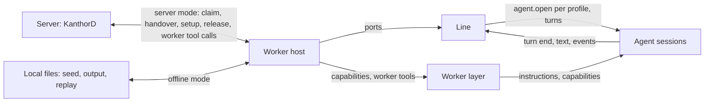

# L1: The model and its boundaries

Back to the [index](index.md). The terms follow the [glossary](index.md#glossary).

## Goals

1. **G1.** Each actor of the model has one role. A responsibility table states what each actor owns and does not own.
2. **G2.** The boundary between the agent and the worker lists each item that crosses it, in each direction, with the layer that specifies it.
3. **G3.** One tool ownership rule assigns each tool, hook, port and prompt part of today to the agent, the worker layer, another consumer or removal.
4. **G4.** "Stateless and runs without KanthorD" is a list of checks that a test can verify.
5. **G5.** For each actor, the page states which credential enters, who holds it and where it is never passed. Each credential rule of today keeps its strength or becomes stricter.
6. **G6.** Each item of today maps to one place in the model: `swe@1`, `re@1`, `env@1`, the three chains, `kanthord worker tasks run` and `kanthord serve worker`.
7. **G7.** Each point of the direction of Ulrich has a verdict with evidence. A point that does not fit has a suggestion. A point that fits has a fit rule.

## Evaluation of the direction

(G7)

The direction of Ulrich is his thinking, not a fixed specification. This section checks each point against the code of today and the pages. The mark **(Q<n>)** shows each place that depends on a ruling of an [open question](#open-questions-for-ulrich).

### E1. Role profiles `bee@1`, `fee@1`, `te@1` (fits, with a fit rule)

- **Verdict.** Fits. A teammate of Ulrich ran the dogfood on another machine. From that run, Ulrich concluded that `swe@1` alone is not specific enough: "During the dogfooding I realized that we need more specific agent than just use swe@1 for all in one" (2026-11-21).
- **Dogfood finding.** The tasks of the `apps` repository, a React app with Tailwind, did not follow the UI. The session lacked the React and Tailwind context.
- **Context mechanism of today.** A session loads no context file by itself (`engine/src/agent/agent-session.ts`, `sessionParts`, `noContextFiles: true`). A repository gives its context through layer 2, the Repository prompt, in two parts: the instruction file of its repository binding (`prompts.instruction_file`, absent by default) and the stored Repository prompt. Layer 3 is the Binding prompt of each agent name ([agent.md](../agent.md#prompt-composer)). The file `apps/AGENTS.md` exists in the `apps` repository.
- **Evidence for the fit.**
  - The pages already name a testing profile: `tdd@1` runs `swe@1`, `te@1` and `re@1` ([overview.md](../overview.md), section "Worked example: `tdd@1`"; [HANDOFF.md](../HANDOFF.md), item "Multi-agent workers").
  - The Role of `swe@1` holds no rule of a stack (`engine/static/prompt/swe@1.md`). A role adds the method of its stack.
- **Fit rule.**
  1. Add `bee@1`, `fee@1` and `te@1` as role profiles. Keep `swe@1`, name unchanged, as the generalist default profile and the evaluation baseline. A role profile that does not do better than `swe@1` on the same inputs, with the same repository context, leaves the catalog.
  2. `swe@1` is the configuration owner of the four implementation profiles. [Constraint C1](#e1-constraints) holds the scope.
  3. The worker selects the profile of each session. A task is one work unit, and an `implement` node with no task is its own work unit ([worker-service.md](../worker-service.md)). The selection method and its unit are open **(Q4)**. [L4](L4-worker.md#profile-selection) holds the detail.
  4. The line holds one agent session per profile of an execution. It opens each session at the first use of its profile. Today one `agent.open` runs per execution (`engine/src/worker/unit/chain-implement.ts`, `implementWorkspaceNodes`).
  5. A `te@1` session runs in the same `unit.turn` step as each other profile. The work unit that gets `te@1` is part of **(Q4)**. A worker that runs `te@1` in its own step is the worker `tdd@1`, which stays an example.
  6. `swe@1` stays the profile of each turn that belongs to no work unit, for example the conflict turn. It is also the profile of `examine`, because an `examine` node holds no task ([mission-service.md](../mission-service.md)), and of the Workbench.
  7. The profile prompt holds one coding text that the coding profiles share. A Role holds only the role statement and its method. [L2](L2-agent.md#profile-prompts) writes the texts. Each method rule of a Role traces to one dogfood finding or to one evaluation result.
  8. The four implementation profiles hold the seven tools of today. A role gets another tool only for a need of today. [L2](L2-agent.md#coding-tools) applies the rule.
  9. Build in two layers. Layer 1 is the role profiles in the runtime catalog and the agent CLI. Layer 1 adds no server operation, no server record and no server view. Layer 2 is the profile selection, the session per profile and the execution setup. Layer 2 also ships the shared coding text as a new prompt part of `swe@1` and `re@1` in the worker path. [L6](L6-migration.md) starts layer 2 after layer 1 passes its check.

#### E1 constraints

- **C1. One configuration owner.** A role profile has no enablement, agent provider, default configuration, fallback chain, cooldown, claim selection, pin, worker binding entry or Binding prompt of its own. It uses those of `swe@1`. Reason: the claim scans each name of `agent_names` and answers no work when one name cools (`engine/src/worker/agent-selection.ts`). `agent_names` of `coder@1` stays `["swe@1"]`. The claim, the inference authorization, the execution setup and the binding checks read `agent_names` (`engine/src/worker/agent-selection.ts`, `authorization.ts`, `execution-setup.ts`, `service.ts`). The role profiles of a worker are a separate list that only the profile selection and the prompt composition read.
- **C2. One LLM credential per execution.** All sessions of one execution use the one model selection and the one credential of `swe@1`, as today. No role has a model of its own in this round.
- **C3. One node can span repositories.** One node can span a backend and a frontend repository ([mission-service.md](../mission-service.md)). One session works from the checkouts root (`engine/src/agent/agent-port.ts`, `checkoutsRootOf`). A per-repository value has no single answer for such a node.
- **C4. Repository conventions stay in the Repository prompt.** The instruction file, `prompts.repository` and the Binding prompt carry them ([agent.md](../agent.md#prompt-composer)). A Role holds no convention of one repository.
- **C5. Today reads one agent.** The session open reads only `setup.agents[0]` (`engine/src/agent/agent-port.ts`, `WORKING_AGENT`). A role profile in a worker thus needs the layer 2 change of the open, not only a catalog entry.
- **C6. The server part lists only configuration owners.** A role profile is in the runtime catalog. It is in no enablement list, no row of the agent page and no `prompts.agents` key. Reason: `AGENT_NAMES` (`engine/src/agent/contract.ts`) keys `AGENT_DECLARATIONS` (`engine/src/agent/catalog.ts`) and one `prompts.agents` key per name (`engine/src/project/contract.ts`). The enablement and the agent page read the catalog ([agent.md](../agent.md#agent-catalog)). The shared coding text is a new value of the closed set `PromptPart` (`engine/src/agent/contract.ts`), and `engine/src/agent/prompt-files.ts` lists only the Standard and the Role. It changes the composed prompt and the references of each `swe@1` and `re@1` execution, so it ships in layer 2.
- **C7. Sessions of one execution.** A session sees no turn of another session. The workspace and the work prompt carry the state from one profile to the next. One resource budget covers all sessions of an execution. The execution setup holds one composed prompt and its references for `swe@1` and for each role profile that the selection can give **(Q4)**. Today it holds one per name of `agent_names` (`engine/src/worker/execution-setup.ts`). [L4](L4-worker.md#profile-selection) specifies the sessions.

### E2. "Stateless" (fits, with a definition)

- **Evidence.** A pi session holds state inside one run. The worker host in server mode passes a session root, and pi writes a session file for the resume (`engine/src/agent/agent-port.ts`, `sessionManagerOf`; [agent.md](../agent.md#agent-session)). The offline mode records each turn to `turns.jsonl` for the replay ([design.md §5.7](../worker-execution-refactor/design.md#57-standalone-tasks-run)). The line sends several turns to one session (`engine/src/worker/unit/native-agent-session.ts`, `prompt` and `instruct`).
- **Fit.** [L1-D11](#decisions) defines "stateless". [Statelessness](#statelessness) holds the checks.

### E3. Agent capability and worker capability (fits, with a rule)

- **Evidence.** A capability of D32 is one pi extension factory that registers tools (`engine/src/agent/capabilities/execution-evidence.ts`). The guards and hooks are also extension factories (`engine/src/agent/hooks/`).
- **Fit.** One mechanism, with the owner set by the [tool ownership rule](#tool-ownership-rule). A capability that needs a resource of a consumer belongs to the consumer that holds that resource ([L1-D7](#decisions)).

### E4. The worker "integrates deeply with KanthorD" (fits, with a limit)

- **Evidence.** The line constructs no client and no transport. It makes a side effect only through a host tool ([design.md D32](../worker-execution-refactor/design.md#1-decisions)). `kanthord worker tasks run` runs the same line code of `implement` with no server call (`engine/src/worker/unit/tasks-run.ts`).
- **Fit.** Only the worker host in server mode talks to the server ([L1-D2](#decisions)). The offline mode and the replay of D31 stay.

### E5. Two CLIs (fits, with the root `run`)

- **Evidence.** `kanthord serve worker` starts one worker instance from its instance configuration and runs until it stops. The instance key is its only credential, and it refuses `--token` (`engine/docs/cli/other.md`, section `serve worker`). The direction pairs the worker CLI with an agent CLI that takes one input.
- **Fit.** Both CLIs are one-shot commands under a new global root `run`. The binary stays `kanthord`, and `serve` stays the long-running process.
  1. The agent CLI is `kanthord run agent`. It runs one agent profile from one input and exits ([L3](L3-agent-cli.md)). It holds only the LLM credential, on standard input, and no KanthorD credential.
  2. The worker CLI is `kanthord run worker`. It claims one execution, runs it and exits ([L5](L5-worker-cli.md)). The instance key is its only start credential and its only credential toward the server, as `serve worker`. It reads the machine key and receives the handover as `serve worker` does. It refuses `--token`.
  3. Change: `run` joins the closed set of global root names. Today the set holds `config`, `upgrade`, `serve` and `auth` (`engine/docs/cli/other.md`, section "Closed root names and option scope").
  4. [L5](L5-worker-cli.md) decides whether `kanthord worker tasks run` moves under `run worker`.

### E6. Profile names `ops@1` and `comm@1` (fits, with another name for Operation Setup)

- **Evidence.** The direction gives `ops@1` to Operation Setup and `comm@1` to the Communication agent "Yumi". The branch `origin/feature/workbench-v2` names Yumi `ops@1`: `git show origin/feature/workbench-v2:src/agent/catalog.ts` gives `"ops@1"` with `display_name: "Yumi"`.
- **Fit.** Yumi keeps `ops@1`. Operation Setup takes another name when a later round designs it. This round designs neither profile.

### Points that fit with no rule

- `evidence-upload` and `link_update_list` belong to the worker layer. Both call the server through the worker host in server mode (`engine/src/apps/worker/execution.ts`, `hostToolsOf`). The [tool inventory](#tool-inventory) moves them.
- The agent runs on pi-coding-agent (`engine/src/agent/agent-session.ts`, `openSessionRuntime`).
- The worker adds a repository instruction to the system prompt. The Repository prompt does this today ([agent.md](../agent.md#prompt-composer)).
- Define only the coding tool set of today. [L2](L2-agent.md#coding-tools) applies the rule of this page.

## Roles

(G1)

The model has three actors: the agent, the worker and the server. A worker has three parts: the worker host, the line and the worker layer.

The diagram states these facts:

- In server mode, the server and the worker host exchange the claim, the handover, the setup, the release and the calls of worker tools.
- In offline mode, the worker host reads a seed and writes the output folder and the replay record. It makes no server call.
- The worker host gives ports to the line. It gives capabilities and worker tools to the worker layer.
- The line opens one agent session per profile and sends turns to it.
- The worker layer gives instructions and capabilities to each agent session.
- Each agent session gives the turn end, the text and the session events back to the line.

### Agent

- An agent is a person in the factory: one LLM working unit that runs one agent profile on pi-coding-agent.
- The agent profile fixes the profile prompt, the profile tools and the confinement.
- The agent is stateless and runs without KanthorD. [Statelessness](#statelessness) holds the checks.
- The agent knows no worker, no execution, no claim and no node. [agent.md](../agent.md#boundary) states this for the input. Change: the code follows it. Today `SessionOpenRequest` carries `claim.execution_id` (`engine/src/agent/agent-port.ts`).

#### Agent runtime and server part of the Agent component

Change: the Agent component of [agent.md](../agent.md#scope) splits into two parts. Only the runtime part is the agent of the model.

- **Agent runtime.** The session open, the profiles, the guards, the tools and the prompt composition. Files of `engine/src/agent/` today: `agent-session.ts`, `agent-port.ts`, `tool-table.ts`, `bash-process.ts`, `environment.ts`, `pi.ts`, `pi-tools.ts`, `catalog.ts`, `pinned-layers.ts`, `sensitive-text.ts`, `hooks/`, and the joins `finalPrompt` and `systemPrompt` of `prompt-render.ts`.
- **Server part.** The configuration, the selection, the prompt sources and references, and the migrations. Files of `engine/src/agent/` today: `service.ts`, `configuration.ts`, `enablements.ts`, `cooldowns.ts`, `migrations.ts`, `prompt-resolve.ts`, `prompt-source.ts`, `prompt-files.ts`, `instruction-files.ts`, `prompt-templates.ts`, and the part reads of `prompt-render.ts`.
- **Files that L2 splits or assigns.** `prompt-render.ts` splits: the joins go to the runtime, and the part reads stay in the server part. `contract.ts` serves both parts and imports `engine/src/scheduler/contract.ts`. `prompt-composer.ts` serves `pinned-layers.ts` and imports `prompt-templates.ts` of the server part. `prompt-assets.ts`, `config.ts` and `index.ts` have no part yet.
- The server part imports custody, project, mission and tracking modules and uses the store (`engine/src/agent/service.ts`). Those imports stay.
- The runtime imports today: `engine/src/worker/contract.ts` (`catalog.ts`, `agent-port.ts`, `pi-tools.ts`, `capabilities/*.ts`), `engine/src/tracking/contract.ts` (`SpanStatus` in `agent-port.ts`) and `engine/src/custody/contract.ts` (`SecretShape` in `hooks/sensitive-text-redaction.ts`).
- Change: the runtime imports no worker, project, mission or scheduler module, no transport and no gateway client. [L2](L2-agent.md) assigns each file and rules the `SpanStatus` and `SecretShape` imports.

### Worker

- A worker automates one category of work. `coder@1` and `reviewer@1` are the workers of the coding category. Change: the direction calls the whole worker a manufacturing line. The V3 pages use "line" only for the part below.
- The **worker host** links the line to the outside. It has two run modes:
  - **Server mode** talks to KanthorD: `kanthord serve worker` and `kanthord run worker`.
  - **Offline mode** works on local files, a seed and a replay, with no server call: `kanthord worker tasks run` (`engine/src/worker/unit/tasks-run.ts`). It covers the `implement` chain only (`engine/docs/cli/worker.md`, section `tasks run`).
- The **line** is the `tasks` phase of each chain and its steps, behind typed ports (`engine/src/worker/unit/foundry-implement.ts`, `foundry-evaluation.ts`, `foundry-examine.ts`, `foundry-ports.ts`).
- The **worker layer** is what the worker adds to an agent session: worker instructions, worker capabilities and the worker tools that they register.
- The worker selects the profile of each session. The agent never selects a profile or a worker.
- The line sits inside the worker, between the worker host and the agent. The steps outside `tasks` run in the worker host (`engine/src/worker/unit/chain-runner.ts`).
- The port seam of the line stays. It serves the offline mode, the replay and the eval set.
  - The import closure of the line holds no client, no transport and no credential (`engine/src/worker/unit/foundry-boundary.test.ts`).
  - The build rule `FoundryReadsSshAccess` refuses a `tasks` step that reads `sshAccess` (`engine/src/worker/unit/chain.ts`).
- Every D32 rule of the Foundry applies to the line ([design.md D32](../worker-execution-refactor/design.md#1-decisions)). The line holds no client, no transport and no credential. It makes a side effect only through a host tool.
- Change: the line opens an agent session only through the agent contract of [L2](L2-agent.md). The port `agent.open` builds the agent input from the execution setup and the worker layer (`engine/src/worker/unit/foundry-ports.ts`, `AgentPort`).
- The code keeps its names this round: `foundry-*.ts`, `FoundryHost` and `FoundryStep`. The Worker V2 pages keep the terms Foundry, Foundry host and CLI host. "Line" names the code of the Foundry. "Worker host" names the code of each Foundry host.

### Server

- The server is KanthorD: one process with its services ([architecture.vocabulary.md](../architecture.vocabulary.md#server)).
- The server owns the agent configuration, custody, the prompt sources and references, the scheduling and every record.
- The server runs no agent session for a worker execution. A server instance at the `server` or `container` placement is a worker instance ([worker-service.vocabulary.md](../worker-service.vocabulary.md#placement)).
- The server runs agent sessions for two other consumers. The Workbench Service opens `swe@1` and `re@1` sessions in the server process (`engine/src/workbench/service.ts`). The Project Service opens `env@1` sessions (`engine/src/project/environment-agent.ts`).

### Other consumers

- The Workbench Service adds server operation tools, its own `bash` wrapper and the approval hook (`engine/src/workbench/tools.ts`, `builtinTools`, `toolOperations`).
- The Project Service adds the tools `probe` and `environment_write` (`engine/src/project/environment-agent-tools.ts`).
- The agent CLI of [L3](L3-agent-cli.md) is a consumer that is no service and adds no tool.
- Each tool that a consumer other than a worker adds is a consumer tool. This round changes neither the Workbench Service nor the Project Service.

## Responsibility table

(G1)

| Actor or part        | Owns                                                                                                                                                    | Does not own                                                    |
| -------------------- | ------------------------------------------------------------------------------------------------------------------------------------------------------- | --------------------------------------------------------------- |
| Agent (runtime)      | Profiles, session open, profile prompt, profile tools, guards, wrapped `bash`, child environment, pi tool install, prompt join                          | A server call, a database, a durable record, a model choice     |
| Worker: worker host  | Server link in server mode, local files in offline mode, host resources, line ports, worker tool implementations, telemetry sink, steps outside `tasks` | The `tasks` phase; the profile prompt                           |
| Worker: line         | The `tasks` phase: turns, gate, verification, unit records, release gate                                                                                | A client, a transport, a credential, an SSH signer, a tree pool |
| Worker: worker layer | Worker instructions, worker capabilities, worker tools, the tool grant of a session, the profile selection                                              | The session open; the guards; a credential                      |
| Server               | Agent configuration and selection, custody, prompt sources and references, scheduling, records                                                          | An agent session of a worker execution                          |
| Other consumer       | Its consumer tools and hooks; its credential source                                                                                                     | A profile; a guard of the agent runtime                         |

## Agent–worker boundary

(G2)

The worker calls the agent; the agent never calls the worker. [L2](L2-agent.md#input-and-output-contract) specifies the agent side. [L4](L4-worker.md) specifies the worker side.

| Direction      | Item              | Content at L1 level                                                                         | Today                                                      |
| -------------- | ----------------- | ------------------------------------------------------------------------------------------- | ---------------------------------------------------------- |
| Worker → agent | Input             | Profile name, model selection and model runtime, workspace roots, budget, child environment | `AgentSetup`, `OpenSessionInput` (`agent-session.ts`)      |
| Worker → agent | Work              | The work prompt of each turn, as text                                                       | `prompt`, `instruct` (`native-agent-session.ts`)           |
| Worker → agent | System prompt     | Worker path: the composed text and its prompt references. Agent CLI path: the instructions  | `prompt.final` of the execution setup                      |
| Worker → agent | Capabilities      | Extension factories and the tool names that they register                                   | `capabilities` of `agentPort`; `host_tools`                |
| Worker → agent | Consumer records  | An optional session store and its identity, a trace sink, the known-secret source           | `sessionRoot`, `trace`, `knownSecrets` of `AgentPortInput` |
| Worker → agent | Stop              | An abort of the session                                                                     | `stopOnEnd` (`native-method.ts`)                           |
| Agent → worker | Result            | The end of each turn and the last text                                                      | `completeReply`, `lastText`                                |
| Agent → worker | Events            | Session entries, turns, tool calls, usage, redaction counts                                 | `agent.session`, `agent.turn`, `agent.tool` spans          |
| Agent → worker | Workspace changes | The files that the agent changes in the workspace roots                                     | Gate G reads the checkouts after each turn                 |
| Inside a turn  | Worker tool call  | The model calls; the guards run first; the worker implementation runs                       | `evidence-upload`, `link_update_list`                      |

Boundary rules:

1. The input names no execution, no claim, no node and no server address. The worker keeps these in the closures of its worker tools.
2. One pure composition function in the agent runtime joins the system prompt: profile prompt, then instructions in consumer order. The precedence of [agent.md](../agent.md#prompt-composer) stays.
3. In the worker path, the server calls that function at the execution setup. The agent input carries the composed text and its references, and the agent adds no text. Today the server joins the parts with `finalPrompt` (`engine/src/agent/prompt-render.ts`), which `prompt-resolve.ts`, `service.ts` and `engine/src/worker/execution-setup.ts` call. The session takes `agent.prompt.final` whole (`agent-port.ts`). The composition function replaces `finalPrompt` in the worker path. The Workbench and the Project Service keep the second join `systemPrompt` of `prompt-render.ts` this round (`engine/src/workbench/service.ts`, `engine/src/project/environment-agent.ts`).
4. In the agent CLI path, the agent composes the shipped profile prompt and the instructions of the input.
5. The override of a profile prompt file by the agent directory of the server host stays a server feature ([agent.md](../agent.md#prompt-composer)).
6. Change: the KanthorD protocol text of each Role moves to the worker instructions. In `swe@1.md`, these are two sentences of "Execution": "The worker runs the verifications after the turn." of item 4 and "The worker merges the base branch itself." of item 5. The method rules of items 4 and 5 stay in the Role. In `re@1.md`, these are item 8 of "Judgement" and the section "Findings". The Role of `re@1` keeps its judgement rules 1 to 7.
7. The guards of the agent wrap every tool, a worker tool included. The worker cannot remove a guard.

## Tool ownership rule

(G3)

1. A tool belongs to the agent profile when it needs only the workspace roots and the process tree of the session. It needs no server, no credential, no device and no host resource.
2. Every other tool belongs to the consumer that holds what the tool needs. In a worker, it is a worker tool. Each tool that calls the KanthorD server is a worker tool or a consumer tool.
3. A worker capability registers only worker tools.
4. A worker tool reaches the agent only as a pi tool or an MCP tool that a worker capability registers (D32). The agent sees its name, its schema and its result.
5. Change: the allowlist guard holds the profile tools and the tool names that the worker grants. Today it holds `tools` and `host_tools` of the declaration (`engine/src/agent/tool-table.ts`, `sessionTools`).
6. In a confined session, the confinement guard refuses each tool with no location declaration (`engine/src/agent/hooks/checkout-confinement.ts`). Each granted tool carries its location list at the grant, also when the list is empty. A new tool of a confined profile needs a D27 test ([design.md §5.4](../worker-execution-refactor/design.md#54-credentials)).
7. A line port is no tool. Step code calls it outside a turn, and the model never sees it.

[L2](L2-agent.md#coding-tools) applies rule 1. [L4](L4-worker.md#worker-tools) applies rules 2 to 6 to the worker tools of `coder@1` and `reviewer@1`.

### Tool inventory

Each tool, hook, port and prompt part that an agent session gets today, with its owner in the model. Paths start at `engine/`.

| Item                                                                                                                             | Path                                                                                                                        | Owner in the model                                                                                 |
| -------------------------------------------------------------------------------------------------------------------------------- | --------------------------------------------------------------------------------------------------------------------------- | -------------------------------------------------------------------------------------------------- |
| `read`, `edit`, `write`, `grep`, `find`, `ls`                                                                                    | `src/agent/catalog.ts` (`BuiltinTool`)                                                                                      | Agent: profile tool                                                                                |
| `bash` with timeout, `childEnvironment`, `killGroupAtEnd`                                                                        | `src/agent/tool-table.ts`                                                                                                   | Agent: profile tool. The budget is an input                                                        |
| pi tool binaries for `grep` and `find`                                                                                           | `src/agent/pi-tools.ts` (`installPiTools`)                                                                                  | Agent. Change: its error code leaves the worker contract                                           |
| `evidence-upload`                                                                                                                | `src/agent/capabilities/execution-evidence.ts`; `src/apps/worker/evidence-upload.ts`; `src/apps/worker/tasks-host-tools.ts` | Worker tool. Change: leaves `src/agent/`                                                           |
| `link_update_list`                                                                                                               | `src/agent/capabilities/link-updates.ts`; `src/apps/worker/execution.ts`                                                    | Worker tool. Change: leaves `src/agent/`                                                           |
| `SessionHostTools`, `asToolError`                                                                                                | `src/agent/capabilities/host-tools.ts`                                                                                      | Worker layer                                                                                       |
| `host_tools`, `HOST_TOOL_PARAMETERS`, their `TOOL_CATALOG` entries                                                               | `src/agent/catalog.ts`                                                                                                      | Removal from the agent catalog. The worker grant carries them                                      |
| `probe`, `environment_write`                                                                                                     | `src/project/environment-agent-tools.ts`; `EnvironmentTool` in `src/agent/catalog.ts`                                       | Consumer tool of the Project Service. The entries stay this round                                  |
| Workbench operation tools and Workbench `bash`                                                                                   | `src/workbench/tools.ts` (`toolOperations`, `builtinTools`)                                                                 | Consumer tools of the Workbench. Unchanged                                                         |
| `homeRelativeCwd`                                                                                                                | `src/agent/hooks/home-relative-cwd.ts`                                                                                      | Agent                                                                                              |
| Sensitive-text redaction                                                                                                         | `src/agent/hooks/sensitive-text-redaction.ts`; added by `sessionParts`                                                      | Agent: guard. The known-secret source is an input                                                  |
| Tool allowlist                                                                                                                   | `src/agent/hooks/tool-allowlist.ts`                                                                                         | Agent: guard, with rule 5                                                                          |
| Checkout confinement                                                                                                             | `src/agent/hooks/checkout-confinement.ts`; `isConfinedAgent`                                                                | Agent: guard. Change: a profile property; the roots are an input                                   |
| Review roots                                                                                                                     | `src/agent/review-roots.ts` (`reviewRootsOf`)                                                                               | Worker layer. It computes the roots input                                                          |
| Pinned layers                                                                                                                    | `src/agent/hooks/pinned-layers.ts`; `src/agent/pinned-layers.ts`                                                            | Agent                                                                                              |
| Tool approval                                                                                                                    | `src/agent/hooks/tool-approval.ts`                                                                                          | Consumer hook of the Workbench. Unchanged                                                          |
| `agentPort`                                                                                                                      | `src/agent/agent-port.ts`                                                                                                   | Agent. Change: the reads of `ExecutionSetup`, the claim and `reviewWorkspace` move to `agent.open` |
| Session store by execution                                                                                                       | `src/agent/session-directory.ts`                                                                                            | Worker layer. The agent takes the store as input                                                   |
| Session trace                                                                                                                    | `src/worker/unit/native-agent.ts`; `src/worker/unit/agent-telemetry.ts`                                                     | Worker layer records; the agent emits the events                                                   |
| Model runtime factory                                                                                                            | `src/worker/unit/model-runtime.ts`; `frozenStore` in `src/llm/refresh-watch.ts`                                             | Consumer. The agent takes the runtime as input                                                     |
| Capability list                                                                                                                  | `capabilities` of `AgentPortInput` in `src/agent/agent-port.ts`; `FoundryHost.capabilities` in `src/worker/unit/foundry.ts` | Worker layer: worker capabilities. Change: `FoundryHost.capabilities` has no reader and leaves     |
| Line ports                                                                                                                       | `src/worker/unit/foundry-ports.ts`                                                                                          | Worker: the worker host implements them. No change of owner                                        |
| `base.md`; Roles `swe@1.md`, `re@1.md`, `env@1.md`                                                                               | `static/prompt/`                                                                                                            | Agent: profile prompt. Change: boundary rule 6; the shared coding text                             |
| `workbench.md`, template `framing-workbench`                                                                                     | `static/prompt/`; `static/prompt/template/`                                                                                 | Consumer prompt of the Workbench. Unchanged                                                        |
| Other templates (`work`, `framing-worker`, `task-revision`, `criterion-revision`, `evaluation`, `examine`, `repair`, `conflict`) | `static/prompt/template/`                                                                                                   | Worker layer: worker instructions and turn texts                                                   |
| Instruction file, stored Repository prompt, Binding prompt                                                                       | [agent.md](../agent.md#prompt-composer)                                                                                     | Worker layer. The server keeps the storage                                                         |

No tool of today goes to removal. The removal applies only to the agent catalog fields that name worker tools.

### Extension rule

(G3)

1. Each pi extension is one module that exports one extension factory. Its test file is next to it.
2. pi receives each extension as a function at session start: an `InlineExtension` through `extensionFactories` (`engine/src/agent/agent-session.ts`, `sessionParts`). The in-memory closures thus stay: the redaction secrets, the worker tool transport function and the confinement roots.
3. No consumer loads an extension from a file path.
4. The extension lists of [L2](L2-agent.md) and [L4](L4-worker.md) follow this rule.

Change: these modules of engine `c864130e` break rule 1.

- `engine/src/agent/hooks/sensitive-text-redaction.ts` returns two factories, `restore` and `hook`, from `sensitiveTextRedaction`.
- No test names `homeRelativeCwd`, `pinnedLayersHook` or `toolAllowlist`.
- Only `engine/src/agent/hooks/sensitive-text-redaction.test.ts` tests `toolApproval`.
- The capabilities `executionEvidence` and `linkUpdates` have no test file next to them. `engine/src/worker/unit/agent-port.test.ts` tests them.

## Statelessness

(G4)

"Stateless and runs without KanthorD" means that each check holds for every session that the agent runtime opens. [L3](L3-agent-cli.md) tests the checks with the agent CLI.

1. **No server call.** The runtime holds no transport, no gateway client and no server address. The child environment holds no `KANTHORD_TOKEN`, `KANTHORD_ENDPOINT`, `KANTHORD_WORKER_CONFIG` or `KANTHORD_MACHINE_CONFIG` (`engine/src/agent/environment.ts`, `childEnvironment`). A worker tool is the only path from a worker session to a server.
2. **No database.** The runtime opens no database and no store of a service.
3. **No state between runs.** The runtime writes no file that a later run reads, except the pi tool install of check 5. pi gets in-memory settings. It loads no extension from a file path and no skill, prompt template, theme or context file (`engine/src/agent/agent-session.ts`, `sessionParts`). pi writes no `auth.json`, because the model runtime holds the credential store.
4. **Consumer-owned records.** The session store, the resume, the replay record and the telemetry belong to the consumer. The default session store is in memory. A resume opens only the session identity that the consumer gives ([agent.md](../agent.md#agent-session)).
5. **pi directory.** The consumer gives the pi directory. The install writes only shipped files. A binary passes the manifest digest, and the install skips a binary whose digest matches. A license file is a shipped asset with no digest (`engine/src/agent/pi-tools.ts`, `installPiTools`, `publishLicense`). The directory holds no run state.
6. **Reads.** The runtime reads its input, the shipped profile prompt, the pi directory and the workspace roots. A confined profile reads only inside its roots. A session with no confinement guard reaches more; [reach of an unconfined session](#reach-of-an-unconfined-session) states it.
7. **Writes.** The runtime writes the workspace roots, the temporary directory of its child processes, the pi directory of check 5 and the session store that the consumer gives. It writes nothing else.
8. **Network.** The runtime itself calls only the LLM provider of its model runtime. A child process of `bash` uses the network of its host, as today.
9. **No model choice.** The runtime resolves no enablement, no fallback chain and no cooldown. It takes one model selection as input. An advance of the fallback chain stays a server decision at release ([agent.md](../agent.md#advance)).

## Credential flow

(G5)

### LLM credential

- **What.** The `api_key` or `oauth` credential of the selected agent provider, and its routing metadata.
- **Enters.** The agent runtime, only as the pi credential store inside the model runtime.
- **Holders.**
  - Worker path: `credential.store` (C1) of the worker host in server mode, from the handover.
  - `run agent` and the offline mode: one `frozenStore` from standard input (`engine/src/llm/refresh-watch.ts`).
  - Workbench: `custody.workbenchCredentials`, holder `server` (`engine/src/apps/server/index.ts`).
  - Project Service: `custody.serverAgentCredentials`, holder `server` (`engine/src/apps/server/index.ts`).
- **Extension reach.** Each extension factory can reach the credential through `ctx.modelRegistry` of pi. A lint rule forbids `modelRegistry` and `registerProvider` (`engine/eslint.config.js`). Change: the lint glob covers each directory that holds a capability or a consumer hook. Today it covers only `src/agent/capabilities/`.
- **Endpoint.** The routing metadata of the provider, for example `base_url`, enters only with the credential on standard input. No option, no environment variable and no input file names an endpoint.
- **Never passed in.** `process.env`; the environment of a child process; a CLI option; an input file; the prompt; a tool input or result; the session store; a span; a log; a diagnostic; a seed, capture or export; the result output; a pi `auth.json`.

### Credentials that never enter the agent

| Credential                                | Holder                                                                                                                                                             | Never passed in                                                                                                                                                            |
| ----------------------------------------- | ------------------------------------------------------------------------------------------------------------------------------------------------------------------ | -------------------------------------------------------------------------------------------------------------------------------------------------------------------------- |
| Instance key and machine key              | The worker host in server mode: `serve worker` and `run worker`. The worker transport holds a bearer from the instance key (`engine/src/apps/worker/transport.ts`) | The agent, the line, a capability, a child process, `run agent`, the worker host in offline mode. A worker tool closes over a transport function and never gets the bearer |
| Handover key and report key               | `credential.store` (C1); zeroed at dispose                                                                                                                         | The agent, the line, every context key, `run agent`, the worker host in offline mode                                                                                       |
| SSH identity or relay signer of a binding | `ssh.access` (C2); read by `workspace.node`, `workspace.review`, `branch.push`, `repository.fetchBase`                                                             | The agent, each `tasks` step, a child process (`SSH_AUTH_SOCK` removed), `run agent`, the worker host in offline mode                                                      |
| Custody master key, JWT signing key       | The server                                                                                                                                                         | Each worker host, agent and line, `run agent`                                                                                                                              |

A secret of a capability follows the capability rules of [design.md §5.4](../worker-execution-refactor/design.md#54-credentials). No capability of this round holds one.

- `run agent` takes only the LLM credential, on standard input. It takes no KanthorD credential: no instance key, no machine key and no token. It declares no `--token`.
- `run worker`: the instance key is its only start credential and its only credential toward the server, as `serve worker`. It reads the machine key and receives the handover as `serve worker` does. It refuses `--token`.

### Reach of an unconfined session

A session with no confinement guard reaches each file and process of its OS user, through `bash` or through an unconfined `read`. The table states that reach. The `HOME` redirect of `tasks run` is no confinement.

| Where the session runs                                 | Reach through `bash`                                                                                                                                                                                   |
| ------------------------------------------------------ | ------------------------------------------------------------------------------------------------------------------------------------------------------------------------------------------------------ |
| `server` placement                                     | Every resource of the server: each credential, `master_key`, the JWT signing key, the database ([worker-service.vocabulary.md](../worker-service.vocabulary.md#placement))                             |
| `container` placement                                  | The slot volume, the network and its own instance; no file of the server                                                                                                                               |
| `worker` placement                                     | The instance key, the credential copies and the workspaces of its instance, the machine key and its copies ([trust boundary](../worker-service.vocabulary.md#trust-boundary))                          |
| Workbench session in the server process                | Every resource of the server, through the Workbench `bash` of `swe@1` and through the unconfined `read` of `re@1` (`engine/src/workbench/tools.ts`, `builtinTools`; `engine/src/workbench/service.ts`) |
| `run agent` or the offline mode on a developer machine | Each file of that OS user: SSH keys, cloud credential files, kanthord instance files, the token of `cli.yaml`                                                                                          |

The OS containment of these processes is an open item of [HANDOFF.md](../HANDOFF.md), Worker Service ("Decide the OS containment").

### Rules of today and their strength in the model

| Rule of today                                                                                                                                    | Source                                                                                                                                   | Rule in the model                                                                                                             | Strength |
| ------------------------------------------------------------------------------------------------------------------------------------------------ | ---------------------------------------------------------------------------------------------------------------------------------------- | ----------------------------------------------------------------------------------------------------------------------------- | -------- |
| Frozen store: no refresh, rotation, lease or report                                                                                              | `engine/src/llm/refresh-watch.ts` (`frozenStore`)                                                                                        | `run agent` and the offline mode use it. Only the worker host in server mode refreshes, through C1                            | Same     |
| `--credential-stdin` with the `isatty(0)` check and a zeroed buffer                                                                              | `engine/src/apps/cli/worker-tasks.ts`; `credentialOf` in `engine/src/worker/unit/tasks-credential.ts`                                    | `run agent` takes the LLM credential only this way, with the same checks                                                      | Same     |
| Provider check, routing metadata only from standard input, `credential_expiring`                                                                 | `engine/src/worker/unit/tasks-credential.ts`                                                                                             | `run agent` applies each check; no option, variable or input file names an endpoint                                           | Same     |
| No option, environment variable or file takes a credential                                                                                       | [design.md §5.7](../worker-execution-refactor/design.md#57-standalone-tasks-run)                                                         | Kept for `run agent`                                                                                                          | Same     |
| Session redaction with the known secrets on every session                                                                                        | `engine/src/agent/hooks/sensitive-text-redaction.ts`; `sessionParts`                                                                     | Kept. The `run agent` result output passes the writer redaction                                                               | Same     |
| In-memory session of `tasks run`                                                                                                                 | [design.md §5.7](../worker-execution-refactor/design.md#57-standalone-tasks-run)                                                         | `run agent` holds an in-memory session store this round                                                                       | Same     |
| `childEnvironment` for each child process                                                                                                        | `engine/src/agent/environment.ts`                                                                                                        | Kept                                                                                                                          | Same     |
| `--pass-env` refuses a fixed name, an ambient-removal name and a name that `childEnvironment` removes; each passed value joins the known secrets | `passEnvRefused` in `engine/src/worker/unit/tasks-seed.ts`; `engine/src/apps/cli/worker-tasks.ts`; `engine/src/worker/unit/tasks-run.ts` | A value that a consumer passes to the child environment: the same name refusals apply, and each value joins the known secrets | Same     |
| Ambient credential removal before pi loads, `HOME`, AWS file paths, metadata endpoints off                                                       | `withoutAmbientCredentials` in `engine/src/worker/unit/tasks-credential.ts`                                                              | Change: `run agent` applies it too                                                                                            | Stricter |
| `checkoutConfinement` on each `re@1` session that `agentPort` opens and each `env@1` session                                                     | `engine/src/agent/agent-port.ts` (`guardsOf`); `engine/src/project/environment-agent.ts`                                                 | Kept. Confinement becomes a profile property in the worker path and `run agent`                                               | Same     |
| No context key holds a credential; a capability gets no handover result, `sshAccess` or model runtime                                            | [design.md §5.4](../worker-execution-refactor/design.md#54-credentials)                                                                  | Kept for the line and each worker capability                                                                                  | Same     |
| Lint rule on `modelRegistry` and `registerProvider`                                                                                              | `engine/eslint.config.js`                                                                                                                | Change: the glob covers each directory of a capability or consumer hook                                                       | Stricter |
| The runtime imports `worker/contract.ts`                                                                                                         | `engine/src/agent/catalog.ts`, `agent-port.ts`                                                                                           | Change: the runtime imports no worker module, so no profile tool reaches a server                                             | Stricter |
| pi writes no `auth.json` or settings file; `tasks run` refuses an `auth.json`                                                                    | `engine/src/agent/agent-session.ts`; design.md §5.7                                                                                      | Kept; `run agent` refuses an `auth.json` in its pi directory and loads no extension from a path                               | Same     |
| `serve worker`: the instance key is the only credential; `--token` refused with `cli.serve.worker_token`                                         | `engine/docs/cli/other.md`, section `serve worker`                                                                                       | Kept. `run worker` has the same rule                                                                                          | Same     |
| `--token` applies only to a remote command that declares it                                                                                      | `engine/docs/cli/other.md`, section "Closed root names and option scope"                                                                 | `run agent` and `run worker` declare no `--token`. `run agent` holds no KanthorD credential                                   | Same     |

## Mapping of today

(G6)

This section states what each item becomes. [L6](L6-migration.md) plans the build.

| Item of today                               | Path                                                           | Becomes                                                                                                                                                  |
| ------------------------------------------- | -------------------------------------------------------------- | -------------------------------------------------------------------------------------------------------------------------------------------------------- |
| `swe@1`                                     | `engine/src/agent/catalog.ts`; `engine/static/prompt/swe@1.md` | The generalist default profile, the evaluation baseline and the configuration owner of the implementation profiles. Its `host_tools` become worker tools |
| `bee@1`, `fee@1`, `te@1`                    | none                                                           | New role profiles under the [fit rule of E1](#e1-role-profiles-bee1-fee1-te1-fits-with-a-fit-rule)                                                       |
| `re@1`                                      | `engine/src/agent/catalog.ts`; `engine/static/prompt/re@1.md`  | The review profile, name unchanged, confined. Its protocol text moves to the `reviewer@1` instructions                                                   |
| `env@1`                                     | `engine/src/project/environment-agent.ts`                      | A profile whose consumer is the Project Service. Unchanged in this round                                                                                 |
| `coder@1`                                   | `engine/src/worker/catalog.ts`                                 | The coding worker for `implement` and `examine`, with `swe@1`, `bee@1`, `fee@1` and `te@1`. The selection method and its unit are open **(Q4)**          |
| `reviewer@1`                                | `engine/src/worker/catalog.ts`                                 | The review worker, with `re@1` and the action performer                                                                                                  |
| `claude-code@1`                             | `engine/src/worker/catalog.ts`                                 | Unchanged. An external harness hosts it, and it holds no profile                                                                                         |
| Chain `implement`                           | `engine/src/worker/unit/chain-implement.ts`                    | The chain of `coder@1` for `implement`. Its `tasks` phase is the line, with one session per profile                                                      |
| Chain `examine`                             | `engine/src/worker/unit/chain-examine.ts`                      | The chain of `coder@1` for `examine`, with `swe@1`. Its `tasks` phase is the line. The offline mode does not run it                                      |
| Chain `evaluation`                          | `engine/src/worker/unit/chain-evaluation.ts`                   | The chain of `reviewer@1`, with `re@1`. Its `tasks` phase is the line. The offline mode does not run it                                                  |
| `kanthord worker tasks run`                 | `engine/src/worker/unit/tasks-run.ts`                          | The offline mode of the worker host, for the `implement` chain only. [L5](L5-worker-cli.md) decides whether it moves under `run worker`                  |
| `kanthord serve worker`                     | `engine/docs/cli/other.md`, section `serve worker`             | The server mode of the worker host as a long-running process. Unchanged                                                                                  |
| `kanthord run agent`, `kanthord run worker` | none                                                           | The agent CLI and the worker CLI: one-shot commands under the new global root `run` ([E5](#e5-two-clis-fits-with-the-root-run))                          |
| Workbench sessions                          | `engine/src/workbench/service.ts`                              | A consumer with its own tools and guard set. Unchanged in this round                                                                                     |

## Handoffs to later layers

- [L2](L2-agent.md): the file assignment of the [agent runtime](#agent-runtime-and-server-part-of-the-agent-component), with the split of `prompt-render.ts` and the part of `contract.ts`, `prompt-composer.ts`, `prompt-assets.ts`, `config.ts` and `index.ts`; the anchors `#coding-tools`, `#profile-prompts` and `#input-and-output-contract`; the composition function of boundary rule 2; the extension list under the [extension rule](#extension-rule).
- [L3](L3-agent-cli.md): the command `kanthord run agent` under the global root `run`. L3 adds `run` to the closed root set of `engine/docs/cli/other.md` ("Closed root names and option scope"), because `run agent` is the first command under it. Goal "One input runs under two profiles, and the results compare." The checks of [Statelessness](#statelessness). The command page tells the developer the [reach of an unconfined session](#reach-of-an-unconfined-session) and to use a credential that the developer owns, as the `tasks run` page does.
- [L4](L4-worker.md): the anchors `#worker-instructions`, `#worker-capabilities`, `#worker-tools` and `#profile-selection`; the profile selection after the ruling of Q4; the sessions of constraint C7 and the separate profile list of constraint C1; the lint glob of the [LLM credential](#llm-credential); the extension list under the [extension rule](#extension-rule).
- [L4](L4-worker.md): one session per profile needs the port `agent.open` in the port set of the `implement` line. Today `IMPLEMENT_PORTS` holds no `agent.open`; only `IMPLEMENT_HOST_PORTS` adds it for the host step (`engine/src/worker/unit/foundry-ports.ts`).
- [L5](L5-worker-cli.md): the command `kanthord run worker` under the global root `run`. L5 decides whether `kanthord worker tasks run` moves under `run worker`. A move keeps the credential rule of the offline mode: the LLM credential on standard input and no instance key. The same change updates the glossary entries `server mode` and `worker CLI`.
- [L6](L6-migration.md): layer 2 of E1 starts after layer 1 passes its check; the import check of [L1-D5](#decisions).
- [L6](L6-migration.md): remove the field `FoundryHost.capabilities` (`engine/src/worker/unit/foundry.ts:36`) and its three arguments, because `runTasks` never reads it. Remove the exports `foundryEvaluation` and `foundryExamine`, which have no caller. Update `chain-golden.txt` and the `name` strings `"foundryEvaluation"` (`engine/src/worker/unit/chain-evaluation.ts:42`) and `"foundryExamine"` (`engine/src/worker/unit/chain-examine.ts:26`).
- [L6](L6-migration.md): for the [extension rule](#extension-rule), split `sensitive-text-redaction.ts` into one factory per module and add the missing tests. Add a gate check that fails on an extension file with no test file next to it.

## Open items for HANDOFF

- Agent component: the Workbench and the Project Service keep their guard set in this round. A Workbench session holds only `toolApproval` (`engine/src/workbench/service.ts`). Decide the allowlist and the confinement for these consumers, with a `locations` entry for each of their tools.

## Decisions

1. **L1-D1.** The model has three actors: agent, worker and server. A worker has three parts: the worker host, the line and the worker layer. The worker host has two run modes: server mode and offline mode. Constraint: each later layer assigns each new item to one row of the [responsibility table](#responsibility-table); the code keeps the names `foundry-*.ts` this round.
2. **L1-D2.** Only the worker host in server mode talks to the server. Constraint: the line and the worker layer construct no client and no transport. The port seam of the line stays (`foundry-boundary.test.ts`, `FoundryReadsSshAccess`). The offline mode stays, for the `implement` chain only.
3. **L1-D3.** The agent runs one agent profile. The profile fixes the profile prompt, the profile tools and the confinement. Constraint: a profile names no worker tool and no model default.
4. **L1-D4.** The worker selects the profile of each session, and the line holds one session per profile. The selection method and its unit are open **(Q4)**. Constraint: the agent input holds one profile name; [L4](L4-worker.md#profile-selection) specifies the selection after the ruling.
5. **L1-D5.** The agent input names no execution, claim, node or server address. The agent runtime imports no worker, project, mission or scheduler module, no transport and no gateway client. Constraint: an import check of the `engine` repository fails the build on such an import.
6. **L1-D6.** The coding category has the implementation profiles `swe@1`, `bee@1`, `fee@1`, `te@1` and the review profile `re@1`. Constraint: E1 constraints C1 to C7 hold.
7. **L1-D7.** The [tool ownership rule](#tool-ownership-rule) decides the owner of each tool and capability. Constraint: `evidence-upload` and `link_update_list` are worker tools, and the agent catalog loses `host_tools`.
8. **L1-D8.** In the worker path and the agent CLI, no consumer can remove a guard. The allowlist holds the profile tools and the granted worker tools. Constraint: the Workbench and the Project Service keep their guard set this round.
9. **L1-D9.** Confinement is an explicit property of the profile; `re@1` and `env@1` hold it. It applies in the worker path and the agent CLI this round. Constraint: the roots are an input of the consumer.
10. **L1-D10.** One pure composition function of the agent runtime joins the system prompt. It replaces `finalPrompt` of `engine/src/agent/prompt-render.ts` in the worker path, where the server calls it. The agent CLI calls it on the shipped profile prompt and the input instructions. Constraint: the agent adds no text to a composed prompt; the agent directory override stays a server feature; the Workbench and the Project Service keep `systemPrompt` this round.
11. **L1-D11.** "Stateless" means the [nine checks](#statelessness): no state between runs, and each durable record owned by the consumer. Constraint: a session store, a replay record and a trace enter as input.
12. **L1-D12.** The KanthorD protocol text of each Role moves to the worker instructions. Constraint: a Role names no worker, no gate, no node branch and no reply format of a worker.
13. **L1-D13.** The LLM credential is the only credential that enters the agent, only as the pi credential store inside the model runtime. Constraint: no other credential reaches the agent, the line or a child process.
14. **L1-D14.** The agent CLI (`kanthord run agent`) takes the LLM credential and its routing metadata only through standard input, with the frozen store, the in-memory session store and `withoutAmbientCredentials`. Constraint: no option, environment variable or input file takes a credential or names an endpoint.
15. **L1-D15.** The lint rule on `modelRegistry` and `registerProvider` covers each directory that holds a capability or a consumer hook. Constraint: a move of a capability moves the glob in the same change.
16. **L1-D16.** `swe@1` stays the generalist default profile and the evaluation baseline. Each method rule of a Role traces to a dogfood finding or to an evaluation result. Constraint: a role profile that does not do better than `swe@1` on the same inputs, with the same repository context, leaves the catalog.
17. **L1-D17.** The agent CLI and the worker CLI are one-shot commands under the new global root `run`: `kanthord run agent` and `kanthord run worker`. `serve` stays the long-running process, and the binary stays `kanthord`. Constraint: `run agent` holds only the LLM credential, on standard input, and no KanthorD credential. For `run worker`, the instance key is its only start credential and its only credential toward the server, as `serve worker`. It reads the machine key and receives the handover as `serve worker` does, and it refuses `--token`.
18. **L1-D18.** Each pi extension is one module that exports one extension factory. Its test file is next to it. pi receives each extension as an `InlineExtension` through `extensionFactories` at session start. Constraint: no consumer loads an extension from a file path. The in-memory closures thus stay: the redaction secrets, the worker tool transport function and the confinement roots.

## Open questions for Ulrich

1. **Q4. Profile selection.** Selection by code, with no new field: evaluation in progress. Ulrich wants code to select the profile of each work unit: `bee@1` for a backend repository, `fee@1` for a frontend repository and `swe@1` when the type is unknown. [Constraint C3](#e1-constraints) is a fact that the selection must meet. L4 designs the selection after the ruling.
