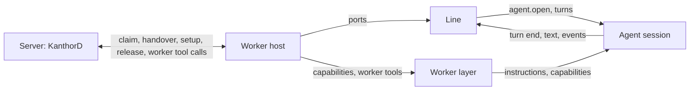

# L1: The model and its boundaries

Back to the [index](index.md). The terms follow the [glossary](index.md#glossary).

## Goals

1. **G1.** Each actor of the model has one role. A responsibility table states what each actor owns and does not own.
2. **G2.** The boundary between the agent and the worker lists each item that crosses it, in each direction, with the layer that specifies it.
3. **G3.** One tool ownership rule assigns each tool, hook, port and prompt part of today to the agent, the worker layer, another consumer or removal.
4. **G4.** "Stateless and runs without KanthorD" is a list of checks that a test can verify.
5. **G5.** For each actor, the page states which credential enters, who holds it and where it is never passed. Each credential rule of today keeps its strength or becomes stricter.
6. **G6.** Each item of today maps to one place in the model: `swe@1`, `re@1`, `env@1`, the three chains, `kanthord worker tasks run` and `kanthord serve worker`.
7. **G7.** Each point of the direction of Ulrich has a verdict with evidence. A point that does not fit has a suggestion. A point that fits has a fit rule.

## Evaluation of the direction

(G7)

The direction of Ulrich is his thinking, not a fixed specification. This section checks each point against the code of today and the pages. The mark **(Q<n>)** shows each place that depends on a ruling of an [open question](#open-questions-for-ulrich).

### E1. Project context through the binding prompt (fits, with a fit rule)

- **Verdict.** Fits. Ulrich ruled on 2026-11-22: `swe@1` stays the one implementation profile, and the context of a kind of project comes through the repository binding prompt, as the implementation of today does.
- **Dogfood finding.** The tasks of the `apps` repository, a React app with Tailwind, did not follow the UI. The session lacked the React and Tailwind context.
- **Context mechanism of today.** A session loads no context file by itself (`engine/src/agent/agent-session.ts`, `sessionParts`, `noContextFiles: true`). A repository gives its context through layer 2, the Repository prompt, in two parts: the instruction file of its repository binding (`prompts.instruction_file`, absent by default) and the stored Repository prompt. Layer 3 is the Binding prompt of each agent name ([agent.md](../agent.md#prompt-composer)). The file `apps/AGENTS.md` exists in the `apps` repository.
- **Evidence for the fit.**
  - The Role of `swe@1` holds no rule of a stack (`engine/static/prompt/swe@1.md`). Layer 2 and layer 3 hold the context of each repository.
  - One node can span a backend and a frontend repository ([mission-service.md](../mission-service.md)). One session works from the checkouts root (`engine/src/agent/agent-port.ts`, `checkoutsRootOf`). A prompt per repository serves such a node; one profile per kind of project does not.
- **Fit rule.**
  1. `swe@1`, name unchanged, is the one implementation profile of this round. `re@1` stays the review profile.
  2. The context of a kind of project, for example backend, frontend or devops, comes from the repository binding prompt: the instruction file, the stored Repository prompt and the Binding prompt. This round loads no `AGENTS.md`. The instruction file stays as today, absent by default.
  3. No automatic profile selection runs this round. `coder@1` runs `swe@1`, and `reviewer@1` runs `re@1`, as today.
  4. [L4](L4-agent-evaluation.md) evaluates `swe@1` against fixed goals in two stages. Stage 1 runs `swe@1` with no project context. Stage 2 runs `swe@1` with a backend or a frontend binding prompt that simulates the repository binding prompt.
  5. Each method rule of the `swe@1` Role traces to one dogfood finding or to one finding of the evaluation.
  6. A Role holds no convention of one repository. The instruction file, `prompts.repository` and the Binding prompt carry the conventions ([agent.md](../agent.md#prompt-composer)).
  7. The profile prompt of a coding profile is the Standard, one coding text and the Role. [L3](L3-agent.md#profile-prompts) writes the texts.

### E2. "Stateless" (fits, with a definition)

- **Evidence.** A pi session holds state inside one run. The worker host passes a session root, and pi writes a session file for the resume (`engine/src/agent/agent-port.ts`, `sessionManagerOf`; [agent.md](../agent.md#agent-session)). The line sends several turns to one session (`engine/src/worker/unit/native-agent-session.ts`, `prompt` and `instruct`).
- **Fit.** Only the agent is stateless. The pi session file is the single record of a session, and the consumer owns it. [L1-D11](#decisions) defines "stateless". [Statelessness](#statelessness) holds the checks.

### E3. Agent capability and worker capability (fits, with a rule)

- **Evidence.** A capability of D32 is one pi extension factory that registers tools (`engine/src/agent/capabilities/execution-evidence.ts`). The guards and hooks are also extension factories (`engine/src/agent/hooks/`).
- **Fit.** One mechanism, with the owner set by the [tool ownership rule](#tool-ownership-rule). A capability that needs a resource of a consumer belongs to the consumer that holds that resource ([L1-D7](#decisions)).

### E4. The worker "integrates deeply with KanthorD" (fits)

- **Evidence.** The line constructs no client and no transport. It makes a side effect only through a host tool ([design.md D32](../worker-execution-refactor/design.md#1-decisions)).
- **Fit.** The worker is stateful and needs a KanthorD server to run. Only the worker host talks to the server ([L1-D2](#decisions)).
- Change: the offline mode leaves the model. `kanthord worker tasks run`, `tasks seed`, `tasks compare` and the replay of D31 go (`engine/docs/cli/worker.md`, section "Local tasks runs"). [L1-D20](#decisions) replaces the replay.

### E5. Two CLIs (fits, with the root `run`)

- **Evidence.** `kanthord serve worker` starts one worker instance from its instance configuration and runs until it stops. The instance key is its only credential, and it refuses `--token` (`engine/docs/cli/other.md`, section `serve worker`). The direction pairs the worker CLI with an agent CLI that takes one input.
- **Fit.** Both CLIs are one-shot commands under a new global root `run`. The binary stays `kanthord`, and `serve` stays the long-running process.
  1. The agent CLI is `kanthord run agent`. It runs one agent profile from one input and exits ([L2](L2-agent-cli.md)). It holds only the LLM credential, from its `--auth` file, and no KanthorD credential.
  2. The worker CLI is `kanthord run worker`. It claims one execution, runs it and exits ([L5](L5-worker-cli.md)). The instance key is its only start credential and its only credential toward the server, as `serve worker`. It reads the machine key and receives the handover as `serve worker` does. It refuses `--token`.
  3. Change: `run` joins the closed set of global root names. Today the set holds `config`, `upgrade`, `serve` and `auth` (`engine/docs/cli/other.md`, section "Closed root names and option scope").

### E6. Profile names `ops@1` and `comm@1` (fits)

- **Evidence.** The direction gives `ops@1` to Operation Setup and `comm@1` to the Communication agent "Yumi". The branch `origin/feature/workbench-v2` names Yumi `ops@1`: `git show origin/feature/workbench-v2:src/agent/catalog.ts` gives `"ops@1"` with `display_name: "Yumi"`. `env@1` sets up the environment of a repository binding (`engine/src/project/environment-agent.ts`).
- **Fit.** `env@1` is the Operation Setup agent. Yumi keeps `ops@1`. No name conflict remains. This round designs no Yumi profile.
- **Rename at the rebase.** The branch renames `env@1` to `pe@1` (`PE_AGENT_NAME` in `src/project/environment-agent.ts:55` of the branch). The rename lands with the rebase of `feature/workbench-v2` onto `main`. Until then, the V3 pages use `env@1`.

### Points that fit with no rule

- `evidence-upload` and `link_update_list` belong to the worker layer. Both call the server through the worker host (`engine/src/apps/worker/execution.ts`, `hostToolsOf`). The [tool inventory](#tool-inventory) moves them.
- The agent runs on pi-coding-agent (`engine/src/agent/agent-session.ts`, `openSessionRuntime`).
- The worker adds a repository instruction to the system prompt. The Repository prompt does this today ([agent.md](../agent.md#prompt-composer)).
- Define only the coding tool set of today. [L3](L3-agent.md#coding-tools) applies the rule of this page.

## Roles

(G1)

The model has three actors: the agent, the worker and the server. A worker has three parts: the worker host, the line and the worker layer.

The diagram states these facts:

- The server and the worker host exchange the claim, the handover, the setup, the release and the calls of worker tools.
- The worker host gives ports to the line. It gives capabilities and worker tools to the worker layer.
- The line opens the agent session and sends turns to it.
- The worker layer gives instructions and capabilities to the agent session.
- The agent session gives the turn end, the text and the session events back to the line.

### Agent

- An agent is a person in the factory: one LLM working unit that runs one agent profile on pi-coding-agent.
- The agent profile fixes the profile prompt, the full tool set of the profile by name, the start preconditions and the confinement.
- The agent is stateless and runs without KanthorD. [Statelessness](#statelessness) holds the checks.
- The agent knows no worker, no execution, no claim and no node. [agent.md](../agent.md#boundary) states this for the input. Change: the code follows it. Today `SessionOpenRequest` carries `claim.execution_id` (`engine/src/agent/agent-port.ts`).
- Every consumer opens a session through the agent contract of [L3](L3-agent.md#input-and-output-contract): a worker, the Workbench Service, the Project Service and the agent CLI.

#### Setup and start preconditions

- The agent does no workspace setup. A layer above it prepares the workspace and gives the agent a valid setup: a worker, or the human who runs `run agent`.
- Each profile declares its start preconditions. The agent checks them at session open. When one fails, the agent refuses to start and states the reason.
- Example for a coding profile: the working directory exists, and it is a git worktree with no uncommitted change.
- Change: today no session open checks a precondition of a profile (`engine/src/agent/agent-session.ts`, `openSession`).

#### Agent runtime and server part of the Agent component

Change: the Agent component of [agent.md](../agent.md#scope) splits into two parts. Only the runtime part is the agent of the model.

- **Agent runtime.** The session open, the profiles, the guards, the tools and the prompt composition. Files of `engine/src/agent/` today: `agent-session.ts`, `agent-port.ts`, `tool-table.ts`, `bash-process.ts`, `environment.ts`, `pi.ts`, `pi-tools.ts`, `catalog.ts`, `pinned-layers.ts`, `sensitive-text.ts`, `hooks/`, and the new `prompt-chain.ts` with the composition function.
- **Server part.** The configuration, the selection, the prompt sources and references, and the migrations. Files of `engine/src/agent/` today: `service.ts`, `configuration.ts`, `enablements.ts`, `cooldowns.ts`, `migrations.ts`, `prompt-resolve.ts`, `prompt-source.ts`, `prompt-files.ts`, `instruction-files.ts`, `prompt-templates.ts`, and `prompt-render.ts` with its part reads and `finalPrompt`.
- **Files that L3 splits or assigns.** `prompt-render.ts` stays in the server part. Its `finalPrompt` calls the composition function, and its `systemPrompt` leaves. `contract.ts` serves both parts and imports `engine/src/scheduler/contract.ts`. `prompt-composer.ts` serves `pinned-layers.ts` and imports `prompt-templates.ts` of the server part. `prompt-assets.ts`, `config.ts` and `index.ts` have no part yet.
- The server part imports custody, project, mission and tracking modules and uses the store (`engine/src/agent/service.ts`). Those imports stay.
- The runtime imports today: `engine/src/worker/contract.ts` (`catalog.ts`, `agent-port.ts`, `pi-tools.ts`, `capabilities/*.ts`), `engine/src/tracking/contract.ts` (`SpanStatus` in `agent-port.ts`) and `engine/src/custody/contract.ts` (`SecretShape` in `hooks/sensitive-text-redaction.ts`).
- Change: the runtime imports no worker, project, mission or scheduler module, no transport and no gateway client. [L3](L3-agent.md) assigns each file and rules the `SpanStatus` and `SecretShape` imports.

### Worker

- A worker automates one category of work. `coder@1` and `reviewer@1` are the workers of the coding category. Change: the direction calls the whole worker a manufacturing line. The V3 pages use "line" only for the part below.
- The worker is stateful and needs a KanthorD server to run.
- The **worker host** links the line to the KanthorD server: `kanthord serve worker` and `kanthord run worker`. The steps outside `tasks` run in the worker host (`engine/src/worker/unit/chain-runner.ts`).
- The **line** is the `tasks` phase of each chain and its steps, behind typed ports (`engine/src/worker/unit/foundry-implement.ts`, `foundry-evaluation.ts`, `foundry-examine.ts`, `foundry-ports.ts`).
- The **worker layer** is what the worker adds to an agent session: worker instructions, worker capabilities and the implementations of the worker tools that the profile declares.
- The worker gives the profile name of each session. The agent never selects a profile or a worker.
- The line sits inside the worker, between the worker host and the agent.
- The port seam of the line stays, for credential isolation and testability.
  - The import closure of the line holds no client, no transport and no credential (`engine/src/worker/unit/foundry-boundary.test.ts`).
  - The build rule `FoundryReadsSshAccess` refuses a `tasks` step that reads `sshAccess` (`engine/src/worker/unit/chain.ts`).
- Every D32 rule of the Foundry applies to the line ([design.md D32](../worker-execution-refactor/design.md#1-decisions)). The line holds no client, no transport and no credential. It makes a side effect only through a host tool.
- Change: the line opens an agent session only through the agent contract of [L3](L3-agent.md). The port `agent.open` builds the agent input from the execution setup and the worker layer (`engine/src/worker/unit/foundry-ports.ts`, `AgentPort`).
- The code keeps its names this round: `foundry-*.ts`, `FoundryHost` and `FoundryStep`. The Worker V2 pages keep the terms Foundry, Foundry host and CLI host. "Line" names the code of the Foundry. "Worker host" names the code of the Foundry host that talks to the server.

### Server

- The server is KanthorD: one process with its services ([architecture.vocabulary.md](../architecture.vocabulary.md#server)).
- The server owns the agent configuration, custody, the prompt sources and references, the scheduling and every record.
- The server runs no agent session for a worker execution. A server instance at the `server` or `container` placement is a worker instance ([worker-service.vocabulary.md](../worker-service.vocabulary.md#placement)).
- The server runs agent sessions for two other consumers. The Workbench Service opens `swe@1` and `re@1` sessions in the server process (`engine/src/workbench/service.ts`). The Project Service opens `env@1` sessions (`engine/src/project/environment-agent.ts`).

### Other consumers

- The Workbench Service adds server operation tools, its own `bash` wrapper and the approval hook (`engine/src/workbench/tools.ts`, `builtinTools`, `toolOperations`). Its session holds only `toolApproval` (`engine/src/workbench/service.ts`).
- The Project Service adds the tools `probe` and `environment_write` (`engine/src/project/environment-agent-tools.ts`). Its session holds only `checkoutConfinement` (`engine/src/project/environment-agent.ts`).
- The agent CLI of [L2](L2-agent-cli.md) is a consumer that is no service and gives no tool implementation.
- Change: the Workbench Service and the Project Service open each session through the agent contract. The profile declares each of their tools by name, and they give only the implementation. Every guard applies ([L1-D8](#decisions)).
- Change: the Workbench code lives on the branch `feature/workbench-v2`. The Agent V2 and Worker V3 work merges into `main` first. The Workbench change happens on `feature/workbench-v2` when the branch rebases onto `main` after this round (Ulrich, 2026-11-22).

## Responsibility table

(G1)

| Actor or part        | Owns                                                                                                                                                           | Does not own                                                                   |
| -------------------- | -------------------------------------------------------------------------------------------------------------------------------------------------------------- | ------------------------------------------------------------------------------ |
| Agent (runtime)      | Profiles with their full tool sets, start preconditions, session open, profile prompt, guards, wrapped `bash`, child environment, pi tool install, prompt join | A server call, a database, a durable record, a model choice, a workspace setup |
| Worker: worker host  | Server link, host resources, line ports, worker tool transport, telemetry sink, steps outside `tasks`, the workspace setup of its sessions                     | The `tasks` phase; the profile prompt                                          |
| Worker: line         | The `tasks` phase: turns, gate, verification, unit records, release gate                                                                                       | A client, a transport, a credential, an SSH signer, a tree pool                |
| Worker: worker layer | Worker instructions, worker capabilities, the implementations of declared worker tools                                                                         | The session open; the guards; a credential; the tool set of a profile          |
| Server               | Agent configuration and selection, custody, prompt sources and references, scheduling, records                                                                 | An agent session of a worker execution                                         |
| Other consumer       | The implementations of its declared consumer tools; its hooks; its credential source; the workspace setup of its sessions                                      | A profile; a guard of the agent runtime; an undeclared tool                    |

## Agent–worker boundary

(G2)

The worker calls the agent; the agent never calls the worker. [L3](L3-agent.md#input-and-output-contract) specifies the agent side. [L6](L6-worker.md) specifies the worker side.

| Direction      | Item              | Content at L1 level                                                                                                                                                              | Today                                                      |
| -------------- | ----------------- | -------------------------------------------------------------------------------------------------------------------------------------------------------------------------------- | ---------------------------------------------------------- |
| Worker → agent | Input             | Profile name, model selection and model runtime, workspace roots, budget, child environment                                                                                      | `AgentSetup`, `OpenSessionInput` (`agent-session.ts`)      |
| Worker → agent | Work              | The work prompt of each turn, as text                                                                                                                                            | `prompt`, `instruct` (`native-agent-session.ts`)           |
| Worker → agent | System prompt     | Worker path: the composed text and its prompt references. Agent CLI path: the composed text                                                                                      | `prompt.final` of the execution setup                      |
| Worker → agent | Capabilities      | Extension factories that register the implementations of declared worker tools                                                                                                   | `capabilities` of `agentPort`; `host_tools`                |
| Worker → agent | Consumer records  | The session root (worker), the session file path (`run agent`) or no file (`memory`, Project Service), a trace sink, the known-secret source. The Workbench change adds `resume` | `sessionRoot`, `trace`, `knownSecrets` of `AgentPortInput` |
| Worker → agent | Stop              | An abort of the session                                                                                                                                                          | `stopOnEnd` (`native-method.ts`)                           |
| Agent → worker | Result            | The end of each turn and the last text                                                                                                                                           | `completeReply`, `lastText`                                |
| Agent → worker | Refusal           | The failed start precondition and its reason                                                                                                                                     | None                                                       |
| Agent → worker | Events            | Session entries, turns, tool calls, usage, redaction counts                                                                                                                      | `agent.session`, `agent.turn`, `agent.tool` spans          |
| Agent → worker | Workspace changes | The files that the agent changes in the workspace roots                                                                                                                          | Gate G reads the checkouts after each turn                 |
| Inside a turn  | Worker tool call  | The model calls; the guards run first; the worker implementation runs                                                                                                            | `evidence-upload`, `link_update_list`                      |

Boundary rules:

1. The input names no execution, no claim, no node and no server address. The worker keeps these in the closures of its worker tools.
2. One pure composition function in the agent runtime joins the system prompt: profile prompt, then instructions in consumer order. The precedence of [agent.md](../agent.md#prompt-composer) stays.
3. In the worker path, the server calls that function at the execution setup. The agent input carries the composed text and its references, and the agent adds no text. Today the server joins the parts with `finalPrompt` (`engine/src/agent/prompt-render.ts`), which `prompt-resolve.ts`, `service.ts` and `engine/src/worker/execution-setup.ts` call. The session takes `agent.prompt.final` whole (`agent-port.ts`). `finalPrompt` stays in the server part and calls the composition function ([L3 Composition function](L3-agent.md#composition-function)).
4. Change: the Workbench Service and the Project Service call `finalPrompt` too, and `finalPrompt` calls the composition function. Today they call the second join `systemPrompt` of `prompt-render.ts` (`engine/src/workbench/service.ts`, `engine/src/project/environment-agent.ts`).
5. In the agent CLI path, the agent CLI composes the system prompt with the composition function of the agent runtime. The inputs are the shipped profile prompt and the instructions of the input.
6. The override of a profile prompt file by the agent directory of the server host stays a server feature ([agent.md](../agent.md#prompt-composer)).
7. Change: the KanthorD protocol text of each Role moves to the worker instructions. In `swe@1.md`, these are two sentences of "Execution": "The worker runs the verifications after the turn." of item 4 and "The worker merges the base branch itself." of item 5. The method rules of items 4 and 5 stay in the Role. In `re@1.md`, these are item 8 of "Judgement" and the section "Findings". The Role of `re@1` keeps its judgement rules 1 to 7.
8. The guards of the agent wrap every tool, a worker tool included. No consumer can remove a guard.
9. The worker commits the work of a session before it opens the next session of the same execution. The next start precondition check then passes. Today one `agent.open` runs per execution (`engine/src/worker/unit/chain-implement.ts`, `implementWorkspaceNodes`). The rule applies when an execution opens a second session.

## Tool ownership rule

(G3)

1. The agent catalog declares the full tool set of each profile by name: `swe@1`, `re@1` and `env@1`. After the rebase of `feature/workbench-v2` onto `main`, it also declares `ops@1` and each profile that the rebase adds. A consumer adds no undeclared tool.
2. A declared tool is an agent tool when it needs only the workspace roots and the process tree of the session. The agent runtime implements it. It needs no server, no credential, no device and no host resource.
3. Every other declared tool is a consumer tool. The consumer that holds what the tool needs gives its implementation. In a worker, it is a worker tool. Each tool that calls the KanthorD server is a consumer tool.
4. A worker capability registers only worker tools.
5. A worker tool reaches the agent only as a pi tool or an MCP tool that a worker capability registers (D32). The agent sees its name, its schema and its result.
6. The allowlist guard holds the agent tools of the profile and the declared consumer tools of the consumer that opens the session. `agentPort` does this today with `tools` and `host_tools` of the declaration (`engine/src/agent/tool-table.ts`, `sessionTools`). Change: the guard applies to every consumer.
7. In a confined session, the confinement guard refuses each tool with no location declaration (`engine/src/agent/hooks/checkout-confinement.ts`). Each declared tool carries its location list, also when the list is empty. A new tool of a confined profile needs a D27 test ([design.md §5.4](../worker-execution-refactor/design.md#54-credentials)).
8. A line port is no tool. Step code calls it outside a turn, and the model never sees it.

[L3](L3-agent.md#coding-tools) applies rules 1 and 2. [L6](L6-worker.md#worker-tools) applies rules 3 to 7 to the worker tools of `coder@1` and `reviewer@1`.

### Tool inventory

Each tool, hook, port and prompt part that an agent session gets today, with its owner in the model. Paths start at `engine/`.

| Item                                                                                                                             | Path                                                                                                                        | Owner in the model                                                                                                                                                                                                                  |
| -------------------------------------------------------------------------------------------------------------------------------- | --------------------------------------------------------------------------------------------------------------------------- | ----------------------------------------------------------------------------------------------------------------------------------------------------------------------------------------------------------------------------------- |
| `read`, `edit`, `write`, `grep`, `find`, `ls`                                                                                    | `src/agent/catalog.ts` (`BuiltinTool`)                                                                                      | Agent: agent tool                                                                                                                                                                                                                   |
| `bash` with timeout, `childEnvironment`, `killGroupAtEnd`                                                                        | `src/agent/tool-table.ts`                                                                                                   | Agent: agent tool. The budget is an input                                                                                                                                                                                           |
| pi tool binaries for `grep` and `find`                                                                                           | `src/agent/pi-tools.ts` (`installPiTools`)                                                                                  | Agent. Change: its error code leaves the worker contract                                                                                                                                                                            |
| `evidence-upload`                                                                                                                | `src/agent/capabilities/execution-evidence.ts`; `src/apps/worker/evidence-upload.ts`; `src/apps/worker/tasks-host-tools.ts` | Worker tool that `swe@1` declares. Change: the implementation leaves `src/agent/`; `tasks-host-tools.ts` goes                                                                                                                       |
| `link_update_list`                                                                                                               | `src/agent/capabilities/link-updates.ts`; `src/apps/worker/execution.ts`                                                    | Worker tool that `swe@1` declares. Change: the implementation leaves `src/agent/`                                                                                                                                                   |
| `SessionHostTools`, `asToolError`                                                                                                | `src/agent/capabilities/host-tools.ts`                                                                                      | Worker layer                                                                                                                                                                                                                        |
| `host_tools`, `HOST_TOOL_PARAMETERS`, their `TOOL_CATALOG` entries                                                               | `src/agent/catalog.ts`                                                                                                      | Agent catalog: the declaration of the consumer tools of a profile. [L3](L3-agent.md#coding-tools) takes the field shape `AgentTools` of `feature/workbench-v2`                                                                      |
| `probe`, `environment_write`                                                                                                     | `src/project/environment-agent-tools.ts`; `EnvironmentTool` in `src/agent/catalog.ts`                                       | Consumer tools of the Project Service. Change: `env@1` declares them; today its declaration names only `read`, `grep`, `find` and `ls`                                                                                              |
| Workbench operation tools and Workbench `bash`                                                                                   | `src/workbench/tools.ts` (`toolOperations`, `builtinTools`)                                                                 | Consumer tools of the Workbench. Change: `swe@1` and `re@1` declare them. The catalog of `feature/workbench-v2` already declares them in `AgentTools` (`git show origin/feature/workbench-v2:src/agent/catalog.ts`)                 |
| `homeRelativeCwd`                                                                                                                | `src/agent/hooks/home-relative-cwd.ts`                                                                                      | Agent                                                                                                                                                                                                                               |
| Sensitive-text redaction                                                                                                         | `src/agent/hooks/sensitive-text-redaction.ts`; added by `sessionParts`                                                      | Agent: guard. The known-secret source is an input                                                                                                                                                                                   |
| Tool allowlist                                                                                                                   | `src/agent/hooks/tool-allowlist.ts`                                                                                         | Agent: guard, with rule 6                                                                                                                                                                                                           |
| Checkout confinement                                                                                                             | `src/agent/hooks/checkout-confinement.ts`; `isConfinedAgent`                                                                | Agent: guard. Change: a profile property; the roots are an input                                                                                                                                                                    |
| Review roots                                                                                                                     | `src/agent/review-roots.ts` (`reviewRootsOf`)                                                                               | Worker layer. It computes the roots input                                                                                                                                                                                           |
| Pinned layers                                                                                                                    | `src/agent/hooks/pinned-layers.ts`; `src/agent/pinned-layers.ts`                                                            | Agent                                                                                                                                                                                                                               |
| Tool approval                                                                                                                    | `src/agent/hooks/tool-approval.ts`                                                                                          | Consumer hook of the Workbench                                                                                                                                                                                                      |
| `agentPort`                                                                                                                      | `src/agent/agent-port.ts`                                                                                                   | Change: `agent-contract.ts` of [L3](L3-agent.md#input-and-output-contract) is the agent part. The rest of `agent-port.ts` becomes the worker port `agent.open`, with the reads of `ExecutionSetup`, the claim and `reviewWorkspace` |
| Session store by execution                                                                                                       | `src/agent/session-directory.ts`                                                                                            | Worker layer. It names the session root, and pi names the file in it                                                                                                                                                                |
| Session trace                                                                                                                    | `src/worker/unit/native-agent.ts`; `src/worker/unit/agent-telemetry.ts`                                                     | Worker layer records; the agent emits the events                                                                                                                                                                                    |
| Model runtime factory                                                                                                            | `src/worker/unit/model-runtime.ts`; `frozenStore` in `src/llm/refresh-watch.ts`                                             | Consumer. The agent takes the runtime as input                                                                                                                                                                                      |
| Capability list                                                                                                                  | `capabilities` of `AgentPortInput` in `src/agent/agent-port.ts`; `FoundryHost.capabilities` in `src/worker/unit/foundry.ts` | Worker layer: worker capabilities. Change: `FoundryHost.capabilities` has no reader and leaves                                                                                                                                      |
| Line ports                                                                                                                       | `src/worker/unit/foundry-ports.ts`                                                                                          | Worker: the worker host implements them. No change of owner                                                                                                                                                                         |
| `base.md`; Roles `swe@1.md`, `re@1.md`, `env@1.md`                                                                               | `static/prompt/`                                                                                                            | Agent: profile prompt. Change: boundary rule 7; the shared coding text                                                                                                                                                              |
| `workbench.md`, template `framing-workbench`                                                                                     | `static/prompt/`; `static/prompt/template/`                                                                                 | Consumer prompt of the Workbench. Unchanged                                                                                                                                                                                         |
| Other templates (`work`, `framing-worker`, `task-revision`, `criterion-revision`, `evaluation`, `examine`, `repair`, `conflict`) | `static/prompt/template/`                                                                                                   | Worker layer: worker instructions and turn texts                                                                                                                                                                                    |
| Instruction file, stored Repository prompt, Binding prompt                                                                       | [agent.md](../agent.md#prompt-composer)                                                                                     | Worker layer. The server keeps the storage                                                                                                                                                                                          |

No tool of today goes to removal. Only the implementations of the worker tools leave `src/agent/`.

### Extension rule

(G3)

1. Each pi extension is one module that exports one extension factory. Its test file is next to it.
2. pi receives each extension as a function at session start: an `InlineExtension` through `extensionFactories` (`engine/src/agent/agent-session.ts`, `sessionParts`). The in-memory closures thus stay: the redaction secrets, the worker tool transport function and the confinement roots.
3. No consumer loads an extension from a file path.
4. The extension lists of [L3](L3-agent.md) and [L6](L6-worker.md) follow this rule.

Change: these modules of engine `c864130e` break rule 1.

- `engine/src/agent/hooks/sensitive-text-redaction.ts` returns two factories, `restore` and `hook`, from `sensitiveTextRedaction`.
- No test names `homeRelativeCwd`, `pinnedLayersHook` or `toolAllowlist`.
- Only `engine/src/agent/hooks/sensitive-text-redaction.test.ts` tests `toolApproval`.
- The capabilities `executionEvidence` and `linkUpdates` have no test file next to them. `engine/src/worker/unit/agent-port.test.ts` tests them.

## Statelessness

(G4)

"Stateless and runs without KanthorD" means that each check holds for every session that the agent runtime opens. [L2](L2-agent-cli.md) tests the checks with the agent CLI. Only the agent is stateless; the worker is not.

1. **No server call.** The runtime holds no transport, no gateway client and no server address. The child environment holds no `KANTHORD_TOKEN`, `KANTHORD_ENDPOINT`, `KANTHORD_WORKER_CONFIG` or `KANTHORD_MACHINE_CONFIG` (`engine/src/agent/environment.ts`, `childEnvironment`). A worker tool is the only path from a worker session to a server.
2. **No database.** The runtime opens no database and no store of a service.
3. **No state between runs.** The agent owns no state between runs. The runtime writes no file that a later run reads, except the pi tool install of check 5 and the session file of check 4. pi gets in-memory settings. It loads no extension from a file path and no skill, prompt template, theme or context file (`engine/src/agent/agent-session.ts`, `sessionParts`). pi writes no `auth.json`, because the model runtime holds the credential store.
4. **Session file.** The pi session file is the single record of a session. The consumer names its path, and the file belongs to the consumer. A resume opens only the session file that the consumer gives ([agent.md](../agent.md#agent-session)); the session kind `resume` arrives with the Workbench change. A consumer that reads no record of a session opens it in memory, with no file: the Project Service (session kind `memory`). The agent CLI takes the path from its input. The worker host keeps its session root as today (`engine/src/agent/agent-port.ts`, `sessionManagerOf`). The telemetry belongs to the consumer.
5. **pi directory.** The consumer gives the pi directory. The install writes only shipped files. A binary passes the manifest digest, and the install skips a binary whose digest matches. A license file is a shipped asset with no digest (`engine/src/agent/pi-tools.ts`, `installPiTools`, `publishLicense`). The directory holds no run state.
6. **Reads.** The runtime reads its input, the shipped profile prompt, the pi directory, the session file of a resume and the workspace roots. A confined profile reads only inside its roots. A session with no confinement guard reaches more; [reach of an unconfined session](#reach-of-an-unconfined-session) states it.
7. **Writes.** The runtime writes the workspace roots, the temporary directory of its child processes, the pi directory of check 5 and the session file that the consumer names. It writes nothing else.
8. **Network.** The runtime itself calls only the LLM provider of its model runtime. A child process of `bash` uses the network of its host, as today.
9. **No model choice.** The runtime resolves no enablement, no fallback chain and no cooldown. It takes one model selection as input. An advance of the fallback chain stays a server decision at release ([agent.md](../agent.md#advance)).

## Credential flow

(G5)

### LLM credential

- **What.** The `api_key` or `oauth` credential of the selected agent provider, and its routing metadata.
- **Enters.** The agent runtime, only as the pi credential store inside the model runtime.
- **Holders.**
  - Worker path: `credential.store` (C1) of the worker host, from the handover.
  - `run agent`: one `frozenStore` (`engine/src/llm/refresh-watch.ts`), from the selected entry of the [`--auth` file](#the---auth-file-of-run-agent).
  - Workbench: `custody.workbenchCredentials`, holder `server` (`engine/src/apps/server/index.ts`).
  - Project Service: `custody.serverAgentCredentials`, holder `server` (`engine/src/apps/server/index.ts`).
- **Extension reach.** Each extension factory can reach the credential through `ctx.modelRegistry` of pi. A lint rule forbids `modelRegistry` and `registerProvider` (`engine/eslint.config.js`). Change: the lint glob covers each directory that holds a capability or a consumer hook. Today it covers only `src/agent/capabilities/`.
- **Endpoint.** The routing metadata of the provider, for example `base_url`, enters only with the credential. It comes only from the `env` object of the selected `--auth` entry. The metadata schema check of the provider applies to it (`routingMetadataOf` in `engine/src/worker/unit/tasks-credential.ts`). No option, no environment variable and no other input file names an endpoint.
- **Never passed in.** `process.env`; the environment of a child process; a CLI option (the `--auth` option names only a path); an input file other than the `--auth` file; the prompt; a tool input or result; the session file; a span; a log; a diagnostic; a seed, capture or export; the result output; an `auth.json` that pi writes.

### Session file

(G4, G5)

- **LLM output.** Change: KanthorD does not modify a response of the LLM (R2-H, Ulrich, 2026-11-21). Assistant text, tool calls as recorded, thinking blocks and the compaction summary stay as the model gave them, in memory and in the session file. Reason: when a credential reaches the LLM, the human rotates the key, so the key in the session file is no longer valid.
- **Error text.** The `errorMessage` of an `assistant` entry is no LLM output. pi writes it from the error of a failed request (`formatProviderError` in `@earendil-works/pi-ai`, `dist/api/openai-responses.js:166-170`), so it can hold request or response text. The input redaction applies to it before pi persists the entry.
- **LLM input.** Redaction stays for each input to the LLM: the `system`, `user`, `toolResult` and `custom` messages. It acts before pi persists the message and before the model reads it.
- **Rule.** Change: a session file holds no credential value that the LLM did not see. A value in LLM output means that the key is exposed, and the human rotates it.
- **Finding in LLM output.** The session reports a known-secret finding in LLM output as a telemetry finding and as a warning to the consumer. The warning refuses nothing; it tells the human to rotate that key. The finding and the warning name the rule and the count. They never hold the value. The `restore` of a marker into the arguments of `write` and `edit` at execution stays, because it changes no recorded response.
- **Known secret in a tool input.** A tool call whose input holds a known secret as raw text is blocked in every tool. The matcher is the known-secret matcher of the session (`secretMatcher` in `engine/src/agent/hooks/sensitive-text-redaction.ts` today). The block changes no recorded response. Reason: R2-H keeps the tool call arguments as the model gave them, so without this block a tool receives the raw key. With it, AH-Q3 of [HANDOFF.md](../HANDOFF.md#agent-component) ("A rule 0 value blocks in every tool") keeps its strength.
- **Interim of the open paths of today.** Until [L6](L6-worker.md) and the Workbench change, the worker, the Workbench and the Project Service open sessions with `openSessionRuntime` and `openSession` (`engine/src/agent/agent-session.ts`). Both paths keep the three redactions of LLM output of today, in one interim module ([L3](L3-agent.md#interim-redaction)). R2-H applies to a path when its consumer moves to the agent contract. Reason: the worker records, the full-entry read of a session file and the Workbench views have no exit redaction until then.
- **Fact (engine `c864130e`, pi `1.1.0`).** The `hook` factory of the redaction replaces each input message at `message_end` (`engine/src/agent/hooks/sensitive-text-redaction.ts`). pi writes the message to the session file after that event (`@earendil-works/pi-coding-agent`, `dist/core/agent-session.js`, `_handleAgentEvent`). Each input message thus reaches the file redacted.
- **Change against today.** Today the `hook` makes three more redactions of LLM output ([agent.impl.md](../agent.impl.md#sensitive-text-redaction)). It redacts the `assistant` message with rule 0. It keeps a signed or redacted thinking block whole, with the count `thinking_kept`. It redacts the compaction summary at `context` and at `session_compact`. These three redactions leave.
- **Exit redaction.** R2-H covers only the pi record: the memory of the session and the session file. Each text that a consumer takes out of a session passes the known-secret redaction. This holds for the last assistant text that the worker reads (`redaction.modelOutput` in `lastText`, `engine/src/worker/unit/native-agent.ts`). It also holds for each session entry that the worker sends to the server (`redactValue` in `sessionEntryRecord`, `engine/src/worker/unit/session-entries.ts`), the `run agent` result output and the run log on stderr. Owner: the agent runtime applies the exit redaction at the output of the agent contract, so no consumer can omit it. Change: the Workbench Service and the Project Service have no exit redaction today. They read the session events (`engine/src/workbench/service.ts`, `agent.subscribe`) and rely on the `assistant` redaction that R2-H removes.
- **Full-entry read of a session file.** The server can ask a worker for one entry of a session file (`SessionRead`). The worker reads the entry with no redaction (`readSessionFileEntry` in `engine/src/worker/unit/session-store.ts`). Today it relies on the `assistant` redaction in the file. At the end of an execution, the worker discards the credential views and zeroes the handover keys (`discard` in `engine/src/apps/worker/handover.ts`). A later read thus has no known secret to match. [L6](L6-worker.md) rules this path before the worker path drops the interim.
- **Constraint.** [L3](L3-agent.md) specifies the build change and the check that no input entry of the session file holds a known secret. The check covers each entry kind that pi writes, not only messages. This check replaces rule 10 and the `turns.jsonl` part of rule 9 of `tasks run` (`engine/docs/cli/worker.md`).
- **Order.** [LA](LA-agent-build.md) orders the build change and the check before the step that makes `run agent` write a session file. The evaluation of [L1-D20](#decisions) starts after that step.
- **Place.** A session file lies in a private place. The worker host keeps it in a `0700` directory (`engine/src/agent/session-directory.ts`, `ensureDirectory`). `run agent` writes it as a `0600` file, and it refuses a path that is a symbolic link or that another user owns. Today pi creates the file with `openSync(file, "wx")` and no mode (`dist/core/session-manager.js`, `_persist`).

### The `--auth` file of `run agent`

(G5)

Ulrich ruled Q8 on 2026-11-21 and changed it on 2026-11-22. `run agent` takes the LLM credential only from a pi `auth.json` file. It reads no credential from standard input. Reason: `auth.json` is the credential file of pi, and KanthorD uses the mechanism that pi gives ([L1-D24](#decisions)). The worker path takes the LLM credential from the handover of the server, into `credential.store` (C1).

1. `run agent --auth <path>` names the file. Ulrich ruled on 2026-11-22: the default path is `.config/kanthord/auth.json` in the home directory of the OS user, from the user database (`os.userInfo().homedir`). The default path is fixed: it reads no `HOME`, no `XDG_CONFIG_HOME` and no `PI_CODING_AGENT_DIR`. Reason: no environment variable selects the credential file, and `os.homedir()` returns `HOME` first on POSIX. The engine sets `PI_CODING_AGENT_DIR` to its own pi directory (`engine/src/agent/pi.ts`). The file format stays the pi `auth.json` format. To reuse the file of pi, the human passes `--auth ~/.pi/agent/auth.json`. `run agent` passes an explicit path to pi.
2. `run agent` resolves the path and reads the selected entry before `withoutAmbientCredentials` redirects `HOME` (`engine/src/worker/unit/tasks-credential.ts`).
3. It reads the entry with the exported pi function `readStoredCredential(providerId, authPath)`, with an explicit path (`@earendil-works/pi-coding-agent`, `dist/index.js`). The function makes one synchronous read, makes no store, writes nothing, resolves no key value and returns the raw entry (`dist/core/auth-storage.js`). pi does not export `ReadOnlyAuthStorage`.
4. It loads only the entry of the selected provider. The provider check applies: the entry type equals the secret shape of the selected provider (`secret_shape` of `LLM_PLATFORMS` in `engine/src/llm/platforms.ts`). The `credential_expiring` check applies too (`credentialOf` in `engine/src/worker/unit/tasks-credential.ts`). The human refreshes an expiring OAuth entry with pi.
5. It refuses a path that is a symbolic link, a file that the current user does not own, and a file whose mode gives group or other access. Reason for the link refusal: pi reads the entry by path, so the checks apply to the file at that path.
6. It refuses an entry whose key holds the character `$` anywhere, and states the reason. This covers the environment variable references `$NAME`, `${NAME}`, `prefix-$NAME` and `prefix-${NAME}`, and the pi escapes `$$` and `$!` (`parseConfigValueTemplate` in `dist/core/resolve-config-value.js`). A reference reads the `env` object of the entry and then `process.env` (`dist/core/resolve-config-value.js`, `resolveEnvConfigValue`). The read of item 2 runs before the ambient removal, so a reference takes the credential from an ambient variable. The refusal keeps the rule that no environment variable takes a credential.
7. It refuses a key that starts with `!`, and states the reason. In pi, such a key is a shell command whose output is the key (`dist/core/resolve-config-value.js`, `resolveConfigValue`). `run agent` runs no shell code for a credential. `--auth` thus accepts only a literal API key or an OAuth entry.
8. Each credential value of the entry joins the known secrets.
9. `run agent` still refuses an `auth.json` in its own pi directory.
10. `run agent` checks the raw entry with its own schema. It refuses a missing or malformed entry with a stated reason. Reason: `readStoredCredential` returns `undefined` on each read or parse error and checks no entry shape (`dist/core/auth-storage.js`).

### Credentials that never enter the agent

| Credential                                | Holder                                                                                                                                              | Never passed in                                                                                                                           |
| ----------------------------------------- | --------------------------------------------------------------------------------------------------------------------------------------------------- | ----------------------------------------------------------------------------------------------------------------------------------------- |
| Instance key and machine key              | The worker host: `serve worker` and `run worker`. The worker transport holds a bearer from the instance key (`engine/src/apps/worker/transport.ts`) | The agent, the line, a capability, a child process, `run agent`. A worker tool closes over a transport function and never gets the bearer |
| Handover key and report key               | `credential.store` (C1); zeroed at dispose                                                                                                          | The agent, the line, every context key, `run agent`                                                                                       |
| SSH identity or relay signer of a binding | `ssh.access` (C2); read by `workspace.node`, `workspace.review`, `branch.push`, `repository.fetchBase`                                              | The agent, each `tasks` step, a child process (`SSH_AUTH_SOCK` removed), `run agent`                                                      |
| Custody master key, JWT signing key       | The server                                                                                                                                          | Each worker host, agent and line, `run agent`                                                                                             |

A secret of a capability follows the capability rules of [design.md §5.4](../worker-execution-refactor/design.md#54-credentials). No capability of this round holds one.

- `run agent` takes only the LLM credential, from its `--auth` file. It takes no KanthorD credential: no instance key, no machine key and no token. It declares no `--token` and refuses it.
- `run worker`: the instance key is its only start credential and its only credential toward the server, as `serve worker`. It reads the machine key and receives the handover as `serve worker` does. It refuses `--token`.

### Reach of an unconfined session

A session with no confinement guard reaches each file and process of its OS user, through `bash` or through an unconfined `read`. The table states that reach. The `HOME` redirect of `withoutAmbientCredentials` is no confinement.

| Where the session runs                  | Reach through `bash`                                                                                                                                                                                                      |
| --------------------------------------- | ------------------------------------------------------------------------------------------------------------------------------------------------------------------------------------------------------------------------- |
| `server` placement                      | Every resource of the server: each credential, `master_key`, the JWT signing key, the database ([worker-service.vocabulary.md](../worker-service.vocabulary.md#placement))                                                |
| `container` placement                   | The slot volume, the network and its own instance; no file of the server                                                                                                                                                  |
| `worker` placement                      | The instance key, the credential copies and the workspaces of its instance, the machine key and its copies ([trust boundary](../worker-service.vocabulary.md#trust-boundary))                                             |
| Workbench session in the server process | Every resource of the server, through the Workbench `bash` of `swe@1` (`engine/src/workbench/tools.ts`, `builtinTools`). Change: the confinement guard confines `re@1`, so its `read` no longer reaches outside its roots |
| `run agent` on a developer machine      | Each file of that OS user: SSH keys, cloud credential files, kanthord instance files, the token of `cli.yaml`, the default `auth.json` of `run agent` (`~/.config/kanthord/auth.json`), the pi `auth.json` of the human   |

The OS containment of these processes is an open item of [HANDOFF.md](../HANDOFF.md), Worker Service ("Decide the OS containment").

### Rules of today and their strength in the model

| Rule of today                                                                                                                                    | Source                                                                                                                                                                                      | Rule in the model                                                                                                                                                                                                                                                                                                                                                                      | Strength                                       |
| ------------------------------------------------------------------------------------------------------------------------------------------------ | ------------------------------------------------------------------------------------------------------------------------------------------------------------------------------------------- | -------------------------------------------------------------------------------------------------------------------------------------------------------------------------------------------------------------------------------------------------------------------------------------------------------------------------------------------------------------------------------------- | ---------------------------------------------- |
| Frozen store: no refresh, rotation, lease or report                                                                                              | `engine/src/llm/refresh-watch.ts` (`frozenStore`)                                                                                                                                           | `run agent` uses it. Only the worker host refreshes, through C1                                                                                                                                                                                                                                                                                                                        | Same                                           |
| `--credential-stdin` with the `isatty(0)` check and a zeroed buffer; a failed check reads no standard input                                      | `readDescriptor` and `runAction` in `engine/src/apps/cli/worker-tasks.ts`; `credentialOf` in `engine/src/worker/unit/tasks-credential.ts`; `engine/docs/cli/worker.md`, `tasks run`, rule 2 | Change: `run agent` reads no credential from standard input. The `--auth` file is its only credential input (L1-D22, 2026-11-22)                                                                                                                                                                                                                                                       | Removed with its input                         |
| Provider check, routing metadata only from standard input, metadata schema check, `credential_expiring`                                          | `credentialOf` and `routingMetadataOf` in `engine/src/worker/unit/tasks-credential.ts`                                                                                                      | The routing metadata enters with the credential, only from the `env` object of the selected `--auth` entry. The provider check, the metadata schema check and `credential_expiring` apply to it. No option and no variable names an endpoint                                                                                                                                           | Weaker for `run agent` (Q8, ruled 2026-11-21)  |
| No option, environment variable or file takes a credential                                                                                       | [design.md §5.7](../worker-execution-refactor/design.md#57-standalone-tasks-run)                                                                                                            | The `--auth` file of `run agent` takes the LLM credential. Conditions: the own file of the human, no symbolic link, no group or other access, a read-only read, one provider entry, no `$` in the key, no `!` command ([The `--auth` file](#the---auth-file-of-run-agent)). No environment variable takes a credential                                                                 | Weaker for `run agent` (Q8, ruled 2026-11-21)  |
| Session redaction with the known secrets on every session, LLM output included                                                                   | `engine/src/agent/hooks/sensitive-text-redaction.ts`; `sessionParts`                                                                                                                        | Kept for each input to the LLM. Change: LLM output is not redacted, and a finding raises the rotate warning of [Session file](#session-file). A raw known secret in a tool input is blocked in every tool, so AH-Q3 keeps its strength. The open paths of today keep the redaction of LLM output until their consumers move. The `run agent` result output passes the writer redaction | Weaker for LLM output (R2-H, ruled 2026-11-21) |
| In-memory session of `tasks run`; `turns.jsonl` in a `0700` output folder, with the writer redaction                                             | [design.md §5.7](../worker-execution-refactor/design.md#57-standalone-tasks-run); `engine/docs/cli/worker.md`, `tasks run`, rule 10 and the `turns.jsonl` part of rule 9                    | Change: `run agent` writes the session file that the consumer names. The rules of [Session file](#session-file) replace these rules                                                                                                                                                                                                                                                    | Replaced (R2-A)                                |
| Each output file, the run log on stderr and the last text that the worker reads pass the known-secret redaction                                  | `engine/docs/cli/worker.md`, `tasks run`, rule 9; `redaction.modelOutput` in `engine/src/worker/unit/native-agent.ts`; `sessionEntryRecord` in `engine/src/worker/unit/session-entries.ts`  | Kept: the agent runtime redacts each text that a consumer takes out of a session, at the output of the agent contract. Change: the Workbench Service and the Project Service get the exit redaction too ([Session file](#session-file))                                                                                                                                                | Same                                           |
| `childEnvironment` for each child process                                                                                                        | `engine/src/agent/environment.ts`                                                                                                                                                           | Kept                                                                                                                                                                                                                                                                                                                                                                                   | Same                                           |
| A child process of a local run gets only the fixed names, the git isolation values and the passed variables                                      | `engine/docs/cli/worker.md`, `tasks run`, rule 8; `SHELL_NAMES` in `engine/src/apps/cli/worker-tasks.ts`; `FIXED_GIT_ENV` in `engine/src/worker/unit/tasks-run.ts`                          | `run agent` applies the same child environment. Change: the child `TMPDIR` is the temporary directory of the run, not the `TMPDIR` of the shell. `run agent` passes no variable of the shell in this round                                                                                                                                                                             | Stricter                                       |
| `--pass-env` refuses a fixed name, an ambient-removal name and a name that `childEnvironment` removes; each passed value joins the known secrets | `passEnvRefused` in `engine/src/worker/unit/tasks-seed.ts`; `engine/src/apps/cli/worker-tasks.ts`; `engine/src/worker/unit/tasks-run.ts`                                                    | Removed with its input in this round: `run agent` has no input for a passed variable. The item of the Agent component in [HANDOFF.md](../HANDOFF.md#agent-component) keeps these rules for the future input                                                                                                                                                                            | Removed with its input                         |
| Ambient credential removal before pi loads, `HOME`, AWS file paths, metadata endpoints off                                                       | `withoutAmbientCredentials` in `engine/src/worker/unit/tasks-credential.ts`                                                                                                                 | Change: `run agent` applies it too. It also removes `HTTP_PROXY`, `HTTPS_PROXY`, `ALL_PROXY` and `NO_PROXY`, in upper and lower case, and refuses a Node proxy setting ([L2](L2-agent-cli.md#proxy-settings))                                                                                                                                                                          | Stricter                                       |
| `checkoutConfinement` on each `re@1` session that `agentPort` opens and each `env@1` session                                                     | `engine/src/agent/agent-port.ts` (`guardsOf`); `engine/src/project/environment-agent.ts`                                                                                                    | Change: confinement is a profile property for every consumer, the Workbench `re@1` session included                                                                                                                                                                                                                                                                                    | Stricter                                       |
| The allowlist runs only in sessions that `agentPort` opens; a Workbench session holds only `toolApproval`                                        | `engine/src/agent/agent-port.ts` (`guardsOf`); `engine/src/workbench/service.ts`                                                                                                            | Change: the allowlist, the confinement where the profile sets it and the redaction apply to every consumer                                                                                                                                                                                                                                                                             | Stricter                                       |
| None: no check of a session file for a known secret                                                                                              | None                                                                                                                                                                                        | Change: a check that no input entry of a session file holds a known secret ([Session file](#session-file))                                                                                                                                                                                                                                                                             | Stricter                                       |
| None for a session file of `run agent`                                                                                                           | `engine/src/agent/session-directory.ts`; `PRIVATE_DIRECTORY_MODE` in `engine/src/kernel/files.ts`                                                                                           | Change: a session file lies in a private place: a `0700` directory for the worker host, a `0600` file for `run agent`. `run agent` refuses a path that is a symbolic link or that another user owns                                                                                                                                                                                    | Stricter                                       |
| No context key holds a credential; a capability gets no handover result, `sshAccess` or model runtime                                            | [design.md §5.4](../worker-execution-refactor/design.md#54-credentials)                                                                                                                     | Kept for the line and each worker capability                                                                                                                                                                                                                                                                                                                                           | Same                                           |
| Lint rule on `modelRegistry` and `registerProvider`                                                                                              | `engine/eslint.config.js`                                                                                                                                                                   | Change: the glob covers each directory of a capability or consumer hook                                                                                                                                                                                                                                                                                                                | Stricter                                       |
| The runtime imports `worker/contract.ts`                                                                                                         | `engine/src/agent/catalog.ts`, `agent-port.ts`                                                                                                                                              | Change: the runtime imports no worker module, so no agent tool reaches a server                                                                                                                                                                                                                                                                                                        | Stricter                                       |
| pi writes no `auth.json` or settings file; `tasks run` refuses an `auth.json`                                                                    | `engine/src/agent/agent-session.ts`; `bindPiDirectory` in `engine/src/worker/unit/tasks-run.ts`                                                                                             | `run agent` reads one entry of the `--auth` file with `readStoredCredential` and never writes the file. It refuses a key that holds `$` or that starts with `!`. pi writes no `auth.json`. `run agent` refuses an `auth.json` in its own pi directory and loads no extension from a path                                                                                               | Weaker for `run agent` (Q8, ruled 2026-11-21)  |
| `serve worker`: the instance key is the only credential; `--token` refused with `cli.serve.worker_token`                                         | `engine/docs/cli/other.md`, section `serve worker`                                                                                                                                          | Kept. `run worker` has the same rule                                                                                                                                                                                                                                                                                                                                                   | Same                                           |
| `--token` applies only to a remote command that declares it                                                                                      | `engine/docs/cli/other.md`, section "Closed root names and option scope"                                                                                                                    | `run agent` and `run worker` declare no `--token`, and each refuses it. `run agent` holds no KanthorD credential                                                                                                                                                                                                                                                                       | Same                                           |

## Mapping of today

(G6)

This section states what each item becomes. [LA](LA-agent-build.md) and [LB](LB-worker-build.md) plan the build.

| Item of today                               | Path                                                           | Becomes                                                                                                                                                                                                         |
| ------------------------------------------- | -------------------------------------------------------------- | --------------------------------------------------------------------------------------------------------------------------------------------------------------------------------------------------------------- |
| `swe@1`                                     | `engine/src/agent/catalog.ts`; `engine/static/prompt/swe@1.md` | The one implementation profile and the subject of the [agent evaluation](L4-agent-evaluation.md). It declares its worker tools by name                                                                          |
| `re@1`                                      | `engine/src/agent/catalog.ts`; `engine/static/prompt/re@1.md`  | The review profile, name unchanged, confined. Its protocol text moves to the `reviewer@1` instructions                                                                                                          |
| `env@1`                                     | `engine/src/project/environment-agent.ts`                      | The Operation Setup agent. Its consumer is the Project Service, which opens it through the agent contract. The rebase of `feature/workbench-v2` renames it `pe@1` ([E6](#e6-profile-names-ops1-and-comm1-fits)) |
| `coder@1`                                   | `engine/src/worker/catalog.ts`                                 | The coding worker for `implement` and `examine`, with `swe@1`                                                                                                                                                   |
| `reviewer@1`                                | `engine/src/worker/catalog.ts`                                 | The review worker, with `re@1` and the action performer                                                                                                                                                         |
| `claude-code@1`                             | `engine/src/worker/catalog.ts`                                 | Unchanged. An external harness hosts it, and it holds no profile                                                                                                                                                |
| Chain `implement`                           | `engine/src/worker/unit/chain-implement.ts`                    | The chain of `coder@1` for `implement`. Its `tasks` phase is the line                                                                                                                                           |
| Chain `examine`                             | `engine/src/worker/unit/chain-examine.ts`                      | The chain of `coder@1` for `examine`, with `swe@1`. Its `tasks` phase is the line                                                                                                                               |
| Chain `evaluation`                          | `engine/src/worker/unit/chain-evaluation.ts`                   | The chain of `reviewer@1`, with `re@1`. Its `tasks` phase is the line                                                                                                                                           |
| `kanthord worker tasks run`                 | `engine/src/worker/unit/tasks-run.ts`                          | Removed, with `tasks seed`, `tasks compare` and the replay. Its credential checks move to `run agent`                                                                                                           |
| `kanthord serve worker`                     | `engine/docs/cli/other.md`, section `serve worker`             | The worker host as a long-running process. Unchanged                                                                                                                                                            |
| `kanthord run agent`, `kanthord run worker` | none                                                           | The agent CLI and the worker CLI: one-shot commands under the new global root `run` ([E5](#e5-two-clis-fits-with-the-root-run))                                                                                 |
| Workbench sessions                          | `engine/src/workbench/service.ts`                              | A consumer that opens each session through the agent contract, with every guard, after the rebase of `feature/workbench-v2`                                                                                     |

## Acceptance checks

(G2, G3, G4, G5)

Each check states one public behavior of the model. Each check is an end-to-end test ([index](index.md#reading-order)): it runs the shipped command or service as a process, with a real file system, real git and the real pi runtime. The only stub is the LLM stub at the outside edge. AC20 also has the test `sshd` for the repository and a fake `podman` executable on `PATH` for the container runtime ([L1-D25](#decisions)). Each check asserts an outcome that crosses components. A rule that one module proves alone is a [unit-level rule](#unit-level-rules) with its owning module. An agent runs each check with no human step. The owner layer turns the check into a runnable command. The implementation of each layer passes the checks of its layer and of every upper layer. A check becomes runnable when its owner layer builds it. Each KanthorD path starts at `engine/`.

A refusal in these checks means: a nonzero exit code, and a first stderr line that starts with the diagnostic code of the failed rule. L2 and L5 name the codes.

### Shared fixtures

- **K.** A literal API key. It joins the known secrets by item 8 of the [`--auth` file](#the---auth-file-of-run-agent) and has more than `KNOWN_VALUE_MIN_CHARACTERS` characters (`src/agent/sensitive-text.ts`). K matches no pattern rule of the redaction rule set.
- **Stub.** A scripted LLM stub of the provider `openai-compatible` on a loopback address. It records each request, headers included, and replies with the scripted turns of the check (`Platform.OpenAICompatible`, `openaiCompatibleMetadataSchema` in `src/llm/platforms.ts`).
- **Auth.** An `auth.json` file with mode `0600`, owned by the current user. It holds one `openai-compatible` entry with the literal key K. The `env` object of the entry holds the routing metadata in the mapping of L2. Its `base_url` is the address of Stub, and its model list holds the model of Run.
- **W.** A git worktree with one commit and no uncommitted change. It is the workspace root.
- **H.** An empty directory. It is `HOME` of the process.
- **P.** The pi directory of the engine: `kanthord/pi` under the KanthorD XDG state directory (`directories` in `src/kernel/xdg.ts`; `piDirectory` in `src/agent/pi.ts`). No option of `run agent` changes it (Ulrich, 2026-11-22). A check sets `XDG_STATE_HOME` to a new empty directory, so P lies outside H.
- **T.** An empty directory. It is `TMPDIR` of the process.
- **N.** A network namespace that allows only loopback and logs each connection attempt.
- **S.** A path in a new `0700` directory. No file exists at S. It is the session file path input of `run agent`.
- **Faux.** The scripted model of pi (`fauxAssistantMessage`, `fauxToolCall`, exported by `@earendil-works/pi-ai`). A unit-level rule at the agent contract uses it in place of Stub.
- **Test consumer.** A test consumer of the agent contract. A unit-level rule uses it. It gives the inputs of the test and no other tool implementation.
- **Run.** `kanthord run agent --auth <Auth>` with the profile `swe@1`, the session file path input S, the pi directory P, the workspace root W and a fixed input. L2 names the inputs that L1 names no flag for.

### Checks

The check IDs stay stable. The IDs AC5, AC9, AC11 to AC17 and AC25 moved to [Unit-level rules](#unit-level-rules).

- **AC1. No state outside the session file** ([Statelessness](#statelessness), checks 1, 2, 3, 5, 7). Owner: L2.
  - Fixture: Auth, Stub, W, H, P, T, N. S and S2 are two paths in the same `0700` directory. The parent environment sets `KANTHORD_TOKEN`, `KANTHORD_ENDPOINT`, `KANTHORD_WORKER_CONFIG` and `KANTHORD_MACHINE_CONFIG` to marker values. Input 1 holds the unique marker M1, and input 2 holds the unique marker M2. The scripted turn calls `bash` with `env`.
  - Command: Run with input 1 and S. Then Run with input 2 and S2.
  - Pass:
    - Each run exits 0.
    - A recursive listing of H, with a SHA-256 digest per file, is byte-equal before and after each run.
    - The parent directory of S gains only S and the output file of L2 after run 1, and only S2 after run 2.
    - P holds only shipped files: the binaries of the pi tool manifest and their license files (`installPiTools`, `publishLicense` in `src/agent/pi-tools.ts`). P holds no `auth.json` and no settings file. A recursive listing of P with digests is byte-equal after run 1 and after run 2.
    - T holds no file after each exit.
    - Auth is byte-equal, with the same mode.
    - The `bash` tool result holds none of the four `KANTHORD_*` names.
    - No request of run 2 holds M1. The first request of run 2 holds exactly the system prompt and one user message.
    - N logs connection attempts only to Stub.
  - Today: `childEnvironment` removes the four names (`src/agent/environment.ts`).

- **AC2. The session file at the caller path, in a private place** ([Session file](#session-file), "Place"; L1-D19). Owner: L2.
  - Fixture: Auth, Stub, W, H, P, and one variant of S per case:
    1. S as in the shared fixtures;
    2. S is a symbolic link to a file in another directory.
  - Command: Run, once per variant.
  - Pass: for variant 1, the exit code is 0, and a pi session file exists at S with mode `0600`. No other session file exists under H, P or T. For variant 2, `run agent` refuses before any pi session open. Stub receives no request. No file is created at S, and the link target is byte-equal.
  - Today: pi creates the file with `openSync(file, "wx")` and no mode (`@earendil-works/pi-coding-agent`, `dist/core/session-manager.js`, `_persist`).

- **AC3. No input entry of the session file holds a known secret** ([Session file](#session-file), "LLM input", "Error text" and "Constraint"). Owner: L3, through the command of L2.
  - Fixture: Auth, Stub, W, H, P, S. K is the key of Auth, so it is a known secret. The run puts K into each input entry kind that `run agent` reaches:
    1. the system prompt, through a context part of the input that holds K;
    2. the user message, through a prompt part that holds K;
    3. a `toolResult` message: the one commit of W holds a file whose text holds K, and the scripted turn calls `read` on it;
    4. the `errorMessage` of an `assistant` entry: in a second run with a new S, Stub answers HTTP 400 with a body that holds K.
  - Command: Run with the context part and the prompt part. Then the second run.
  - Pass: no request body to Stub holds K. The check of L3 reads each input entry of each session file, of each entry kind that pi writes. It finds K zero times.
  - Today: the `hook` factory redacts each input message at `message_end` (`src/agent/hooks/sensitive-text-redaction.ts`). No check reads a session file for a known secret.

- **AC4. `run agent` keeps LLM output unchanged, redacts its result and gives the rotate warning on stderr** ([Session file](#session-file), "LLM output", "Finding in LLM output" and "Exit redaction"; R2-H). Owner: L2.
  - Fixture: Auth, Stub, W, H, P, S. The scripted assistant text holds K once.
  - Command: Run.
  - Pass:
    - The exit code is 0.
    - The assistant entry of the session file holds the scripted text byte for byte, K included.
    - stderr holds exactly one warning line. It names the redaction rule and the count 1.
    - stdout, stderr and the result hold K zero times. The `text` of the result holds the redaction marker in the place of K.
  - Today: the `hook` redacts the `assistant` message with rule 0 (`src/agent/hooks/sensitive-text-redaction.ts`). [Change against today](#session-file) removes that redaction.

- **AC6. A refused `--auth` file starts nothing and runs no shell code** ([The `--auth` file](#the---auth-file-of-run-agent), items 5 to 7 and 10). Owner: L2.
  - Fixture: Stub, W, H, P, S. Auth with the key `!touch <marker>`.
  - Command: Run.
  - Pass: `run agent` refuses, and the stderr line states the reason. No file exists at `<marker>`. Stub receives no request. No file exists at S.
  - Today: pi resolves a `!command` key with a shell (`resolveConfigValue` in `dist/core/resolve-config-value.js`). [Unit-level rules](#unit-level-rules), U4, holds each other refusal of the file and the entry.

- **AC7. No credential from standard input** ([The `--auth` file](#the---auth-file-of-run-agent); L1-D22). Owner: L2.
  - Fixture: Auth, Stub, W, H, P, S. Standard input holds a credential document with a second key K2.
  - Command: Run, with that standard input.
  - Pass: the exit code is 0. Each request to Stub carries K and never K2. The session file, stdout and stderr hold K2 zero times.
  - Today: `--credential-stdin` of `tasks run` reads standard input (`readDescriptor` and `runAction` in `src/apps/cli/worker-tasks.ts`).

- **AC8. No KanthorD credential reaches the LLM** ([Credentials that never enter the agent](#credentials-that-never-enter-the-agent); L1-D17). Owner: L2.
  - Fixture: Auth, Stub, W, H, P, S. The parent environment sets `KANTHORD_TOKEN` to T1. The configuration directory holds a `cli.yaml` with the token T2 (`directories(env).config`, `src/gateway/client.ts`).
  - Command: Run.
  - Pass: the exit code is 0. No request to Stub carries T1 or T2, and the session file holds neither. AC1 covers the `KANTHORD_*` names in the child environment. [Unit-level rules](#unit-level-rules), U5, holds the `--token` refusal.
  - Today: `--token` applies only to a remote command that declares it (`docs/cli/other.md`, "Closed root names and option scope").

- **AC10. A failed start precondition refuses the start** ([Setup and start preconditions](#setup-and-start-preconditions); L1-D21). Owner: L2, with the precondition list of L3.
  - Fixture: Auth, Stub, H, P, S. L3 lists the precondition variants of each profile. For a coding profile, the variants are W with an uncommitted change of a tracked file, and a directory that is no git worktree.
  - Command: Run with the variant as the workspace, once per variant.
  - Pass: for each variant, `run agent` refuses and names the failed precondition and its reason. Stub receives no request. The workspace does not change: a recursive listing with a SHA-256 digest per file is byte-equal before and after. For a git variant, the output of `git status --porcelain` is also byte-equal.
  - Today: `openSession` checks no precondition (`src/agent/agent-session.ts`).

- **AC18. A worker session holds the exit redaction and the allowlist** ([Tool ownership rule](#tool-ownership-rule), rule 6; [Session file](#session-file), "Exit redaction"; L1-D8). Owner: L6.
  - Fixture: a local KanthorD server, a registered worker instance, Stub. The custody of the server holds K as the `openai-compatible` credential of `swe@1`, routed to Stub. One claimable `implement` execution of `coder@1`. The scripted assistant text holds K. L6 names a shipped tool of the worker host that `swe@1` does not declare, when one exists; the scripted turn then calls it.
  - Command: `kanthord run worker` as a process, with that instance. L6 names the read command for the session entries of the execution.
  - Pass: each session entry that the server records for the execution holds K zero times. With the named tool, the tool result is the pi result `Tool <name> not found` (`@earendil-works/pi-agent-core`, `dist/agent-loop.js:486`, `prepareToolCall`), and the implementation does not run. Reason: pi registers no tool outside the declared names ([L3](L3-agent.md#a-declared-consumer-tool-with-no-implementation)). With no shipped tool of that kind, U13 holds the allowlist part.
  - Today: `agentPort` adds `toolAllowlist` before the capabilities (`guardsOf` in `src/agent/agent-port.ts`). The worker redacts each session entry (`sessionEntryRecord` in `src/worker/unit/session-entries.ts`).

- **AC19. A Workbench session holds the allowlist and the exit redaction** ([Other consumers](#other-consumers); L1-D8). Owner: the Workbench change. It runs on `feature/workbench-v2` after the branch rebases onto `main`.
  - Fixture: a local KanthorD server with the Workbench, as a process. The Workbench credential is K, for `openai-compatible`, routed to Stub. The scripted turn calls a tool name that the profile of the session does not declare. The Workbench change names that tool at the rebase. The scripted assistant text then holds K.
  - Command: a Workbench session with one message. The Workbench change names the operation and the read command for the session events.
  - Pass: the tool result is the pi result `Tool <name> not found` (`@earendil-works/pi-agent-core`, `dist/agent-loop.js:486`, `prepareToolCall`). The tool implementation does not run. The first request lists no tool name that the profile does not declare. Each text that the Workbench Service gives out holds K zero times.
  - Today: a Workbench session holds only `toolApproval`, and the Workbench Service reads the session events with no exit redaction (`src/workbench/service.ts`).

- **AC20. A Project Service session of `env@1` holds the exit redaction** ([Other consumers](#other-consumers); L1-D8). Owner: L3, built in [LA4](LA4-consumer-migration.md#acceptance-checks).
  - Fixture: a local KanthorD server as a process, a repository binding on the test `sshd`, a fake `podman` executable on `PATH` that fails each proof command, Stub. The server agent credential is K, for `openai-compatible`, routed to Stub.
  - Variant 1: the scripted assistant text holds K. Variant 2: Stub answers with HTTP 400 and a body that holds K. Variant 3: a scripted `probe` call holds K in its input.
  - Command: a repository binding apply starts the environment setup. The failed proof starts one `env@1` session. The reads are `kanthord project environment list` and `kanthord project environment show`.
  - Pass: each text that the Project Service gives out holds K zero times. In variant 3, no command of the call reaches `podman`. U13 holds the allowlist part, because only a test seam gives an `env@1` session a tool that it does not declare.
  - Today: the Project Service registers `probe` and `environment_write` (`src/project/environment-agent-tools.ts`). An `env@1` session holds only `checkoutConfinement` (`src/project/environment-agent.ts`).

- **AC21. The default `--auth` path is in the home directory of the OS user** ([The `--auth` file](#the---auth-file-of-run-agent), item 1). Owner: L2.
  - Fixture: Stub, W, P, S, as the test user of the Linux job. The home directory of the OS user is H, and `HOME` is H. `H/.config/kanthord/auth.json` is Auth. `H/.pi/agent/auth.json` holds the key K5. The parent environment sets `PI_CODING_AGENT_DIR` to a directory D2 that holds an `auth.json` with the key K2. Each file has mode `0600`.
  - Variant 2: as variant 1, with `HOME` set to a second directory H2. `H2/.config/kanthord/auth.json` holds the key K3, with mode `0600`.
  - Variant 3: as variant 1, with `XDG_CONFIG_HOME` set to a directory X2. `X2/kanthord/auth.json` holds the key K4, with mode `0600`.
  - Command: Run with no `--auth`, once per variant.
  - Pass: the exit code is 0. Each request to Stub carries K, and never K2, K3, K4 or K5.
  - Today: the engine sets `PI_CODING_AGENT_DIR` to its own pi directory (`loadPi` in `src/agent/pi.ts`).

- **AC22. An `auth.json` in the pi directory is refused** ([The `--auth` file](#the---auth-file-of-run-agent), item 9). Owner: L2.
  - Fixture: Auth, Stub, W, H, S. P holds an `auth.json` with mode `0600`.
  - Command: Run.
  - Pass: `run agent` refuses, and the stderr line names `auth.json`. Stub receives no request. No file exists at S. P holds only `auth.json`.
  - Today: `bindPiDirectory` refuses a pi directory that holds `auth.json` (`src/worker/unit/tasks-run.ts`).

- **AC23. No ambient credential reaches the LLM or a child process** ([Rules of today](#rules-of-today-and-their-strength-in-the-model), ambient credential removal). Owner: L2.
  - Fixture: Auth, Stub, W, H, P, S. The profile of Run is `swe@1`, which declares `bash`. The parent environment sets these names to unique markers: `ANTHROPIC_API_KEY`, `AWS_ACCESS_KEY_ID`, `AWS_SECRET_ACCESS_KEY`, and the names that only `AMBIENT_CREDENTIAL_NAMES` holds: `AWS_PROFILE`, `AWS_WEB_IDENTITY_TOKEN_FILE` and `AWS_CONTAINER_CREDENTIALS_FULL_URI`. `H/.aws/credentials` holds one more unique marker. The scripted turn calls `bash` with `env; cat ~/.aws/credentials`.
  - Command: Run.
  - Pass: the exit code is 0. No request to Stub holds a marker, in a header or the body. The `bash` tool result holds no marker. The session file holds no marker.
  - Today: `childEnvironment` removes `ANTHROPIC_API_KEY` (`src/agent/environment.ts`). `withoutAmbientCredentials` removes the names of `AMBIENT_CREDENTIAL_NAMES` and redirects `HOME` and the AWS file paths (`src/worker/unit/tasks-credential.ts`; `src/worker/unit/tasks-seed.ts:393-407`).

- **AC24. No environment variable names an endpoint or a credential of the provider** ([LLM credential](#llm-credential), "Endpoint"). Owner: L2.
  - Fixture: Auth, Stub, W, H, P, S. A second stub Stub2 records each connection. The parent environment sets `KANTHORD_ENDPOINT`, `AZURE_OPENAI_BASE_URL`, `OPENAI_BASE_URL`, `HTTPS_PROXY`, `HTTP_PROXY`, `ALL_PROXY`, `https_proxy`, `http_proxy` and `all_proxy` to the address of Stub2. It sets `OPENAI_API_KEY` to a unique marker.
  - Command: Run.
  - Pass: the exit code is 0. Stub2 records no connection. Stub receives each request. Each request to Stub carries K and never the marker. U14 holds the refusal of a Node proxy setting.
  - Today: pi reads `AZURE_OPENAI_BASE_URL` (`@earendil-works/pi-ai`, `dist/api/azure-openai-config.js`). The `openai` client reads `OPENAI_BASE_URL` and `OPENAI_API_KEY` (`openai`, `client.js:175`). pi enables the environment proxy in its own entry points: `configureHttpDispatcher` sets an `EnvHttpProxyAgent` (`@earendil-works/pi-coding-agent`, `dist/core/http-dispatcher.js:73-85`). `dist/main.js`, `dist/cli/setup.js`, `dist/rpc-entry.js` and `dist/modes/interactive/interactive-mode.js` call it. The engine does not call it. pi-ai also reads the proxy names itself, lower and upper case, from `process.env` (`getProxyEnv` in `@earendil-works/pi-ai`, `dist/utils/node-http-proxy.js:10-17`). On Node, only the Bedrock request uses them (`dist/api/bedrock-converse-stream.js:101`). The OpenAI Codex request reads them only under Bun (`dist/api/openai-codex-responses.js:732-740`). Node 24 also applies the proxy names to its global HTTP clients when `NODE_USE_ENV_PROXY` is set or the process has the option `--use-env-proxy` (`node --help`). The ambient removal of today keeps the proxy names (`docs/cli/worker.md:1006`).

- **AC26. The confinement guard blocks each call outside the roots** ([Tool ownership rule](#tool-ownership-rule), rule 7; L1-D9). Owner: L2, with the confinement of L3.
  - Fixture: Auth, Stub, H, P, S. The profile of Run is `re@1`, which sets confinement, and W is its one root. A marker file outside W holds the unique text M6. The one commit of W holds a file F with known text and a symbolic link L whose target is the marker file. Each scripted call uses a tool that `re@1` declares, so the allowlist passes it (`guardsOf` in `src/agent/agent-port.ts:123-128`). The scripted calls are:
    1. `read` with the absolute path of the marker file;
    2. `grep` for M6 on the directory of the marker file;
    3. `read` with a relative `../` path to the marker file;
    4. `read` of L;
    5. `read` of F.
  - Command: Run with the profile `re@1`.
  - Pass: the exit code is 0. Each of calls 1 to 4 gets a block result in the session file. Call 5 returns the text of F. M6 is in no request to Stub and in no entry of the session file.
  - Today: `checkoutConfinement` resolves each path with `resolveNearest`, so a symbolic link resolves to its target, and blocks a path outside the roots (`src/agent/hooks/checkout-confinement.ts`). `re@1` declares `read`, `grep`, `find` and `ls` (`src/agent/catalog.ts`).

- **AC27. `run agent` loads no extension and no context file from a path** ([Extension rule](#extension-rule), rule 3; [Statelessness](#statelessness), check 3; [E1](#e1-project-context-through-the-binding-prompt-fits-with-a-fit-rule), fit rule 2). Owner: L2.
  - Fixture: Auth, Stub, H, P, S. The one commit of W holds `.pi/extensions/x.ts`, an extension that writes the marker file M7 at load, and an `AGENTS.md` that holds the unique marker text M8. P holds an `extensions/` module that writes the marker file M9 at load.
  - Command: Run.
  - Pass: the exit code is 0. No file exists at M7 or M9. No request to Stub holds M8.
  - Today: `sessionParts` gives pi `noExtensions: true` and `noContextFiles: true` (`src/agent/agent-session.ts`). E1 fit rule 2 rules that this round loads no `AGENTS.md`.

- **AC28. The local tasks commands are unknown** (L1-D23). Owner: [LA4](LA4-consumer-migration.md#acceptance-checks).
  - Fixture: an empty directory T as the working directory and as `XDG_CONFIG_HOME`. Standard input is a pipe that holds the text `K`.
  - Command: `kanthord worker tasks run S --credential-stdin --tree a=T`, `kanthord worker tasks seed exe_1 --output T/out` and `kanthord worker tasks compare T/a T/b`.
  - Pass: each process exits `1`. The first stderr line is `error: unknown command 'tasks'`. Stdout is empty. T holds no new entry. The process reads no byte of standard input.

- **AC29. The seed route is absent** (L1-D23). Owner: [LA4](LA4-consumer-migration.md#acceptance-checks).
  - Fixture: a local KanthorD server as a process, with a human token.
  - Command: `GET /api/worker/execution/exe_1/seed` with the human token.
  - Pass: the status is `404` and the error code is `gateway.routing.not_found`.

### Unit-level rules

Each rule holds in one module, with no process, no file system flow and no LLM stub, so its test is a unit test ([index](index.md#reading-order)). Each item names its former check ID and the owning module. The owner layer assigns the exact file. Each rule stays in the text of this page.

1. **U1, from AC2 variants 3 and 4.** The session path check refuses a symbolic link to an absent path and a path in a directory of another OS user. Module: the session path checks of `run agent` (L2).
2. **U2, from AC3 kinds 4 and 5.** The input redaction covers a custom message and a steering message before pi persists them. `run agent` reaches neither kind. Module: the redaction hook of the agent runtime (L3). The test uses Faux and the test consumer.
3. **U3, from AC5.** Each text that the agent contract gives out holds K zero times. L3 covers `TurnEnd.text`, `RunFailure.reason` and the `AgentOpenError` message. Module: the agent contract (L3). L6 covers each session event and each session entry, when L6 adds the events. The test uses Faux and the test consumer.
4. **U4, from the case list of AC6.** The `--auth` reader refuses the modes `0640` and `0604` and a file of another OS user. It refuses the keys `$NAME`, `${NAME}`, `prefix-$NAME`, `prefix-${NAME}`, `$$` and `$!`. It refuses an expired and an expiring OAuth entry, a missing entry and an entry that fails the schema. Module: the `--auth` reader of `run agent` (L2).
5. **U5, from AC8.** `run agent` refuses `--token` before each other check. Module: the option parser of `run agent` (L2).
6. **U6, from AC11.** The allowlist blocks a tool that the profile does not declare, with one fixed block text, and the implementation does not run. Module: `toolAllowlist` (L3). U6 is a unit test of the handler. In a session, pi registers only the declared names, so the handler blocks only a nested `ctx.executeTool` call of a name outside them ([L3](L3-agent.md#a-declared-consumer-tool-with-no-implementation)).
7. **U7, from AC12.** The line holds no client, no transport and no credential: `src/worker/unit/foundry-boundary.test.ts:141` and `src/worker/unit/chain-runner.test.ts:583` pass. Module: the Foundry of the worker (L6). It is runnable today.
8. **U8, from AC13.** A gate check in `pnpm run verify` fails on an extension module with no test file next to it. Module: the gate checks of the build (LA).
9. **U9, from AC14.** `run` is in `TOP_LEVEL_NAMES`, `docs/cli/other.md` lists it, and `kanthord run --help` lists `agent`. Module: `src/apps/cli/completeness.test.ts` and the program of the CLI (LA).
10. **U10, from AC15.** The agent contract reports a known secret in LLM output as one finding and one warning with the rule and the count. The assistant entry stays byte for byte. Module: the redaction hook of the agent runtime (L3).
11. **U11, from AC16.** The lint rule on `modelRegistry` and `registerProvider` covers each directory of a capability or a consumer hook. Module: `eslint.config.js` (L6).
12. **U12, from AC17.** `kanthord run --help` lists `worker`. Module: the program of the CLI (L5).
13. **U13, from the allowlist parts of AC18 and AC20.** The test uses a seam that no shipped command reaches. A Project Service tool in `consumerTools` that the profile does not declare makes the open throw `agent.tool_undeclared`. A worker capability can register a tool that the profile does not declare. That tool gets `Tool <name> not found` at a call, and its implementation does not run. Module: the worker host (L6) and the Project Service (built in [LA4](LA4-consumer-migration.md#unit-level-rules)).
14. **U14, from AC24 variant 2.** `run agent` refuses a set `NODE_USE_ENV_PROXY` and a `--use-env-proxy` option. Module: the start checks of `run agent` (L2).
15. **U15, from AC25.** The agent runtime imports no worker, project, mission or scheduler module. Module: the import check of the build (LA).
16. **U16, from AC9.** `run worker` refuses `--token` before it claims an execution. Module: the option parser of `run worker` (L5).

### Rules with no check, and the reason

- **Statelessness check 4, resume.** `run agent` has no resume input in this round ([L2-D5](L2-agent-cli.md#decisions)).
- **Statelessness check 6, reads.** A read trace needs an OS file-access tracer. The gate holds no portable tracer.
- **Statelessness check 8, the network of a child process.** A child process of `bash` uses the network of its host, as today, so no check applies. AC1 covers the network of the runtime. The OS containment is an open item of [HANDOFF.md](../HANDOFF.md), Worker Service.
- **Statelessness check 9, no model choice.** The input holds one model selection, so no public output shows a choice. U15 blocks the imports that a choice needs.
- **Confinement of `re@1` and `env@1` for each consumer.** AC26 covers the contract level. L3 and L6 define the roots input of each consumer. The Workbench `re@1` session exists only after the rebase of `feature/workbench-v2` onto `main`.
- **Boundary rule 8, no consumer removes a guard.** The rule is an absence in the code. U6 shows the handler of the allowlist guard. U13, AC18 and AC19 show for each consumer that an undeclared tool never runs. pi registers only the declared names. The open throws `agent.tool_undeclared` for an undeclared `consumerTools` name.
- **Boundary rule 9, commit before the next session.** This round runs one `agent.open` per execution (`implementWorkspaceNodes` in `src/worker/unit/chain-implement.ts`). No second session of one execution ships this round.
- **Extension rule 1, one factory per module.** The rule is code structure. U8 covers the test file of rule 1. AC27 covers rule 3.
- **Tool ownership rule 7, a declared tool with no location declaration.** The rule is a catalog structure rule. The test "a tool with no location field passes, a tool with no catalog entry is blocked and a path field of another tool is checked" covers it (`src/agent/hooks/checkout-confinement.test.ts:87`).
- **L1-D10, one composition function.** The rule is code structure. The composed text depends on the prompt texts that L3 writes.
- **L1-D16, the stage gate.** [L4](L4-agent-evaluation.md#unit-level-rules) covers it with the unit-level rule of the gate.
- **Reach of an unconfined session.** The table states a risk, not a behavior.
- **"Never passed in" of the LLM credential.** The list has no closed set of outputs. AC4, AC7, AC8, AC23 and U3 cover the closed outputs.

## Handoffs to later layers

- [L2](L2-agent-cli.md): the command `kanthord run agent` under the global root `run`. L2 adds `run` to the closed root set of `engine/docs/cli/other.md` ("Closed root names and option scope"), because `run agent` is the first command under it. The session file path is an input, under the place rule of [Session file](#session-file). The `--auth` file follows [The `--auth` file](#the---auth-file-of-run-agent). L2 specifies the mapping from the `env` object of an `--auth` entry to the routing metadata of the provider, and the schema of the raw `--auth` entry. Goal "One input runs under two profiles, and the results compare." The checks of [Statelessness](#statelessness). The command page tells the developer the [reach of an unconfined session](#reach-of-an-unconfined-session) and to use a credential that the developer owns.
- [L4](L4-agent-evaluation.md): the evaluation of [L1-D20](#decisions): the goals of a coding agent, prepared workspaces, fixed inputs, the binding prompt of a kind of project as a context text, the pi session file as the record, and the stage gate of L1-D16. [L2](L2-agent-cli.md#comparison-rule) keeps the comparison rule.
- [L3](L3-agent.md): the file assignment of the [agent runtime](#agent-runtime-and-server-part-of-the-agent-component), with the place of `prompt-render.ts` and the part of `contract.ts`, `prompt-composer.ts`, `prompt-assets.ts`, `config.ts` and `index.ts`; the anchors `#coding-tools`, `#profile-prompts` and `#input-and-output-contract`; the composition function of boundary rule 2; the extension list under the [extension rule](#extension-rule).
- [L3](L3-agent.md): the full tool set of each profile in the catalog, and the field that declares the consumer tools. L3 takes the field shape `AgentTools` of `feature/workbench-v2`. L3 states the session of a consumer that gives no implementation of a declared consumer tool, for example `run agent` with `swe@1`. L3 states whether the Workbench `bash` wrapper becomes the agent `bash`.
- [L3](L3-agent.md): the exit redaction at the output of the agent contract, for every consumer. For the Workbench Service and the Project Service, this is new work: R2-H removes their only redaction of LLM output.
- [L3](L3-agent.md): the start preconditions of each profile and the refusal output. The list holds for every consumer, the Workbench and the Project Service included. L3 rules the Workbench `swe@1` session, whose working directory is no git worktree today (`engine/src/workbench/sessions.ts`, `workbenchDirectory`), and the check at a resume. Ruled in [L3-D23](L3-agent.md#decisions): a resume skips `git_clean`, with the Workbench change.
- [L3](L3-agent.md): the split of `swe@1.md` into the coding text and the Role. The split does not change the composed prompt or the prompt references of a worker execution.
- [L3](L3-agent.md): the build change of [Session file](#session-file). Remove the redaction of `assistant` messages, thinking blocks and the compaction summary. Keep the input redaction, the `restore` and `modelOutput`. Add the rotate warning, and specify the shape of its finding and warning. Add the check that no input entry of the session file holds a known secret, for each entry kind that pi writes.
- [L5](L5-worker-cli.md): the command `kanthord run worker` under the global root `run`.
- [L6](L6-worker.md): the anchors `#worker-instructions`, `#worker-capabilities`, `#worker-tools`; the lint glob of the [LLM credential](#llm-credential); the extension list under the [extension rule](#extension-rule).
- [L6](L6-worker.md): boundary rule 9. The worker commits the work of a session before it opens the next session of the same execution.
- [LA4](LA4-consumer-migration.md#pr-1-the-project-service-on-the-contract): the Project Service opens each session through the agent contract, with every guard.
- [L6](L6-worker.md) and [LB](LB-worker-build.md): the Workbench Service opens each session through the agent contract, with every guard. The Workbench change happens on `feature/workbench-v2` when the branch rebases onto `main` after this round (Ulrich, 2026-11-22).
- [LA](LA-agent-build.md): the import check of [L1-D5](#decisions); the order of [Session file](#session-file): the build change and the check come before the step that makes `run agent` write a session file.
- [LA](LA-agent-build.md): remove the field `FoundryHost.capabilities` (`engine/src/worker/unit/foundry.ts:36`) and its three arguments, because `runTasks` never reads it. Remove the exports `foundryEvaluation` and `foundryExamine`, which have no caller. Update `chain-golden.txt` and the `name` strings `"foundryEvaluation"` (`engine/src/worker/unit/chain-evaluation.ts:42`) and `"foundryExamine"` (`engine/src/worker/unit/chain-examine.ts:26`).
- [LA](LA-agent-build.md): for the [extension rule](#extension-rule), split `sensitive-text-redaction.ts` into one factory per module and add the missing tests. Add a gate check that fails on an extension file with no test file next to it.
- [LA](LA-agent-build.md): delete `engine/src/worker/unit/tasks-run.ts`, `engine/src/apps/cli/worker-tasks.ts`, `engine/src/apps/worker/tasks-host-tools.ts` and their tests. Delete the section "Local tasks runs" of `engine/docs/cli/worker.md`.
- [LA](LA-agent-build.md): delete the code that the removal leaves with no reader. In `engine/src/worker/unit/`: `chain-tasks-prepare.ts`, `tasks-capture.ts`, `tasks-compare.ts`, `tasks-open-world.ts`, `tasks-output.ts`, `tasks-seed.ts`, `tasks-seed-file.ts`, `tasks-steps.ts`, `tasks-trees.ts`, `tasks-turns.ts`, `tasks-turns-file.ts` and `tasks-verify.ts`. In `engine/src/apps/cli/`: `worker-tasks-seed.ts`, `worker-tasks-compare.ts` and `tasks-test-support.ts`. The class `Turns` of `tasks-turns.ts` records `turns.jsonl`; `tasks-output.ts` holds its file name and writer.
- [LA](LA-agent-build.md): delete the seed capture `KANTHORD_CAPTURE_TASKS` (`chain-runner.ts`, `native-method.ts`, `tasks-capture.ts`, `engine/src/apps/server/thread-driver.ts`, `engine/src/apps/server/container-runtime.ts`).
- [LA](LA-agent-build.md): remove the published server operation `worker.execution.seed.get` (`engine/docs/cli/worker.md`, `tasks seed`) with the deletion of the `tasks-*` files ([L1-D23](#decisions)). LA can place this step early.
- [LA](LA-agent-build.md): keep each check that `run agent` takes over, and move it before the deletion. `credentialOf` and `withoutAmbientCredentials` (`engine/src/worker/unit/tasks-credential.ts`); `SHELL_NAMES` (`engine/src/apps/cli/worker-tasks.ts`); `FIXED_GIT_ENV`, `PI_AUTH_FILE` and `bindPiDirectory` (`engine/src/worker/unit/tasks-run.ts`). `readDescriptor` and the `isatty` check of `runAction` leave with standard input. The checks of a passed variable leave with `--pass-env`; [HANDOFF.md](../HANDOFF.md#agent-component) keeps them for the future input.
- [LA](LA-agent-build.md): the eval set `~/kanthord-evalset/worker-v2/` loses its runner. The evaluation of [L1-D20](#decisions) replaces it. [L7](L7-worker-evaluation.md) owns its worker-level successor.

## Decisions

1. **L1-D1.** The model has three actors: agent, worker and server. A worker has three parts: the worker host, the line and the worker layer. Constraint: each later layer assigns each new item to one row of the [responsibility table](#responsibility-table). The code keeps the names `foundry-*.ts` this round.
2. **L1-D2.** Only the worker host talks to the server. The worker is stateful and needs a KanthorD server to run. Constraint: the line and the worker layer construct no client and no transport. The port seam of the line stays for credential isolation and testability (`foundry-boundary.test.ts`, `FoundryReadsSshAccess`).
3. **L1-D3.** The agent runs one agent profile. The profile fixes the profile prompt, its full tool set by name, the start preconditions and the confinement. Constraint: a profile names no model default. A consumer adds no undeclared tool.
4. **L1-D4.** No automatic profile selection runs this round. `coder@1` runs `swe@1`, and `reviewer@1` runs `re@1`, as today. Constraint: the agent input holds one profile name.
5. **L1-D5.** The agent input names no execution, claim, node or server address. The agent runtime imports no worker, project, mission or scheduler module, no transport and no gateway client. Constraint: an import check of the `engine` repository fails the build on such an import.
6. **L1-D6.** The coding category has the implementation profile `swe@1` and the review profile `re@1` (Ulrich, 2026-11-22). Constraint: the context of a kind of project comes from the repository binding prompt, and a Role holds no convention of one repository.
7. **L1-D7.** The [tool ownership rule](#tool-ownership-rule) decides the owner of each tool and capability. Constraint: `swe@1` declares `evidence-upload` and `link_update_list` by name. The worker gives their implementation, which leaves `src/agent/`.
8. **L1-D8.** No consumer can remove a guard. The tool allowlist, the checkout confinement where the profile sets it and the redaction apply to every consumer. Constraint: the allowlist holds the agent tools of the profile and the declared consumer tools of the consumer that opens the session. The Workbench change happens on `feature/workbench-v2` when the branch rebases onto `main` after this round (Ulrich, 2026-11-22).
9. **L1-D9.** Confinement is an explicit property of the profile; `re@1` and `env@1` hold it. It applies for every consumer. Constraint: the roots are an input of the consumer. Constraint of the Workbench change: a consumer can add the confinement to a session of a profile that does not set it. A consumer can never remove it. The confinement does not confine `bash`. The Workbench change gives `bash` an empty location list, and the sandbox confines `bash` ([L3](L3-agent.md#constraints-on-the-workbench-branch-at-rebase)).
10. **L1-D10.** One pure composition function of the agent runtime joins the system prompt for every consumer. In the worker path, the server calls it at the execution setup. The agent CLI calls it on the shipped profile prompt and the input instructions. Constraint: the agent adds no text to a composed prompt. The agent directory override stays a server feature. `systemPrompt` of `prompt-render.ts` leaves.
11. **L1-D11.** "Stateless" means the [nine checks](#statelessness): the agent owns no state between runs, and each durable record belongs to the consumer. Constraint: the consumer names the session file, and a trace enters as input.
12. **L1-D12.** The KanthorD protocol text of each Role moves to the worker instructions. Constraint: a Role names no worker, no gate, no node branch and no reply format of a worker.
13. **L1-D13.** The LLM credential is the only credential that enters the agent, only as the pi credential store inside the model runtime. Constraint: no other credential reaches the agent, the line or a child process.
14. **L1-D14.** The agent CLI (`kanthord run agent`) takes the LLM credential and its routing metadata only from its `--auth` file, with the frozen store and `withoutAmbientCredentials`. The metadata schema check of the provider applies to them. It writes the session file that the consumer names. Constraint: no environment variable takes a credential or names an endpoint. No option other than `--auth` names a credential source.
15. **L1-D15.** The lint rule on `modelRegistry` and `registerProvider` covers each directory that holds a capability or a consumer hook. Constraint: a move of a capability moves the glob in the same change.
16. **L1-D16.** `swe@1` is the subject of the agent evaluation. Each method rule of the `swe@1` Role traces to a dogfood finding or to an evaluation finding. Constraint: the stage gate is fixed before the first run ([L4 Stage gate](L4-agent-evaluation.md#stage-gate)): runs that end `completed` and pass the scripted goals A1 to A4 reach at least the gate share of the held-out runs of each kind, and no run breaches A9 (Ulrich, 2026-11-22).
17. **L1-D17.** The agent CLI and the worker CLI are one-shot commands under the new global root `run`: `kanthord run agent` and `kanthord run worker`. `serve` stays the long-running process, and the binary stays `kanthord`. Constraint: `run agent` holds only the LLM credential, from its `--auth` file, and no KanthorD credential. For `run worker`, the instance key is its only start credential and its only credential toward the server, as `serve worker`. It reads the machine key and receives the handover as `serve worker` does, and it refuses `--token`.
18. **L1-D18.** Each pi extension is one module that exports one extension factory. Its test file is next to it. pi receives each extension as an `InlineExtension` through `extensionFactories` at session start. Constraint: no consumer loads an extension from a file path. The in-memory closures thus stay: the redaction secrets, the worker tool transport function and the confinement roots.
19. **L1-D19.** The pi session file is the single record of a session, and the consumer owns it. Constraint: a session file holds no credential value that the LLM did not see, and it lies in a private place. KanthorD does not modify LLM output. LA orders the build change and the check of [Session file](#session-file) before the step that makes `run agent` write a session file.
20. **L1-D20.** Evaluation replaces the replay. `kanthord run agent` runs `swe@1` on prepared workspaces with fixed inputs, and the pi session file is the record. [L4](L4-agent-evaluation.md) owns the agent evaluation. Worker-level checks run against a local KanthorD server ([L7](L7-worker-evaluation.md)). Constraint: the offline mode, `kanthord worker tasks` and the replay leave the model.
21. **L1-D21.** The agent does no workspace setup. A layer above it prepares the workspace. Each profile declares its start preconditions, and the agent checks them at session open. Constraint: a failed precondition refuses the start with a stated reason. The worker commits the work of a session before it opens the next session of the same execution.
22. **L1-D22.** `run agent` takes the LLM credential only from a pi `auth.json` file named by `--auth <path>`. The default is `.config/kanthord/auth.json` in the home directory of the OS user, from the user database and not from `HOME` or `XDG_CONFIG_HOME`. It reads no credential from standard input (Ulrich, 2026-11-22). The worker path takes the LLM credential from the handover of the server. Constraint: [The `--auth` file](#the---auth-file-of-run-agent) holds the rules. `run agent` reads the entry with the exported pi function `readStoredCredential` and an explicit path. It refuses a key that holds `$` or that starts with `!`, so it resolves no variable and runs no shell code for a credential. The three changed credential rows are weaker for `run agent` (Q8, ruled 2026-11-21). Ulrich re-confirmed this full effect, with its conditions, on 2026-11-21 (R2-I).
23. **L1-D23.** The server operation `worker.execution.seed.get` leaves with `kanthord worker tasks seed`, because no reader remains. Ulrich accepted this breaking change on 2026-11-21 (R2-I). No server runs the latest code, so the change breaks no deployed client. Constraint: LA can remove it early, in the step that deletes the `tasks-*` files.
24. **L1-D24.** The pi packages (`@earendil-works/pi-*`) are the official implementation of the agent runtime. When pi gives a mechanism, KanthorD uses it and builds no second one: the credential file `auth.json`, the session file and the extension factories. Constraint: KanthorD calls only the exported pi API. A KanthorD check can refuse more than pi (for example the `!` and `$NAME` keys of [The `--auth` file](#the---auth-file-of-run-agent)), but it never accepts what pi refuses.
25. **L1-D25.** L1 states its public behavior as the end-to-end checks and the unit-level rules of [Acceptance checks](#acceptance-checks) (Ulrich, 2026-11-22). Constraint: each check runs the shipped command or service as a process, with a real file system, real git, the real pi runtime and a stub only at the LLM edge, except AC20, which also has the test `sshd` and a fake `podman` executable as edges; each owner layer makes its checks runnable; a rule that one module proves alone is a unit-level rule with its owning module; an implementation passes the checks of its layer and of every upper layer.

## Open questions for Ulrich

No question is open.
