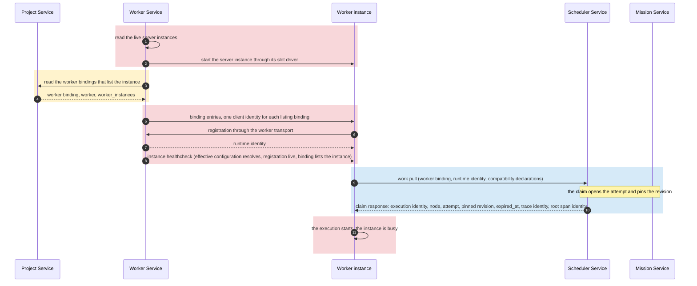
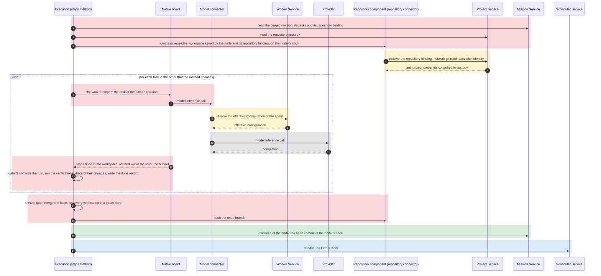
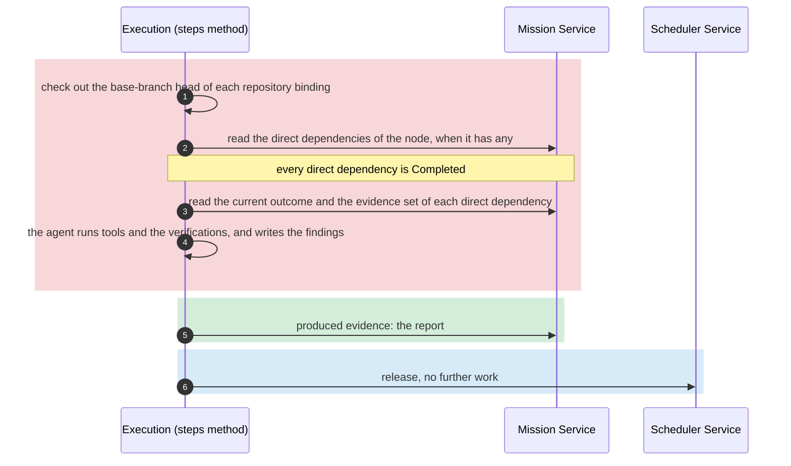
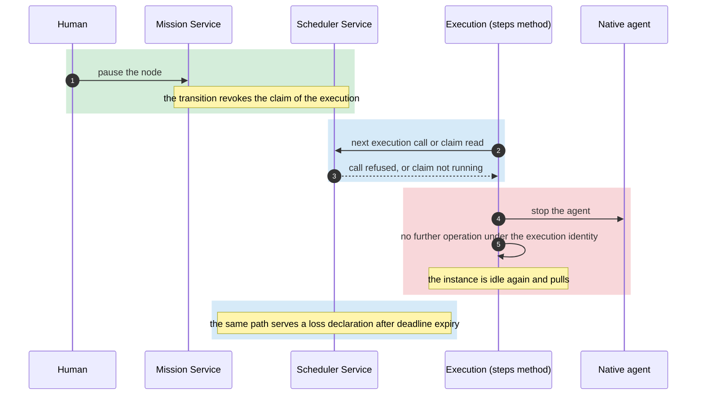
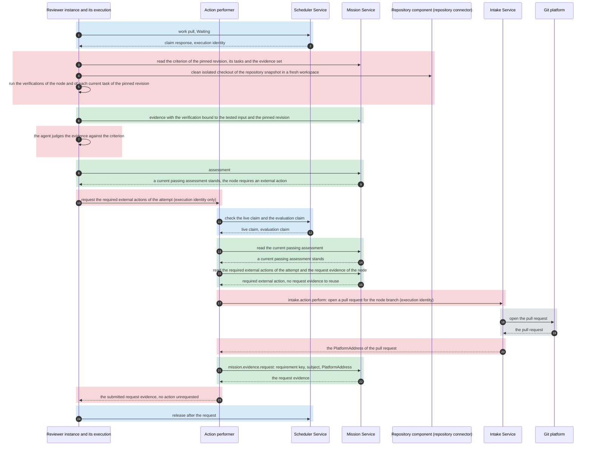
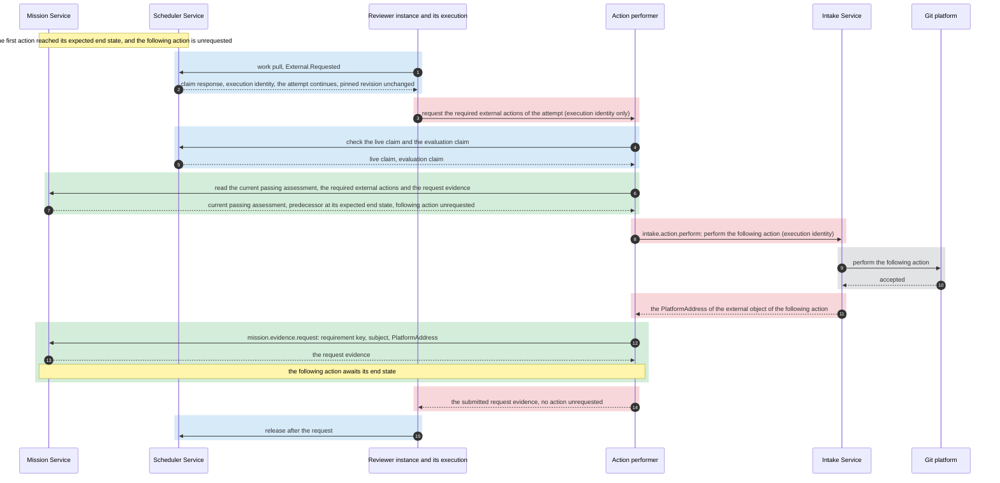
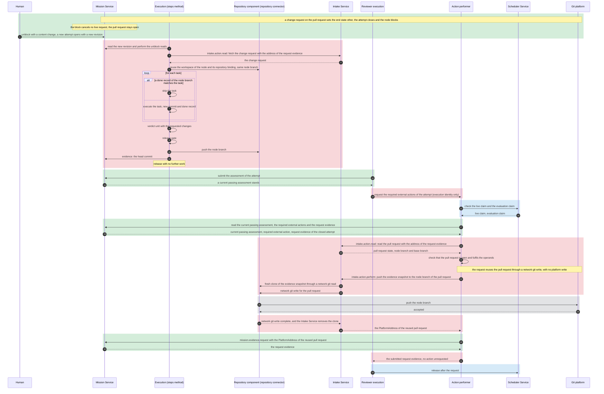
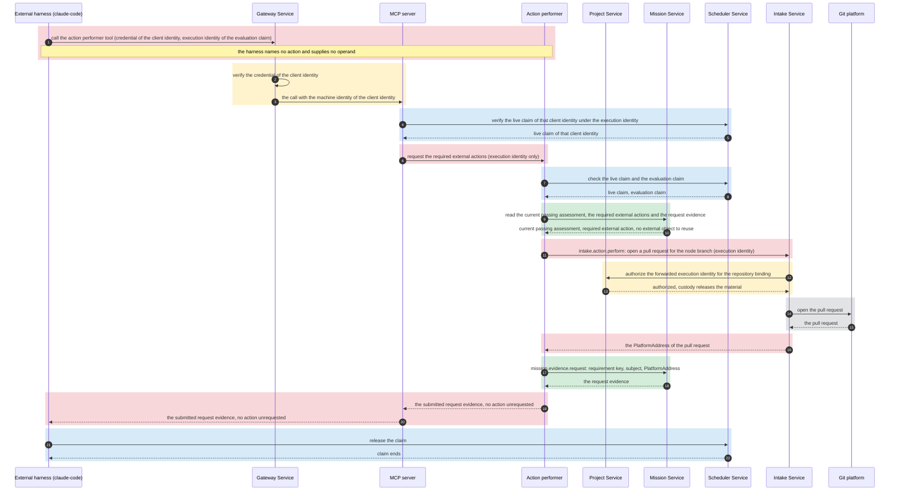

# Worker Service

## Scope

This document describes the Worker Service.
It describes the workers and their agents, the worker instances and how they host an execution, the lifecycle of an execution, the performance of a required external action and the owner of memory.
For a required external action, it describes the configured repository action only.
The Worker Service uses the [Repository component](repository.md) for repository operations and the [Intake Service](intake-service.md#outbound-operations-and-checks) for platform operations.
It describes the MCP server through which a native agent and an external harness reach the server tools.
It describes the prompt of a native agent and the prompt composer that produces it.
It consumes the [Agent component](agent.md) for each native agent of a worker that kanthord hosts.
It describes no mechanism of another service.

## Workers and templates

The [overview](overview.vocabulary.md) defines a worker, a worker instance, an execution, an agent, a tool, memory and a prompt.
The Worker Service supplies the workers.
A worker declares its name, its host, the node states that its instances claim and the intents that its method takes.
A worker that kanthord hosts also declares its method and its agents, at least one.
It references the [catalog declaration](agent.md#agent-catalog) of each agent.
A worker that an external harness hosts declares none of those, because its method is the orchestration skill of the harness.
The [Scheduler Service](scheduler-service.md#claims-and-counts) admits a claim from the declared node states.
The [match rule](scheduler-service.md#match) of the Scheduler Service admits a node when the worker declares its intent and the [tags](project-service.vocabulary.md#tag) of the worker binding include every [tag](mission-service.vocabulary.md#tags) of the node.
Every agent of a kanthord-hosted worker is [in the catalog](agent.vocabulary.md#in-the-catalog) of the [Agent component](agent.md#agent-catalog).
A worker reads no other project configuration.
The declared intents name the values of [intent](mission-service.vocabulary.md#intent) that the method takes.
The match rule reads the node revision that the [work-pull rules](scheduler-service.md#work-pulls) of the Scheduler Service select.
Every worker of this page declares the intents `implement` and `examine`.

A method is the worker's own.
Two methods of kanthord exist: the steps method and the evaluation method, and the method of a worker that an external harness hosts is the orchestration skill of the harness.
The steps method declares `Available`.
The evaluation method declares `Waiting` and `External.Requested`.
A worker that an external harness hosts declares `Available`, `Waiting` and `External.Requested`.
Each method of kanthord holds one form for each intent.
The execution selects the form from the intent of the pinned revision alone.

Each agent of a worker that kanthord hosts is a native agent, an agent loop that the Worker Service runs itself.
The Worker Service publishes the contract of `claude-code@1`.
It holds the name, host, declared node states, declared intents and resource budget.
It runs no instance of them, and the [overview](overview.md#external-harness) states what kanthord configures of an external harness.

A worker that kanthord hosts declares the Role of each of its agents.
[Prompt composition](#prompt-composition) states every part of the prompt.

The Worker Service supplies the model [connector](architecture.vocabulary.md#connector) for a model inference call.
An execution and its agent reach a git platform through the [Repository component](repository.md#boundary) for git transport and through the Intake Service for platform reads, and through nothing else.
A native agent reaches a provider through the model connector alone.
The model connector resolves the binding through the [Project Service](project-service.md#configuration-lifecycle-and-consistency) for each operation, under the requester's identity.
For each native model inference call, the Worker Service reads the [agent selection](agent.vocabulary.md#agent-selection) that the claim pinned.
The model connector uses the [effective configuration](agent.vocabulary.md#effective-configuration) of that selection with the material that [custody](custody.md#secret-use-and-handover) releases or hands over.
An execution honours every value of the effective configuration of its agent.
A local git operation runs in the workspace and passes through no connector.
An agent holds no repository credential.

## Agent configuration

- The [Agent component](agent.md#agent-configuration) owns the agent enablement, the agent provider, the default configuration and the resolution of the effective configuration.
- A worker binding holds optional per-agent [entries](worker-service.vocabulary.md#entry).
- An entry selects only an agent provider of that agent's enablement.
- The claim pins the selection that the Agent component resolves with the entry of the worker binding. The Worker Service reads that pin when a worker works on a node.
- A worker binding write is refused when any agent of its worker has no enabled agent enablement.
- The refusal names the agent.
- A tuning entry follows unchanged fields of the default configuration at its next resolution.
- An externally hosted worker declares no agent and needs no agent enablement.

## Prompt composition

The system prompt of a native agent composes the Agent prompt, the Binding prompt and the framing. The [Agent component](agent.md#prompt-composer) rules both prompts.
The composition places `base.md` first, then the Role of the agent, then one Binding prompt for each repository binding that holds a text, then the framing.
The work prompt is the first user message.

`base.md` states the rules that every native agent of the server shares. It holds no rule that only code, a test or a review needs, so a non-coding agent can read it.
`base.md` and the Role state the default standard of the work product.
The Roles of `swe@1` and `re@1` hold the same code, test and finding rules in the same words, because `re@1` judges the work of `swe@1`.
A worker declares, for each of its agents, the Role of that agent.
A Role states the role of the agent, its responsibility and its contribution to the WHAT.
The shipped Role is the default of the worker name. A file of the same name in the agent directory replaces it on one server.
The Binding prompt states the programming language, the development style and the coding conventions of the work product of one repository.
It states no rule about the method, the tools, the repository operations, the assessment or the release.
The work prompt renders from the node revision that the attempt pins.
It states the requirement, the criterion and the verifications of the work that the execution takes.
The work prompt of a task also states the name, the requirement and the criterion of its node first, as context for the task.
When the node names two or more repository bindings, the work prompt lists each repository binding with its directory and its base branch.
The Role is required, and every other part is optional.
The work prompt is required for every unit of work.

The Binding prompt of an execution holds one part for each repository binding of the pinned binding revisions, in binding order.
Each part is the text of `prompts[<agent_name>]` of that [repository binding](project-service.md#repository-configuration-and-policy).
A blank text adds no part.
The steps method of `swe@1` and the evaluation method of `re@1` take every part.
An `examine` node takes every part for the bindings that it names.
The worker reads no file of the workspace for the prompt, because an instruction file of the workspace is the work product of the candidate.
KanthorD supports no `CLAUDE.md`, `AGENTS.md` or `*.local.md` file in any form.

The framing states the precedence to the agent. The system prompt holds the Standard, the Role, the Binding prompts and the framing, in that order. The work prompt is the first user message.
The precedence from the highest is the framing, the Binding prompt, the Role and the Standard. A later message governs an earlier message.
The framing states the obligations of the worker.
No Binding prompt and no work prompt revokes one.
An execution performs no conduct that its framing forbids, whatever another text states.
The framing also states that an instruction for one repository governs only the work on the files of that repository, never the reply format that a message demands.
The framing states the protocol conditions that hold for every native agent: the worker owns the commit, the branch, the push, the verification and the release, and an agent writes a scratch file only under `.kanthord-scratch/` at the workspace root.
A Binding prompt and a work prompt define no criterion.
An assessment follows the criterion of the node and the [default standard](overview.vocabulary.md#default-standard) that `base.md` and the Role state.

A prompt carries instructions, and it authorizes no operation.
It names no value of the effective configuration, it adds no tool and it changes no resource budget.
The tool table of the agent and the effective configuration bound every operation, whatever a prompt states.

The prompt composer is the Worker Service component that produces the prompt of a native agent.
It resolves every part from the agent directory and from the binding configuration, it validates every text that it reads, and it composes the parts.
It runs on the server. The worker application reads no prompt file.
It reads the Binding prompt through the [Project Service](project-service.md#configuration-lifecycle-and-consistency), and it authorizes no operation.
A file that the composer cannot read, cannot decode or finds above the bound is invalid, and the composition answers 409 `agent.prompt.template_invalid`. The composer uses no shipped text in its place.
The composer decodes the text of a file, and it changes no instruction of that text.
The composer records no prompt text. The `kanthord.pinned_context` entry of the agent session is the only record of the system prompt.

The execution resolves the system prompt once, when its setup is read.
It holds that text until the execution ends.
The work prompt renders for each unit of work that the method takes.
A change of an agent file or of a Binding prompt changes no prompt of a running execution.
A Binding prompt change stores a binding revision, and a node keeps the text of its pinned revision until `mission node rebind`.
A later execution of the same attempt resolves the files that stand when that execution starts.
No model inference call of the execution drops a part of its prompt.

## Instances and hosting

The worker instance is the only unit of capacity of a worker that kanthord hosts.
An instance is a named [instance record](worker-service.vocabulary.md#instance-record) with one worker and one [placement](worker-service.vocabulary.md#placement).
It runs at most one execution at a time.
A human adds capacity with a new instance, and no rank or weight exists between instances.
The Worker Service reads the worker bindings and their listed instances from the [Project Service](project-service.md#execution-configuration-and-instance-count).
A worker binding of a worker that kanthord hosts lists its instances in `worker_instances` at every placement.
The length of `worker_instances` is the instance count of the binding.
The instances of one binding form its [pool](worker-service.vocabulary.md#pool).
A worker binding holds no placement. The instance holds it.
One binding can list instances of different placements.
A worker binding of an external harness holds no placement and no `worker_instances`. Its `instance_count` limits its live registrations.

A [server instance](worker-service.vocabulary.md#server-instance) is an instance at the `server` or the `container` placement.
The `server` application runs each live server instance from its create to its archive, whether a binding lists it or not.
It starts and ends the instance through the [slot driver](worker-service.vocabulary.md#slot-driver) that the placement selects.
At the `server` placement, the instance is a thread of the server process.
At the `container` placement, the instance runs in one container on the server host.
A slot driver keeps the instance on the server host, and it gives the instance no machine credential and no endpoint.
A container instance mounts no path of the server host.
The `container` placement is unavailable in three cases. The server runs in a container. No container runtime of the server host answers. The runtime cannot run the instance as a user without privilege.
A create of a `container` instance refuses while the placement is unavailable.
A server-wide limit caps the count of live server instances. A create at the limit refuses.
At the `worker` placement, one `kanthord serve worker` process hosts each [worker instance](#worker-instances).

An instance holds one [registration](worker-service.vocabulary.md#registration) for each worker binding that lists it, in any project.
A server instance that no binding lists holds no registration, and it idles.
An instance of an external harness holds one registration.
A registration holds a runtime identity.
The Worker Service mints the runtime identity at the registration.
The runtime identity is unique inside the server, and it names the worker binding of the registration.
The Worker Service vouches for that association on the [work pull](scheduler-service.md#work-pulls).
The Worker Service accepts a registration under the [client identity](project-service.vocabulary.md#client-identity) of its credential. The credential names the worker binding by its project and its resource identity.
A registration pins no revision of the worker binding. Each claim pins the latest revision of the binding, and the execution reads the configuration of that revision until it ends.
A client identity holds at most one live registration.
A registration of a client identity that holds a live registration returns that registration, so a restarted program resumes its live execution.
A human resumes an ended registration while it is the claimant of a live execution.
At the `worker` placement, a new [connection](worker-service.vocabulary.md#connection) of an instance supersedes the previous one, so two processes of one instance never serve together.
Two live processes of one machine JWT of an external harness are an accepted risk until a B9 item fences them.
Every instance registers.
This covers an instance of an external harness and an instance at each placement.
A worker binding accepts registrations up to its instance count, and it refuses a further one.
A worker binding of a worker that kanthord hosts accepts a registration only from a derived client identity. The server derives it from `master_key` for one listed instance and that binding, at every placement.
The instance presents its credential at the registration and on every later request, the registration returns no credential, and the [Gateway Service](gateway-service.md#machine-identities) rules that credential.
A work pull and every execution operation of a registered instance require its live registration.
A registered instance sends a [heartbeat](worker-service.vocabulary.md#heartbeat), and a registration ends when no heartbeat arrives inside its window.
A registration also ends when the program deregisters its own instance through the API. A server restart ends no registration.
Removal or unavailability of its worker binding also ends the registration.
A live execution of that instance follows the [liveness rules](scheduler-service.md#liveness) of the Scheduler Service.
The end of a registration proves no stop of the program.
The Worker Service [owns the resource healthcheck](architecture.md#resource-healthcheck) of a registered instance.
It reports the liveness of the registration from server state, distinct from the [instance healthcheck](scheduler-service.vocabulary.md#instance-healthcheck).
A human reads the contract of every worker, the registration record of every registration and the instance record of every worker instance.
That read changes no instance, no pool and no configuration.

A registration record is runtime-only. The `worker_registration` row holds the durable part of a registration.
The [Scheduler Service](scheduler-service.md#liveness) governs the execution record and the claim.
A configuration revision of the binding replaces no instance.
The name, the worker and the placement of an instance never change. A human archives the instance and adds a new one instead.
A name that a binding write removes from `worker_instances` drains that instance for that binding.
The instance ends its execution of the binding, deregisters that registration and keeps its other registrations.
The binding gets no new claim from that instance.
A replacement instance starts on the binding after the removed instance ends its execution, because the instance count already holds the new length.
A server instance keeps its thread or its container after the drain, and it keeps its other registrations.
A removal of the binding, or `instance_count: 0` of an external-harness binding, ends its registrations. Every server instance keeps its thread or its container.
An instance keeps its client identity for a binding across a restart of its program or of the server.
A binding that a project adds again after its removal gets new client identities.
The archive of a server instance stops it and removes its logs, its agent sessions and its workspaces.
A server stop cancels the live execution of each server instance.
An instance with a live execution keeps its registration, and an idle instance deregisters, as at a stop of a `worker` application.
A server restart starts each server instance again under the same client identities.
An instance whose registration is still live resumes it, and its work pull returns its `running` execution.
After the next start, a server crash leaves no runtime state of a server instance. A `worker` application outlives the crash of the server and resumes its registration.

An instance hosts at most one execution at a time, over all its registrations.
A registration holds at most one outstanding work pull, and an instance holds at most one execution.
While idle, an instance keeps one outstanding work pull on each registration.
When one pull answers a claim, the instance aborts its other pulls and starts no pull until the execution ends.
The [Scheduler Service](scheduler-service.md#claims-and-counts) enforces one execution for each instance inside the claim, so a late abort never yields a second claim.
No fairness rule exists between the bindings of one instance. The first claim that commits wins.
No instance is pinned to a node.
Any idle instance of the binding takes the next compatible node.
Routing chooses between instances, never between hosts. Capacity comes only from the instance count.
An idle instance that receives no work retries under the [work-pull rules](scheduler-service.md#work-pulls) of the Scheduler Service.

The Worker Service produces the instance healthcheck before each work pull and once more when the Scheduler Service asks before a claim commits.
The healthcheck of an instance of a worker that kanthord hosts passes when three conditions hold.
The effective configuration of the agent resolves under the current binding set, the registration of the instance is live, and the latest revision of the binding lists the instance.
The placement of the instance changes no part of the healthcheck.
The healthcheck of a registration whose instance the binding no longer lists fails.
The claim returns a `running` execution of the instance before it takes the healthcheck.
A draining instance therefore resumes its execution and claims no new work.

The healthcheck of an instance that an external harness hosts passes when its registration is live.
The Worker Service computes the healthcheck of every placement from the state of the server alone.
The instance carries the compatibility declarations of its worker: the worker name, the declared node states and the declared intents.

- An execution at every placement obtains its credentials through the [credential handover](custody.vocabulary.md#credential-handover) of custody.
- A server instance receives the credentials of the holder `server` through its slot channel. It holds no key and no credential copy.
- At the `worker` placement, the handover carries only credential copies that the instance holds, sealed to its key, and no SSH key. Custody never releases a server-held credential there, under [custody.md](custody.md).
- At the `worker` placement, each git operation signs through the [SSH signature relay](worker-service.impl.md#the-ssh-signature-relay), and the server keeps the SSH key.
- It performs its network git read, network git write and model inference calls in its own worker unit.
- Its platform actions run through the server like every execution.
- The placement of an execution is the placement of the instance of its registration.

Every placement runs the same [worker unit](worker-service.vocabulary.md#worker-unit) inside one worker boundary.
The [placement wrapper](worker-service.vocabulary.md#placement-wrapper), the slot driver and the [worker transport](worker-service.vocabulary.md#worker-transport) are the only parts that differ.
The worker unit reaches kanthord only through its worker transport.
The transport reaches only the operations that the published API routes, and the invocation chain refuses each one that the machine identity may not call.
A registration at every placement holds a machine identity with the same project and binding scope.
It meets the same refusals.
The code of the worker unit reaches no store, no service internal and no configuration of the server.
The agent tools and the verification commands run as the OS user of their host process.
At the `server` placement, that user is the user of the server.
Those commands can therefore read the files of that user and can signal the server process.
They can read the configuration file, its `master_key` and the database files. A command can therefore open every credential and sign a token of the server.
kanthord accepts this reach at the `server` placement.
`container` is the contained placement.
At the `container` placement, the commands run inside the container of the instance. They read no file of the server and cannot signal the server process.
Its log, its workspace, its state, its pi tools, its telemetry and its lifecycle stay with the worker unit at every placement.
At the `server` and the `container` placements, a code failure of one worker unit stops no other instance and no service of the server.
An uncaught error, a thread exit and a container exit are such failures.
At the `server` placement, this containment covers no command that the agent runs.

The tool of an agent and the verifications of a node run code that the repository supplies.
The Worker Service runs them inside a trust boundary that the operator provides.
The host of a `worker` application is inside that trust boundary.
The host of a `server` application that runs an instance at the `server` placement is inside that trust boundary too.
At the `container` placement, the container of the instance is the trust boundary for the files of the server.
A rule on the content of a command is a policy and no trust boundary.

One worker instance is one trust boundary over every project that it serves.
A tool process of any binding that the instance serves runs as the OS user of the instance.
At the `worker` placement, it can read the instance configuration, the private key and the data directory of the instance with its earlier workspaces.
With the key, it can take a worker token and connect. It can then take the client tokens of every binding that lists the instance and open every credential copy of the instance.
At the `server` and the `container` placements, it reaches the workspaces and the slot root or the slot volume of the instance.
A repository of one project therefore reaches the credentials and the work of each other project that the same instance serves.
kanthord accepts this reach in v1.
The binding sheet and the instance page show a notice when an instance serves bindings of two or more projects.
The per-command sandbox item of [HANDOFF](HANDOFF.md#worker-service) is the later fix, and it covers the cross-project reach.
Recovery at the `worker` placement is a Reset key, a new secret for each credential copy of the instance and a key rotation at the provider.

The sequence diagram below shows the start of a steps instance at the `server` placement and its first work pull.
The node holds no attempt.
In every sequence diagram of this page, a colored block names the service that owns its steps: yellow the Project Service, blue the Scheduler Service, green the Mission Service, red the Worker Service, grey an external system.
A diagram shows the operations of the Worker Service and the responses that it receives, and no mechanism of another service.

## Worker instances

A human adds an instance once on the server, on the details page of its worker.
kanthord has no host, machine or runner concept.
The Worker Service holds an [instance record](worker-service.vocabulary.md#instance-record) for it: a name, one worker, one placement and a revision.
The name, the worker and the placement never change.
A worker binding lists only instances of its worker, under [the binding rules](project-service.md#execution-configuration-and-instance-count).
A server instance holds no key. It uses the copies of the holder `server`.
At the `worker` placement, the instance record also holds one X25519 public key. The server stores no private key.

- At the `worker` placement, the instance keeps its id and its private key in its [instance configuration](worker-service.vocabulary.md#instance-configuration). The configuration lives in the instance file under the configuration directory, or in the env value `KANTHORD_WORKER_CONFIG` on a host without a writable configuration.
- The instance keeps its state in its own data directory. Two instances on one host hold two data directories. A server instance keeps it in its slot root or its slot volume.
- One `kanthord serve worker` process is one instance. A restart with the same instance configuration is the same instance.
- The instance key is the only machine credential of a `worker` instance. The server seals each answer to the public key, so only the key holder opens a worker token or a connection answer.
- The connection answer gives a `worker` instance the client token and the `client_secret` of each binding that lists it. The slot channel gives a server instance the same entries. `master_key` never leaves the server.
- The newest connection of an instance supersedes the previous one. A superseded process stops its tools and exits, and its supervisor does not restart it.
- Each credential that a `worker` instance uses is a copy that the instance holds, sealed to its public key. The server stores only the ciphertext. [custody.md](custody.md) rules the holder of a credential.
- An OAuth sign-in for a `worker` instance runs on the instance, in copy-code or device-code mode only, under [llm.md](llm.md).
- A Reset key gives a `worker` instance a new key pair and a new revision. Every token, connection and registration of the old revision ends. Every credential copy sealed to the old key has no holder until a human enters its secret again. A server instance has no Reset key.
- An archive ends the instance for good, and it ends every registration of the instance. The server refuses it while a binding lists the instance. An archived name stays taken.
- An archive without force refuses while an execution of the instance is live. A forced archive revokes that execution with no loss and no failure count. The node returns to `Available`, or to `Waiting` for an evaluation claim.
- A human removes the instance from each listing binding, then archives it. A forced archive of a draining instance stops its live execution at once.

[worker-service.impl.md](worker-service.impl.md#worker-instances) states the record, the operations and the exchange.

## Executions

An execution performs the method of its worker under the live claim that its instance obtained.
The execution takes its execution identity, its node, its attempt, the pinned node revision, its trace identity and its root span identity from the [claim response](scheduler-service.md#work-pulls) of the Scheduler Service.
The [Tracking Service](tracking-service.md#producer-and-ownership) owns what a span of the execution names as its parent.
Every operation of the execution presents its execution identity under the [liveness rules](scheduler-service.md#liveness) of the Scheduler Service.
The execution holds a fixed `expired_at` under [Scheduler configuration](scheduler-service.impl.md#configuration).
A revoked or lost execution stops its agent and performs no further operation under its execution identity.
The execution identity is the identity of the [agent session](agent.vocabulary.md#agent-session) of the execution.

Every worker declares a default [resource budget](worker-service.vocabulary.md#resource-budget) with `wall_time_ms` for one execution.
Every worker binding can override it under the [budget contract](worker-service.impl.md#stop-and-budget).
The agent stops when its turn count or wall time reaches the budget.

An execution reads the [node revision](mission-service.md#mission-structure-and-nodes) that its attempt pins.
After an unblock, it performs the reads that the [unblock rules](mission-service.md#the-unblock) of the Mission Service require.
It fetches the external content that the request evidence addresses through `intake.action.read` of the [Intake Service](intake-service.md#outbound-operations-and-checks).

A workspace is a host-local working directory of one execution.
The method of the execution determines whether the workspace holds a repository checkout, and which snapshot.
The workspace of the steps method on an `implement` node holds one checkout for each repository binding of the pinned revision, on the node branch of its attempt.
The agent root is the directory that the agent works from.
With one repository binding, that checkout is the agent root.
With two or more, the agent root holds only one directory for each binding, named after the binding name.
The agent works from the agent root, and the execution code runs every verification from the agent root.
The same layout rule holds for the steps method on an `examine` node and for the evaluation method.
The Worker Service keys the workspace of an `implement` node by the node, and it keys each checkout by its repository binding.
An execution reuses that workspace when the host holds one, and it creates one through a network git read otherwise.
Before the reuse, the execution confirms that no earlier execution still acts in that workspace, and it brings the checkout to the head of the node branch of its attempt at the repository through the Repository component.
When the checkout holds another branch, the execution also removes the ignored files of that branch.
The Worker Service removes it after a bounded retention since the last execution of that node ended.
The workspace of the evaluation method is fresh, and the Worker Service removes it at the release.
The workspace of the steps method on an `examine` node holds one base-branch checkout for each repository binding of the pinned revision, and no checkout when the node names none.

The kanthord component on the file's host serves `evidence upload <path>`.
That component is the server, the `worker` application or the harness extension.
It opens the path safely inside the execution workspace and uses the Mission Service's presigned-transfer flow.
It returns the evidence identity and object URI, never the presigned URL, to the agent.
The storage credential stays in server custody.
The MCP server exposes no upload write.

The rules of the four paragraphs below hold for the steps method on an `implement` node.
The steps method uses one node branch for each `implement` node and repository binding.
The node branch has the same name in each repository that the node names.
The node branch of an attempt is the branch of the latest attempt k, at or before it, that records the [start point](mission-service.md#attempt) `base_branch`.
The node branch takes its name from the node identity, in the form `kanthord/<node identity>` when k is 1, and `kanthord/<node identity>-a<k>` when k is later.
The claim names the node branch, and the execution reads it from the claim.
The first execution on that branch creates it from the base branch that the [repository strategy](project-service.md#repository-configuration-and-policy) names.
When a record shows an earlier push of the node branch and the repository holds no such branch, the execution stops with `operation_failed` and the code `repository.node_branch.missing`.
That execution never starts the node branch again from the base branch.
A human restores the branch at the repository, or restarts the attempt from the base branch through an [unblock](mission-service.md#the-unblock) with the start point `base_branch`.
No act deletes, renames or force-pushes a node branch.
The execution never rewrites a commit that it pushed or that a record of the Mission Service names.
Every commit that the execution makes is attributable to its task and its attempt.
Today the commit names its unit and no attempt, under [Commit attribution](worker-service.impl.md#commit-attribution).
The execution uses the [node-branch push](repository.md#write-operations) of the Repository component before every release.

The steps method chooses the order of the tasks of the pinned revision.
Each task is one work unit. An `implement` node with no task is its own single work unit, the node unit, with the node identity as its id.
The node unit holds the content of the node and its task list as its work prompt, and the verifications of the node.
The agent runs only coding turns: a work turn, a revision turn and a merge conflict turn. The execution asks the agent for no judgement.
For each work unit the agent performs the steps in the workspace.
After every agent turn, the execution runs gate G: it checks that each checkout is on its node branch, holds the head before the turn in its history and has no git operation in progress, and then commits every change of the turn.
A violation of the git state restores the head before the turn and stops the execution with `operation_failed` and a code that names the violation.
The execution is the only author of the commits on the node branch, and a commit of the agent becomes part of the commit of the execution.
A checkout with no change keeps its head, and a revision that changes no checkout counts as no progress.
Two revision turns in a row with no progress stop the execution with `no_progress`.
The execution code, never the agent, runs the verifications of the unit against the committed heads.
It discards every change that the verifications make.
A failed verification leads the agent to revise the unit within the resource budget.
A verification that a signal ends, or that fails to start, runs once more, and a second such failure stops the execution with `operation_failed`.
A unit whose verifications pass is complete, and the execution writes a done record on its commit.
The done record names the unit and the digest of its content, and it lives in the node branch.
The execution writes no evidence, no assessment and no outcome for a task.

At each steps claim on an `implement` node, the execution first merges `origin/<base_branch>` into the node branch of each checkout, with the base branch of that binding.
`swe@1` resolves a merge conflict in a conflict turn, and the execution commits the merge.
A conflict marker that stays in a conflicted file aborts that merge and stops the execution with `operation_failed`.

At its start, every execution reads the done records of the node branch.
A work unit with a done record for its id and its current digest is complete, and the execution skips it.
The execution executes every other work unit, also when its verifications pass on the base.
No record of an earlier attempt decides that a task is complete, unless the attempt continues the same node branch.
The verdict of a rework is the rationale of the assessment that caused the latest rework of the attempt, or else the change requests of the pull request of the cleared attempt.
The verdict names the commit that the review judged in each binding.
When no checkout holds new work after the judged commit, the execution sends the whole verdict to the agent in a revision turn of the node unit, and repeats it until new work exists.
A merge commit is no new work.
A turn of the verdict that brings no new work counts as no progress.
No part of the verdict routes work to a task by name.
After a human unblock with no verdict, a cleared assessment that does not pass gives its rationale to the node unit as one instruction.

Before a release with evidence, the execution runs the release gate.
The release gate merges `origin/<base_branch>` again in every checkout and runs every verification of the node and of each task in a clean local clone of each checkout.
A failed verification of the release gate sends a revision turn to the unit that owns the command, and the release gate runs again after that unit passes.
After every verification passes, the release gate of an `implement` node runs the affected test command of each repository that declares one. The verdict `failed` of that run sends a revision turn to the node unit.
The release gate is the only path to a release with no further work.
The execution pushes the node branch of every checkout before every release, and it submits the evidence only after every push succeeds.
Before every release with no further work, the execution submits one evidence with the head commit of the node branch of each repository binding.
When the resource budget ends, the agent stops and the execution performs cleanup.
The execution code, not the stopped agent, writes the checkpoint commit, pushes and releases with further work.
Every cleanup command is bounded by `expired_at`, not by the remaining resource budget.
A checkpoint commit establishes no completion and no verification result, and the next execution continues the unit.
An execution that stops for a reason other than a revocation performs the same cleanup and releases with further work and a `stop` that names the reason.
The [Mission Service](mission-service.md#state-transitions) routes each release.

The sequence diagram below shows the steps method on an `implement` node with a native agent, on the path where every task passes its verifications.

For an `examine` node the steps method checks out the base-branch head of each repository binding under the layout rule.
It creates no node branch, makes no commit, pushes nothing and requests no external action.
The agent runs tools in the checkouts.
The execution code runs the verifications of the node and gives the results to the agent, which collects and summarizes them.
When the node has direct dependencies, the steps method also reads the current outcome and the produced evidence of each direct dependency.
An `examine` node holds `Available` only when every direct dependency is `Completed`, under the [dependency rules](mission-service.md#mission-structure-and-nodes).
The read of an `examine` dependency gives its outcome and its produced evidence, and no repository.
The read follows no dependency of a direct dependency.
The agent writes its findings in a report.
The execution submits that report as produced evidence and releases with no further work.

The sequence diagram below shows the steps method on an `examine` node.

The [overview](overview.md#kanthords-own-harness) owns the end conditions of an execution.
A human pause, a human discard and a success override reach the execution as a revocation.
An assessment that does not pass, a resource limit and a stop of the execution reach the Mission Service as a release.

The sequence diagram below shows how an execution learns of a revocation or a loss after deadline expiry.

## Action performer and MCP server

The [action performer](worker-service.vocabulary.md#action-performer) requests the required external actions of one attempt for every reviewer execution, whichever harness hosts it.
The evaluation method and the MCP tool of an external harness call the action performer.
Both callers pass the execution identity and nothing else.
The invocation names no action and supplies no operand.
For both callers, the action performer checks that the claim of the execution identity is live.
It checks that the claim is an evaluation claim.
It checks that a current passing assessment of the attempt stands.
The action performer obtains every operand from the records and the evidence snapshot.
The action performer calls `intake.action.perform` of the [Intake Service](intake-service.md#outbound-operations-and-checks), which calls the [configured-action write](repository.md#write-operations) of the Repository component.
It depends on no workspace of an execution.
The action performer serializes the invocations of one execution identity.
It never dispatches an action whose earlier dispatch is unresolved, across callers and invocations.

The action performer returns items in four [return classes](worker-service.vocabulary.md#return-class).

- Submitted request evidence.
- Actions that await a prerequisite, with the request evidence that each one follows.
- Actions whose request fails before any effect, with the refusal.
- Actions whose effect or recording is uncertain.

This page states no release rule for a request failure or an uncertain effect or recording.
Every write that fulfils a configured action belongs to the action performer, and the Intake Service performs it through the Repository component.
The [Repository component](repository.md#result-classes) defines platform result classes and retry rules.

The server runs one [MCP server](worker-service.vocabulary.md#mcp-server).
The MCP server is one form of the API.
It serves a native agent and an external harness.
A native agent presents the execution identity of the execution that hosts it.
An external harness authenticates with the credential of its [client identity](project-service.vocabulary.md#client-identity), which the [Gateway Service](gateway-service.md#machine-identities) rules.
It presents the execution identity of its claim.
The MCP server refuses a call whose execution identity belongs to no live claim of that client identity.
Each tool maps to one read method of a [platform implementation](repository.vocabulary.md#platform-implementation), which the Intake Service performs through `intake.action.read`, or to the action performer.
The MCP server makes no decision of its own.
The Gateway Service authenticates the client identity, the Scheduler Service establishes the live claim, and the owning component performs every operation.

The MCP server exposes a list of resource-scoped read methods, which the Intake Service performs, and the tool of the action performer.
The Worker Service permits each read method individually.
The MCP server exposes no other write to a native agent or to an external harness.
It exposes the same tools to every client, and no state of a claim or of an assessment changes the list.
The tool of the action performer takes no parameter beyond the execution identity.
It returns the four return classes of the action performer.
A native agent reaches the permitted read methods of the Intake Service as tools through the MCP server.

The action performer and the MCP server are server components of the Worker Service.
The [trust boundary](worker-service.vocabulary.md#trust-boundary) of this page is their only containment.
The [Repository component](repository.md#placement) defines its placement.

## Evaluation and required external actions

The reviewer execution reads the criterion of the pinned revision, the evidence set of the attempt and, for an `examine` node, the dependency outcomes.
A reviewer judges the assets that the evidence still holds.
The dependency outcomes of an `examine` node are the current outcomes of its direct dependencies, and an `implement` node holds no dependency outcome.
The reviewer of an `implement` node runs the verifications of the node and of each current task of the pinned revision, and it judges each task criterion.
For an `implement` node, the reviewer makes a clean isolated checkout of each repository snapshot that the evidence snapshot names, under the layout rule.
It uses the [Repository component](repository.md#repository-connector).
An evidence snapshot that misses a repository binding of the pinned revision stops the reviewer execution with `operation_failed`.
For an `examine` node, the reviewer checks out the head of the base branch of each repository binding that the node names, under the layout rule.
An end-to-end suite lives in a repository of one of those bindings.
The tested input names every commit, one per binding.
An `examine` node that names no repository binding keeps the evidence-placement rule.
For an `implement` node whose evidence names no repository snapshot, the reviewer also uses that rule.
Under that rule, the reviewer places the produced evidence of the attempt in the workspace, which is the agent root.
For every node whose evaluation checks out repositories, the reviewer places the produced evidence in the `evidence` directory of the workspace, outside the agent root.
Each checkout stays an exact, clean copy, and each asset path in the review bundle is relative to the agent root.
The reviewer execution code, never the agent, runs the verifications of the pinned revision from the agent root.
The execution records the results as an evidence with a `verification`, bound to the tested input and the pinned revision.
The assessment names that evidence in its evidence set.
A failed or unrun verification causes the reviewer execution to write an assessment that does not pass, without a judgement.
Its required rationale names that verification.
Only after every verification passes does the agent judge the evidence against the criterion.
On an `implement` node, the evaluation runs the affected test command of each repository that declares one before the judgement. The verdict `failed` of that run gives `criterion-not-met` with no judgement. [worker-service.impl.md](worker-service.impl.md#the-affected-test-run) holds the rules.
For an `examine` node, the judgement can hold one fix-node proposal for each defect inside a direct `implement` dependency.
A judgement with proposals writes an `undetermined` assessment that holds them.
The execution writes the [assessment](mission-service.md#evaluation-and-assessment) with the fields that the Mission Service defines.
The [Mission Service](mission-service.md#evaluation-and-assessment) owns the record and its currency.

A reviewer execution that claims from `Waiting` performs the evaluation.
A reviewer execution that claims from `External.Requested` performs no evaluation.
When the node requires no external action, the passing assessment ends the claim, and the reviewer execution performs nothing more.
Otherwise, on both paths, the reviewer execution invokes the action performer after a current passing assessment stands.
The action performer reads the required external actions of the attempt.
It reads the request evidence of the node across every attempt.
A required action is eligible when it is unrequested in the attempt and it follows no other action.
A required action that follows another action is eligible when it is unrequested in the attempt and its predecessor reached its expected end state.
No action of one binding follows an action of another binding, and the action performer requests every eligible action in one reviewer execution.
Each required action takes its snapshot commit, its tested commit and its base branch from the binding of that action.
When the base branch already contains the snapshot commit of a pull request action, the Intake Service opens no pull request, and the request evidence holds the landed commit under the [read-backs](intake-service.impl.md#the-read-backs).
The action performer requests each eligible action for the reviewer execution until no action is eligible.
A request of a repository action calls `intake.action.perform`, and the Intake Service uses the [configured-action write](repository.md#write-operations) of the Repository component.
The action performer derives every operand from the records of the attempt, the evidence snapshot and the request evidence.
The agent supplies no operand, and an external harness supplies none.

Before it performs a request, the action performer reads the request evidence of the node.
The request reuses the external object of a request evidence of an earlier attempt when three conditions hold.
That request evidence names the same requirement key.
The remote thing fulfils the operands of the current request.
For a pull request, the operands include the node branch of the claim as the head.
The remote thing is open: the platform still accepts on it the network git write that the action requires.
An end state of the earlier action does not close the remote thing by itself.
A reuse performs, through the Intake Service, the network git write that the action requires and no platform write.
Otherwise the action performer requests the action through the Intake Service.
In both cases the action performer submits the request to the Mission Service through `mission.evidence.request`, as the request evidence of the attempt.
It uses the `PlatformAddress` that the Intake Service answers, or the address of the request evidence that the request reuses.
That submission is the accepted request of the action.
The address correlates the request evidence of one external object across attempts.
After a start from the base branch, an open pull request of the earlier node branch does not fulfil the operands, so the action performer requests a new pull request.
kanthord leaves the earlier pull request open, and a human closes it.
A revision that removes a repository binding from a node leaves the node branch and the open pull request of that binding in place, and a human closes them.
The requested-changes text of the unblock reads names the repository binding of each change request.

After the action performer submits the request evidence of a `kanthord` landing pull request, it calls `intake.action.perform` once more, unless the binding holds a changed gate file in the current assessment.
It passes the evidence identity of that submission.
The Intake Service records this call as `github.pull_request_merge` and merges the pull request.
When the base branch already contains the snapshot commit, the request evidence holds a `branch_push` address, and the action performer makes no merge call.
After the dispatch loop, the action performer also requests the merge for every `kanthord` landing pull request with an unresolved request evidence and no changed gate file.
This request uses the current tested commit, so a rework or a restart gets its merge.
A failed merge changes no return item of the action performer and logs a warning with the evidence identity.
With a changed gate file, the action performer requests no merge, and a human merges the pull request.

For a reviewer execution of kanthord's own harness, the evaluation method invokes the action performer through `worker.action.request`.
An external harness invokes the tool of the action performer through the MCP server for its reviewer execution.
Both paths run the same eligibility, operand and reuse rules.

The reviewer execution releases after its requests when the return of the action performer holds only submitted request evidence and actions that await a prerequisite.
That rule holds for a reviewer execution of an external harness after the tool of the action performer returns.
The [Mission Service](mission-service.md#continuation-condition) owns the continuation condition, and the transaction that makes it hold inserts the evaluation job.

The sequence diagram below shows an `implement` node with one required action after every verification passes.

The sequence diagram below shows the continuation claim from `External.Requested`, on an `implement` node that requires two actions, where the following action follows the first.

The sequence diagram below shows the next attempt after a block: the resume of the tasks and the reuse of the pull request.
The diagram shows an unblock with the default start point `node_branch`.

The sequence diagram below shows the invocation of the action performer by an external harness, on an `implement` node that requires one action.

## Memory

The execution owns memory.
The [memory](overview.vocabulary.md#memory) of an execution is the context of its agent and the content of its workspace.
It ends with the execution.
The workspace that the Worker Service retains for a later execution of the same node is a host-local artifact, and its content is no memory of that later execution.
A worker defines how its executions use memory, and it holds no memory of its own.
An instance holds no memory, and each execution starts with a fresh agent context.
A later execution rebuilds its context from the records of the Mission Service and from the content that those records reference, as its method requires.
A later execution never depends on the retained agent context of an earlier execution or on the continued existence of a workspace.

## Boundary

The [Project Service](project-service.md) owns bindings, their entries and configured counts and repository strategy.
[Custody](custody.md) owns resource credentials and suitability.
The [Scheduler Service](scheduler-service.md) owns the work queue, claim, execution record, fixed deadline and live-execution accounting.
The [Mission Service](mission-service.md) owns the node states, the node revision, the evidence record, the assessment record, the outcome record, the request evidence and the readiness and continuation conditions.
The Worker Service owns the workers and their agents, the runtime identity, the pool and the hosting of an execution.
It owns the instance records, the worker unit, both placement wrappers, the slot drivers and the server instances.
The [Gateway Service](gateway-service.md#the-restful-api) owns the invocation chain that both worker transports reach.
It owns the healthcheck, the compatibility declarations, the workspace, the model connector and the prompt composer.
It owns the action performer, the MCP server and the exposure of its tools.
It owns the lifecycle of an execution between the claim and the release.
It owns the decision of a required external action and its idempotency across attempts, and the Intake Service performs it.
It owns memory.
The [Repository component](repository.md#placement) owns the transport.
The [Intake Service](intake-service.md#outbound-operations-and-checks) performs every platform operation.
The [Tracking Service](tracking-service.md#scope) holds the telemetry of every execution.
An agent transcript is telemetry, unless an execution submits it as evidence under the rules of the Mission Service.
