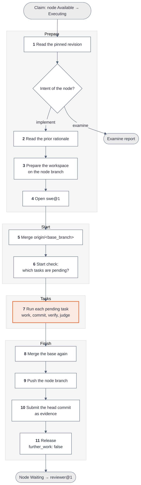
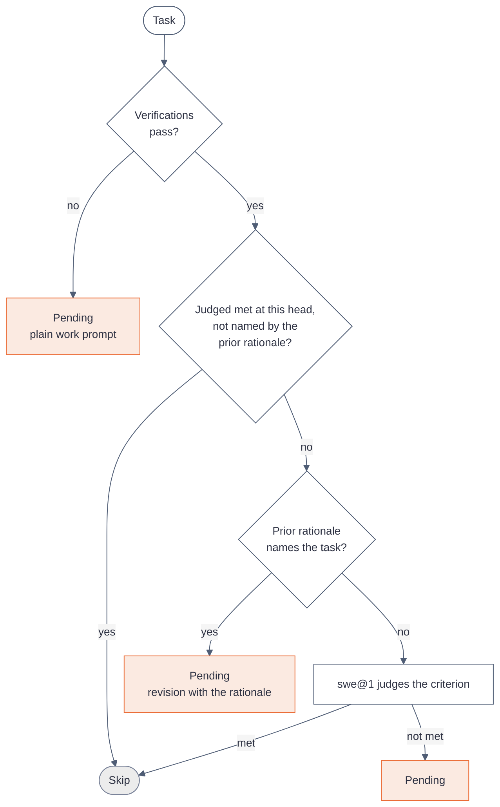
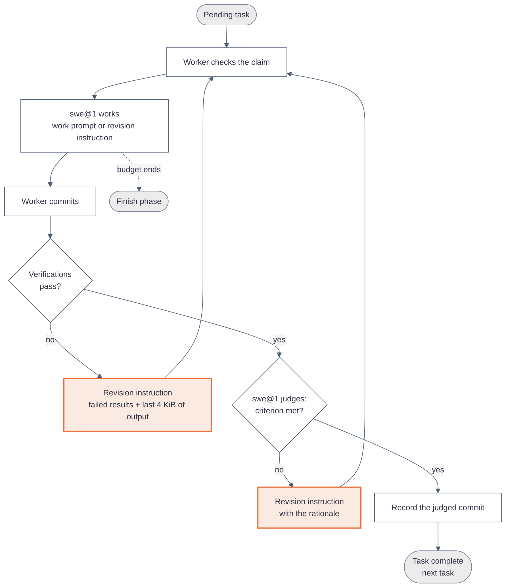
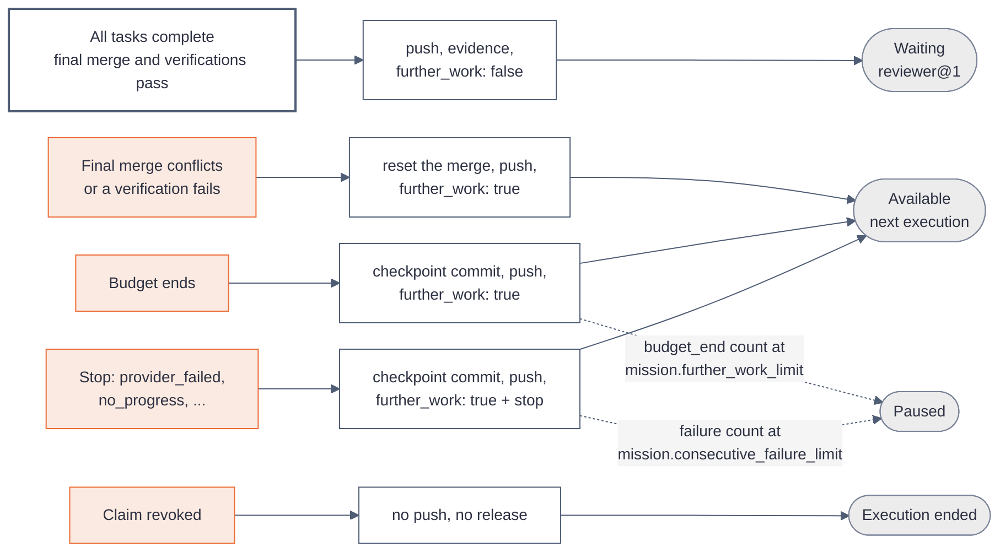

# How the coder@1 worker works

[Explanations](README.md)

`coder@1` is the native worker that does the work of an `implement` node. It drives one LLM agent, `swe@1`, in a git checkout until every task of the node passes its verifications and meets its criterion. It then pushes the node branch and hands the node to `reviewer@1`.

Read [How a worker works](worker.md) first. That page defines the terms of this page: node, attempt, claim, execution, release, evidence and assessment.

| Property        | Value                                                                                                                                                     |
| --------------- | --------------------------------------------------------------------------------------------------------------------------------------------------------- |
| Method          | `steps`                                                                                                                                                   |
| Agent           | `swe@1`                                                                                                                                                   |
| Claims          | An `implement` node or an `examine` node in state `Available`                                                                                             |
| Default budget  | 200 agent turns and 2 hours of wall time for each execution                                                                                               |
| Repository      | The repository bindings that the `implement` node names, by convention one, under [bindings of a node](../reference/mission/import.md#bindings-of-a-node) |
| Git branch      | The node branch `kanthord/<node_id>`                                                                                                                      |
| After a success | The node moves to `Waiting`, and `reviewer@1` evaluates the whole node                                                                                    |

## In short

- One execution of `coder@1` works on one `implement` node. It can finish the node, or stop at the budget and leave the rest to the next execution.
- All work goes to the node branch. The node branch, the records of the Mission Service and a local judgement cache are the only memory between two executions.
- At the start, the worker checks which tasks are already done, so a new execution never redoes finished work.
- For each open task, `swe@1` edits files. The worker commits, runs the verification commands of the task and, when they pass, asks `swe@1` whether the criterion is met.
- A failed command or an unmet criterion goes back to `swe@1` as a revision instruction. The loop repeats until the task is complete or the budget ends.
- At the end, the worker merges the base branch again, pushes the node branch, records the head commit as evidence and releases.

## Who does what inside one execution

The worker code and the agent have separate jobs. This split is the key to the whole worker.

| Job                                              | Worker code | `swe@1` |
| ------------------------------------------------ | :---------: | :-----: |
| Prepare the checkout and the node branch         |     Yes     |         |
| Edit files, run commands to explore and test     |             |   Yes   |
| Resolve a merge conflict                         |             |   Yes   |
| Commit                                           |     Yes     |         |
| Run the verification commands that decide a task |     Yes     |         |
| Judge whether a criterion is met                 |             |   Yes   |
| Decide that a task is complete                   |     Yes     |         |
| Count turns and stop at the budget               |     Yes     |         |
| Push, submit evidence, release                   |     Yes     |         |

The agent can run the verification commands itself, and its prompt tells it to. Those runs only help the agent. The run that counts is the run of the worker code, on the committed head.

A task is complete when two conditions are true: every verification of the task passes on the task commit, and `swe@1` judges the criterion met. A pass alone is not enough, and a judgement alone is not enough.

## The execution at a glance

An execution of an `implement` node has four phases and 11 steps. An `examine` node has no tasks, so `coder@1` writes a report instead, as [An examine node](#an-examine-node-the-report) explains.



| Phase   | Steps   | Question that the phase answers                           |
| ------- | ------- | --------------------------------------------------------- |
| Prepare | 1 to 4  | What is the intent, and where is the checkout?            |
| Start   | 5 and 6 | Which tasks still need work after the last execution?     |
| Tasks   | 7       | How does each open task reach a pass and a met criterion? |
| Finish  | 8 to 11 | Is the result still correct on the newest base branch?    |

## Example: a run with no problem

The `implement` node `node_01JZ8Q0K4M6N8P0R2S4T6V8W0X` adds a health endpoint. Its base branch is `main`, and it has two tasks:

| Task                                | Criterion                                      | Verifications                    |
| ----------------------------------- | ---------------------------------------------- | -------------------------------- |
| `node_01JZ8Q1A…` Add `GET /healthz` | The route answers 200 with `{"status":"ok"}`   | `npm test -- healthz`            |
| `node_01JZ8Q1B…` Document the route | `docs/api.md` describes the route and its body | `grep -q '/healthz' docs/api.md` |

1. The worker claims the node. The claim gives `execution_01JZ8R2B…` and attempt 1.
2. Steps 1 to 4 read the revision, find no prior rationale, check out `kanthord/node_01JZ8Q0K…` and open `swe@1`.
3. Step 5 merges `origin/main` with no conflict. Step 6 runs `npm test -- healthz`, which fails, so the first task is pending. The second task also fails its verification and is pending.
4. Step 7 sends the work prompt of the first task:

   ```text
   # Add GET /healthz

   ## Requirement

   Add a route GET /healthz to the HTTP server.

   ## Criterion

   The route answers 200 with {"status":"ok"}

   ## Verifications

   1. npm test -- healthz
   ```

5. `swe@1` edits `src/server.ts`, adds a test and ends its turns. The worker commits `kanthord: task node_01JZ8Q1A… attempt 1`. `npm test -- healthz` exits with code 0.
6. The worker sends the judgement instruction. The last line of the reply is:

   ```text
   kanthord-judgement: {"criterion_met": true, "rationale": "src/server.ts answers GET /healthz with 200 and {\"status\":\"ok\"}, and test/healthz.test.ts checks both."}
   ```

7. The worker records the judged commit in `judged-tasks.json` and moves to the second task. The second task follows the same path.
8. Step 8 fetches `origin/main`. The base did not move, so the worker runs no verification again.
9. Steps 9 and 10 push the node branch and submit the head commit as evidence:

   ```json
   {
     "execution_id": "execution_01JZ8R2B…",
     "attempt": 1,
     "node_revision": 3,
     "subject": "Head commit of the node branch",
     "assets": [
       {
         "kind": "repository",
         "address": {
           "kind": "repository",
           "binding_id": "binding_01JZ…",
           "commit": "9f2c4e1…"
         }
       }
     ]
   }
   ```

10. Step 11 releases with `{ "further_work": false, "stop": null }`. The node moves to `Waiting`, and `reviewer@1` claims it.

The sections below explain each phase, and then every way that a run can differ from this one.

## Prepare: steps 1 to 4

**Step 1** reads the node revision that the attempt pins. The revision holds the content of the node, its intent and its tasks. The intent selects the form of the method: `implement` or `examine`. An `implement` node with no task is its own single work unit, and the worker treats the content of the node as its one task.

**Step 2** reads the **prior rationale**: the reason why earlier work did not pass. The start check in step 6 uses it. The worker takes the first source that exists:

1. The assessment that caused the latest rework of this attempt. `reviewer@1` wrote it with the result `criterion-not-met`.
2. The requested changes of the reviewers on the pull request, when the earlier attempt ended because a reviewer requested changes. The worker reads them through the Intake Service, at most 4 KiB.
3. The assessment that closed the earlier attempt, after a human unblock. After a pull request that closed with no change request, this is the passing assessment, so it holds no failure reason.

On attempt 1 with no rework, no prior rationale exists.

**Step 3** prepares the **workspace**, the git checkout of the `implement` node:

- The workspace is `workspaces/<node_id>/` in the state directory of the worker host. It holds one checkout for each repository binding, in `checkouts/<binding name>/`. The worker reuses a checkout when the host holds it, and clones the repository otherwise.
- With one repository binding, its checkout is the agent root. With two or more, `checkouts/` is the agent root, and it holds one directory for each binding.
- The agent works from the agent root, and the worker runs every verification from it. With two or more repository bindings, each step below acts on every checkout and every node branch, and the evidence holds one head commit for each binding.
- The worker then fetches and checks out the node branch of the attempt from the remote. It resets the checkout to the remote branch and removes untracked files, so every execution starts from the pushed state. When the remote holds no node branch yet, the worker creates it from the base branch.
- The node branch is `kanthord/<node_id>`. An unblock with the start point `base_branch` opens attempt k on a new branch, `kanthord/<node_id>-a<k>`. The default start point, `node_branch`, keeps the earlier branch.
- The remote can lose a node branch that existed, for example after a manual delete. The worker detects this when the attempt holds repository evidence, or when the workspace saw the remote branch before. It then stops with `operation_failed` and the code `repository.node_branch.missing`. It never starts the branch again from the base branch, because a record names a commit of the lost branch. The stop releases with `further_work: true`, so the node returns to `Available`, and each next execution stops the same way. After `mission.consecutive_failure_limit` stops, the node moves to `Paused`. A human restores the branch on the git host and resumes the node. Or the human pauses and blocks the node, then unblocks it with the start point `base_branch`, which opens the next attempt on a new branch.
- The worker adds `.kanthord-scratch/` to the git exclude file. The agent writes its probe and debug files there, and no commit takes them.

**Step 4** opens the agent `swe@1` at the agent root. [How the native agent works](native-agent.md) explains what the agent receives: the model, the prompt and the tools.

## Start: steps 5 and 6

### Step 5: merge the base branch

The base branch can move while the node waits. The worker merges `origin/<base_branch>` into the node branch first, so that all work starts from the newest base. When the merge has a conflict, `swe@1` resolves the files as work. A file that still holds a conflict marker after the agent ends its turns stops the execution with `operation_failed`.

### Step 6: the start check

The workspace and the node branch survive between executions. The start check decides which tasks still need work, so a new execution does not redo finished work and does not trust work that a later change broke.

The start check runs the verifications of each task on the head of the node branch. For each task, the first matching row below decides. Row 0 applies only in a rework, as the next paragraphs explain.

| #   | Condition                                                                                                          | Result                                                                                                                                                                       |
| --- | ------------------------------------------------------------------------------------------------------------------ | ---------------------------------------------------------------------------------------------------------------------------------------------------------------------------- |
| 0   | In a rework, `swe@1` chose this task for a failed verification of the node.                                        | Pending. The task starts with that failure as its revision instruction.                                                                                                      |
| 1   | A verification of the task fails.                                                                                  | Pending. The task starts with its plain work prompt.                                                                                                                         |
| 2   | The task was judged met at this same head, in this attempt and revision, and the prior rationale does not name it. | Skipped. The judgement still holds.                                                                                                                                          |
| 3   | The prior rationale names the task.                                                                                | Pending. The task starts with the prior rationale as its revision instruction.                                                                                               |
| 4   | Any other passing task.                                                                                            | `swe@1` judges the criterion now, with the prior rationale as context. Met: skipped. Not met: pending, with the prior rationale as its revision instruction when one exists. |

The prior rationale **names** a task when its text holds the task id. `reviewer@1` lists each unmet task id in its assessment for this reason.

A rationale can name no task. `re@1` names the node id for an unmet node criterion or a default-standard violation, and a failed-verification rationale names only the command. Then no task is pending by name. A task whose own verification fails is still pending at row 1. `swe@1` judges each other passing task at row 4, with the rationale as context. When `swe@1` judges every task met, no task is pending, and the execution releases the same head. The next review can then reach `mission.rework_limit` and move the node to `Blocked`.

The worker keeps its judgements in `judged-tasks.json` in the workspace. The file is a cache of the host: a fresh clone on another host has no file, so row 4 judges each passing task again.



**A rework adds one check first.** A rework is an execution after a `criterion-not-met` assessment in the same attempt. The reviewer runs the verifications of the node, not only those of the tasks, so a rework can fail on a node command that no task owns. Before the task checks, the start check of a rework therefore runs the verifications of the node once. When one fails, `swe@1` chooses the task that is most related to the failure. That task is pending, and its revision instruction holds the failure and the last 4 KiB of its output. An invalid choice selects the last task of the plan.

## Tasks: step 7

`swe@1` works on one pending task until its verifications pass and its criterion is met. The tasks run in the order of the plan.



Each pass through the loop does these things:

1. **Claim check.** The worker reads its claim. A claim that is not running, for example after a human pause, ends the execution as revoked.
2. **Work.** The worker sends the work prompt of the task, or a revision instruction. `swe@1` reads files, edits files and runs commands until it ends its turns. One turn is one reply of the model with the tool calls of that reply. Each turn counts toward the budget of 200.
3. **Commit.** The worker commits every change with the message `kanthord: task <task_id> attempt <n>`. A revision that changes no file makes no commit. The same is true when the agent committed its own change with `git commit`: the worker finds nothing to commit.
4. **Verify.** The worker runs each verification command of the task on the head, in order, with `bash -c` at the agent root. The first failure stops the run. Each command has a limit of 10 minutes, and the remaining budget can cut it shorter. The worker then discards every change that the commands made, so a test run never leaks into the next commit.
5. **Judge.** Only after every command passes, the worker asks `swe@1` to judge the criterion. The reply must end with one `kanthord-judgement:` line that holds JSON. A reply with no valid line gets one repair turn. A second invalid reply stops the execution with `judgement_invalid`.
6. **Decide.** A met criterion completes the task. The worker writes the judged commit to `judged-tasks.json` and takes the next pending task.

The worker guards the loop against an agent that makes no progress. After a failed verification, a revision that changes no file counts as unchanged. After the first unchanged revision, the worker verifies the head again. After the second unchanged revision in a row, it stops with `no_progress` before it verifies, because the same head gives the same result. A `no_progress` stop counts toward `mission.consecutive_failure_limit`. An agent commit also counts as unchanged, because the worker finds nothing to commit.

`coder@1` holds no review of its own. The judgement of `swe@1` only ends the task loop. The review of `reviewer@1`, after the release, is the only review of the node.

## Finish: steps 8 to 11

**Step 8** fetches `origin/<base_branch>` again, because the base branch can move during a long execution:

- When the base did not move, the worker runs no verification again.
- When the base moved and merges with no conflict, the worker runs the verifications of every task on the merged head. When all pass, the merge commit stays.
- When the merge has a conflict, or a verification fails on the merged head, the worker resets the node branch to its head before the merge. It then releases with `further_work: true`. The next execution merges at step 5, where `swe@1` can resolve the conflict.

**Step 9** pushes the node branch. Every end after step 4 pushes, except a revocation. A stop before the workspace exists, for example `repository.node_branch.missing`, has nothing to push.

**Step 10** submits the head commit of the node branch as the evidence of the node. `reviewer@1` checks out exactly this commit.

**Step 11** releases with `further_work: false`. The Mission Service moves the node to `Waiting`.

## How the execution ends

The release body decides the next state of the node. A release with `further_work: true` returns the node to `Available` for the next `coder@1` execution. A release with `further_work: false` moves the node to `Waiting` for `reviewer@1`.

| End                                                                                                      | What the worker does                             | Release body                                                               | Next node state                               |
| -------------------------------------------------------------------------------------------------------- | ------------------------------------------------ | -------------------------------------------------------------------------- | --------------------------------------------- |
| Every task complete, the final merge passes                                                              | Push, submit the head commit                     | `further_work: false`                                                      | `Waiting`                                     |
| The final merge conflicts or a verification fails on it                                                  | Reset the merge, push                            | `further_work: true`                                                       | `Available`                                   |
| The budget ends while `swe@1` works, or during the judgement of a passing run                            | Abort the agent, write a checkpoint commit, push | `further_work: true`, `stop` only when no task completed in this execution | `Available`, or `Paused` at the limit         |
| The wall time ends while the worker commits or verifies a task, and a verification fails or does not run | Push, submit the head commit                     | `further_work: false`                                                      | `Waiting`, or `Available` when the base moved |
| A stop: `provider_failed`, `no_progress`, `judgement_invalid`, `operation_failed`                        | Abort the agent, write a checkpoint commit, push | `further_work: true`, `stop` with the reason                               | `Available`, or `Paused` at the limit         |
| The claim is revoked, for example by a pause                                                             | Abort the agent. No push                         | No release                                                                 | Set by the human act                          |



Three rules of the budget end need attention:

- **The checkpoint commit is not a result.** It saves the work in progress as `kanthord: checkpoint of task <task_id> attempt <n>`. It proves no verification and completes no task. The next execution finds the task pending at its start check and continues it.
- **The task commit is the boundary.** When the budget ends before the task commit, the worker writes a checkpoint. When the budget ends after the task commit, during a verification run that then fails or does not finish, the worker writes no checkpoint. It releases that head with `further_work: false`, like a finished run. `reviewer@1` then finds the failed verification and writes `criterion-not-met`, so the node comes back as a rework with that rationale. Only the wall time can end the budget at this point, because the worker runs no agent turn between the commit and the verification. The same rule applies when the wall time ends during the verification runs of the start check. When the base branch moved, the worker cannot verify the merge with no budget left, so it resets the merge and releases with `further_work: true`.
- **The `budget_end` stop marks a stalled execution.** The release carries `stop: { "reason": "budget_end", "code": "turns" }` only when no task completed in that execution. The code is `wall_time` when the wall time ended first. Such releases count toward `mission.further_work_limit`. A release without that stop resets the count.

All cleanup after a budget end, the checkpoint commit, the push and the release, runs under `expired_at`, not under the spent budget. The claim keeps a reserve of 10 minutes after the budget for this cleanup.

## Edge cases

| Case                                               | Behavior                                                                                                                |
| -------------------------------------------------- | ----------------------------------------------------------------------------------------------------------------------- |
| Conflict at the step 5 merge                       | `swe@1` resolves the files. A file that still holds a marker stops with `operation_failed`.                             |
| Conflict at the step 8 merge                       | The worker aborts the merge and releases with `further_work: true`.                                                     |
| The base moves during the run                      | Step 8 merges it and runs the verifications of every task again.                                                        |
| A verification fails                               | `swe@1` gets the failed command, the results and the last 4 KiB of its output.                                          |
| A verification command runs longer than 10 minutes | The worker kills the command. The command counts as failed, and later commands do not run.                              |
| A judgement reply has no valid marker line         | One repair turn. A second invalid reply stops with `judgement_invalid`.                                                 |
| A model call fails at the provider                 | The turn ends with the error, and the worker stops with `provider_failed` and its code.                                 |
| Two revisions in a row change no file              | The worker stops with `no_progress` before it verifies the unchanged head a third time.                                 |
| The node branch is gone after a recorded push      | The worker stops with `operation_failed` and `repository.node_branch.missing`.                                          |
| The node is paused during the execution            | The claim check after the next turn or before the next task ends the execution as revoked.                              |
| A rework after a `criterion-not-met` assessment    | The start check gives the rationale to each task that it names.                                                         |
| A node verification fails at a rework              | `swe@1` chooses one task. That task is revised with the failure output.                                                 |
| An unblock after a change request on the PR        | The start check judges each task against the requested changes of the reviewers.                                        |
| The budget ends inside a task                      | The worker writes a checkpoint commit, pushes and releases. The next execution resumes.                                 |
| The wall time ends during a task verification      | The worker releases the head with `further_work: false`. The reviewer judges it.                                        |
| The next execution runs on another host            | The worker clones the repository and checks out the pushed node branch. The start check judges the passing tasks again. |

## Examples of the edge cases

Each example starts from [the run with no problem](#example-a-run-with-no-problem) and changes one fact.

### A verification fails

`npm test -- healthz` exits with code 1 after the first turn. The worker sends this revision instruction:

````text
Revise the task work to satisfy its criterion and verifications. Verification 1 `npm test -- healthz` failed with exit code 1.
Verification results: [{"command":"npm test -- healthz","exit_code":1,"signal":null,"timed_out":false}]

Output of the last verification that ran (the last 4 KiB):

```text
FAIL test/healthz.test.ts
  expected 200, received 404
```
````

`swe@1` fixes the route. The worker commits, verifies again and continues with the judgement.

### The criterion is not met

The verifications pass, but the reply ends with:

```text
kanthord-judgement: {"criterion_met": false, "rationale": "The route answers 200, but the body is the text ok, not {\"status\":\"ok\"}."}
```

The worker sends `Revise the task work to meet its criterion. Previous judgement: The route answers 200, but …`. The loop goes back to work.

### The judgement has no marker line

The reply ends with `The criterion is met.` and no `kanthord-judgement:` line. The worker sends one repair turn: `The reply holds no valid kanthord-judgement: line. Reply again with exactly one such line.` A second reply with no valid line stops the execution:

```json
{
  "further_work": true,
  "stop": { "reason": "judgement_invalid", "code": null }
}
```

### The budget ends inside a task

The 200th turn ends while `swe@1` works on the second task. The first task is complete. The worker aborts the session, commits `kanthord: checkpoint of task node_01JZ8Q1B… attempt 1`, pushes and releases:

```json
{ "further_work": true, "stop": null }
```

The stop is `null` because one task completed in this execution. The node moves to `Available`. The next execution judges the first task again at the start check, because the checkpoint commit moved the head after its judgement. A met judgement skips the task, so no work repeats. The judgement costs one agent turn.

When no task completes before the budget ends, the release carries the stop, and the count toward `mission.further_work_limit` grows:

```json
{ "further_work": true, "stop": { "reason": "budget_end", "code": "turns" } }
```

### The wall time ends during a verification

The worker commits the second task and runs `grep -q '/healthz' docs/api.md`. The 2-hour wall time ends while the command runs. The worker kills the command, and the run counts as failed. No budget remains for a revision. The task commit is the boundary: the worker writes no checkpoint, pushes, submits the head commit and releases:

```json
{ "further_work": false, "stop": null }
```

The node moves to `Waiting`. `reviewer@1` runs the verifications, the grep fails, and the assessment is `criterion-not-met` with the failed command in its rationale. The node returns to `Available` as a rework.

### Two revisions change no file

`npm test -- healthz` fails. `swe@1` answers two revision instructions in a row and changes no file. The worker stops and does not verify the same head again:

```json
{ "further_work": true, "stop": { "reason": "no_progress", "code": null } }
```

### The provider refuses a call

The provider answers 429 to a model call. The turn ends with `stopReason: "error"`. The worker writes a checkpoint commit, pushes and releases:

```json
{
  "further_work": true,
  "stop": {
    "reason": "provider_failed",
    "code": "rate_limited",
    "detail": "429 Too Many Requests: rate limit exceeded"
  }
}
```

The `detail` holds the provider error text, with the secrets removed and cut to 300 characters. The code `rate_limited` moves the agent to the next model of its fallback chain for the next execution. It does not count as a failure. The codes `bad_request` and `unauthorized` count, and after `mission.consecutive_failure_limit` failures in a row the node moves to `Paused`.

### The base moves during the run

At step 8, `origin/main` holds a new commit. The merge has no conflict, so the worker runs the verifications of every task again. When all pass, the worker pushes the merge commit. When one fails, the worker resets the node branch to the head before the merge, pushes and releases with `{ "further_work": true, "stop": null }`.

### A human pauses the node

The human pauses the node during the work on the first task. After the next turn, the claim check reads a claim that is not `running`. The worker ends the execution as revoked. It does not push and does not release, because the claim is no longer its own.

## An examine node: the report

An `examine` node has no tasks and no node branch. `coder@1` claims it in `Available`, after every direct dependency is `Completed`. The execution then does these steps:

1. It checks out the base-branch head of each repository binding that the node names, read-only, under `checkouts/<binding name>/` of a fresh directory. A node with no repository binding gets an empty directory.
2. When the node names a repository binding, it runs the verifications of the node, for example an end-to-end suite.
3. It sends `swe@1` the direct dependencies, their outcomes, their evidence and the verification results, and asks for its findings.
4. It submits the findings as produced evidence with the subject `Report on current dependency outcomes`, and releases with `further_work: false`.

`reviewer@1` then judges the `examine` node from the report and the outcomes of its direct dependencies.

## Under the hood: how coder@1 drives pi

`swe@1` runs on the pi SDK, `@earendil-works/pi-coding-agent` 1.1.0. The [native agent](native-agent.md) page explains the configuration, the prompt layers and the tool set. This section shows which pi calls `coder@1` makes and what it reads back.

| Need of the worker           | pi API                                                                    | What the worker does with it                                                                  |
| ---------------------------- | ------------------------------------------------------------------------- | --------------------------------------------------------------------------------------------- |
| A model with a credential    | `ModelRuntime.create`, then `runtime.getModel`                            | Step 4. The runtime reads the secret from the custody handover. It makes no network call.     |
| A session in the workspace   | `createAgentSession` with `SessionManager.inMemory`                       | Step 4. The session lives in memory. A new execution opens a new session.                     |
| The task in every model call | The `context` hook and a guard on `agent.streamFunction`                  | The worker pins the work prompt of the current task, so that a compaction does not remove it. |
| A turn of work               | `session.prompt(text)`, then `session.waitForIdle()`                      | Steps 5 to 7. The worker sends the work prompt or an instruction and waits for the agent.     |
| The reply                    | `session.getLastAssistantText()`                                          | The worker parses the `kanthord-judgement:` line from the last reply.                         |
| A provider failure           | The last assistant message with `stopReason: "error"`                     | The worker maps `errorMessage` to a code and stops with `provider_failed`.                    |
| The turn budget              | `session.subscribe` for `turn_end`, and an override of `agent.finishTurn` | Each `turn_end` counts one turn. After each turn the worker checks the budget and the claim.  |
| A safe `bash`                | `createBashToolDefinition` with a `spawnHook` and a timeout               | The hook removes every provider key from the environment. The timeout is 10 minutes or less.  |
| Evidence from the agent      | A custom tool `evidence-upload`                                           | The tool uploads a workspace file and returns `evidence_id`, `asset_id` and `uri`.            |
| A stop                       | `session.abort()`                                                         | The worker aborts on a budget end, on a cancellation and before a checkpoint commit.          |
| The transcript               | `session.messages`                                                        | At the end, the worker writes the messages to `<state>/transcripts/<execution_id>.jsonl`.     |

The worker does not use `steer` or `followUp`. Each instruction is a new `prompt` call after the agent is idle.

One task, from the side of the worker, has this shape:

```ts
await session.prompt(workPrompt, { expandPromptTemplates: false });
await session.waitForIdle();
failOnProviderError(session.messages);

const head = await commitWork(workspace, task, attempt);
const verification = await runVerifications(workspace, task.verifications);
if (!verificationPassed(verification)) {
  await session.prompt(taskRevisionInstruction(verification, outputTail));
  await session.waitForIdle();
}

await session.prompt(taskJudgementInstruction(task));
await session.waitForIdle();
const judgement = parseJudgement(session.getLastAssistantText());
```

The code sketch leaves out the loop, the budget checks and the claim checks. [Tasks: step 7](#tasks-step-7) shows the full loop.

## What coder@1 reports

`coder@1` reports on the two channels of the [worker contract](worker-contract.md). On the state channel, it checks its claim, submits the head commit as evidence and releases. On the telemetry channel, it writes a `worker.phase` span for each phase, a `worker.task` span for each task, and `worker.verification`, `worker.judgement`, `agent.turn` and `agent.tool` spans below each task. An external harness writes the same `agent.turn` and `agent.tool` spans.

The worker process also writes one JSON log line to stderr for each task start, task commit, task verification and task judgement. A line holds identities and results, and no agent content.

## Limits

- **One review, at the node.** `coder@1` judges each task itself. Only `reviewer@1` reviews the work, and only after the release.
- **No atomic landing across repositories.** The task commit of a node with two or more repository bindings is the set of the heads of its node branches. Each required external action resolves on its own. An action with the end state other blocks the node, and the landed commit of a sibling action stays a record of its attempt.
- **No memory in the agent.** Each execution starts a new agent conversation. Only the node branch, the records of the Mission Service and the local `judged-tasks.json` carry over.
- **A stalled node pauses.** An execution that completes no task before its budget ends counts toward `mission.further_work_limit`. At the limit, the node moves to `Paused`. An `examine` budget end releases with no stop and does not count.
- **The agent can use git.** `swe@1` has `bash`, and its commands run with the git and SSH configuration of the host user. KanthorD removes `SSH_AUTH_SOCK` and `SSH_AGENT_PID` from each command, so a command reaches no SSH agent of the host user. During a network git operation of KanthorD on the same host, a command of the same user can still sign through the SSH agent socket of that operation. A `git push` of the agent can also use a key under `~/.ssh` of the host user. KanthorD has no sandbox; see [where a worker runs](worker.md#where-a-worker-runs). Nothing blocks a `git commit` or a `git push` by the agent. The worker does not depend on it: an agent commit leaves the worker nothing to commit, and after a failed verification that counts as an unchanged revision.
- **Workspace reuse on one host.** The worker holds the workspace of an `implement` node for one execution at a time. Today that hold covers the executions of one worker process only. Two worker processes on the same host share the `workspaces/` directory, so an execution can reuse a workspace in which a lost earlier execution of another process still runs a command.
