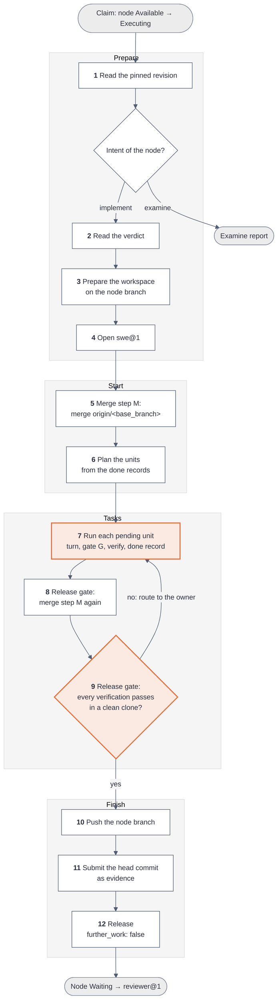
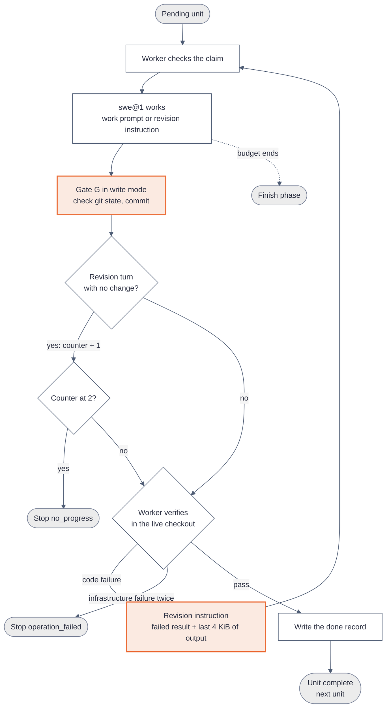
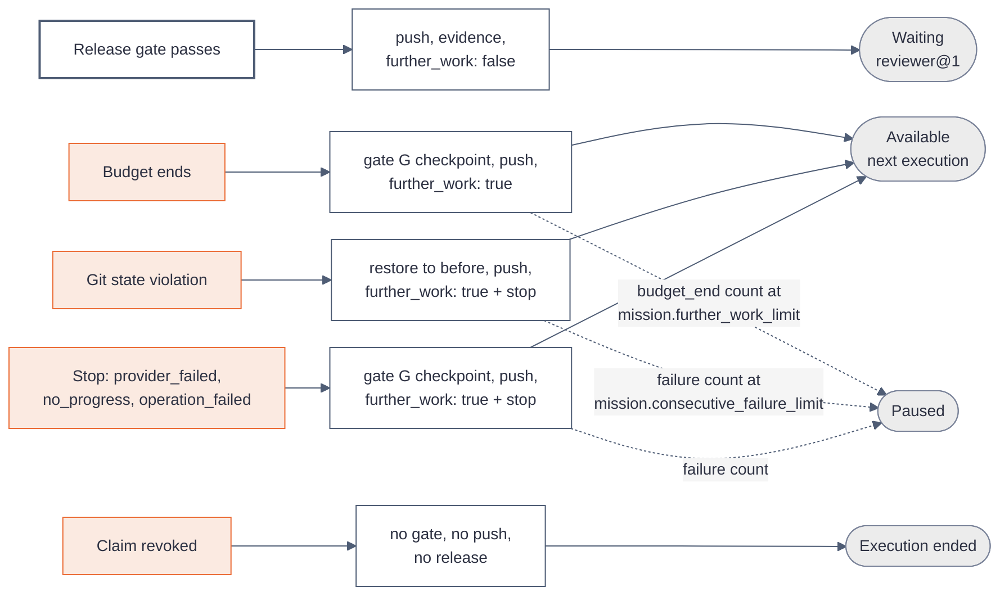

# How the coder@1 worker works

[Explanations](README.md)

`coder@1` is the native worker that does the work of an `implement` node. It drives one LLM agent, `swe@1`, in a git checkout. The agent only writes code. The worker commits after every agent turn, runs every verification itself, and releases the node to `reviewer@1` only after every verification of the node passes in a clean clone.

Read [How a worker works](worker.md) first. That page defines the terms of this page: node, attempt, claim, execution, release, evidence and assessment.

| Property        | Value                                                                                                                                                     |
| --------------- | --------------------------------------------------------------------------------------------------------------------------------------------------------- |
| Method          | `steps`                                                                                                                                                   |
| Agent           | `swe@1`                                                                                                                                                   |
| Claims          | An `implement` node or an `examine` node in state `Available`                                                                                             |
| Default budget  | 200 model turns and 2 hours of wall time for each execution                                                                                               |
| Repository      | The repository bindings that the `implement` node names, by convention one, under [bindings of a node](../reference/mission/import.md#bindings-of-a-node) |
| Git branch      | The node branch `kanthord/<node_id>`                                                                                                                      |
| After a success | The node moves to `Waiting`, and `reviewer@1` evaluates the whole node                                                                                    |

## In short

- One execution of `coder@1` works on one `implement` node. It can finish the node, or stop at the budget and leave the rest to the next execution.
- The work of a node splits into **units**. Each task of the node is one unit. A node with no task is one unit.
- `swe@1` runs only coding **turns**: a work turn, a revision turn and a merge conflict turn. A turn is one prompt of the worker and every reply of the agent until the agent is idle. The agent answers no question of the worker.
- After every turn, the worker runs **gate G**. The gate checks the git state of each checkout and commits every change of the turn.
- The worker runs the verifications of a unit itself. A pass writes a **done record** on the commit of the unit, so no later execution redoes the unit. A pass with no new commit writes no record.
- After the last unit, the **release gate** merges the base branch and runs every verification of the node in a clean clone. Only a pass of the release gate releases the node with `further_work: false`.
- A budget end always releases with `further_work: true`. The next execution continues from the pushed node branch.

## Who does what inside one execution

The worker code and the agent have separate jobs. This split is the key to the whole worker.

| Job                                                | Worker code | `swe@1` | `reviewer@1` |
| -------------------------------------------------- | :---------: | :-----: | :----------: |
| Prepare the checkout and the node branch           |     Yes     |         |              |
| Merge the base branch                              |     Yes     |         |              |
| Edit files, run commands to explore and test       |             |   Yes   |              |
| Resolve the files of a merge conflict              |             |   Yes   |              |
| Commit, after every agent turn                     |     Yes     |         |              |
| Run the verification commands that decide a unit   |     Yes     |         |              |
| Decide that a unit is done                         |     Yes     |         |              |
| Count turns and stop at the budget                 |     Yes     |         |              |
| Push, submit evidence, release                     |     Yes     |         |              |
| Judge whether a criterion and the standard are met |             |         |     Yes      |

The role prompt of `swe@1` tells the agent to check its work against the criterion before it ends a turn. That check only helps the agent. No step of the worker reads an answer of the agent. The agent can also run the verification commands itself. The run that counts is the run of the worker code, on the committed head.

A unit is done when every verification of the unit passes on its commit. Only `reviewer@1` judges a criterion, in its own execution, after the release.

## The execution at a glance

An execution of an `implement` node has four phases and 12 steps. An `examine` node has no units, so `coder@1` writes a report instead, as [An examine node](#an-examine-node-the-report) explains.



| Phase   | Steps    | Question that the phase answers                                     |
| ------- | -------- | ------------------------------------------------------------------- |
| Prepare | 1 to 4   | What is the intent, what is the verdict, and where is the checkout? |
| Start   | 5 and 6  | Is the newest base merged, and which units still need work?         |
| Tasks   | 7 to 9   | Does each unit pass, and does the whole node pass in a clean clone? |
| Finish  | 10 to 12 | Which head does `reviewer@1` get?                                   |

A failure of the release gate at step 9 sends the execution back to step 7, with one unit and one revision instruction. The loop ends when the release gate passes, when the budget ends, or when a stop ends the execution.

## Example: a run with no problem

The `implement` node `node_01JZ8Q0K4M6N8P0R2S4T6V8W0X` has the name `Add a health endpoint` and no `commit_type`. It names one repository binding, `api`, with the base branch `main`. It has one node verification, `npm run build`, which the first task also holds, and two tasks:

| Task                                | Criterion                                      | Verifications                          |
| ----------------------------------- | ---------------------------------------------- | -------------------------------------- |
| `task_01JZ8Q1A…` Add `GET /healthz` | The route answers 200 with `{"status":"ok"}`   | `npm test -- healthz`, `npm run build` |
| `task_01JZ8Q1B…` Document the route | `docs/api.md` describes the route and its body | `grep -q '/healthz' docs/api.md`       |

1. The worker claims the node. The claim gives `execution_01JZ8R2B…` and attempt 1.
2. Steps 1 to 4 read the revision, find no verdict, check out `kanthord/node_01JZ8Q0K…` and open `swe@1`.
3. Step 5 finds that `origin/main` is an ancestor of the head, so it merges nothing. Step 6 reads no done record on `origin/main..HEAD`, so both tasks are pending.
4. Step 7 sends the work prompt of the first task:

   ```text
   # Add GET /healthz

   ## Requirement

   Add a route GET /healthz to the HTTP server.

   ## Criterion

   The route answers 200 with {"status":"ok"}

   ## Verifications

   1. npm test -- healthz
   2. npm run build
   ```

5. `swe@1` edits `src/server.ts`, adds a test and ends its turns. Gate G finds the checkout on the node branch with no git operation in progress. It stages every change and commits:

   ```text
   feat: add GET /healthz

   task_01JZ8Q1A…
   ```

6. The worker runs `npm test -- healthz` and `npm run build` at the agent root. Both commands exit with code 0. The worker discards every change and every untracked file that the commands wrote, then adds the done record to the commit:

   ```text
   feat: add GET /healthz

   task_01JZ8Q1A…

   Kanthord-Done: task_01JZ8Q1A… 5f0c9a3e…
   ```

7. The second task follows the same path, with the commit `feat: document the route`.
8. Step 8 fetches `origin/main`. The base did not move, so the worker merges nothing.
9. Step 9 clones the checkout into `workspaces/node_01JZ8Q0K…/release/api/` and checks out the head, detached. It runs `npm run build`, `npm test -- healthz`, `npm run build` and `grep -q '/healthz' docs/api.md` there, in this order: the node verification first, then the verifications of each task. Every command exits with code 0. The worker removes the clone.
10. Steps 10 and 11 push the node branch and submit the head commit as evidence:

    ```json
    {
      "execution_id": "execution_01JZ8R2B…",
      "attempt": 1,
      "node_revision": 3,
      "subject": "Head commit of the node branch",
      "assets": [
        {
          "kind": "repository",
          "address": {
            "kind": "repository",
            "binding_id": "binding_01JZ…",
            "commit": "9f2c4e1…"
          }
        }
      ]
    }
    ```

11. Step 12 releases with `{ "further_work": false, "stop": null }`. The node moves to `Waiting`, and `reviewer@1` claims it.

The agent ran two turns, one work turn for each task. The worker asked it no question.

The sections below explain each phase, and then every way that a run can differ from this one.

## Prepare: steps 1 to 4

**Step 1** reads the node revision that the attempt pins. The revision holds the content of the node, its intent and its tasks. The intent selects the form of the method: `implement` or `examine`.

**Step 2** reads the **verdict**: the latest review of the node that asks for more work. The worker takes the first source that exists:

1. The assessment that caused the latest rework of this attempt. `reviewer@1` wrote it with the result `criterion-not-met`. The verdict text is its rationale.
2. The change requests of the reviewers on the pull request, when the earlier attempt ended with the closing event `external-failed`. The worker reads them with `worker.execution.change_request.get` of the Worker Service and writes one requested-changes text of at most 4 KiB.

A verdict also holds one **judged commit** for each repository binding that the review saw. For an assessment, it is the commit of each `repository` address in `tested_input`. For change requests, it is the `commit_id` of the latest change request of each binding.

When no verdict exists, the worker reads the **cleared assessment**: the assessment that closed the earlier attempt, before a human unblock. Attempt 1 has none. A cleared assessment with the result `success` gives no text. Any other result gives its rationale as a plain instruction. It is not a verdict, and it has no judged commit.

**Step 3** prepares the **workspace**, the git checkout of the `implement` node:

- The workspace is `workspaces/<node_id>/` in the data directory of the worker instance. At the `worker` placement, that directory is `$XDG_DATA_HOME/kanthord/workers/<name>/`, by default `~/.local/share/kanthord/workers/<name>/`. It holds one checkout for each repository binding, in `checkouts/<binding name>/`. The worker reuses a checkout when the instance holds it, and clones the repository otherwise.
- With one repository binding, its checkout is the **agent root**. With two or more, `checkouts/` is the agent root, and it holds one directory for each binding.
- The agent works from the agent root, and the worker runs every verification from it. With two or more repository bindings, each step below acts on every checkout and every node branch, and the evidence holds one head commit for each binding.
- The worker fetches `origin` and checks out the node branch of the attempt from the remote. When the remote holds no node branch yet, the worker creates it from the base branch.
- The worker then runs the **restore sequence** on each checkout. It quits every open rebase, `am`, cherry-pick or revert, aborts an open merge, forces the node branch to the target commit, and removes every change and every untracked file. The target here is the head that the checkout step read. A branch switch also removes the ignored files of the earlier branch. Every execution therefore starts from the pushed state.
- The node branch is `kanthord/<node_id>`. An unblock with the start point `base_branch` opens attempt k on a new branch, `kanthord/<node_id>-a<k>`. The default start point, `node_branch`, keeps the earlier branch.
- The remote can lose a node branch that existed, for example after a manual delete. The worker detects this when the attempt holds repository evidence, or when the workspace saw the remote branch before. It then stops with `operation_failed` and the code `repository.node_branch.missing`. It never starts the branch again from the base branch, because a record names a commit of the lost branch. The stop releases with `further_work: true`, so the node returns to `Available`, and each next execution stops the same way. After `mission.consecutive_failure_limit` stops, the node moves to `Paused`. A human restores the branch on the git host and resumes the node. Or the human pauses and blocks the node, then unblocks it with the start point `base_branch`, which opens the next attempt on a new branch.
- The worker adds `.kanthord-scratch/` to the git exclude file. The agent writes its probe and debug files there, and no commit takes them.
- The worker also removes `workspaces/<node_id>/release/`, the clones of an earlier release gate.

**Step 4** opens the agent `swe@1` at the agent root. [How the native agent works](native-agent.md) explains what the agent receives: the model, the prompt and the tools. The execution opens one session, and every turn of steps 5 to 9 runs in it.

## Start: steps 5 and 6

### Step 5: merge step M

The base branch can move while the node waits. **Merge step M** brings the newest base into the node branch, so that all work starts from it. For each checkout:

1. When `origin/<base_branch>` is an ancestor of the head, the step does nothing.
2. Otherwise the worker runs `git merge --no-edit --no-ff` with the merge message `feat: merge main`, for a node with no `commit_type` and the base `main`.
3. A merge with no conflict ends the step. The merge commit is the new head.
4. A merge with a conflict sends `swe@1` one **conflict turn**. The instruction names the binding, the directory, the base branch and the conflicted files. It asks the agent to resolve every conflict and to remove every marker. It tells the agent that the worker commits.
5. Gate G then runs in conflict mode. It scans only the conflicted files for a line that starts with `<<<<<<<` or `>>>>>>>`, followed by a space or the end of the line. A marker aborts the merge and stops the execution with `operation_failed` and the code `worker.merge.markers_left`, with no `detail`. With no marker, the gate concludes the merge with the merge message.

After a `worker.merge.markers_left` stop, the node branch holds no part of the merge and no part of the resolution. Its head is the commit before the merge. The stop path runs gate G in checkpoint mode, which finds no open merge and nothing to commit, and pushes the node branch at that head. At step 5, that head is the pushed head. At step 8, the push carries the unit commits of this execution. The next execution merges the base again at step 5 and sends a new conflict turn.

### Step 6: plan the units

The node branch survives between executions. Step 6 decides which units still need work, from records on the node branch only. It runs no verification and asks the agent nothing.

The worker reads the **done records** of each checkout: the `Kanthord-Done` trailers of the commits on `origin/<base_branch>..HEAD`. It takes the union over the checkouts. A done record has the form `Kanthord-Done: <unit id> <digest>`. The digest is the SHA-256 hex of the canonical JSON, with sorted keys, of the content of the unit. For a task, the content is the object `{ name, requirement, criterion, verifications, bindings }` of the task, with `bindings` always `[]`. For the node unit, the content is the node content: `name`, `requirement`, `criterion`, `verifications`, `bindings`, `intent`, `tags`, and `commit_type` when the node sets it. The id and the plan file name are not part of the content, so a rename of the plan file reopens no unit.

For each unit, in the order of the plan, the first matching row decides:

| #   | Condition                                                                       | Result                                         |
| --- | ------------------------------------------------------------------------------- | ---------------------------------------------- |
| 1   | A done record matches the id of the unit and the digest of its current content. | Done. The unit gets no turn.                   |
| 2   | Any other unit.                                                                 | Pending. The unit starts with its work prompt. |

A revision that changes the content of one task changes its digest, so only that task is pending again. The done record lives in the pushed branch, so a fresh clone on another host reads the same records.

After the units, the worker decides the **verdict unit**. The **node unit** is the unit that holds the node content and the task list as its work prompt, and the node verifications as its commands. The **verdict unit** is one run of the node unit with the verdict or the cleared text as its instruction. This page uses that term for both texts. In a node with tasks, the node unit gets no work turn. It runs only as the verdict unit, or when the release gate routes a failed node command to it. The first matching row decides:

| #   | Condition                                                                | Result                                                                 |
| --- | ------------------------------------------------------------------------ | ---------------------------------------------------------------------- |
| 1   | A verdict exists, and the **verdict rule** holds now.                    | No verdict unit. The work after the review already exists.             |
| 2   | A verdict exists, and at least one judged commit is on the node history. | Verdict unit, with the verdict rule. It runs after the pending units.  |
| 3   | A verdict exists, and no judged commit is on the node history.           | Verdict unit, with no rule. Its verification decides, as for any unit. |
| 4   | No verdict, and a cleared assessment gives a text.                       | Verdict unit with the cleared text, with no rule. A pass completes it. |
| 5   | Neither exists.                                                          | No verdict unit.                                                       |

A judged commit is **on the node history** when the checkout holds it and it is an ancestor of the head. A judged commit that fails this check drops out of the rule, and the worker logs `judged commit off the node history`.

Only a binding with a judged commit takes part in the rule. Change requests give a judged commit only to a binding that holds a change request. An assessment gives one only to a binding with a `repository` address in `tested_input`. A binding with no judged commit is ignored by the rule, so a verdict turn that changes only that binding counts as unchanged.

The **verdict rule** holds when at least one checkout with a judged commit holds new work after it: `git rev-list --first-parent --ancestry-path --no-merges <judged commit>..HEAD` is not empty. A merge commit never counts. A base merge therefore never satisfies the rule, also when the base brings commits of its own.

The verdict text goes to the agent in one instruction, with the task list of the work prompt. For a verdict, the instruction is `Revise the task work to meet its criterion. Previous judgement: <verdict text>`. The worker routes no part of the text by a task id. The agent reads the whole review and decides which file to change.

## Tasks: steps 7 to 9

### Step 7: the unit loop

`swe@1` works on one pending unit until its verifications pass. The units run in the order of the plan, then the verdict unit.



Each pass through the loop does these things:

1. **Claim check.** The worker reads its claim. A claim that is not running, for example after a human pause, ends the execution as revoked.
2. **Turn.** The worker sends the work prompt of the unit for a **work turn**, or a revision instruction for a **revision turn**. `swe@1` reads files, edits files and runs commands until it is idle. Each reply of the model with the tool calls of that reply is one **model turn**. Each model turn counts toward the budget of 200, so one turn of the worker can use many model turns.
3. **Gate G.** The gate checks the git state of each checkout and commits every change of the turn, as [Gate G](#gate-g-the-commit-after-every-turn) explains. It reports `changed`: true when the turn changed a file of at least one checkout.
4. **Progress check.** A revision turn with `changed` false adds one to the **unchanged-turn counter**. A turn with `changed` true sets the counter to zero. At two, the worker stops with `no_progress` before it verifies, because the same head gives the same result. A work turn with `changed` false adds nothing, because the verification of the unit decides.
5. **Verify.** The worker runs each verification command of the unit on the head, in order, with `bash -c` at the agent root. The first command that does not pass ends the run. Each command has a limit of 10 minutes, and the remaining budget can cut it shorter. The worker classifies the result of each command, as the table below shows.
6. **Restore.** After the run, the worker runs the restore sequence to the head commit on each checkout. It removes every change and every untracked file that the commands made, but keeps the ignored files, for example installed dependencies. A test run therefore never leaks into the next commit.
7. **Decide.** A pass completes the unit and writes its done record. A code failure sends a revision instruction with the failed result and the last 4 KiB of output, and the loop runs again.

The counter belongs to the execution, not to one unit. No event other than a changed turn sets it to zero.

The worker classifies the result of each verification command. The first matching row decides:

| #   | Condition                                                                                                    | Class                  | What the worker does                                             |
| --- | ------------------------------------------------------------------------------------------------------------ | ---------------------- | ---------------------------------------------------------------- |
| 1   | The budget is spent, the wall deadline killed the command, or the command did not start before the deadline. | Budget end             | Ends the unit loop and takes the budget end.                     |
| 2   | The limit of 10 minutes killed the command, or a stop of the execution cancelled it.                         | Code failure           | Sends a revision instruction.                                    |
| 3   | The command did not spawn, a signal ended it, or it exited with a code from 129 to 192.                      | Infrastructure failure | Runs the command once more, and classifies the new result.       |
| 4   | Exit code 0.                                                                                                 | Pass                   | Runs the next command, or completes the unit after the last one. |
| 5   | Any other exit code, 127 included.                                                                           | Code failure           | Sends a revision instruction.                                    |

The limit of 10 minutes kills the whole process group of the command with `SIGKILL`. The result then holds `"exit_code": null`, `"signal": "SIGKILL"` and `"timed_out": true`. Row 2 decides before row 3, so this signal is a code failure, and the revision instruction says that the command reached its deadline. A kill at the wall deadline gives the same result values, and row 1 makes it a budget end.

A pass on the rerun of an infrastructure failure is a pass. A second infrastructure failure stops the execution with `operation_failed`, the code `worker.verification.infrastructure_failed`, and a detail that holds the command and its result. That stop counts toward `mission.consecutive_failure_limit`. The rerun does not start when the deadline already passed: the result is then a budget end. When the execution is already stopping, the rerun does not start, and the result is a code failure. An exit code from 129 to 192 is the code of a shell after a signal, for example 137 after an out-of-memory kill.

### Gate G: the commit after every turn

The agent has `bash`, so it can run any git command. Gate G makes every agent act on git harmless. The gate runs after every agent turn of the execution: a work turn, a revision turn and a conflict turn. The worker records `before`, the head of each checkout before the turn. The gate then runs these steps for each checkout:

| #   | Mode       | Check or act                                                                                                                                                            |
| --- | ---------- | ----------------------------------------------------------------------------------------------------------------------------------------------------------------------- |
| G0  | checkpoint | When a merge is open, run `git merge --abort`. Keep no part of the resolution.                                                                                          |
| G1  | all        | Check that `HEAD` is `refs/heads/<node branch>`. Else the violation `worker.turn.branch_changed`.                                                                       |
| G2  | all        | Check that `before` is an ancestor of `HEAD`. Else the violation `worker.turn.history_rewritten`.                                                                       |
| G3  | conflict   | Check that the open merge is the merge of step M. Else the violation `worker.turn.merge_missing`.                                                                       |
| G3  | all        | Check that no rebase, `am`, cherry-pick or revert is in progress, and no merge outside conflict mode. Else the violation `worker.turn.git_in_progress`.                 |
| G4  | all        | When `HEAD` is not `before`, run `git reset --soft <before>`. A commit of the agent becomes a staged change of the worker commit.                                       |
| G5  | all        | Stage every change with `git add --all`. `changed` is true when the stage differs from `before`. In conflict mode, `changed` is always true.                            |
| G6  | conflict   | Scan the conflicted files for a marker. A marker aborts the merge and stops with `worker.merge.markers_left`.                                                           |
| G7  | all        | Commit when the stage holds a change, with the message of the unit. In conflict mode, always commit, to conclude the merge. Make no empty commit outside conflict mode. |
| G8  | all        | Read `HEAD` into the head of the checkout. Check the invariant: on the node branch, no change, no untracked file and no git operation in progress.                      |
| G9  | all        | With two or more checkouts, remove each entry of the agent root that is not a checkout or `.kanthord-scratch`. Log the names.                                           |

The gate has three modes. **Write mode** follows a work turn or a revision turn. **Conflict mode** follows a conflict turn. **Checkpoint mode** runs at a budget end or a stop. The worker is the only author of the commits on the node branch, because G4 folds every agent commit into the worker commit.

A violation at G1, G2 or G3 is a defect of the agent turn. The worker then runs the restore sequence to `before` on every checkout, so the work of the turn is lost. It makes no checkpoint commit. It stops with `operation_failed`, the code of the violation and a detail that names the checkout. The stop path pushes the node branch at `before`.

In the checkpoint of any other stop, a violation also restores `before` on every checkout and commits nothing. The stop keeps its own reason and code.

A rebase in progress detaches `HEAD`. G1 therefore finds it first and reports `worker.turn.branch_changed`. An open merge, `am`, cherry-pick or revert keeps `HEAD` on the node branch, so G3 reports `worker.turn.git_in_progress`.

Every git command of the worker runs in an isolated git environment: `GIT_CONFIG_GLOBAL=/dev/null`, `GIT_CONFIG_NOSYSTEM=1`, `GIT_ATTR_NOSYSTEM=1`, and through `GIT_CONFIG_COUNT=3` the keys `core.hooksPath`, `core.excludesFile` and `core.attributesFile`, each `/dev/null`. The worker removes `GIT_CONFIG_PARAMETERS` of the host, the pager, editor and askpass variables, and the SSH agent variables. When the environment names no author or committer, the identity is `kanthord <kanthord@localhost>`. The hooks of the repository therefore never run, and no global or system git configuration applies. A `commit-msg` hook of the target repository therefore cannot refuse a worker commit. The verifications of the node run the checks of the repository instead.

### The commit names

Every worker commit has the header `<commit_type>: <subject>`, with no scope. The pull request that `reviewer@1` requests uses the same header as its title. The plan sets `commit_type` on the node: `feat`, `fix`, `docs`, `style`, `refactor`, `test` or `chore`. A node with no `commit_type` gets `feat`. [Plan files](../reference/mission/import.md#plan-files) states the validation of `commit_type` and `name`.

| Commit             | Subject                        | Example header                |
| ------------------ | ------------------------------ | ----------------------------- |
| Task commit        | The `name` of the task         | `feat: add GET /healthz`      |
| Node unit commit   | The `name` of the node         | `feat: add a health endpoint` |
| Merge commit       | `merge <base_branch>`          | `feat: merge main`            |
| Checkpoint commit  | The `name` of the current unit | `feat: document the route`    |
| Pull request title | The `name` of the node         | `feat: add a health endpoint` |

Every worker commit of the node uses the `commit_type` of the node, the merge commit and the checkpoint commit included: a node with `commit_type: fix` merges its base as `fix: merge main`. The first letter of the subject becomes lowercase. The worker first replaces each run of whitespace with one space. It then cuts the subject to `100` minus the length of `<commit_type>: ` UTF-16 characters, removes a final half of a split surrogate pair, and then removes every final full stop and space. The body is the id of the unit after a blank line: the task id for a task commit, and the node id for a node unit commit, a verdict commit and a merge commit. A checkpoint commit takes the id of the current unit. A done record follows the id after a blank line on a passed unit. The worker writes no other trailer.

In a node with tasks, the node unit commit appears only for the verdict unit or for a routed node command.

The design requires that every commit of the execution is attributable to its task and its attempt. Today the body names the unit and no attempt, and the evidence of the attempt names the head commit.

### The done record

The worker writes the done record right after the unit passes step 7:

1. It takes each checkout whose head is a commit of gate G for this unit in this execution.
2. It runs `git commit --amend --no-edit --trailer "Kanthord-Done: <unit id> <digest>"` on that head. The amend rewrites no pushed commit, because the worker pushes only at the finish or at a stop.
3. It reads the new head.

When no checkout holds a commit of the unit in this execution, the worker writes no record and logs `done record skipped`. This happens when the unit passes with no change, for example a task whose verifications already pass on the base. The next execution then runs a work turn for that unit again. Correctness rests on the release gate. The records only save turns.

A unit **completed** in this execution when this execution wrote a new done record for it and step 6 found no record for it, or when the verdict unit passed. Only an `implement` execution counts completed units. The count decides the `budget_end` stop of [a budget end](#how-the-execution-ends).

### The verdict unit

The verdict unit runs like any other unit, with three differences:

- Its first turn sends the verdict instruction, or the cleared text, not the work prompt. With no rule, an unchanged first turn adds nothing to the counter, as a work turn.
- With the verdict rule, the worker checks the rule after each turn. While the rule fails, the turn counts as unchanged, also when it changed a file of a checkout that holds no judged commit, and the worker sends the verdict instruction again. It runs no verification until the rule holds.
- It runs the node verifications only.

A pass of the verdict unit always counts as [completed](#the-done-record), also when it writes no new done record. With the verdict rule, two verdict turns in a row with no new work in a judged checkout stop the execution with `no_progress`, so the same head never goes back to review unchanged. With no rule, the progress rule of any unit applies.

### Steps 8 and 9: the release gate

The units can pass one by one while the node as a whole fails. Task 2 can break the verification of task 1, or a verification can need a file that exists only in the live checkout. The **release gate** checks the whole node in the form that `reviewer@1` sees it.

**Step 8** fetches `origin/<base_branch>` for each checkout and runs merge step M again. A conflict goes through a conflict turn and gate G in conflict mode, as at step 5.

**Step 9** runs every verification of the node in clean local clones:

1. For each checkout, the worker clones the live checkout into `workspaces/<node_id>/release/`, in the layout of the agent root. It runs `git clone --local --no-checkout`, copies the `origin` remote-tracking refs of the live checkout, sets the `origin` URL to the repository address, and checks out the head, detached. The clone holds no ignored file and no untracked file of the live checkout.
2. It runs the verifications of the node, then the verifications of each task in the order of the plan, at the agent root of the clones. It classifies each result as at step 7. It runs no rerun of a code failure.
3. It removes the clones after the run, also at a budget end or a stop.
4. When every command passes, the execution goes to step 10.
5. Otherwise the worker finds the **owner** of the first failed command: the node unit for a node command, the task for a task command. It sends that unit one revision turn with the failed result and its output, and the loop of step 7 runs that unit. After the unit passes, the execution comes back to step 8.

A failure of the release gate never resets the head. The live checkout stays the place of the unit loop, so installed dependencies persist between turns. The unchanged-turn counter also covers the routed revision turns. Two routed revision turns in a row that change no file therefore stop with `no_progress`.

## Finish: steps 10 to 12

**Step 10** pushes the node branch of each checkout. The push is not forced. Every end after step 4 pushes, except a revocation. A stop before the workspace exists, for example `repository.node_branch.missing`, has nothing to push.

**Step 11** submits the head commit of each node branch as the evidence of the node. `reviewer@1` checks out exactly these commits.

**Step 12** releases with `further_work: false`. The Mission Service moves the node to `Waiting`. Only the release gate leads to this release.

## How the execution ends

The release body decides the next state of the node. A release with `further_work: true` returns the node to `Available` for the next `coder@1` execution. A release with `further_work: false` moves the node to `Waiting` for `reviewer@1`.

The table below covers an `implement` execution. An `examine` execution ends as [An examine node](#an-examine-node-the-report) explains.

| End                                                                  | What the worker does                                                                                          | Release body                                                                                  | Next node state                                          |
| -------------------------------------------------------------------- | ------------------------------------------------------------------------------------------------------------- | --------------------------------------------------------------------------------------------- | -------------------------------------------------------- |
| The release gate passes                                              | Push, submit the head commit                                                                                  | `further_work: false`, `stop: null`                                                           | `Waiting`                                                |
| The budget ends, and at least one unit [completed](#the-done-record) | Abort the agent, remove the release clones, run gate G in checkpoint mode, push                               | `further_work: true`, `stop: null`                                                            | `Available`                                              |
| The budget ends, and no unit [completed](#the-done-record)           | The same                                                                                                      | `further_work: true`, `stop` with the reason `budget_end` and the code `turns` or `wall_time` | `Available`, or `Paused` at `mission.further_work_limit` |
| Gate G finds a violation of the git state                            | Restore each checkout to `before`, make no checkpoint commit, push                                            | `further_work: true`, `stop` with `operation_failed`, the code `worker.turn.*` and the detail | `Available`, or `Paused` at the failure limit            |
| A stop: `provider_failed`, `no_progress`, `operation_failed`         | Abort the agent, run gate G in checkpoint mode, push. A violation there restores `before` and commits nothing | `further_work: true`, `stop` with the reason, the code and the detail when one exists         | `Available`, or `Paused` at the failure limit            |
| The claim is revoked, for example by a pause                         | Abort the agent. No gate, no push                                                                             | No release. The execution counts as no failure and resets the failure and stall counts        | Set by the human act                                     |

The failure limit is `mission.consecutive_failure_limit`. A `provider_failed` stop with a busy code does not count toward it, as [Limits that stop a loop](worker.md#limits-that-stop-a-loop) explains.



Four rules of the end need attention:

- **A budget end always gives further work.** Only the release gate releases with `further_work: false`. A budget end during a verification, or during the release gate, also releases with `further_work: true`. The next execution plans the units again from the done records and runs the release gate.
- **The checkpoint commit is not a result.** At a budget end or a stop, gate G in checkpoint mode commits the work in progress with the message of the current unit, for example `feat: document the route`. It writes no done record. The next execution finds the unit pending at step 6 and continues it. Two exceptions apply. A checkpoint commit of the verdict unit is new work after the judged commit, so the verdict rule holds at the next step 6, and the verdict unit does not run again. A checkpoint commit of a routed unit that already holds a matching done record leaves that unit done. In both cases, the release gate of the next execution decides. Today a checkpoint commit therefore can satisfy the verdict rule.
- **The `budget_end` stop marks a stalled execution.** The release carries `stop: { "reason": "budget_end", "code": "turns" }` only when no unit [completed](#the-done-record) in that `implement` execution. The code is `wall_time` when the wall time ended first. Such releases count toward `mission.further_work_limit`. A release without that stop resets the count.
- **A violation wins over a budget end.** When the budget ends inside a turn, the worker runs no write-mode gate. The checkpoint gate then checks the git state. A violation there restores `before` and ends the execution with the violation stop, not with the budget end.

All cleanup after a budget end or a stop runs under `expired_at`, not under the spent budget: every git command of gate G, the restore sequence, the push and the release. The claim keeps a reserve of 10 minutes after the budget for this cleanup.

## Edge cases

| Case                                                      | Behavior                                                                                                                                                                                            |
| --------------------------------------------------------- | --------------------------------------------------------------------------------------------------------------------------------------------------------------------------------------------------- |
| A verification fails                                      | `swe@1` gets the failed command, the results and the last 4 KiB of its output in a revision turn.                                                                                                   |
| A verification command runs longer than 10 minutes        | The worker kills the command. It is a code failure, and later commands do not run.                                                                                                                  |
| A verification is killed by a signal or exits with 137    | The worker runs it once more. A second such result stops with `worker.verification.infrastructure_failed`.                                                                                          |
| The wall time ends during a verification                  | A budget end. The worker restores the checkout, commits nothing new and releases with `further_work: true`.                                                                                         |
| The agent runs `git commit` in a turn                     | G4 folds the commit. The worker commit holds the change.                                                                                                                                            |
| The agent switches the branch or rewrites history         | Gate G restores `before` and stops with `worker.turn.branch_changed` or `worker.turn.history_rewritten`.                                                                                            |
| The agent leaves a merge, cherry-pick or revert open      | Gate G restores `before` and stops with `worker.turn.git_in_progress`. An open rebase detaches `HEAD`, so it stops with `worker.turn.branch_changed`. The next prepare restores the checkout.       |
| Two revision turns in a row change no file                | The worker stops with `no_progress` before it verifies the unchanged head a third time.                                                                                                             |
| A task breaks the verification of an earlier task         | The release gate fails. The earlier task gets a revision turn, then the release gate runs again.                                                                                                    |
| A verification needs an ignored file of the live checkout | The release gate fails in the clean clone. The owner gets a revision turn. Two unchanged turns stop with `no_progress`.                                                                             |
| Conflict at the step 5 or step 8 merge                    | `swe@1` resolves the files in a conflict turn. A file that still holds a marker stops with `worker.merge.markers_left`.                                                                             |
| The base moves during the run                             | Step 8 merges it. The release gate verifies the merged head.                                                                                                                                        |
| A rework after a `criterion-not-met` assessment           | The verdict unit runs with the rationale of the assessment. It ends when the head holds new work after the judged commit.                                                                           |
| A rework whose review changes nothing                     | With the verdict rule, two verdict turns with no new work stop with `no_progress`. The same head never returns to review.                                                                           |
| An unblock after a change request on the pull request     | The verdict unit runs with the requested-changes text.                                                                                                                                              |
| An unblock after any other review                         | The verdict unit runs with the rationale of the cleared assessment, with no rule. A pass completes it.                                                                                              |
| A unit passes with no change                              | No done record. The unit does not count as completed, and the next execution runs a work turn for it again.                                                                                         |
| A model call fails at the provider                        | The turn ends with the error, and the worker stops with `provider_failed`, its code and the provider text as `detail`.                                                                              |
| A commit hook of the repository refuses commits           | No effect. The worker runs git with no hook.                                                                                                                                                        |
| The node branch is gone after a recorded push             | The worker stops with `operation_failed` and `repository.node_branch.missing`.                                                                                                                      |
| The node is paused during the execution                   | The claim check after the next model turn, or before the next turn of a unit, ends the execution as revoked.                                                                                        |
| The budget ends inside a unit                             | Gate G in checkpoint mode commits, the worker pushes and releases. The next execution continues the unit, except a verdict unit or a routed unit with a done record: the release gate decides then. |
| The next execution runs on another host                   | The worker clones the repository and checks out the pushed node branch. The done records on the branch skip every done unit.                                                                        |

## Examples of the edge cases

Each example starts from [the run with no problem](#example-a-run-with-no-problem) and changes one fact.

### A verification fails

`npm test -- healthz` exits with code 1 after the first turn. The worker sends this revision instruction:

````text
Revise the task work to satisfy its criterion and verifications. Verification 1 `npm test -- healthz` failed with exit code 1.
Verification results: [{"command":"npm test -- healthz","exit_code":1,"signal":null,"timed_out":false}]

Output of the last verification that ran (the last 4 KiB):

```text
FAIL test/healthz.test.ts
  expected 200, received 404
```
````

`swe@1` fixes the route. Gate G commits `feat: add GET /healthz` again, and the worker verifies the new head.

### The agent commits its own work

In the first turn, `swe@1` runs `git commit -am "wip"`. Gate G finds the head one commit after `before`. G4 runs `git reset --soft <before>`, so the change of the agent becomes a staged change. G7 commits it as `feat: add GET /healthz`. The message `wip` is gone, and the turn counts as changed.

### The agent switches the branch

In the first turn, `swe@1` runs `git checkout -b experiment`. G1 finds `HEAD` at `refs/heads/experiment`. The worker forces the node branch back to `before`, removes every change, pushes the node branch at `before` and releases:

```json
{
  "further_work": true,
  "stop": {
    "reason": "operation_failed",
    "code": "worker.turn.branch_changed",
    "detail": "Error: The HEAD of checkout api is refs/heads/experiment, not [redacted]"
  }
}
```

The work of the turn is lost. The redaction replaces the whole ref `refs/heads/kanthord/node_01JZ8Q0K4M6N8P0R2S4T6V8W0X.` with `[redacted]`. The ref is one token of 32 or more characters, and it is no visible path, because its last segment, with the final full stop, holds 32 characters. A commit hash in the detail of `worker.turn.history_rewritten` and `worker.turn.merge_missing` becomes `[redacted]` for the same reason. Today the detail of a violation therefore names the checkout and the branch of the agent, but not the node branch or the commit.

### The release gate fails

The second task changes the route, and `npm test -- healthz` now fails. Each task passed its own verification in the live checkout. At step 9, the clean clone runs `npm run build`, which passes, then `npm test -- healthz`, which fails. The first failed command belongs to the first task. The worker logs `release failure routed` and sends the first task one revision turn with the failure output. After the first task passes again, the worker runs steps 8 and 9 again. When all four commands pass, the execution releases with `further_work: false`.

### A verification is killed

The host runs out of memory, and the kernel kills `npm test -- healthz` with exit code 137 at step 7. The worker runs the command once more. It is killed again, and the worker stops. Gate G in checkpoint mode finds nothing new to commit. The worker pushes and releases:

```json
{
  "further_work": true,
  "stop": {
    "reason": "operation_failed",
    "code": "worker.verification.infrastructure_failed",
    "detail": "{\"exit_code\":137,\"signal\":null,\"timed_out\":false,\"command\":\"npm test -- healthz\"}"
  }
}
```

No revision turn follows, because the code is not at fault. A pass on the rerun completes the task like a pass on the first run.

### The budget ends inside a unit

The 200th model turn ends while `swe@1` works on the second task. The first task is complete with its done record. The worker aborts the session. Gate G in checkpoint mode commits the work in progress as `feat: document the route`, with no done record. The worker pushes and releases:

```json
{ "further_work": true, "stop": null }
```

The stop is `null` because one unit completed in this execution. The node moves to `Available`. The next execution reads the done record of the first task at step 6 and gives it no turn. It runs a work turn for the second task on top of the checkpoint commit.

When no unit completes before the budget ends, the release carries the stop, and the count toward `mission.further_work_limit` grows:

```json
{ "further_work": true, "stop": { "reason": "budget_end", "code": "turns" } }
```

### The wall time ends during a verification

The worker commits the second task and runs `grep -q '/healthz' docs/api.md`. The 2-hour wall time ends while the command runs. The worker kills the command, and the result is a budget end, not a failure. The worker restores the checkout to the task commit, writes no done record, pushes and releases with `further_work: true`. The stop is `null`, because the first task completed in this execution. The next execution runs a turn for the second task again, verifies it, and then runs the release gate.

### Two revisions change no file

`npm test -- healthz` fails. `swe@1` answers two revision instructions in a row and changes no file. After the second one, the worker stops and does not verify the same head again:

```json
{
  "further_work": true,
  "stop": {
    "reason": "no_progress",
    "code": null,
    "detail": "{\"rule\":\"unchanged_revision\",\"count\":2,\"limit\":2,\"verification\":{\"passed\":false,\"ran\":1,\"exit_code\":1}}"
  }
}
```

### A rework

`reviewer@1` reviews the head and answers `criterion-not-met`. Its rationale is `The route answers 200, but the body is the text ok, not {"status":"ok"}.`, followed by `Unmet:` and `- task_01JZ8Q1A…: The body of GET /healthz is the text ok.` The assessment names the head `9f2c4e1…` in `tested_input`. The node returns to `Available` in the same attempt.

The next execution reads the assessment at step 2. At step 6, both done records still match, so no task is pending. The verdict rule fails: the head is still `9f2c4e1…`. The worker sends the verdict unit one revision turn:

```text
Revise the task work to meet its criterion. Previous judgement: The route answers 200, but the body is the text ok, not {"status":"ok"}.
Unmet:
- task_01JZ8Q1A…: The body of GET /healthz is the text ok.
```

The worker sends the whole text, the task id included, to the verdict unit. It routes no work to the task by that id.

`swe@1` fixes the body. Gate G commits `feat: add a health endpoint`, and the verdict rule now holds. The worker runs `npm run build`, which passes, writes the done record of the node unit and runs the release gate. When `swe@1` brings no new work in two verdict turns in a row, the worker stops with `no_progress` instead, and the unchanged head never goes back to review.

### The provider refuses a call

The provider answers 429 to a model call. The turn ends with `stopReason: "error"`. Gate G in checkpoint mode commits the work in progress, and the worker pushes and releases:

```json
{
  "further_work": true,
  "stop": {
    "reason": "provider_failed",
    "code": "rate_limited",
    "detail": "429 Too Many Requests: rate limit exceeded"
  }
}
```

The `detail` holds the provider error text, with the secrets removed and cut to 300 characters. The code `rate_limited` moves the agent to the next model of its fallback chain for the next execution. It does not count as a failure. The codes `bad_request` and `unauthorized` count, and after `mission.consecutive_failure_limit` failures in a row the node moves to `Paused`.

### The base moves during the run

At step 8, `origin/main` holds a new commit. The merge has no conflict, so the worker commits `feat: merge main` and runs the release gate on the merged head. When a command fails there, its owner gets a revision turn on top of the merge commit. The merge commit stays.

### A human pauses the node

The human pauses the node during the work on the first task. After the next model turn, the claim check reads a claim that is not `running`. The worker ends the execution as revoked. It runs no gate, does not push and does not release, because the claim is no longer its own.

## An examine node: the report

An `examine` node has no tasks and no node branch. `coder@1` claims it in `Available`, after every direct dependency is `Completed`. The execution then does these steps:

1. It checks out the base-branch head of each repository binding that the node names, read-only, under `checkouts/<binding name>/` of a fresh directory. A node with no repository binding gets an empty directory.
2. When the node names a repository binding, it runs the verifications of the node, for example an end-to-end suite.
3. It sends `swe@1` the direct dependencies, their outcomes, their evidence and the verification results, and asks for its findings.
4. It submits the findings as produced evidence with the subject `Report on current dependency outcomes`, and releases with `further_work: false`.

A budget end of an `examine` execution releases with `further_work: true` and `stop: null`. It never carries the `budget_end` stop, because an `examine` execution has no unit to complete.

`reviewer@1` then judges the `examine` node from the report and the outcomes of its direct dependencies.

## Under the hood: how coder@1 drives pi and git

`swe@1` runs on the pi SDK, `@earendil-works/pi-coding-agent` 1.1.0. The [native agent](native-agent.md) page explains the configuration, the prompt and the tool set. This section shows which pi calls `coder@1` makes, and which git commands the worker runs.

| Need of the worker           | pi API                                                                    | What the worker does with it                                                                                                |
| ---------------------------- | ------------------------------------------------------------------------- | --------------------------------------------------------------------------------------------------------------------------- |
| A model with a credential    | `ModelRuntime.create`, then `runtime.getModel`                            | Step 4. The runtime reads the secret from the custody handover. It makes no network call.                                   |
| A session in the workspace   | `createAgentSession` with `SessionManager.create`                         | Step 4. pi persists the session to a session file of the execution. A new execution opens a new session.                    |
| The unit in every model call | The `context` hook and a guard on `agent.streamFunction`                  | The worker pins the work prompt of the current unit, so that a compaction does not remove it.                               |
| A turn of work               | `session.prompt(text)`, then `session.waitForIdle()`                      | Steps 5 to 9. The worker sends the work prompt or an instruction and waits for the agent. Gate G runs after the wait.       |
| A provider failure           | The last assistant message with `stopReason: "error"`                     | The worker maps `errorMessage` to a code and stops with `provider_failed`.                                                  |
| The turn budget              | `session.subscribe` for `turn_end`, and an override of `agent.finishTurn` | Each `turn_end` counts one model turn. After each model turn, the worker checks the budget and the claim.                   |
| A safe `bash`                | `createBashToolDefinition` with a `spawnHook` and a timeout               | The hook removes every provider key from the environment. The timeout is 10 minutes or less.                                |
| Evidence from the agent      | A custom tool `evidence-upload`                                           | The tool uploads a workspace file and returns `evidence_id`, `asset_id` and `uri`. No step of the worker depends on it.     |
| A stop                       | `session.abort()`                                                         | The worker aborts on a budget end, on a cancellation and before a checkpoint.                                               |
| The transcript               | `SessionManager.create` and `sessionManager.getEntries()`                 | pi persists each entry to `pi/sessions/execution/<execution_id>/`. The worker sends each new entry to the Tracking Service. |

The worker does not use `steer` or `followUp`. Each instruction is a new `prompt` call after the agent is idle. The worker reads no reply of `swe@1` in an `implement` execution.

The worker wraps the agent of the execution in one gated agent. Each `prompt` and each `instruct` call records `before`, runs the turn and then runs gate G. A new call site cannot skip the gate. One unit, from the side of the worker, has this shape:

```ts
const agent = gatedAgent(state, unitCommitMessage(state, unit));
await agent.prompt(taskWork(state, unit));
const run = await verifyTaskRun(state, unit);
if (verificationPassed(run.verification, unit.content.verifications))
  await writeDoneRecord(state, unit, agent.commits());
else
  await agent.instruct(
    taskWork(state, unit),
    taskRevisionInstruction(templates, run.verification, commands, output),
  );
```

The code sketch leaves out the loop, the budget checks, the claim checks and the progress check. [Step 7: the unit loop](#step-7-the-unit-loop) shows the full loop.

The restore sequence runs these git commands on one checkout, in order:

1. For each operation whose state exists: `git rebase --quit`, `git am --quit`, `git cherry-pick --quit`, `git revert --quit` or `git merge --abort`.
2. `git checkout --force -B <node branch> <target>`.
3. `git reset --hard HEAD`, then `git clean -ffd`.
4. The invariant check of G8.

The target is `before` after a violation, and the head of the checkout after a verification. Prepare runs the same sequence on the head that its checkout step read.

## What coder@1 reports

`coder@1` reports on the two channels of the [worker contract](worker-contract.md). On the state channel, it checks its claim, submits the head commit as evidence and releases. On the telemetry channel, it writes these spans:

- A `worker.phase` span for each phase: `prepare` covers step 3, `start` covers steps 5 and 6, `tasks` covers steps 7 to 9, and `finish` covers steps 10 and 11 and the checkpoint of a budget end.
- A `worker.task` span for each run of a unit. `kanthord.task.id` is the task id, or the node id for the node unit. `kanthord.task.result` is `complete` or `budget_end`. A `no_progress` stop adds `kanthord.stop.reason`, `kanthord.stop.rule`, `kanthord.stop.count`, `kanthord.stop.limit` and, after a verification, `kanthord.stop.verification.passed`.
- A `worker.verification` span for each command run. The spans of the release gate have the `tasks` phase span as their parent.
- A `worker.git` span for the merge of step M (`merge_base`), the fetch of step 8 (`fetch_base`) and the push of step 10 or of a budget end (`push`). The push of a stop has no `worker.git` span. Each run of gate G writes one `worker.gate` span, also the checkpoint of a budget end, and its commit writes no `worker.git` span.
- `agent.turn` and `agent.tool` spans below the span that encloses the turn. An external harness writes the same `agent.turn` and `agent.tool` spans.

The worker process also writes one JSON log line to stderr for each event of the method, for example `units planned`, `task started`, `task committed`, `task verified`, `done recorded`, `done record skipped`, `verdict planned`, `verdict rule checked`, `release verified`, `release failure routed`, `base merged`, `turn violation` and `root entries removed`. A line holds identities and results, and no agent content.

## Limits

- **One review, at the node.** `coder@1` judges no criterion. Only `reviewer@1` reviews the work, and only after the release.
- **No atomic landing across repositories.** The head commit of a node with two or more repository bindings is the set of the heads of its node branches. Each required external action resolves on its own. An action with the end state other blocks the node, and the landed commit of a sibling action stays a record of its attempt.
- **No memory in the agent.** Each execution starts a new agent conversation. Only the node branch with its done records, and the records of the Mission Service, carry over. The workspace saves clones and installed dependencies, and decides nothing.
- **A stalled node pauses.** An `implement` execution that completes no unit before its budget ends counts toward `mission.further_work_limit`. At the limit, the node moves to `Paused`. An `examine` execution has no unit. Its budget end releases with `further_work: true` and `stop: null`, so it does not count and resets the stall count.
- **The agent can use git.** `swe@1` has `bash`, and its commands run with the git and SSH configuration of the host user. Gate G makes an agent commit, a branch switch, a history rewrite and an open operation harmless. Nothing blocks a `git push` by the agent. The push of the worker is not forced, so an agent push that diverges from the node branch fails the push of the worker with a visible cause. KanthorD removes `SSH_AUTH_SOCK` and `SSH_AGENT_PID` from each command, so a command reaches no SSH agent of the host user. During a network git operation of KanthorD on the same host, a command of the same user can still sign through the SSH agent socket of that operation. A `git push` of the agent can also use a key under `~/.ssh` of the host user. KanthorD has no sandbox; see [where a worker runs](worker.md#where-a-worker-runs).
- **The worker commit has no content filter.** Gate G commits every file that the agent leaves outside `.kanthord-scratch/` and the ignored files. `reviewer@1` judges the added files.
- **Workspace reuse by a superseded process.** The worker holds the workspace of an `implement` node for one execution at a time. Each worker instance holds its own `workspaces/` in its data directory, so two instances share no workspace. One case stays. A second process with the same instance configuration takes the connection of the instance. Until the first process ends the child tree of its running bash tool, both processes can act in the same workspace. That time is at most one heartbeat interval of 15 s, plus the time of the heartbeat request.
