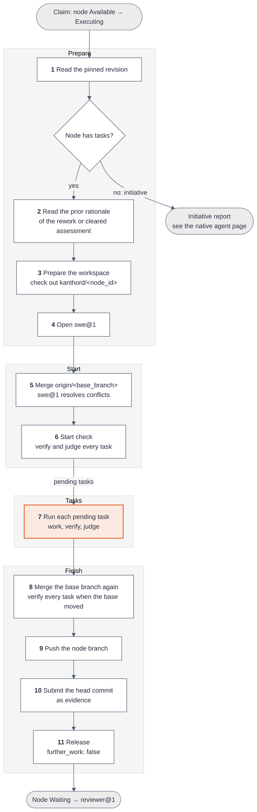
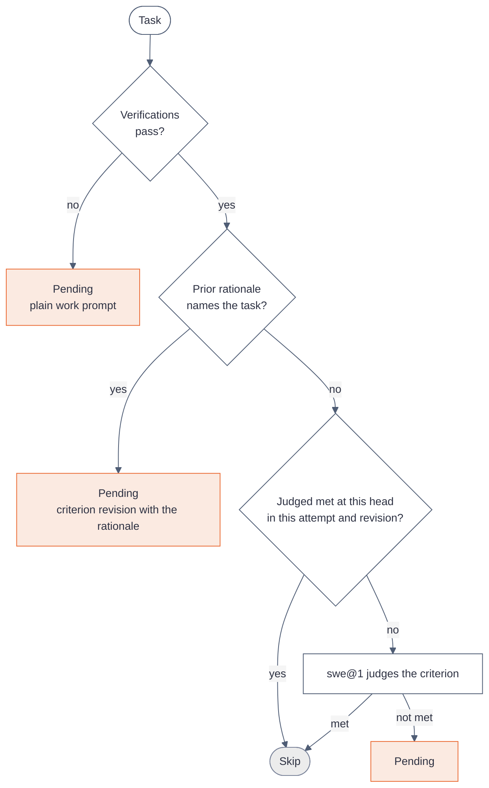
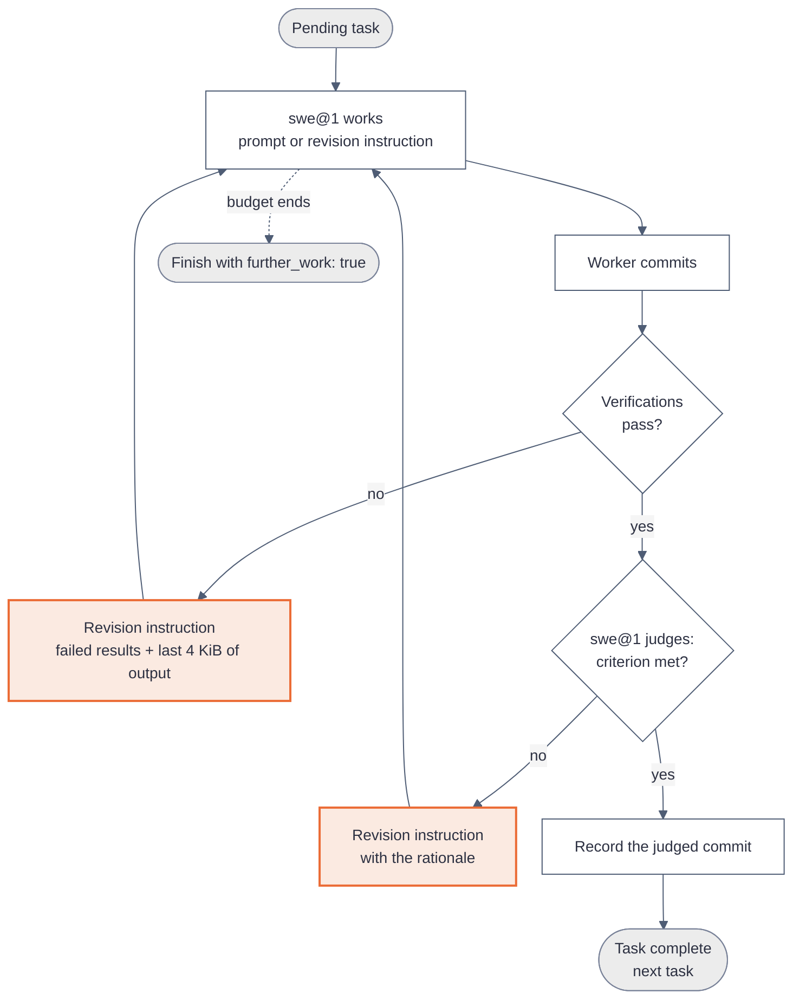
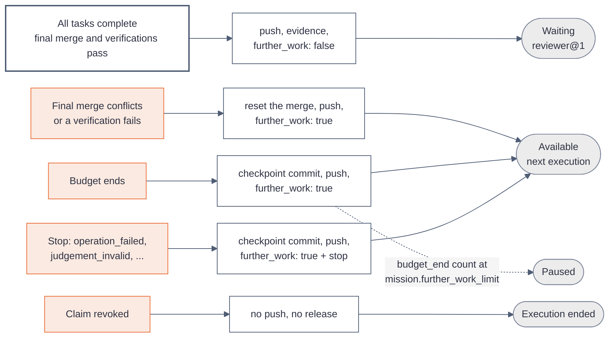

# How the coder@1 worker works

[Explanations](README.md)

`coder@1` is the native worker that does the work of a node. It uses one agent of the [native agent](native-agent.md), `swe@1`. `swe@1` works on each task until its verifications pass and its criterion is met.

| Property        | Value                                                                                                                    |
| --------------- | ------------------------------------------------------------------------------------------------------------------------ |
| Method          | `steps`                                                                                                                  |
| Agent           | `swe@1`                                                                                                                  |
| Claims          | A node in state `Available`                                                                                              |
| Default budget  | 200 turns and 2 hours of wall time                                                                                       |
| Repository      | The repository binding of the objective, after [binding inheritance](../reference/mission/import.md#binding-inheritance) |
| After a success | The node moves to `Waiting`, and `reviewer@1` evaluates the whole node                                                   |

The native workers are `coder@1` and `reviewer@1`. `coder@1` does the work, and `reviewer@1` judges it.

## The execution in 11 steps

An execution of an objective has four phases and 11 steps. An initiative has no tasks, so `coder@1` writes a report instead.

## Step 6: the start check

The workspace and the node branch survive between attempts. The start check decides which tasks still need work, so a new execution does not redo finished work.

## Step 7: one task

`swe@1` works on one task until its verifications pass and its criterion is met. The worker, not the agent, commits, runs the verifications and decides when the task is complete.

`coder@1` holds no review of its own. The node review of `reviewer@1`, after the release, is the only review.

## How the execution ends

Every end pushes the node branch, except a revocation. The release decides the next node state.

A budget end carries the `budget_end` stop only when no task completed in that execution. A release without that stop resets the count toward `mission.further_work_limit`.

## Edge cases

| Case                                               | Behavior                                                                                    |
| -------------------------------------------------- | ------------------------------------------------------------------------------------------- |
| Conflict at the step 5 merge                       | `swe@1` resolves the files. A file that still holds a marker stops with `operation_failed`. |
| Conflict at the step 8 merge                       | The worker aborts the merge and releases with `further_work: true`.                         |
| A verification fails                               | `swe@1` gets the failed command, the results and the last 4 KiB of its output.              |
| A verification command runs longer than 10 minutes | The worker kills the command. The command counts as failed, and later commands do not run.  |
| A judgement reply has no valid marker line         | One repair turn. A second invalid reply stops with `judgement_invalid`.                     |
| A model call fails at the provider                 | The turn ends with the error, and the worker stops with `provider_failed` and its code.     |
| Two revisions in a row change no file              | The worker stops with `no_progress` and does not verify the unchanged head again.           |
| The node is paused during the execution            | The claim check after the next turn or before the next task ends the execution as revoked.  |
| A rework after a `criterion-not-met` assessment    | The start check gives the rationale to each task that it names.                             |
| The budget ends inside a task                      | The worker writes a checkpoint commit, pushes and releases. The next execution resumes.     |

## Limits

- **One review, at the node.** `coder@1` judges each task itself. Only `reviewer@1` reviews the work, and only after the release.
- **One repository.** An objective works on its one repository binding. Work in two repositories needs two objectives.
- **A stalled node pauses.** An execution that completes no task before its budget ends counts toward `mission.further_work_limit`. At the limit, the node moves to `Paused`.
