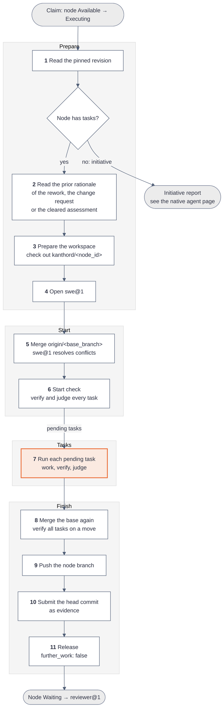

# How the coder@1 worker works

[Explanations](README.md)

`coder@1` is the native worker that does the work of a node. It uses one agent of the [native agent](native-agent.md), `swe@1`. `swe@1` works on each task until its verifications pass and its criterion is met.

| Property        | Value                                                                                                                    |
| --------------- | ------------------------------------------------------------------------------------------------------------------------ |
| Method          | `steps`                                                                                                                  |
| Agent           | `swe@1`                                                                                                                  |
| Claims          | A node in state `Available`                                                                                              |
| Default budget  | 200 turns and 2 hours of wall time                                                                                       |
| Repository      | The repository binding of the objective, after [binding inheritance](../reference/mission/import.md#binding-inheritance) |
| After a success | The node moves to `Waiting`, and `reviewer@1` evaluates the whole node                                                   |

The native workers are `coder@1` and `reviewer@1`. `coder@1` does the work, and `reviewer@1` judges it.

## The execution in 11 steps

An execution of an objective has four phases and 11 steps. An initiative has no tasks, so `coder@1` writes a report instead.



## How coder@1 drives pi

`swe@1` runs on the pi SDK, `@earendil-works/pi-coding-agent` 1.0.3. The [native agent](native-agent.md) page explains the configuration, the prompt layers and the tool set. This section shows which pi calls `coder@1` makes and what it reads back.

| Need of the worker           | pi API                                                                    | What the worker does with it                                                                  |
| ---------------------------- | ------------------------------------------------------------------------- | --------------------------------------------------------------------------------------------- |
| A model with a credential    | `ModelRuntime.create`, then `runtime.getModel`                            | Step 4. The runtime reads the secret from the custody handover. It makes no network call.     |
| A session in the workspace   | `createAgentSession` with `SessionManager.inMemory`                       | Step 4. The session lives in memory. A new execution opens a new session.                     |
| The task in every model call | The `context` hook and a guard on `agent.streamFunction`                  | The worker pins the work prompt of the current task, so that a compaction does not remove it. |
| A turn of work               | `session.prompt(text)`, then `session.waitForIdle()`                      | Steps 5 to 8. The worker sends the work prompt or an instruction and waits for the agent.     |
| The reply                    | `session.getLastAssistantText()`                                          | The worker parses the `kanthord-judgement:` line from the last reply.                         |
| A provider failure           | The last assistant message with `stopReason: "error"`                     | The worker maps `errorMessage` to a code and stops with `provider_failed`.                    |
| The turn budget              | `session.subscribe` for `turn_end`, and an override of `agent.finishTurn` | Each `turn_end` counts one turn. After each turn the worker checks the budget and the claim.  |
| A safe `bash`                | `createBashToolDefinition` with a `spawnHook` and a timeout               | The hook removes every provider key from the environment. The timeout is 10 minutes or less.  |
| Evidence from the agent      | A custom tool `evidence-upload`                                           | The tool uploads a workspace file and returns `evidence_id`, `asset_id` and `uri`.            |
| A stop                       | `session.abort()`                                                         | The worker aborts on a budget end, on a cancellation and before a checkpoint commit.          |
| The transcript               | `session.messages`                                                        | At the end, the worker writes the messages to `<state>/transcripts/<execution_id>.jsonl`.     |

The worker does not use `steer` or `followUp`. Each instruction is a new `prompt` call after the agent is idle.

One task, from the side of the worker, has this shape:

```ts
await session.prompt(workPrompt, { expandPromptTemplates: false });
await session.waitForIdle();
failOnProviderError(session.messages);

const head = await commitWork(workspace, task, attempt);
const verification = await runVerifications(workspace, task.verifications);
if (!verificationPassed(verification)) {
  await session.prompt(taskRevisionInstruction(verification, outputTail));
  await session.waitForIdle();
}

await session.prompt(taskJudgementInstruction(task));
await session.waitForIdle();
const judgement = parseJudgement(session.getLastAssistantText());
```

The code sketch leaves out the loop, the budget checks and the claim checks. Step 7 below shows the full loop.

## Step 6: the start check

The workspace and the node branch survive between attempts. The start check decides which tasks still need work, so a new execution does not redo finished work.


## Step 7: one task

`swe@1` works on one task until its verifications pass and its criterion is met. The worker, not the agent, commits, runs the verifications and decides when the task is complete.


`coder@1` holds no review of its own. The node review of `reviewer@1`, after the release, is the only review.

## Example: a run with no problem

The objective `node_01JZ8Q0K4M6N8P0R2S4T6V8W0X` adds a health endpoint. Its base branch is `main`, and it has two tasks:

| Task                                | Criterion                                      | Verifications                    |
| ----------------------------------- | ---------------------------------------------- | -------------------------------- |
| `node_01JZ8Q1A…` Add `GET /healthz` | The route answers 200 with `{"status":"ok"}`   | `npm test -- healthz`            |
| `node_01JZ8Q1B…` Document the route | `docs/api.md` describes the route and its body | `grep -q '/healthz' docs/api.md` |

1. The worker claims the node. The claim gives `execution_01JZ8R2B…` and attempt 1.
2. Steps 1 to 4 read the revision, find no prior rationale, check out `kanthord/node_01JZ8Q0K…` and open `swe@1`.
3. Step 5 merges `origin/main` with no conflict. Step 6 runs `npm test -- healthz`, which fails, so the first task is pending. The second task also fails its verification and is pending.
4. Step 7 sends the work prompt of the first task:

   ```text
   # Add GET /healthz

   ## Requirement

   Add a route GET /healthz to the HTTP server.

   ## Criterion

   The route answers 200 with {"status":"ok"}

   ## Verifications

   1. npm test -- healthz
   ```

5. `swe@1` edits `src/server.ts`, adds a test and ends its turns. The worker commits `kanthord: task node_01JZ8Q1A… attempt 1`. `npm test -- healthz` exits with code 0.
6. The worker sends the judgement instruction. The last line of the reply is:

   ```text
   kanthord-judgement: {"criterion_met": true, "rationale": "src/server.ts answers GET /healthz with 200 and {\"status\":\"ok\"}, and test/healthz.test.ts checks both."}
   ```

7. The worker records the judged commit in `judged-tasks.json` and moves to the second task. The second task follows the same path.
8. Step 8 fetches `origin/main`. The base did not move, so the worker runs no verification again.
9. Steps 9 and 10 push the node branch and submit the head commit as evidence:

   ```json
   {
     "execution_id": "execution_01JZ8R2B…",
     "attempt": 1,
     "node_revision": 3,
     "subject": "Head commit of the node branch",
     "assets": [
       {
         "kind": "repository",
         "address": {
           "kind": "repository",
           "binding_id": "binding_01JZ…",
           "commit": "9f2c4e1…"
         }
       }
     ]
   }
   ```

10. Step 11 releases with `{ "further_work": false, "stop": null }`. The node moves to `Waiting`, and `reviewer@1` claims it.

## How the execution ends

Every end pushes the node branch, except a revocation. The release decides the next node state.


A budget end carries the `budget_end` stop only when no task completed in that execution. A release without that stop resets the count toward `mission.further_work_limit`.

## Edge cases

| Case                                               | Behavior                                                                                    |
| -------------------------------------------------- | ------------------------------------------------------------------------------------------- |
| Conflict at the step 5 merge                       | `swe@1` resolves the files. A file that still holds a marker stops with `operation_failed`. |
| Conflict at the step 8 merge                       | The worker aborts the merge and releases with `further_work: true`.                         |
| A verification fails                               | `swe@1` gets the failed command, the results and the last 4 KiB of its output.              |
| A verification command runs longer than 10 minutes | The worker kills the command. The command counts as failed, and later commands do not run.  |
| A judgement reply has no valid marker line         | One repair turn. A second invalid reply stops with `judgement_invalid`.                     |
| A model call fails at the provider                 | The turn ends with the error, and the worker stops with `provider_failed` and its code.     |
| Two revisions in a row change no file              | The worker stops with `no_progress` and does not verify the unchanged head again.           |
| The node branch is gone after a recorded push      | The worker stops with `operation_failed` and `repository.node_branch.missing`.              |
| The node is paused during the execution            | The claim check after the next turn or before the next task ends the execution as revoked.  |
| A rework after a `criterion-not-met` assessment    | The start check gives the rationale to each task that it names.                             |
| An unblock after a change request on the PR        | The start check judges each task against the requested changes of the reviewers.            |
| The budget ends inside a task                      | The worker writes a checkpoint commit, pushes and releases. The next execution resumes.     |

## Examples of the edge cases

Each example starts from the run above and changes one fact.

### A verification fails

`npm test -- healthz` exits with code 1 after the first turn. The worker sends this revision instruction:

````text
Revise the task work to satisfy its criterion and verifications. Verification 1 `npm test -- healthz` failed with exit code 1.
Verification results: [{"command":"npm test -- healthz","exit_code":1,"signal":null,"timed_out":false}]

Output of the last verification that ran (the last 4 KiB):

```text
FAIL test/healthz.test.ts
  expected 200, received 404
```
````

`swe@1` fixes the route. The worker commits, verifies again and continues with the judgement.

### The criterion is not met

The verifications pass, but the reply ends with:

```text
kanthord-judgement: {"criterion_met": false, "rationale": "The route answers 200, but the body is the text ok, not {\"status\":\"ok\"}."}
```

The worker sends `Revise the task work to meet its criterion. Previous judgement: The route answers 200, but …`. The loop goes back to work.

### The judgement has no marker line

The reply ends with `The criterion is met.` and no `kanthord-judgement:` line. The worker sends one repair turn: `The reply holds no valid kanthord-judgement: line. Reply again with exactly one such line.` A second reply with no valid line stops the execution:

```json
{
  "further_work": true,
  "stop": { "reason": "judgement_invalid", "code": null }
}
```

### The budget ends inside a task

The 200th turn ends while `swe@1` works on the second task. The first task is complete. The worker aborts the session, commits `kanthord: checkpoint of task node_01JZ8Q1B… attempt 1`, pushes and releases:

```json
{ "further_work": true, "stop": null }
```

The stop is `null` because one task completed in this execution. The node moves to `Available`. The next execution skips the first task at the start check, because it was judged met at the same head, attempt and revision.

When no task completes before the budget ends, the release carries the stop, and the count toward `mission.further_work_limit` grows:

```json
{ "further_work": true, "stop": { "reason": "budget_end", "code": "turns" } }
```

### Two revisions change no file

`npm test -- healthz` fails. `swe@1` answers two revision instructions in a row and changes no file. The worker stops and does not verify the same head again:

```json
{ "further_work": true, "stop": { "reason": "no_progress", "code": null } }
```

### The provider refuses a call

The provider answers 429 to a model call. The turn ends with `stopReason: "error"`. The worker writes a checkpoint commit, pushes and releases:

```json
{
  "further_work": true,
  "stop": { "reason": "provider_failed", "code": "rate_limited" }
}
```

After `mission.consecutive_failure_limit` stops in a row, the node moves to `Paused`.

### The base moves during the run

At step 8, `origin/main` holds a new commit. The merge has no conflict, so the worker runs the verifications of every task again. When all pass, the worker pushes the merge commit. When one fails, the worker resets the node branch to the head before the merge, pushes and releases with `{ "further_work": true, "stop": null }`.

### A human pauses the node

The human pauses the node during the work on the first task. After the next turn, the claim check reads a claim that is not `running`. The worker ends the execution as revoked. It does not push and does not release, because the claim is no longer its own.

## What coder@1 reports

`coder@1` reports on the two channels of the [worker contract](worker-contract.md). On the state channel, it checks its claim, submits the head commit as evidence and releases. On the telemetry channel, it writes a `worker.phase` span for each phase, a `worker.task` span for each task, and `worker.verification`, `worker.judgement`, `agent.turn` and `agent.tool` spans below each task. An external harness writes the same `agent.turn` and `agent.tool` spans.

## Limits

- **One review, at the node.** `coder@1` judges each task itself. Only `reviewer@1` reviews the work, and only after the release.
- **One repository.** An objective works on its one repository binding. Work in two repositories needs two objectives.
- **A stalled node pauses.** An execution that completes no task before its budget ends counts toward `mission.further_work_limit`. At the limit, the node moves to `Paused`.
