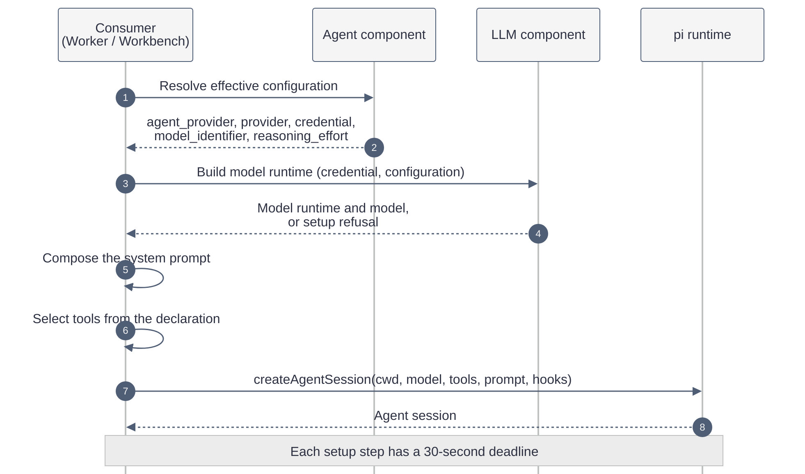

# How the native agent works

[Explanations](README.md)

A native agent is an LLM agent that KanthorD runs inside its own process. A worker drives it: the worker sends it a task, and the agent edits files with its tools. `reviewer@1` and an `examine` execution read the last reply of the agent. An external harness, for example `claude-code@1`, runs a third-party agent program instead.

Read [How a worker works](worker.md) first. That page explains where the agent sits in an execution. This page explains how KanthorD builds the agent, what the agent can see and do, and where its limits are.

KanthorD does not implement the agent loop itself. It embeds [pi](https://www.npmjs.com/package/@earendil-works/pi-coding-agent) (`@earendil-works/pi-coding-agent` 1.1.0) as the runtime. pi supplies the loop, the built-in tools, the session file and the resume. KanthorD supplies the configuration, the credentials, the prompt, the tool set and the budget. KanthorD builds only what pi does not serve.

## In short

- Two agents exist: `swe@1` writes code, and `re@1` reviews code with read-only tools.
- A human picks the provider, the model and the reasoning effort of each agent. The agent itself holds none of these values.
- When a provider is busy, the next execution uses the next model of a fallback chain.
- A human controls two prompts: the Agent prompt, which is a set of files, and the Binding prompt of each repository binding. KanthorD composes both into the system prompt, and the task comes last.
- The tool set, not the prompt, limits what an agent can do. A tool outside the set does not exist for the agent.
- In a worker execution, the agent has a budget of 200 model turns and 2 hours. pi persists its conversation to a session file, and the Tracking Service holds its entries.

## The two agents

The agent catalog is static and holds two declarations. An agent name names a role, not a worker.

| Agent   | Role              | Built-in tools                                        | Host tools        | Used by                            |
| ------- | ----------------- | ----------------------------------------------------- | ----------------- | ---------------------------------- |
| `swe@1` | Software engineer | `read`, `edit`, `write`, `grep`, `find`, `ls`, `bash` | `evidence-upload` | Worker `coder@1`, the Workbench    |
| `re@1`  | Reviewer          | `read`, `grep`, `find`, `ls`                          | none              | Worker `reviewer@1`, the Workbench |

`re@1` has no tool that writes a file or runs a command. Its prompt also forbids a change to the repository. The tool set enforces that rule; the prompt only states it.

Each declaration holds a shipped agent prompt and its tool set. A declaration holds no provider, no model and no reasoning effort. A human selects those values.

## Two consumers

The Agent component belongs to no service. A consumer opens an agent session for its own purpose, under its own authority:

- **Worker execution.** A Worker execution of `coder@1` or `reviewer@1` opens a session to do or to judge the work of one node. No human is present during the run.
- **Workbench session.** A human opens a session from the dashboard and talks to the agent. The agent can call KanthorD operations for the human.

Both consumers use the same open path. They differ in these points:

| Point                | Worker execution                                                         | Workbench session                                    |
| -------------------- | ------------------------------------------------------------------------ | ---------------------------------------------------- |
| Working directory    | The workspace of the execution                                           | `~/.local/state/kanthord/workbench/<agent_name>`     |
| Last pinned message  | The work prompt of the task or the node                                  | None                                                 |
| Extra tools          | `evidence-upload` for `swe@1`                                            | KanthorD operation tools                             |
| Approval of a change | None, because no human is present                                        | The human approves each operation that changes state |
| Budget               | 200 model turns and 2 hours                                              | None                                                 |
| Conversation storage | A pi session file of the execution, and the session entries of its trace | A pi session file that survives a restart            |

## Configuration: which model answers

An agent is usable only when a human enables it. The **agent enablement** is global to the server and keyed by agent name. It holds:

- One or more **agent providers**. Each one pairs a provider platform, for example `anthropic` or `openai-compatible`, with one credential.
- One **default configuration**: an agent provider, a model identifier and a reasoning effort.
- A **fallback list**: up to 7 more configurations, tried in order when a provider is busy. An empty list means no fallback.

A consumer can supply an **entry** that overrides any of these fields. A Worker execution takes the entry from its worker binding. A Workbench session takes the values that the human picked. The Agent component merges the entry over the default and validates the whole result:

- The agent provider exists in the enablement.
- Custody accepts the credential for the platform.
- The model belongs to the built-in model list of the platform. For `openai-compatible`, the model belongs to the approved models of the credential.
- The reasoning effort is one of the levels that the model supports.

The result is the **effective configuration**. The same check runs at enablement write, at worker binding write and at resolution. A configuration that passes once can therefore fail later only when a human changes the enablement or the credential. An enablement change that breaks a worker binding is refused, so that case does not occur in practice. Disablement is the only stop switch: it refuses every later resolution.

### The fallback chain

The effective configuration is the head of a **fallback chain**. The fallback list is its tail. A worker binding entry that names its own fallback list replaces the list of the enablement whole; the two lists never merge.

1. At each claim, the Scheduler picks the first chain entry whose credential has no live cooldown. The execution record pins the chain position and the enablement revision of that entry, and the execution uses that selection until it ends.
2. A worker execution that stops with `provider_failed` and the code `rate_limited`, `quota_exhausted` or `unavailable` puts the credential of its selection into a **cooldown**. The cooldown covers every model of that credential.
3. The next claim skips every entry of a cooling credential. When the cooldown ends, the next claim returns to the earlier entry.
4. A repeated failure on the same credential doubles the cooldown, up to one day. A release with no provider failure clears it, whatever model the execution used.
5. When the credential of every entry cools down, the work pull answers "no work". No node blocks or pauses.

A busy provider therefore does not count as a failure of the node. The codes `bad_request` and `unauthorized` do not advance the chain: they point to a broken configuration, and they count toward the failure limit of the node. The **Cooldown** section of the LLM credential page in the dashboard shows the cooldown of that credential: its strike and its end time. The **Details** tab of an `Available` node names each agent of the project whose every chain credential cools down, with the end time. `kanthord agent cooldown list` shows the cooldowns, and `kanthord agent cooldown clear <credential>` clears one. The design adds a cooldown badge and a Clear action to the agent page. Until then, use the CLI to clear a cooldown.

## From configuration to a running session



For a Worker execution, the server resolves the configuration at the claim. The worker process receives the credentials through the credential handover, and the configuration and the composed prompt through its execution setup.

### Model runtime

The LLM component turns the effective configuration into a pi `ModelRuntime` and one model:

- The runtime reads secrets through a credential store that custody hands over for this one session. The agent never sees the secret as a value.
- The runtime makes no network call to refresh model lists (`allowModelNetwork: false`). The model must already be known.
- For `openai-compatible`, KanthorD registers a provider from the credential metadata: its base URL, its models and the reasoning levels of each model. These models use the OpenAI Responses API and report zero cost.
- Some platforms need extra values, for example `AWS_REGION` for Amazon Bedrock. KanthorD takes these values from the credential metadata, not from the server environment.

The runtime refuses the setup when the credential does not match the configuration or when the model or the effort is unknown. The refusal reasons are `credential_absent`, `credential_revision_mismatch`, `model_unknown` and `reasoning_effort_unsupported`.

### Isolation from the host pi installation

The host can have its own pi installation with extensions, skills and settings. The native agent ignores all of them:

- pi runs with its own agent directory, through `PI_CODING_AGENT_DIR`. On the server, the directory is `~/.local/state/kanthord/pi`. A worker instance at the `worker` placement uses `pi/` of its data directory, `$XDG_DATA_HOME/kanthord/workers/<name>/pi/`, by default `~/.local/share/kanthord/workers/<name>/pi/`.
- pi runs offline (`PI_OFFLINE=1`), with telemetry and analytics off.
- The session loads no extension, no skill, no prompt template, no theme and no context file. KanthorD supplies the system prompt and its own hooks only.
- The system prompt shows the working directory relative to the home directory, for example `~/work/repo`, not the absolute path.

## The prompt

### What the model reads

Start with the result. A worker execution of `swe@1` on a node with one repository binding sends the model this sequence of messages:

```text
[system]
…the text of base.md…

…the text of swe@1.md…

Instructions of repository app:

…the binding prompt of swe@1 for the binding app…

…the framing…

[user]
…the task…
```

The system prompt holds the Standard, the role of the agent, the binding prompts and a fixed paragraph, the **framing**. The framing states the precedence and the protocol of the worker. The task comes last, as a message.

The same order, as a table:

| #   | Part           | Worker execution                                                    | Workbench session          |
| --- | -------------- | ------------------------------------------------------------------- | -------------------------- |
| 1   | System prompt  | `base.md`                                                           | `base.md`                  |
| 2   | System prompt  | `<agent>.md`                                                        | `<agent>.md`               |
| 3   | System prompt  | None                                                                | `workbench.md`             |
| 4   | System prompt  | One part for each repository binding with a nonblank binding prompt | None                       |
| 5   | System prompt  | `framing-worker.md`                                                 | `framing-workbench.md`     |
| 6   | Pinned message | Work prompt                                                         | None                       |
| 7   | Conversation   | Later instructions and replies                                      | Human messages and replies |

The **work prompt** is the task message of a Worker execution: the name, the requirement, the criterion and the verification commands of one pinned node revision. The model receives it once, at row 6. Row 7 holds what comes after it: the revision instructions, the judgement instructions of `reviewer@1` and the replies of the agent.

The agent `env@1` repairs a failed environment of a repository binding on the server. Its system prompt holds `base.md`, `env@1.md`, the binding prompt of its own binding and the worker framing. Its first message holds the failure. It has no Workbench session.

### The two prompts that a human controls

A human controls the prompt of a native agent through two prompts. The framing and the templates of the framing belong to the KanthorD protocol, not to a prompt of a human.

| Prompt         | Purpose                                                          | Owner                                 | Source                                                                                               |
| -------------- | ---------------------------------------------------------------- | ------------------------------------- | ---------------------------------------------------------------------------------------------------- |
| Agent prompt   | The Standard, the role of the agent and the Workbench behavior   | The server host                       | The files `base.md`, `<agent_name>.md` and `workbench.md`                                            |
| Binding prompt | The language and the conventions of one repository for one agent | The repository binding of the project | The field `prompts` of the repository binding, with one text for each of `swe@1`, `re@1` and `env@1` |

**Agent prompt.** Each file has a shipped text that is embedded in the binary. An upgrade replaces it together with the code that depends on it.

- `base.md` is the Standard. Every agent reads it. It holds only the rules that every agent shares, so it holds no code rule.
- The code, test and finding rules stand in both `swe@1.md` and `re@1.md`, in the same words, because `re@1` judges the work of `swe@1`.
- `<agent_name>.md` is the Role, for example `swe@1.md`.
- `workbench.md` is the Workbench behavior. Only a Workbench session reads it, and it is part of the system prompt.

A file of the same name in the directory `agent.prompt.agent_directory` replaces the shipped text of that file whole. The default directory is `agents` in the data directory of the server host, and an empty value selects the shipped texts only. The subdirectory `prompts` of the agent directory holds replacements of the shipped prompt templates, for example `prompts/framing-worker.md`. The worker process reads no prompt file. The server reads the files and sends the composed text.

**Binding prompt.** A human sets `prompts` in the configuration of a repository binding, for example `{ "swe@1": "Write comments in English." }`. Each key is the name of an agent of the catalog, and each text is optional. A text renders as `Instructions of repository <name>:` and the text. A missing key, an empty text and a blank text add nothing.

- `swe@1` and `re@1` read the binding prompts of every repository binding of the node, at the binding revision that the node pins.
- `env@1` reads the binding prompt of the binding of its environment run.

The binding prompt of one agent is an independent text. `re@1` does not read the prompt of `swe@1`. A rule that relaxes the default standard must go into the prompts of both `swe@1` and `re@1`, or the reviewer judges the work against the default standard that the rule relaxes.

KanthorD reads no `CLAUDE.md`, `AGENTS.md` or `*.local.md` file, neither in a repository nor in a home directory. A native agent takes its conventions from the two prompts only. `claude-code@1` receives no KanthorD text. Claude Code loads its own `CLAUDE.md` files as behavior of its harness, not as KanthorD support.

### Precedence

Two rules decide which text wins a conflict:

1. The system prompt outranks every message after it.
2. A later text wins over an earlier text, inside the system prompt and among the messages.

The precedence inside the system prompt, from highest to lowest, is: the framing, the binding prompts, `workbench.md`, the role and the Standard. Then come the messages: a later message governs an earlier one.

An instruction of one repository governs only the work on the files of that repository. It never governs the reply format that a message demands. The reason is that a binding prompt belongs to a repository, and a message belongs to the consumer that drives the agent.

No prompt authorizes an operation: the tool set and the authority of the consumer decide what the agent can do.

### Where the prompt is composed

The server composes the whole system prompt for every consumer:

- A Worker execution receives it as `prompt.final` in its execution setup. The worker application reads no prompt file. It pins only the work prompt.
- A Workbench session and an `env@1` run take it from the server process.

An invalid file is a refusal, not a fallback. A file in the agent directory that is not a regular UTF-8 file, that is larger than 32 KiB, or that holds a control character other than a tab and a newline answers `409 agent.prompt.template_invalid`, and `details.file` names the file. Every reader refuses in this way: `agent.get`, the execution setup, the Workbench session open and the `env@1` run. A reader never replaces the invalid file with the shipped text, because that would run an agent with other rules than the rules that the operator wrote. The same limits apply to a binding prompt, and a violation answers `400 project.bindings.repository.prompt_invalid` at the binding write.

### Why the work prompt is pinned

The work prompt is **pinned**. Before each model call, a pi `context` hook inserts it as a message directly after the system prompt. A second guard on the stream function re-inserts the system prompt and the work prompt when a request lacks them.

Pinning has two effects. A pinned text survives when pi compacts a long conversation, because KanthorD inserts it again on each call. The work prompt can also change between tasks without a new session: each `prompt` or `instruct` call sets the current work, and the next model call carries it.

### What a change of a prompt does

- **A change of an agent file** takes effect at the next read of the server. A running execution keeps the system prompt of its setup.
- **A change of a binding prompt** is a change of the binding configuration. It stores the next binding revision. A node keeps the text of the binding revision that it pins. Run `mission node rebind` to move the node to the current revision.
- **Environment onboarding** treats the new binding ID of the revision as a changed binding. It clears `environment_from_agent`, the mark that a stored environment came from a session of `env@1`.
- **Both agents** can need the same change. The binding prompts of `swe@1` and `re@1` diverge by design, so a human edits both.
- **A deploy** upgrades the server and every worker host together, because they run the same execution setup contract.

### Reading the composed prompt

`agent.get` answers every part of the system prompt, plus the final prompt:

- Each part holds `part` (`standard`, `role`, `workbench` or `binding`), `name`, `origin` (`binary`, `file` or `database`), `path`, `digest` and `text`.
- For `binary`, `path` is the override location that the server looked up. For a `binding` part, `path` is `null`.
- The query `view=final` answers the final prompt only.
- The queries `project_id` and `binding_id` add the binding prompt of one repository binding. Without them, a Workbench agent answers the Workbench system prompt, and `env@1` answers the worker system prompt.
- The CLI reads it with `kanthord agent get swe@1`, adds `--view final` for the final prompt only, or `--project <project-id> --binding-id <binding-id>` for a binding.

## Tools

The agent receives only the tools of its declaration. A tool outside the allowlist does not exist for the agent.

- **Built-in tools** are the pi tools `read`, `edit`, `write`, `grep`, `find`, `ls` and `bash`. They act on the working directory. `grep` and `find` run `rg` and `fd`. The worker and the server install pinned copies into `bin/` of the pi agent directory at startup and never take them from `PATH`.
- **`bash`** runs commands on the host, as the user of the KanthorD process. KanthorD removes every provider API key, `SSH_AUTH_SOCK` and `SSH_AGENT_PID` from the environment of each command, so a command cannot read the credentials of the agent or reach an SSH agent of the host user. During a network git operation of KanthorD on the same host, a command can still sign through the SSH agent socket of that operation, because it runs as the same user. In a Worker execution, the timeout of each command is capped at the remaining budget and at 10 minutes.
- **`evidence-upload`** (`swe@1` in a Worker execution) uploads a workspace file as evidence of the attempt and returns its `evidence_id`, `asset_id` and `uri`.
- **Operation tools** (Workbench only) expose KanthorD operations. Each call runs with the identity of the human who sent the last message. The [operation tool reference](../reference/workbench/tools.md) lists every tool.

An operation becomes a tool when it meets all of these conditions:

- Its access is `human`. A worker or machine operation is never a tool.
- It is not a stream.
- It handles no secret.

The tool name is the operation id with each `.` replaced by `--`, for example `mission--node--create`.

The agent cannot call these 13 human operations. Twelve of them handle a secret. `repository.host_key.pin` confirms the trust of an SSH host, and only a human confirms a host key.

- `llm.credential.create`, `llm.credential.rotate`, `llm.credential.check`, `llm.credential.login_code`
- `repository.credential.create`, `repository.credential.rotate`, `repository.credential.check`, `repository.credential.ssh_key_create`, `repository.credential.ssh_key_rotate`, `repository.host_key.pin`
- `storage.credential.create`, `storage.credential.rotate`, `storage.credential.check`

The agent therefore cannot create a credential, change a secret, pin a host key, or finish an OAuth login. A human does that in the dashboard or the CLI.

A Workbench operation tool that changes state waits for the human. The dashboard shows the pending call, and the human approves or rejects it. A rejection, an abort or the end of the run counts as a rejection. A read operation and a built-in tool run without approval. A Worker execution has no approval step, because no human is present.

## A session inside a Worker execution

A Worker execution opens one session per claim, in a workspace that the worker prepares. The worker method then drives the session with two calls:

- `prompt(work)` sends the work prompt as the user message.
- `instruct(work, text)` pins the work prompt and sends another instruction, for example a revision request.

The worker, not the agent, decides when the work is done. Only `reviewer@1` asks its agent for a decision: a judgement of a criterion. That instruction asks for one last line that starts with `kanthord-judgement:` and holds JSON. A reply that does not parse gets one repair turn. A second invalid reply ends the execution with `judgement_invalid`. `coder@1` reads no reply of `swe@1` in an `implement` execution, and reads the last reply of an `examine` execution as the report.

Each method uses the session in its own way:

- **Steps** (`coder@1` with `swe@1`). The agent works on each unit of the node. After each turn, the worker commits the change and verifies the unit itself. [How the coder@1 worker works](coder-worker.md#step-7-the-unit-loop) shows the loop.
- **Evaluation** (`reviewer@1` with `re@1`). The worker runs the verification commands first. A failure ends the evaluation without the agent. On success, the agent receives the evidence and returns a JSON judgement.
- **Examine** (`coder@1` with `swe@1`). The agent checks out the base-branch head of each repository binding of the node. It runs tools and the verifications, and reads the outcome and the evidence of each direct dependency. It writes its findings as produced evidence.

### Budget

Each native worker has a resource budget of 200 model turns and 2 hours of wall time. A worker binding can override both values. One model turn is one reply of the model with the tool calls of that reply. The wall time counts from the claim, and the wall deadline is also capped by the expiry of the claim. When the budget ends:

- pi stops after the current turn, and KanthorD aborts the session.
- Each later `bash` command is refused.
- The worker method stops and releases or ends the execution.

A cancellation of the execution, for example a revoked claim or a server shutdown, also aborts the session.

## A session inside the Workbench

A Workbench session is a conversation between one human and one agent, stored as a pi JSONL session file:

- The working directory is `~/.local/state/kanthord/workbench/<agent_name>`.
- The session files live under `~/.local/state/kanthord/pi/sessions/workbench/<agent_name>`.
- The session identity that KanthorD assigns is also the pi session id.

KanthorD keeps no copy of the conversation. The session list, the history and the resume all come from pi. When the server restarts, KanthorD reopens the file by its session id; every completed turn is restored, and a turn that was running at the restart is lost. The session also answers a `pi --session <file>` command, so a human can continue the same conversation in a terminal.

The human can change the agent provider, the model and the reasoning effort between runs. KanthorD writes each change into the session file as a pi entry, so the file records which model answered which turn.

## Limitations

- **No resume of a conversation.** A Worker execution persists its pi session to a file, but it never opens that file again. When the worker process ends, a resumed execution starts a new session.
- **Transcript in the Tracking Service.** pi persists each session entry to `pi/sessions/execution/<execution_id>/` of the data directory of the instance, and the instance keeps the newest 50 directories. The worker sends each entry to the Tracking Service when pi appends it, with the secrets of the LLM credential of the agent removed. The spans `agent.turn` and `agent.tool` reference the entries and embed no content.
- **No sandbox.** `bash` and the file tools run on the host with the rights of the KanthorD process. The tool set of `re@1` limits what the reviewer can do. The working directory of `swe@1` is only its default location, not a boundary.
- **No approval in a Worker execution.** Only the Workbench asks a human before a call that changes state.
- **Static catalog.** A new agent or a change of a tool set requires a new KanthorD release. A prompt change does not: a file in the agent directory and a binding prompt override the shipped text.
