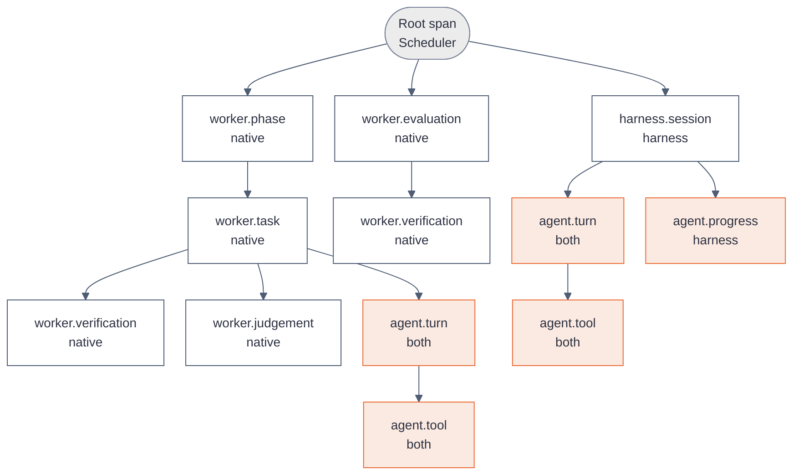

# What a worker reports to KanthorD

[Explanations](README.md)

A worker reports to KanthorD on two channels. The state channel changes the state of a node. The telemetry channel records what the worker did, and it changes nothing. A native worker, for example `coder@1`, and an external harness, for example `claude-code@1`, use the same two channels with the same record shapes.

| Channel   | Owner                 | What it carries                                     | Effect                              |
| --------- | --------------------- | --------------------------------------------------- | ----------------------------------- |
| State     | Scheduler and Mission | Claim, claim check, evidence, release               | Decides the next state of the node  |
| Telemetry | Tracking              | Spans of phases, tasks, turns, tool calls, progress | None. No service reads it to decide |

The telemetry channel follows [ERD 4: Telemetry](../reference/erd/04-tracking.md). The native path is implemented: the Scheduler writes the root span, and a native worker writes its spans with `tracking.telemetry.write`. The external harness path is a design.

## The state channel

Every worker calls the same operations, except the two rows marked native only. A native worker calls them through the worker application. An external harness calls them through the CLI with its machine token.

| Moment                                                      | Operation                     | Reference                                                                           |
| ----------------------------------------------------------- | ----------------------------- | ----------------------------------------------------------------------------------- |
| Start of the instance                                       | `worker.register`             | [register](../reference/worker/register.md)                                         |
| Every 60 seconds                                            | `worker.heartbeat`            | [heartbeat](../reference/worker/heartbeat.md)                                       |
| Wait for work                                               | `scheduler.work.pull`         | [work](../reference/scheduler/work.md)                                              |
| After the claim, native only                                | `worker.handover`             | [handover](../reference/worker/handover.md)                                         |
| After the handover, native only                             | `worker.execution.setup.get`  | No CLI leaf. The worker application reads it.                                       |
| Before each step                                            | `scheduler.claim.get`         | [claim](../reference/scheduler/claim.md)                                            |
| A result to keep                                            | `mission.evidence.submit`     | [evidence](../reference/mission/evidence.md)                                        |
| A judgement of a reviewer                                   | `mission.assessment.submit`   | [assessment](../reference/mission/assessment.md)                                    |
| After a passing assessment that requires an external action | `worker.action.request`       | No CLI leaf. An external harness calls the action performer tool of the MCP server. |
| End of the execution                                        | `scheduler.execution.release` | [execution](../reference/scheduler/execution.md)                                    |

The claim answers the execution record. Its `execution_id`, `trace_id` and `root_span_id` are the three values that the telemetry channel needs.

The release body holds `further_work` and an optional `stop`. A `stop` requires `further_work: true`.

| `stop.reason`                                                                                     | `stop.code`                                                                     |
| ------------------------------------------------------------------------------------------------- | ------------------------------------------------------------------------------- |
| `budget_end`                                                                                      | `turns` or `wall_time`                                                          |
| `provider_failed`                                                                                 | `rate_limited`, `quota_exhausted`, `unauthorized`, `bad_request`, `unavailable` |
| `no_progress`                                                                                     | `null`                                                                          |
| `operation_failed`, `judgement_invalid`, `report_absent`, `action_unsettled`, `assessment_absent` | Any text or `null`                                                              |

A native steps execution whose node branch is gone after a recorded push stops with `operation_failed` and the code `repository.node_branch.missing`.

An external harness releases before `expired_at` of its claim. The claim has no renewal.

## The telemetry channel

### The trace of an execution

The Scheduler opens the root span of an execution after the claim. Every span of the worker names that root span or a span below it as its parent. One execution is one trace.



### The span catalog

The span operation names are a closed set, defined as an enum in code. A span holds identities and measurements in its attributes. Prose, for example a command, an output or a reply, goes into a telemetry text that the span names in `text_ids`.

| Operation             | Producer | Parent                                                     | Attributes                                                                                                                                                                                                                                                                      | Texts                                                                 |
| --------------------- | -------- | ---------------------------------------------------------- | ------------------------------------------------------------------------------------------------------------------------------------------------------------------------------------------------------------------------------------------------------------------------------- | --------------------------------------------------------------------- |
| `worker.phase`        | Native   | Root                                                       | `kanthord.phase`: `prepare`, `start`, `tasks` or `finish`                                                                                                                                                                                                                       | None                                                                  |
| `worker.task`         | Native   | `worker.phase`                                             | `kanthord.task.id`, `kanthord.task.result`: `complete` or `budget_end`. A stop ends the span with the status `Error` and no result                                                                                                                                              | None                                                                  |
| `worker.verification` | Native   | `worker.task`, `worker.phase`, `worker.evaluation` or Root | One span per command. `kanthord.commit`, `kanthord.verification.index`, `kanthord.verification.run`, `process.exit.code`, `kanthord.verification.signal`, `kanthord.verification.timed_out`                                                                                     | `command`, `output`: the last 4 KiB                                   |
| `worker.judgement`    | Native   | `worker.task` or `worker.phase`                            | `kanthord.task.id`, `kanthord.commit`, `kanthord.judgement.reply`: `parsed`, `invalid` or `budget_end`, `kanthord.judgement.criterion_met`                                                                                                                                      | `rationale`                                                           |
| `worker.evaluation`   | Native   | Root                                                       | `kanthord.commit`, `kanthord.evaluation.result`: the result of the judgement                                                                                                                                                                                                    | `rationale`                                                           |
| `harness.session`     | Harness  | Root                                                       | `gen_ai.request.model`, `kanthord.harness.session_id`                                                                                                                                                                                                                           | None                                                                  |
| `agent.turn`          | Both     | The enclosing worker span, Root, or `harness.session`      | `kanthord.agent.name`, `kanthord.turn.index`, `gen_ai.request.model`, `gen_ai.usage.input_tokens`, `gen_ai.usage.output_tokens`, `gen_ai.usage.cache_read_tokens`, `gen_ai.usage.cache_write_tokens`, `gen_ai.response.finish_reasons`, `error.type`: the provider failure code | `reply`: the last assistant text, `error`: the provider error message |
| `agent.tool`          | Both     | `agent.turn`                                               | `gen_ai.tool.name`, `gen_ai.tool.call.id`, `kanthord.tool.outcome`: `ok` or `error`, `kanthord.tool.duration_ms`                                                                                                                                                                | `input`, `output`                                                     |
| `agent.progress`      | Harness  | `harness.session`                                          | `kanthord.progress.total`, `kanthord.progress.completed`, `kanthord.progress.in_progress`                                                                                                                                                                                       | `items`: the todo list                                                |

Every span also holds `kanthord.execution.id`, `kanthord.node.id`, `kanthord.attempt` and `kanthord.worker.name`. The trace header holds the project. A span status is `Error` when its operation failed, and `Ok` otherwise. An `agent.turn` that ends with a provider error has the status `Error`.

`reviewer@1` writes `agent.turn` and `agent.tool` spans below `worker.evaluation`. The `reply` text of its last turn holds the whole review, also the parts that the assessment rationale leaves out.

A turn and a tool call have one shape for both producers. A dashboard therefore shows a native run and a harness run with the same view.

### Identities

A producer computes each identity from the execution and a local key. A retry therefore produces the same identity, and the Tracking Service stores the record once.

| Identity    | Rule                                                                                                                                                                                                           |
| ----------- | -------------------------------------------------------------------------------------------------------------------------------------------------------------------------------------------------------------- |
| `span_id`   | The first 16 hex characters of SHA-256 of `<execution_id>:<local key>`                                                                                                                                         |
| Local key   | `phase:<name>`, `<operation>:<n>` for a task, a verification, a judgement and an evaluation, `turn:<n>`, `tool:<turn span id>:<call id>`, `progress:<n>`, `session:<id>`. `<n>` counts from 1 in the execution |
| `record_id` | `<span_id>:start` or `<span_id>:end` for a span record, `<text_id>` for a text record                                                                                                                          |
| `text_id`   | `<span_id>:<text name>`, for example `<span_id>:output`. A text above 15000 characters splits into `:output.1`, `:output.2`, at most 8 parts                                                                   |

A start record holds `start_time`, the attributes that are known at the start, and the input texts. An end record holds `end_time`, the status, the other attributes and the output texts. No record sets a value that an earlier record set.

A producer writes the start record when the operation starts. It does not wait for the end. A span with a start and no end is an operation that still runs, so a reader sees a hung command and its start time.

## The native path

A native worker writes its records straight to the primary store of the Tracking Service. It holds no local store and runs no import. The producer is the worker.

| Source                    | Record                                                                                                                   |
| ------------------------- | ------------------------------------------------------------------------------------------------------------------------ |
| pi `turn_start`           | Start of `agent.turn`                                                                                                    |
| pi `turn_end`             | End of `agent.turn`. `message.usage` gives the tokens, `message.model` the model, `message.stopReason` the finish reason |
| pi `tool_execution_start` | Start of `agent.tool`. `toolCallId` is the call id, `args` is the `input` text                                           |
| pi `tool_execution_end`   | End of `agent.tool`. `isError` gives the outcome, `result` is the `output` text                                          |
| Worker method             | Start and end of `worker.phase`: `prepare`, `start`, `tasks`, `finish`                                                   |
| Worker task loop          | `worker.task`, `worker.verification`, `worker.judgement`                                                                 |
| `reviewer@1` evaluation   | `worker.evaluation`, and one `worker.verification` for each command and each rerun                                       |
| Provider failure          | `error.type` on the end of `agent.turn` takes the `provider_failed` code; `errorMessage` is the `error` text             |

The worker queues its records and sends a batch each second, or at once when 200 records wait. A batch holds at most 768 KiB. A write that has no answer is sent at most three times.

The execution proof ends with the claim. The worker therefore flushes its queue for at most 5 seconds before the release and before the assessment. A record that is still queued at the end of the execution is dropped, and the worker logs the count. A failed telemetry write never fails the execution.

## The external harness path

`claude-code@1` is the first external harness. KanthorD configures no agent, prompt or tool of the harness. KanthorD adds hooks that capture what Claude Code exposes.

### Launch

1. The harness instance pulls work with `kanthord scheduler work pull`.
2. It sets `KANTHORD_EXECUTION_ID`, `KANTHORD_TRACE_ID` and `KANTHORD_ROOT_SPAN_ID` from the execution record.
3. It runs `claude -p` with `--settings <file>`. The file declares the hooks below. A hook command inherits the three variables.
4. At the end, it submits evidence and releases with the CLI.

Each hook runs `kanthord tracking capture`. The command reads the hook JSON from standard input, maps it to records and appends them to `~/.local/state/kanthord/capture/<execution_id>.jsonl`. It makes no network call, so it fits the 1.5-second timeout of `SessionEnd`. The log has a bound. At the bound, the command discards the oldest records and counts them.

### Hook mapping

| Claude Code hook                                          | Record                                                                                                                                        |
| --------------------------------------------------------- | --------------------------------------------------------------------------------------------------------------------------------------------- |
| `SessionStart`                                            | Start of `harness.session`. `model` and `session_id` are attributes                                                                           |
| `UserPromptSubmit`                                        | Start of `agent.turn`                                                                                                                         |
| `PreToolUse`                                              | Start of `agent.tool`. `tool_use_id` is the call id, `tool_input` is the `input` text                                                         |
| `PostToolUse`                                             | End of `agent.tool` with outcome `ok`. `tool_response` is the `output` text, `duration_ms` is the duration                                    |
| `PostToolUseFailure`                                      | End of `agent.tool` with outcome `error`. `error` is the `output` text                                                                        |
| `PostToolUse` for `TaskCreate`, `TaskUpdate`, `TodoWrite` | One `agent.progress` span with the counts, and the list as the `items` text                                                                   |
| `Stop`                                                    | End of `agent.turn`. `last_assistant_message` is the `reply` text. The usage comes from `message.usage` of the transcript entries of the turn |
| `SessionEnd`                                              | End of `harness.session`                                                                                                                      |

No hook payload holds the token usage. The capture reads it from `transcript_path`. The transcript can lag the hook, so a turn can end with no usage attributes.

### Ingestion

A human starts each ingestion with `kanthord tracking telemetry ingest`. The ingestion sends the records of the local log in batches of at most 1,000 records and 1 MiB. It deletes a local record when the record holds a disposition, `Stored` or `Refused`. The Tracking Service derives the producer from the claimant of the execution, so the records carry no producer.

A revoked or ended claim still ingests its records, because the authority of an ingestion comes from the human.

## Example: one tool call from both producers

`swe@1` and Claude Code both run `npm test -- healthz` in execution `execution_01JZ8R2B…`.

The native worker receives this pi event:

```json
{
  "type": "tool_execution_end",
  "toolCallId": "call_7",
  "toolName": "bash",
  "result": { "content": [{ "type": "text", "text": "Tests: 1 passed" }] },
  "isError": false
}
```

The Claude Code hook receives this payload:

```json
{
  "hook_event_name": "PostToolUse",
  "session_id": "5f0c…",
  "tool_name": "Bash",
  "tool_input": { "command": "npm test -- healthz" },
  "tool_response": { "stdout": "Tests: 1 passed" },
  "tool_use_id": "toolu_01A…",
  "duration_ms": 4120
}
```

Both produce the same two records, with their own call id:

```json
[
  {
    "record_id": "3b9d0c1e5a7f2264:end",
    "trace_id": "4bf92f3577b34da6a3ce929d0e0e4736",
    "kind": "span",
    "span_id": "3b9d0c1e5a7f2264",
    "operation": "agent.tool",
    "parent_span_id": "a1c2e3f405162738",
    "end_time": 1791734520120,
    "status": "Ok",
    "attributes": {
      "gen_ai.tool.name": "bash",
      "gen_ai.tool.call.id": "toolu_01A…",
      "kanthord.tool.outcome": "ok",
      "kanthord.tool.duration_ms": 4120
    },
    "text_ids": ["3b9d0c1e5a7f2264:output"]
  },
  {
    "record_id": "3b9d0c1e5a7f2264:output",
    "trace_id": "4bf92f3577b34da6a3ce929d0e0e4736",
    "kind": "text",
    "text_id": "3b9d0c1e5a7f2264:output",
    "text": "Tests: 1 passed"
  }
]
```

## What the trace answers

The e2e runs of `coder@1` and `reviewer@1` raised these questions. Each one has an answer in the trace of the execution.

| Question during a run                                      | Where the answer is                                                                                                    |
| ---------------------------------------------------------- | ---------------------------------------------------------------------------------------------------------------------- |
| Does the agent make progress, or is it idle?               | The newest `agent.turn` and `agent.tool` spans and their start times                                                   |
| Which command hangs, and since when?                       | An `agent.tool` or `worker.verification` span with a start and no end. Its `input` or `command` text names the command |
| Why does each turn fail at once?                           | `agent.turn` spans with the status `Error`, their `error.type` and their `error` text                                  |
| Does the task loop verify the same commit again and again? | Consecutive `worker.verification` spans with the same `kanthord.commit` and a failed exit code                         |
| Why did a verification fail?                               | The `output` text of the `worker.verification` span                                                                    |
| Does a verification pass and then fail on the same commit? | `worker.verification` spans of one command and one commit, across runs and executions, with different exit codes       |
| How many tokens did a node use before the quota ended?     | The sum of `gen_ai.usage.*` over the `agent.turn` spans of the node                                                    |
| What did the reviewer write beyond the rationale?          | The `reply` text of the last `agent.turn` below `worker.evaluation`                                                    |

The answers are for a human. No service reads them to stop an execution or to move a node. The state channel does that: the claim check, the `no_progress` stop and the `provider_failed` stop.

## Limits

- **Telemetry decides nothing.** A missing span proves no failure, and a span completes no node. Only the state channel moves a node.
- **No live view of a harness.** A harness record reaches the server only at an ingestion that a human starts.
- **Best effort capture.** A harness that exposes less produces fewer spans. A full local log discards its oldest records.
- **No secret in a record.** The native worker removes provider keys from every command environment. A harness hook captures what the tool returns, so a secret in a tool output reaches the `output` text.
