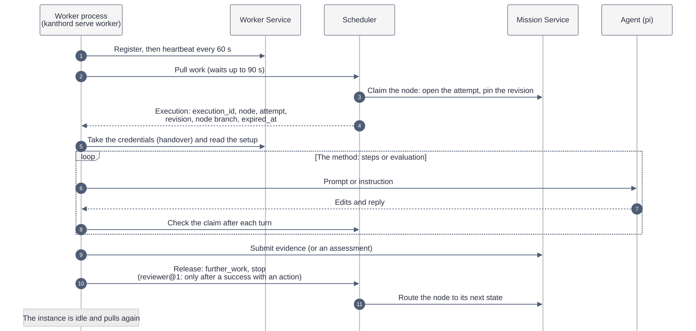

# How a worker works

[Explanations](README.md)

A worker is the part of KanthorD that does the work of a mission. A human writes the work as nodes: what to build, how to judge it, and which commands check it. A worker takes one node, changes the code of a repository with an LLM agent, proves the change with those commands, and reports the result. A second worker then judges the result independently.

This page is the entry point. Read it first. It explains the worker concept from the top down. Two pages go deeper:

- [How the coder@1 worker works](coder-worker.md): every step of one execution of the worker that writes the code.
- [How the native agent works](native-agent.md): how KanthorD builds the LLM agent that the worker drives.

## The idea in five sentences

1. A human imports a mission: a tree of **initiatives**, **objectives** and **tasks**. Each node holds a requirement, a criterion and verification commands.
2. The **Scheduler** gives one objective at a time to one **worker instance**. That grant is a **claim**, and the work under it is an **execution**.
3. The worker `coder@1` opens an LLM agent, `swe@1`, in a git checkout. The agent edits files. The worker code commits, runs the verification commands and asks the agent to judge each task.
4. When every task passes, the worker pushes a branch, records the head commit as **evidence** and **releases** the claim. The node now waits for review.
5. The worker `reviewer@1` checks out that commit in a clean directory, runs every verification again, and asks a read-only agent, `re@1`, for an **assessment**. A passing assessment completes the node, or first opens a pull request when the project requires one.

The rest of this page explains each of these sentences.

## The words you need

The terms below appear on every worker page. Each term has exactly one meaning.

| Term                 | Meaning                                                                                                                                                          |
| -------------------- | ---------------------------------------------------------------------------------------------------------------------------------------------------------------- |
| Mission              | All the work of one project, as a graph of nodes.                                                                                                                |
| Node                 | One vertex of the mission: an initiative, an objective or a task.                                                                                                |
| Initiative           | A root node. It groups objectives. Its work is a report on the outcomes of its objectives.                                                                       |
| Objective            | A node that holds tasks and works on one repository. Most worker activity is on an objective.                                                                    |
| Task                 | One step of an objective. A task has a criterion and verifications, but no state. A worker never claims a task alone.                                            |
| Requirement          | The text that states what the node must achieve.                                                                                                                 |
| Criterion            | The text that states how to judge the result.                                                                                                                    |
| Verification         | One bash command that checks the result, for example `npm test`. Exit code 0 is a pass.                                                                          |
| Node revision        | One version of the content of a node. An execution reads the revision that its attempt pins, so a later edit does not change a running execution.                |
| Attempt              | One try at a node. It holds one or more executions. The first claim opens attempt 1. A human unblock opens the next attempt.                                     |
| Worker               | A template that defines how work happens: its method, its agents, the node states that it claims and its default budget. `coder@1` and `reviewer@1` are workers. |
| Worker binding       | The project configuration that turns a worker on for one project. It sets the instance count, the model of each agent and an optional budget.                    |
| Worker instance      | One running copy of a worker. It pulls work and holds at most one execution at a time.                                                                           |
| Claim                | The grant of one node to one instance. It has a fixed deadline, `expired_at`.                                                                                    |
| Execution            | The work under one claim, from the claim to the release. It has an identity, for example `execution_01JZ8R2B…`.                                                  |
| Agent                | An LLM participant that the worker drives, for example `swe@1`. The agent edits and judges. It decides nothing about the node.                                   |
| Node branch          | The git branch of an objective, `kanthord/<node_id>`. Every execution of the objective continues on it.                                                          |
| Evidence             | A result that an execution records, for example the head commit of the node branch.                                                                              |
| Assessment           | The judgement of the evidence against the criterion: `success`, `criterion-not-met` or `undetermined`.                                                           |
| Outcome              | The final record of an attempt. A successful outcome completes the node.                                                                                         |
| Release              | The end of an execution that returns the node to the Mission Service, with `further_work: true` or `false`.                                                      |
| Budget               | The resource limit of one execution: 200 agent turns and 2 hours of wall time by default.                                                                        |
| Stop                 | The reason in a release that the execution ended early, for example `{ "reason": "budget_end", "code": "turns" }`. A release with no stop has `stop: null`.      |
| Revision instruction | A message from the worker to the agent that asks for more work on a task, for example after a failed verification. It is not a node revision.                    |

## Who does what

A worker is one of several actors. Each actor owns one concern, and no actor does the job of another one.

| Actor                    | Owns                                                                                                   | Does not own                                          |
| ------------------------ | ------------------------------------------------------------------------------------------------------ | ----------------------------------------------------- |
| Human                    | The WHAT: the requirement, the criterion and the verifications. Pause, unblock, override.              | How the work is done.                                 |
| Mission Service          | The node states, the attempts, the evidence, the assessments and the outcomes.                         | Which instance does the work.                         |
| Scheduler Service        | The work queue, the claim, its deadline and the execution record.                                      | The content of the work.                              |
| Worker Service           | The registration, the heartbeat, the credential handover, the execution setup and the action requests. | The node state and the claim.                         |
| Worker (the code)        | The method: the order of the steps, git, the verifications, the decision that a task ends.             | The node state. It releases or submits an assessment. |
| Agent (`swe@1`, `re@1`)  | The file edits and the judgement of a criterion, inside one session.                                   | Git, the verifications, the release, the budget.      |
| Project Service, custody | The bindings, the credentials and the model configuration.                                             | The execution.                                        |

The most important line is the split between the worker and the agent. The agent can claim that its work is done. The worker does not trust that claim. The worker commits the work itself, runs the verification commands itself, and asks the agent for a judgement only after every command passes.

## The life of an objective

A node moves through states. Each worker claims only from the states that it declares: `coder@1` claims `Available`, and `reviewer@1` claims `Waiting` and `External.Requested`. No worker sets a state directly. A worker releases or submits an assessment, and the Mission Service picks the next state from it. The Mission Service makes every move of the diagram, also the moves that no worker causes, for example `Pending` to `Available` when the last dependency completes.

```mermaid
%%{init: {"theme": "base", "themeVariables": {"background": "#f5f5f5", "primaryColor": "#ffffff", "primaryTextColor": "#2d3142", "primaryBorderColor": "#4f5d75", "secondaryColor": "#ececec", "tertiaryColor": "#f5f5f5", "lineColor": "#4f5d75", "edgeLabelBackground": "#f5f5f5", "fontFamily": "system-ui, sans-serif", "fontSize": "14px"}, "flowchart": {"htmlLabels": true, "useMaxWidth": false, "nodeSpacing": 28, "rankSpacing": 44}}}%%
flowchart LR
    accTitle: The life of an objective
    accDescr: Pending becomes Available when its dependencies complete. coder@1 claims Available and the node is Executing. A release with further work returns it to Available. A release with no further work moves it to Waiting. reviewer@1 claims Waiting and the node is Evaluating. criterion-not-met below the rework limit returns it to Available. A success with no external action completes the node. A success with an external action opens a pull request and moves the node to External.Requested, then External.Success and Completed. A pull request that conflicts with the base returns the node to Available. reviewer@1 claims External.Requested again when a chained action becomes eligible. A criterion-not-met at the limit, an undetermined assessment or a failed external action moves the node to Blocked. A human unblock opens the next attempt.
    pending(["Pending"]) -- "dependencies Completed" --> available(["Available"])
    available -- "coder@1 claims" --> executing["Executing<br/>coder@1 works"]
    executing -- "release<br/>further_work: true" --> available
    executing -- "release<br/>further_work: false" --> waiting(["Waiting"])
    waiting -- "reviewer@1 claims" --> evaluating["Evaluating<br/>reviewer@1 judges"]
    evaluating -- "criterion-not-met<br/>rework" --> available
    evaluating -- "success,<br/>no external action" --> completed(["Completed"])
    evaluating -- "success,<br/>pull request opened" --> requested(["External.Requested"])
    requested -- "merged" --> success(["External.Success"]) --> completed
    requested -- "pull request conflicts<br/>with the base" --> available
    requested -- "next chained action<br/>eligible: reviewer@1 claims" --> evaluating
    requested -- "closed or<br/>changes requested" --> failed(["External.Failed"]) --> blocked
    evaluating -- "criterion-not-met at the limit,<br/>or undetermined" --> blocked(["Blocked"])
    blocked -- "human unblock:<br/>next attempt" --> available
    classDef work fill:#fbeae1,stroke:#eb6c36,color:#2d3142,stroke-width:2px;
    classDef done fill:#ececec,stroke:#7a8399,color:#2d3142;
    class executing,evaluating work;
    class completed done;
```

Three facts explain most of the diagram:

- **Two workers, two claims.** `coder@1` and `reviewer@1` never share a claim. The coder does the work and releases. The reviewer judges later in its own execution, from a clean checkout.
- **Further work is normal.** One execution does not need to finish the objective. When the budget ends, the coder pushes a checkpoint and releases with `further_work: true`. The node returns to `Available`, and the next execution continues on the same node branch.
- **A conflict sends the work back.** A pull request that conflicts with the base branch returns the node to `Available` in the same attempt. `coder@1` merges the base at its next start and resolves the conflict.
- **The merge comes from outside.** After the reviewer opens a pull request, no worker acts until the pull request ends. The Intake Service checks the pull request on the git host. A human starts that check with [`kanthord mission node check`](../reference/mission/node-control.md#check). An Intake inbound of the repository, when one is configured, starts it on an event of the git host. A merge moves the node to `External.Success`, and the Mission Service then completes it with the passing assessment of the attempt. A closed pull request, or a pull request with a change request, moves the node to `External.Failed` and then to `Blocked`.
- **A human closes the loop.** A node in `Blocked` waits for a human. The human reads the reason, edits the node or not, and unblocks it. The unblock opens the next attempt.

Two more states can interrupt any step. A human can pause a node, which sets `Paused` and stops a running execution within one agent turn. The Mission Service also pauses a node that fails too often, as [Limits that stop a loop](#limits-that-stop-a-loop) explains. `Discarded` and `Completed` are the two final states.

## One execution, from pull to release

A native worker instance runs as one `kanthord serve worker` process. The process talks to the server only through the API. It repeats the same cycle for every execution:

The steps in plain words:

1. **Register.** The process starts with a machine token. The token names the project and the worker binding. The process registers one instance with the Worker Service and sends a heartbeat every 60 seconds.
2. **Pull.** The instance asks for work. The Scheduler answers when a node in a declared state is ready, or answers "no work" after 90 seconds.
3. **Claim.** The Scheduler grants the node. The Mission Service opens attempt 1 when the node has no attempt, and pins the node revision. The claim holds a fixed deadline: `expired_at` is the start time, plus the wall-time budget of the binding, plus `scheduler.release_reserve`, 10 minutes by default, for the cleanup.
4. **Setup.** The process receives the credentials of the execution through the credential handover of the Worker Service. It then reads the execution setup: the worker name, the model configuration, the composed prompt, the prompt templates, the repository and the budget. The process reads no configuration file of its own.
5. **Method.** The process runs the method of its worker: `steps` for `coder@1`, `evaluation` for `reviewer@1`. The method opens one agent session and drives it.
6. **Claim check.** After each agent turn and before each task, the process reads its claim. A claim that is no longer running ends the execution at once as revoked. A revoked execution pushes nothing and releases nothing, because the node is no longer its own.
7. **Report.** The method records evidence or an assessment in the Mission Service.
8. **Release.** `coder@1` releases the claim with `further_work` and an optional `stop`, and the Mission Service picks the next node state. `reviewer@1` releases only after a success that requires an external action. Its other assessments move the node and end the claim at once, with no release. Either way, the instance is idle again and pulls the next node.

[What a worker reports to KanthorD](worker-contract.md) lists each operation of this cycle and the telemetry that the worker writes beside it.

## The three workers

| Worker          | Host                           | Method               | Agent            | Claims from                                  | Job                                                                    |
| --------------- | ------------------------------ | -------------------- | ---------------- | -------------------------------------------- | ---------------------------------------------------------------------- |
| `coder@1`       | KanthorD (native)              | `steps`              | `swe@1`          | `Available`                                  | Does the tasks of an objective, or writes the report of an initiative. |
| `reviewer@1`    | KanthorD (native)              | `evaluation`         | `re@1`           | `Waiting`, `External.Requested`              | Judges the result, then requests the pull request.                     |
| `claude-code@1` | External harness (Claude Code) | The harness launcher | None of KanthorD | `Available`, `Waiting`, `External.Requested` | Does the work in a third-party agent program.                          |

A **native** worker runs its agent inside KanthorD on the [pi runtime](native-agent.md). An **external harness** runs a third-party agent program, and KanthorD configures none of its agent, prompt or tools. Both kinds use the same claim, evidence and release operations. This page and the two pages below it cover the native workers.

## How reviewer@1 judges

`reviewer@1` has its own execution. It trusts nothing that `coder@1` judged.

1. It reads the pinned revision and the evidence of the attempt. For an objective, the evidence names the head commit of the node branch.
2. It makes a fresh directory and a clean checkout of that commit.
3. Its code runs the verifications of the objective, then the verifications of each task, in order. The first failure stops the run. A failed command runs up to two more times, only to detect a flaky test. A pass on a rerun still counts as a failure, and the rationale names the test as flaky.
4. It records the results as evidence.
5. When a command failed, it writes a `criterion-not-met` assessment at once, with no agent. The rationale names the command and holds the last 4 KiB of its output.
6. When every command passed, the agent `re@1` judges the evidence against the criterion of the objective, each task criterion and the default standard. `re@1` can read files but cannot write a file or run a command. It reads no `AGENTS.md` or `CLAUDE.md` of the workspace, because the candidate under review wrote those files.
7. It submits the assessment. The assessment itself moves the node: the reviewer does not release, except in one case. A `success` with no required external action completes the node. A `success` with a required action, for example a pull request, makes the reviewer request the action through the Intake Service and release. The node then waits in `External.Requested` until the action ends.

A `criterion-not-met` assessment returns the node to `coder@1` as a **rework**, in the same attempt, while the attempt holds fewer reworks than the limit and no requested action. The next `coder@1` execution reads the rationale of that assessment. It revises the tasks whose ids the rationale names, and it judges the other tasks again with the rationale as context. An `undetermined` assessment, or a `criterion-not-met` at the limit, moves the node to `Blocked`.

**A chained action.** A project can require two actions in order, for example a pull request and then a second action that follows its merge. When the first action reaches its expected end, the node is claimable again in `External.Requested`. `reviewer@1` claims it, requests the next eligible action and releases. This claim performs no evaluation, because a current passing assessment already stands. Today `reviewer@1` runs the full evaluation again at this claim. A `criterion-not-met` there blocks the node, because the attempt already holds a requested action.

**When the reviewer fails.** A reviewer execution can stop before it has an assessment. It then releases with `further_work: true` and a stop, and the node returns to `Waiting` for the next reviewer execution:

| Stop                | Cause                                                               |
| ------------------- | ------------------------------------------------------------------- |
| `assessment_absent` | The budget ends before the assessment.                              |
| `judgement_invalid` | `re@1` gives a second reply with no valid judgement line.           |
| `action_unsettled`  | The request of an external action fails or has an uncertain result. |
| `operation_failed`  | Any other failure, for example a failed checkout.                   |

Each of these stops counts toward `mission.consecutive_failure_limit`. A `provider_failed` stop of the reviewer follows the same rules as for `coder@1`.

## Limits that stop a loop

Without limits, a node could cycle between the coder and the reviewer forever. Three limits in the server configuration stop that. Each limit counts inside one attempt.

| Limit                               | Default | Counts                                                                                | At the limit                                                                                                                             |
| ----------------------------------- | ------- | ------------------------------------------------------------------------------------- | ---------------------------------------------------------------------------------------------------------------------------------------- |
| `mission.rework_limit`              | 2       | `criterion-not-met` assessments that returned the node to `Available`                 | With the default, the first two `criterion-not-met` assessments of an attempt cause a rework, and the third moves the node to `Blocked`. |
| `mission.further_work_limit`        | 3       | Releases in a row with the stop `budget_end`, which means that no task completed      | The third such release in a row moves the node to `Paused`.                                                                              |
| `mission.consecutive_failure_limit` | 3       | Executions in a row, coder or reviewer, that stopped on a failure or lost their claim | The third failure in a row moves the node to `Paused`.                                                                                   |

A human resumes a `Paused` node with [`kanthord mission node resume`](../reference/mission/node-control.md#resume), which grants one more try and resets no count. A **failure** is a lost claim or a release with any stop except `budget_end` and a busy provider. The failure stops are `operation_failed`, `no_progress`, `judgement_invalid`, `report_absent`, `action_unsettled`, `assessment_absent` and `provider_failed` with the code `bad_request` or `unauthorized`. A release with no stop resets the count. A stop because the provider is busy (`rate_limited`, `quota_exhausted` or `unavailable`) does not count as a failure. It moves the agent to the next model of its fallback chain instead. [How the native agent works](native-agent.md#configuration-which-model-answers) explains the fallback chain.

## Rules that hold in every execution

These rules explain most behavior that looks surprising at first.

- **The worker decides, the agent works.** The worker code commits, runs the verifications that count, pushes, records evidence and releases. The agent cannot mark a task complete. The worker does not depend on the agent for git: `swe@1` has `bash`, so nothing blocks a `git commit` by the agent, but the worker commits whatever the agent leaves.
- **Commands before opinions.** The agent judges a criterion only after every verification of the task passes. A failed command never reaches a judgement.
- **A fresh agent for each execution.** Each execution opens a new agent session with an empty conversation. The execution can lose its claim or its process at any time, so nothing durable lives in the agent. The next execution rebuilds its context from the node branch and from the records of the Mission Service.
- **Git is the memory of the work.** The node branch carries the work from one execution to the next. A budget end writes a checkpoint commit and pushes it, so no work is lost.
- **No history rewrite.** No execution deletes, renames or force-pushes a node branch. No execution rewrites a commit that it pushed, because a record can name that commit.
- **One instance, one execution.** An instance holds at most one execution at a time. One `kanthord serve worker` process hosts one instance. An instance count of 3 needs 3 processes, each with its own machine token.
- **A lost claim is a failure.** A claim that reaches `expired_at` with no release is lost. The Scheduler ends the execution and returns the node to `Available` (or `Waiting` for a reviewer claim). The loss counts toward `mission.consecutive_failure_limit`. The worker process that still runs learns of the loss at its next call and stops.

## Where the state lives

The agent forgets everything at the end of an execution. The next execution reads the state from these places:

| State                                                  | Where it lives                                 | Durable                 |
| ------------------------------------------------------ | ---------------------------------------------- | ----------------------- |
| The work: every task commit and checkpoint commit      | The node branch on the git remote              | Yes                     |
| The node state, the attempt and the pinned revision    | The Mission Service                            | Yes                     |
| The evidence, the assessments and their rationales     | The Mission Service                            | Yes                     |
| The claim, its deadline and the selected model         | The Scheduler execution record                 | Yes                     |
| The cooldown of a busy model                           | The Agent component on the server              | Yes                     |
| The task judgements of the last execution on this host | `judged-tasks.json` in the workspace           | No, a cache of one host |
| The checkout itself                                    | `workspaces/` on the worker host               | No, a cache of one host |
| The agent conversation                                 | Memory, then `transcripts/` on the worker host | No, never read again    |

The start check of `coder@1` runs every task verification again on the head of the node branch. It therefore needs only the durable rows. The caches save agent turns, and their loss repeats no work.

- **Tasks are not scheduled.** The Scheduler grants an objective or an initiative. The worker orders and runs the tasks inside its own execution.
- **Telemetry decides nothing.** The worker writes spans of its phases, tasks, turns and tool calls. No service reads them to move a node. Only the release and the records move a node.

## Where a worker runs

Today every native instance runs as a separate `kanthord serve worker --endpoint <url> --token <token>` process. The process can run on the server host or on another host.

To run 3 instances of `coder@1` for one project:

1. Enable the agent `swe@1` with a provider and a model. See [agent enablement](../reference/agent/enablement.md).
2. Add a worker binding with `"worker": "coder@1"` and `"instance_count": 3` to the project. See [project bindings](../reference/project/binding.md).
3. Generate one machine token for each instance with `kanthord auth jwt generate --project <project_id> --binding <binding_name> --output <file>`. See [JWT generation](../reference/auth/jwt.md).
4. Start one `kanthord serve worker` process with each token. The host needs `git`, `rg` and `fd`, because the agent tools `grep` and `find` call them.

The process keeps its files in the state directory of its host, `~/.local/state/kanthord/`:

| Path                                 | Content                                                                                                                                                                          |
| ------------------------------------ | -------------------------------------------------------------------------------------------------------------------------------------------------------------------------------- |
| `workspaces/<node_id>/<binding_id>/` | The checkout of one objective. The next execution of the objective on this host reuses it. The process removes it 7 days after its last use.                                     |
| `workspaces/<execution_id>/`         | The fresh directory of one evaluation or initiative execution. The process removes it at the end.                                                                                |
| `transcripts/<execution_id>.jsonl`   | The agent conversation of one execution, mode `0600`. The process keeps the newest 50.                                                                                           |
| `pi/`                                | The private directory of the pi runtime. It is separate from any pi installation of the user. A worker execution keeps its pi session in memory and writes no session file here. |

The workspace and the transcript are local conveniences, not records. Another host can take the next execution of the same objective. It then clones the repository and checks out the pushed node branch.

The agent tools and the verification commands run on the host with the rights of the worker process. KanthorD has no sandbox. Run the worker process on a host that you trust with the repository and its credentials.

## Read next

- [How the coder@1 worker works](coder-worker.md): the 11 steps of a `coder@1` execution, the start check, the task loop, every way that an execution ends, and examples of the edge cases.
- [How the native agent works](native-agent.md): the model configuration, the prompt that the model reads, the tools, the budget and the limits of the agent.
- [What a worker reports to KanthorD](worker-contract.md): the state channel and the telemetry channel.
- Reference: [worker](../reference/worker/worker.md), [register](../reference/worker/register.md), [work pull](../reference/scheduler/work.md), [release](../reference/scheduler/execution.md), [node controls](../reference/mission/node-control.md).
