# ERD 1: Environment and planning

## Scope

This view holds the tables that set up an environment and write a plan.
After this group, a human creates a project, stores credentials and pins SSH host keys.
The human also adds worker instances, binds repositories, a storage bucket and workers, enables agents and imports the mission plan.
No execution runs yet.

The [README](README.md) holds the conventions, the colors and the map of every group.

## Capability limits

- A project binds the kinds `repository`, `storage` and `worker`.
- A worker binding of a native worker needs an enabled [agent enablement](#agent-component), because `validateEntry` refuses a binding whose agent has no enabled enablement.
- A worker binding of an externally hosted worker needs no agent enablement.
- A delivery source is no binding. The Intake Service designs it under [HANDOFF](https://github.com/kanthorlabs/kanthord/blob/main/docs/brainstorm/HANDOFF.md#intake-service).
- The Mission Service accepts the import, the export, the node API, the dependency edits, the criterion set and the priority.
- The human controls (pause, resume, block, unblock, ready, override and discard) come with [ERD 2](02-execution.md), because most of them write an attempt or an outcome.
- The Scheduler work queue is in this group, although the Scheduler Service owns it. A Mission write that makes a node claimable inserts its job in the same transaction. A Scheduler migration cannot read a Mission table, so no later migration can back-fill the queue.

## Owners without a table

- The Gateway Service owns no table. It holds idempotency records in memory. It stores no human account and no client identity. A human `sub` and a `client_identity_<ulid>` appear only as values inside an `actor` column.
- The worker catalog and the agent catalog are static server modules. A worker name and an agent name are keys of those modules, not rows.

## Diagram

```mermaid
erDiagram
    credential {
        text id PK "credential_ + ULID, one revision"
        text name "group key, 1-63 chars, never changes"
        text platform "closed platform set of the owning component"
        integer revision "unique with name, starts at 1"
        blob nonce "12 bytes, AES-256-GCM"
        blob ciphertext "secret material + 16-byte tag"
        text metadata "canonical JSON, platform schema, or null"
        integer created_at "Unix ms"
        integer ended_at "Unix ms, null while live"
        integer available_at "Unix ms, end of the cooldown of the name, revision 1 only, else null"
        integer strikes "failures of the name in a row, revision 1 only, default 0"
        text holder "server or a worker instance name, group key with name"
        text sealed_to "fingerprint of the instance key, null for server"
    }

    worker_instance {
        text id PK "worker_instance_ + ULID, one revision"
        text name "binding-name form, group key, never changes"
        text worker "catalog worker that kanthord hosts, never changes"
        integer revision "unique with name, starts at 1"
        text public_key "base64url, 32-byte X25519 public key"
        text fingerprint UK "SHA256: + unpadded base64 of SHA-256 of the key"
        integer created_at "Unix ms"
        integer ended_at "Unix ms, null while live"
    }

    repository_host_key {
        text id PK "host_key_ + ULID"
        text host UK "member of an SSH host set"
        text public_key "ssh-ed25519 and base64"
        integer created_at "Unix ms"
    }

    project_project {
        text id PK "project_ + ULID"
        text name UK "binding-name form"
        integer created_at "Unix ms"
        integer paused_at "Unix ms, null while active"
    }

    project_binding {
        text id PK "binding_ + ULID, one revision"
        text project_id FK
        text name "unique among current bindings"
        text resource_identity "kind:platform:identifier, group key"
        integer revision "unique with project_id and resource_identity"
        text config "canonical JSON of the kind"
        integer created_at "Unix ms"
        integer removed_at "Unix ms, set on a tombstone"
    }

    agent_enablement {
        text id PK "agent_enablement_ + ULID, one revision"
        text agent_name "catalog agent, for example swe@1, group key"
        integer revision "unique with agent_name, starts at 1"
        text state "enabled | disabled"
        text agent_providers "JSON list of name, provider, credential"
        text default_configuration "JSON agent_provider, model_identifier, reasoning_effort"
        text fallback_configurations "JSON list of agent_provider, model_identifier, reasoning_effort, default []"
        integer created_at "Unix ms"
        integer removed_at "Unix ms, set on a tombstone"
    }

    mission_mission {
        text id PK "mission_ + ULID"
        text project_id UK "one mission per project"
        integer version "mission version, starts at 1"
        integer created_at "Unix ms"
    }

    mission_node {
        text id PK "node_ + ULID"
        text mission_id FK
        text filename "plan file name, *.md"
        text state "12 states"
        integer attempt "latest attempt, 0 before the first"
        integer priority "signed, null reads 0"
        integer retired_at "Unix ms, null while not retired, final"
        integer created_at "Unix ms"
    }

    mission_node_revision {
        text node_id PK, FK "node"
        integer revision PK "starts at 1"
        text filename
        text name
        text requirement
        text criterion
        text verifications "JSON list of bash commands"
        text bindings "JSON list of binding identities"
        text intent "implement | examine"
        text tags "JSON set of tags"
        text commit_type "feat | fix | docs | style | refactor | test | chore, or null"
        text tasks "JSON task content, [] for an examine node"
        text change "JSON: write, previous_revision, changed_fields, tasks"
        text reason
        text actor "JSON Actor"
        integer created_at "Unix ms"
    }

    mission_dependency {
        text dependent_id PK, FK
        text depends_on_id PK, FK
        text mission_id FK
    }

    scheduler_job {
        text id PK "job_ + ULID, ULID orders"
        text project_id
        text node_id UK "node"
        integer priority "copy of the Mission priority"
        integer available_at "end of the stop backoff, or null"
        integer queued_at "time of the insert of this job"
    }

    scheduler_queue_place {
        text node_id PK "node"
        text job_id "job_ + ULID of the first job of the node"
    }

    project_project ||..o{ project_binding : "FK project_id"
    project_binding }o..o| credential : "ref in config JSON, no FK"
    project_binding }o..o{ agent_enablement : "ref via catalog agents of config.worker, and entry agent_provider, no FK"
    agent_enablement }o..|{ credential : "ref by name in agent_providers JSON, no FK"
    project_binding }o..o{ worker_instance : "ref by name in config.worker_instances JSON, no FK"
    credential }o..o| worker_instance : "ref holder by name, no FK"

    project_project ||..|| mission_mission : "ref, no FK, createMission"
    mission_mission ||..o{ mission_node : "FK mission_id"
    mission_node ||--o{ mission_node_revision : "FK node_id"
    mission_node ||--o{ mission_dependency : "FK dependent_id"
    mission_node ||--o{ mission_dependency : "FK depends_on_id"
    mission_mission ||..o{ mission_dependency : "FK mission_id"
    mission_node_revision }o..o| project_binding : "ref in bindings JSON, no FK"

    mission_node ||..o| scheduler_job : "ref, no FK"
    project_project ||..o{ scheduler_job : "ref, no FK"
    mission_node ||..o| scheduler_queue_place : "ref, no FK"
    scheduler_queue_place ||..o| scheduler_job : "job_id = id, no FK"

    classDef custody fill:#e2e3e5,stroke:#6c757d,color:#212529
    classDef repository fill:#efe3d3,stroke:#8d6e63,color:#212529
    classDef project fill:#fff3cd,stroke:#b8860b,color:#212529
    classDef agent fill:#fde2c8,stroke:#c0602b,color:#212529
    classDef worker fill:#f8d7da,stroke:#b02a37,color:#212529
    classDef mission fill:#d4edda,stroke:#2e7d32,color:#212529
    classDef scheduler fill:#d6eaf8,stroke:#1f618d,color:#212529

    class credential custody
    class repository_host_key repository
    class project_project,project_binding project
    class agent_enablement agent
    class worker_instance worker
    class mission_mission,mission_node,mission_node_revision,mission_dependency mission
    class scheduler_job,scheduler_queue_place scheduler
```

## Tables

The basis column states the source of each table.
A ruled table has its name and its columns in a design page.
A derived table maps a ruled record to rows, and this page proposes that mapping.

| Table                   | Owner                | Basis                                                                                                                                                                                                                                                                             |
| ----------------------- | -------------------- | --------------------------------------------------------------------------------------------------------------------------------------------------------------------------------------------------------------------------------------------------------------------------------- |
| `credential`            | Custody              | Ruled: [custody.impl.md](https://github.com/kanthorlabs/kanthord/blob/main/docs/brainstorm/custody.impl.md#the-credential-store-record), [the credential table](https://github.com/kanthorlabs/kanthord/blob/main/docs/brainstorm/architecture.impl.md#the-credential-table).     |
| `repository_host_key`   | Repository component | Ruled: [host keys](https://github.com/kanthorlabs/kanthord/blob/main/docs/brainstorm/repository.impl.md#host-keys).                                                                                                                                                               |
| `project_project`       | Project Service      | Ruled: [the binding store](https://github.com/kanthorlabs/kanthord/blob/main/docs/brainstorm/project-service.impl.md#the-binding-store).                                                                                                                                          |
| `project_binding`       | Project Service      | Ruled: [the binding store](https://github.com/kanthorlabs/kanthord/blob/main/docs/brainstorm/project-service.impl.md#the-binding-store).                                                                                                                                          |
| `worker_instance`       | Worker Service       | Ruled: [worker instances](https://github.com/kanthorlabs/kanthord/blob/main/docs/brainstorm/worker-service.impl.md#worker-instances).                                                                                                                                             |
| `agent_enablement`      | Agent component      | Derived from the [agent enablement](https://github.com/kanthorlabs/kanthord/blob/main/docs/brainstorm/agent.md#agent-configuration) record and the [agent enablement record](https://github.com/kanthorlabs/kanthord-engine/blob/main/docs/cli/agent.md#agent-enablement-record). |
| `mission_mission`       | Mission Service      | Derived from the `Mission` record of the [Mission CLI](https://github.com/kanthorlabs/kanthord-engine/blob/main/docs/cli/mission.md#proposed-result-schemas).                                                                                                                     |
| `mission_node`          | Mission Service      | Derived; the unique index on `(mission_id, filename)` is ruled in [the plan file name](https://github.com/kanthorlabs/kanthord/blob/main/docs/brainstorm/mission-service.impl.md#the-plan-file-name).                                                                             |
| `mission_node_revision` | Mission Service      | Derived from [the revisions](https://github.com/kanthorlabs/kanthord/blob/main/docs/brainstorm/mission-service.impl.md#the-revisions).                                                                                                                                            |
| `mission_dependency`    | Mission Service      | Derived from the [dependency](https://github.com/kanthorlabs/kanthord/blob/main/docs/brainstorm/mission-service.vocabulary.md#dependency).                                                                                                                                        |
| `scheduler_job`         | Scheduler Service    | Derived from the `Job` record of [the Scheduler operation contracts](https://github.com/kanthorlabs/kanthord/blob/main/docs/brainstorm/scheduler-service.impl.md#operation-contracts).                                                                                            |
| `scheduler_queue_place` | Scheduler Service    | Ruled: [the identities of the Scheduler Service](https://github.com/kanthorlabs/kanthord/blob/main/docs/brainstorm/scheduler-service.impl.md#the-identities-of-the-scheduler-service); the columns are derived.                                                                   |

## Keys and relationship notation

- A solid line is an identifying relationship: the primary key of the child contains the primary key of the parent. A dashed line is a non-identifying relationship.
- `project_binding` holds one row for each revision. The group `(project_id, resource_identity)` is one binding, and its latest row states the binding. A record pins one row by `id`.
- `agent_enablement` holds one row for each revision. The group `agent_name` is one enablement, and its latest row states the enablement.
- `credential` holds one row for each revision. The group `(name, holder)` is one copy of a credential, and each copy keeps its own revisions.
- `worker_instance` holds one row for each revision. The group `name` is one worker instance, and its live revision states the instance.
- `mission_node_revision` holds one row for each content revision of a node. The current revision of a node is its row with the greatest `revision`, and the primary key `(node_id, revision)` serves that lookup. A task has no row of its own.
- No pair of tables references each other, so no key is deferred. `foreign_keys` is `ON`, as [architecture.impl.md](https://github.com/kanthorlabs/kanthord/blob/main/docs/brainstorm/architecture.impl.md#the-connection-and-the-transaction) rules.

## Constraints

The owning service enforces every rule below in the transaction of its write. A rule that SQL can hold is a unique index or a key. Every other rule is a validation of the owner.

### Custody

- `credential` holds one row for each revision. `(name, holder, revision)` has a unique index, and a create of a taken `(name, holder)` group answers 409 `credential.name.conflict`.
- `holder` is never null. It holds `server` or the name of a live worker instance. `sealed_to` is null for `server` and holds the fingerprint of the instance key that sealed the secret otherwise. Custody validates the fingerprint form, and the LLM component validates the instance.
- Only an LLM platform takes a holder other than `server`. Another platform with an instance holder answers 400 `credential.sealed.invalid`.
- The write keeps one `platform` for every row of a name over every holder. A create of an existing name with another platform answers 409 `credential.name.platform_conflict`. The newest live revision of a group is the greatest `revision` of `(name, holder)` with a null `ended_at`.
- The plaintext under the envelope of an instance row is the sealed object `{ alg, enc, ciphertext }`: HPKE base mode to the instance key. The server cannot open it. A row sealed to a fingerprint that is no live revision of its instance has no holder.
- A rotation inserts the next revision and, in the same transaction, drains every older live revision that no live execution pins. A drain or a revoke sets `ended_at`. Custody refuses a revoke of the newest live revision.
- The secret shape and the `metadata` schema depend on `platform`, as the platform validators of the [LLM](https://github.com/kanthorlabs/kanthord/blob/main/docs/brainstorm/llm.impl.md#platform-validators), [Repository](https://github.com/kanthorlabs/kanthord/blob/main/docs/brainstorm/repository.impl.md#platform-validators) and [Storage](https://github.com/kanthorlabs/kanthord/blob/main/docs/brainstorm/storage.impl.md#platform-validators) components state.
- Each revision holds its own `metadata`. A rotation copies the metadata of the newest live revision unless the request replaces it. A metadata edit inserts the next revision in one transaction, with the secret of the newest live revision and the new metadata, and the older revisions stay live until custody drains them or a human revokes them.
- The `base_url` of an `openai-compatible` revision is fixed for the life of the revision and changes only at a rotation. A removal of an approved model is refused while a default configuration or an entry names it. The check and the metadata update commit in one transaction.
- The additional authenticated data of the envelope is the row identity and the platform.
- Revision 1 of a `(name, holder)` group holds the cooldown of that copy in `available_at` and `strikes`. A rotation inserts the next revision with no hold and copies none. The Agent component reads and writes the hold through the Custody port `CredentialHolds`.
- An archive is refused while a dependent names the credential. The dependents are an agent provider and a `project_binding` row. A binding row is a dependent when it is the latest row of its group and no tombstone. It is also a dependent when no tombstone follows it and a node that is not terminal and not retired pins it. The node pins it through its current revision or its open attempt. The check and the archive are atomic. An archive sets `ended_at` on every live revision of the group and keeps the rows. A group with no live revision is archived, and an archive is final. The archive of a worker instance archives every live group of that holder in its transaction.
- The dependents above apply to a group of the holder `server`. The dependents of a group of an instance holder are the worker bindings that list the instance and whose agent configuration names the credential. The Project Service answers them through `bindingsListingInstance`.
- A login session is a runtime record of the LLM component, and no table holds it. A failed or expired session stores nothing.

### Repository component

- `repository_host_key` holds one row for each pinned SSH host. `host` has the unique index `repository_host_key_host`, and the table declares no other index.
- `host` is a member of an SSH host set of a platform. The Repository component validates it before the write.
- A pin replaces the row of its host: one transaction deletes the row and inserts the new one. No operation deletes a pin.
- `source` and the fingerprint are derived on read, and no column stores them.

### Project Service

- `project_project.name` has a unique index.
- `project_binding` has a unique index on `(project_id, resource_identity, revision)`.
- Every kind holds a `resource_identity`: `repository:github:<owner>/<name>`, `worker:kanthord:<binding name>` and `storage:s3:<endpoint host>/<bucket>`. Its first part is the binding kind, and no column holds the kind. A read derives the kind from that part.
- The write refuses a name that another current binding of the project holds. A partial index cannot select the latest row of a group, so the write checks this rule.
- A row is immutable. A configuration change inserts the next revision of its group.
- A tombstone is the next row of a group with `removed_at` set and the last `config` copied. A disablement is the next row with `available: false`, or for a worker binding `instance_count: 0`, or `worker_instances: []` at `placement: worker`.
- A use reads the `config` of its pinned row. A disabled latest row of the group refuses the use, and a tombstone after the pinned row refuses the use.
- Every Project table holds `id` as its first column. `project_binding` belongs to a project, so it holds `project_id` as its second column, as [the binding store](https://github.com/kanthorlabs/kanthord/blob/main/docs/brainstorm/project-service.impl.md#the-binding-store) rules.
- The binding-set version is 1 plus the number of `project_binding` rows of the project. A write that names another version is refused. A write equal to the stored set inserts no row and keeps the version.
- No sweep deletes a removed binding or a revision.
- A write derives `resource_identity` from the configuration of the binding. A human never enters it.
- A write compares each submitted binding with the current binding of the same name. An unchanged configuration inserts no row. A changed configuration of the same resource inserts the next revision of the group. A changed resource inserts a tombstone in the old group and revision 1 of the new group. A new name inserts revision 1 of its group, or the next revision after the tombstone of a group that it binds again. A name that the submission omits takes a tombstone, and its rows stay.
- A write refuses a change of the worker of an existing worker binding under the same name.
- The `config` of a worker binding at `placement: worker` holds `worker_instances` and no `instance_count`. `worker_instances` is a list of 0 to 64 unique names of live instances of its worker. At another placement it holds `instance_count` and no `worker_instances`. The length of `worker_instances` is the instance count of the binding.
- `config` holds the configuration of its kind: [repository](https://github.com/kanthorlabs/kanthord-engine/blob/main/docs/cli/project.md#repository-configuration--proposed-fields), [worker](https://github.com/kanthorlabs/kanthord-engine/blob/main/docs/cli/project.md#worker-and-agent-configuration--proposed-fields) and [storage](https://github.com/kanthorlabs/kanthord-engine/blob/main/docs/cli/project.md#storage-configuration). Every credential reference inside `config` holds a credential name. A worker binding also holds the worker name and, in an entry, an agent name and an agent provider name. SQLite enforces no foreign key inside JSON, so the write validates each reference.

### Worker Service

- `worker_instance` holds one row for each revision. `id` is the primary key, `(name, revision)` has a unique index, and `fingerprint` has a unique index over every row.
- `name` takes the binding-name form. A taken name answers 409 `worker.instance.name_conflict`, an archived name included. The names `server`, `token`, `connect` and `heartbeat` are reserved and answer 400 `worker.instance.name_invalid`.
- `worker` names a catalog worker that kanthord hosts. The Worker Service validates the name form, the worker and the key form before the write. `name` and `worker` never change.
- The live revision of a name is its row with the greatest `revision` and a null `ended_at`. A name with no live revision is archived, and an archive is final.
- Only a Reset key inserts a revision. It inserts the next revision with a new public key and ends the old revision in one transaction. It names `expected_revision`, and a stale value answers 409 `worker.instance.revision_conflict`.
- An archive ends the live revision and every live registration of the instance. It is refused with 409 `worker.instance.in_use` while a worker binding that is no tombstone lists the instance. It is also refused while a registration of the instance holds a live execution.

### Agent component

- An enablement belongs to no project. `agent_name` is its group key.
- `agent_enablement` has a unique index on `(agent_name, revision)`.
- A row is immutable. Every change of an enablement, including a change of `state` and a change of a provider credential, inserts the next revision of its group.
- A removal inserts a tombstone: the next row of the group with `removed_at` set and the last content copied. A later write of the same agent inserts the next revision after the tombstone.
- `agent_providers` holds one or more items. Each item holds `name`, `provider` and `credential`. `name` is unique inside the row, and `credential` holds a credential name.
- `default_configuration` holds `agent_provider`, `model_identifier` and `reasoning_effort`. `agent_provider` names an item of `agent_providers` of the same row.
- `fallback_configurations` is `TEXT NOT NULL DEFAULT '[]'`. It holds at most 7 items. Each item holds `agent_provider`, `model_identifier` and `reasoning_effort`, and `agent_provider` names an item of `agent_providers` of the same row.
- A pair of `agent_provider` and `model_identifier` is unique inside `fallback_configurations`, and no item repeats the pair of `default_configuration`. A repeat answers 400 `agent.configuration.fallback_duplicate`.
- SQLite enforces no key inside JSON, so the write validates each reference.
- An enablement write validates its own providers and default configuration first: the suitability of each credential platform, the model catalog or the credential metadata, and the reasoning effort that the model supports. Then it validates every dependent worker binding.
- A retained provider name keeps its `provider` in every later revision.
- A worker binding depends on every agent that the catalog declares for its worker, whether or not the binding holds an entry for that agent. The catalog is static, so this dependency is no column.
- A binding write is refused when an agent of a native worker has no enabled enablement. `validateEntry` runs for every agent inside the binding write transaction.
- The `config` JSON of a repository binding holds `prompts`, a map from an agent name to a text of at most 32768 UTF-8 bytes. A change of a text inserts the next binding revision.
- An enablement change validates every dependent worker binding through `entriesOfAgent` in the transaction of its commit, and a change that invalidates one is refused.
- A disablement is always permitted, and it refuses every later resolution.
- The Agent component owns no cooldown table. The cooldown of a credential copy is the hold on revision 1 of its `(name, holder)` group, and the hold covers every model of that copy. A claim reads and writes the copy of its claimant holder: the instance of the registration at the `worker` placement, else `server`.
- `available_at` of a hold is the clock plus `min(base(code) × 2^(strikes − 1), agent.cooldown.max_ms)`. A hold is live while `available_at` is later than the clock.
- A hold stays after its `available_at`, with its `strikes`. A release with no `provider_failed` stop and an operator clear set `available_at` to null and `strikes` to 0.
- The release transaction writes the hold through the port, and the claim transaction reads it. An operator clear releases it.
- A resolution reads the latest row of the enablement. A latest row with `state` `disabled` or with `removed_at` set refuses the resolution.
- The credential dependents of an enablement are the items of `agent_providers` of its latest row, unless that row is a tombstone. An older row is no dependent, because no resolution reads it.
- An `agent_provider` of a complete entry names an item of `agent_providers` of the latest row of the enablement of its own agent. A provider name is unique only inside one enablement, so the lookup reads the latest row of that `agent_name`.
- A removal of an enablement is refused while a worker binding of a worker that uses the agent exists. A write that omits a provider of the latest row is refused while an entry of a dependent worker binding names it. The write checks the new row, so a replacement that moves the default configuration to another provider and omits the old provider is valid.

### Mission Service

- `mission_mission.project_id` has a unique index. `project.create` inserts the project row and calls `createMission` in one transaction.
- `mission_node` has a partial unique index on `(mission_id, filename)` where `retired_at` is null.
- Every node holds one `intent`: `implement` or `examine`. The Mission Service validates the value before the write.
- A task is content of an `implement` node. It holds a `task_<ulid>` identity, and no task identity takes the prefix `node_`.
- A dependency names a node of the same mission.
- A binding in `bindings` belongs to the project of the mission.
- A task holds no row, no revision, no state, no attempt and no priority. Its content is in the `tasks` column of the revision of its node. An `examine` node holds `[]`, and an `implement` node with `[]` is its own single work unit.
- `tasks` holds one `TaskContent` item for each current task, as the [Mission CLI](https://github.com/kanthorlabs/kanthord-engine/blob/main/docs/cli/mission.md#human-actions) proposes: the task identity, its plan file name and its complete content. A revision keeps that content for its moment, so a later move or rename changes no stored revision.
- `name`, `requirement` and `criterion` are nonblank text. `verifications` is a nonempty ordered list of nonblank bash commands.
- `tags` holds unique tags under the [tag](https://github.com/kanthorlabs/kanthord/blob/main/docs/brainstorm/project-service.vocabulary.md#tag) form. An absent list reads `[]`.
- `commit_type` holds the commit type of the node, or `null` when the node sets none. The owning service validates the closed set before the write. The worker reads `null` as `feat`.
- `bindings` obeys the rule table of [the node content](https://github.com/kanthorlabs/kanthord/blob/main/docs/brainstorm/mission-service.impl.md#the-node-content). A node names every binding that it uses, and no node takes a binding from the project. The storage bindings of `bindings` form an ordered upload list in the order of the write. An `implement` node names one or more repository bindings, and the convention is one binding. An `implement` node with no repository binding answers `mission.node.bindings_invalid`. A task names no binding.

  | Binding kind | `implement` | `examine` |
  | ------------ | ----------- | --------- |
  | Repository   | 1 or more   | 0 or more |
  | Worker       | 0           | 0         |
  | Storage      | 0 or more   | 0 or more |

- A write that changes `intent` of a node whose attempt reads 1 or more answers 409 `mission.node.intent_locked`.
- A node write that adds an unmatched pair of a node and a claimable state answers 409 `mission.node.tags_unmatched`. The [match](https://github.com/kanthorlabs/kanthord/blob/main/docs/brainstorm/scheduler-service.md#match) of the Scheduler Service defines the pair.
- A content change of a node inserts the next `mission_node_revision` row of that node in the same transaction. `mission_node.filename` equals the `filename` of the current revision.
- A task change inserts the next revision of its node. An import that moves a task to another node inserts the next revision of both nodes.
- A retired node keeps its row, its `filename`, its revisions and its last state. A retirement is final.
- A node API retirement retires the named node alone, and its tasks leave the work of the mission with it. A retirement inserts no revision. A retired node accepts no write. A node API write or a human control on it answers 409 `mission.node.retired`. An import entry with its identity or with the identity of one of its tasks answers 400 `mission.import.retired_id`. No write names a retired node as a dependency.
- A node in a terminal state takes no new revision.
- A dependency on a retiring node from a nonterminal dependent outside the retirement set refuses the retirement, unless the human forces it. A forced retirement deletes that dependency row. A dependency from a terminal dependent stays.
- A retirement deletes the job of every retired node in its transaction.
- A dependency edit and a retirement reroute every claim-free node whose dependency closure changes between `Pending` and `Available`. The dependency closure of a node is its direct dependencies. The same transaction inserts or deletes their jobs.
- A dependency relates two nodes of one mission, whatever their intent. A write that creates a cycle in a dependency closure is refused.
- A write that changes the structure or the content of the mission increments `mission_mission.version` once. A write with no change does not.
- `mission_node.priority` holds the authoritative priority. A priority act overwrites it, and no Mission row keeps the earlier value. `scheduler_job.priority` holds a copy for the selection order.
- An `actor` column holds one of three JSON forms: a human, an execution or a service. In this group only the human form occurs.

### Scheduler Service

- `scheduler_job.node_id` has a unique index, because the queue holds one job for each claimable node.
- `project_id` equals the project of the mission of the node. The Mission Service supplies both values at the insert.
- The selection order is `priority` descending, then `id` ascending.
- A priority change keeps the `id` of the job, so the job keeps its age.
- `scheduler_queue_place` holds the `id` of the first job of each node. Each later job of the node keeps that `id` and thus the queue place of the node.
- `queued_at` holds the time of the insert of the current job, and not the time of the first job.
- The Mission Service inserts and deletes the rows through the public insert and delete of the work queue, in the transaction of its accepted fact.
- In this group every job is for a node in `Available`. An evaluation job comes with [ERD 2](02-execution.md).

## Cross-group references

| From                               | To                                 | Kind                                                                                                                                            |
| ---------------------------------- | ---------------------------------- | ----------------------------------------------------------------------------------------------------------------------------------------------- |
| `mission_mission.project_id`       | `project_project.id`               | Reference, no FK.                                                                                                                               |
| `mission_node_revision.bindings`   | `project_binding.id`               | Reference in JSON, no FK. Each item pins one row. The [Mission Service](#mission-service) rules state the count of each binding kind by intent. |
| `project_binding.config`           | `credential.name`                  | Reference in JSON by name, no FK.                                                                                                               |
| `project_binding.config`           | `agent_enablement.agent_name`      | Reference through the catalog agents of the worker, no FK.                                                                                      |
| `project_binding.config`           | `agent_enablement.agent_providers` | Reference to an item name in a complete entry, no FK.                                                                                           |
| `agent_enablement.agent_providers` | `credential.name`                  | Reference in JSON by name, no FK.                                                                                                               |
| `project_binding.config`           | `worker_instance.name`             | Reference in `worker_instances` JSON by name, no FK.                                                                                            |
| `credential.holder`                | `worker_instance.name`             | Reference by name, no FK. `server` names no row.                                                                                                |
| `scheduler_job.node_id`            | `mission_node.id`                  | Reference, no FK.                                                                                                                               |
| `scheduler_job.project_id`         | `project_project.id`               | Reference, no FK.                                                                                                                               |
| `scheduler_queue_place.node_id`    | `mission_node.id`                  | Reference, no FK.                                                                                                                               |
