# ERD 4: Telemetry

## Scope

This view holds the tables of the Tracking Service.
They live in `tracking.duckdb`, a DuckDB database file separate from `kanthord.db`.
After this group, the server keeps the spans, the telemetry texts and the session entries that reach it. A human lists and reads traces and imports the capture of an external harness. Telemetry is lossy, so the store holds no complete trace by promise.

The [README](README.md) holds the conventions, the colors and the map of every group.

## Capability limits

- Every other service plugs the interface of the Tracking Service in from ERD 1 onwards, so a trace identity and a root span identity exist in `scheduler_execution` before this group.
- The server opens `tracking.duckdb` at every start and runs the migrations of the Tracking Service on it. The file holds its own `migration(service, version, applied_at)` table. The [README](README.md#stores) defines that table. In `tracking.duckdb` it holds the history of the Tracking Service alone.
- The schema declares no foreign key, no sequence, no view and no partial index. A line of the diagram between two tables is a correlation that the Tracking Service keeps, and no constraint enforces it.
- No service reads telemetry to make a decision, and no outcome depends on a row of this group.
- A foreign key cannot reach `kanthord.db`. Every project, execution and node value of this group is a correlation value.

## Records without a table

- The local store of an external harness is an append-only log on the host of the harness, not a kanthord record. Only an ingested record is a kanthord record.
- The Tracking Service holds no state of the progress of an ingestion between two ingestions.
- The count of a drop and of a refusal is itself telemetry. Its representation is open in [HANDOFF](https://github.com/kanthorlabs/kanthord/blob/main/docs/brainstorm/HANDOFF.md#tracking-service).

## Diagram

```mermaid
erDiagram
    tracking_trace {
        varchar trace_id PK "protocol value"
        varchar project_id "correlation, null for no project"
        varchar execution_id UK "correlation or null, unique when set"
        varchar root_span_id "the root of the trace, its row can be absent"
        varchar node_id "correlation or null"
        bigint attempt "attempt of the execution or null"
        bigint position "admission order of the row"
        varchar state "open | ok | error"
        bigint started_at "Unix ms of the root start or null"
        bigint ended_at "Unix ms of the root end or null"
        varchar stop_reason "kanthord.stop.reason of the root or null"
        varchar worker_name "first kanthord.worker.name or null"
        varchar_list agent_names "distinct agent names"
        varchar_list models "distinct models"
        varchar_list error_types "distinct error.type values"
        bigint input_tokens "sum over the spans"
        bigint output_tokens "sum over the spans"
        bigint cache_read_tokens "sum over the spans"
        bigint cache_creation_tokens "sum over the spans"
        double cost_usd "sum of the pi cost estimates"
        bigint span_count "stored spans"
        bigint turn_count "stored agent.turn spans"
        bigint tool_count "stored agent.tool spans"
        bigint record_count "stored records, read by the record bound"
        bigint error_count "spans with status Error"
        varchar first_error_span_id "first span with status Error, root excluded"
        bigint created_at "Unix ms, start of the retention"
    }

    tracking_span {
        varchar trace_id PK "protocol value"
        varchar span_id PK "protocol value"
        varchar parent_span_id "null for a root span"
        varchar producer "derived by the service"
        varchar origin "observed | asserted"
        varchar operation "one operation name"
        bigint position "admission order of the first record"
        bigint start_time "Unix ms or null"
        bigint end_time "Unix ms or null"
        bigint duration_ms "end_time - start_time or null"
        varchar status "Unset | Ok | Error"
        varchar project_id "copied from the trace row"
        varchar node_id "copied from the trace row"
        varchar execution_id "copied from the trace row"
        bigint attempt "copied from the trace row"
        varchar agent_name "derived from kanthord.agent.name"
        varchar request_model "derived from gen_ai.request.model"
        varchar response_model "derived from gen_ai.response.model"
        varchar provider_name "derived from gen_ai.provider.name"
        varchar tool_name "derived from gen_ai.tool.name"
        varchar worker_name "derived from kanthord.worker.name"
        varchar error_type "derived from error.type"
        bigint input_tokens "derived usage or null"
        bigint output_tokens "derived usage or null"
        bigint cache_read_tokens "derived usage or null"
        bigint cache_creation_tokens "derived usage or null"
        double cost_usd "derived pi cost estimate or null"
        varchar attributes "JSON map of attribute values"
        varchar events "JSON list of name, time, attributes"
        varchar links "JSON list of trace_id, span_id"
        varchar text_ids "JSON list of telemetry text identities"
        bigint created_at "Unix ms"
    }

    tracking_record {
        varchar trace_id PK
        varchar record_id PK "producer-minted identity"
        varchar kind "span | text | session_entry"
        varchar target_id "span_id, text_id or record_id of the entry"
        bigint created_at "Unix ms"
    }

    tracking_telemetry_text {
        varchar trace_id PK
        varchar text_id PK "identity contract open"
        varchar content "authored prose, never null"
        bigint created_at "Unix ms"
    }

    tracking_session_entry {
        varchar trace_id PK
        varchar session_id PK "span_id of the agent.session span"
        varchar entry_id PK "identity inside the session"
        varchar parent_entry_id "null for a root entry"
        bigint sequence UK "position in the session, unique per session"
        varchar entry_type "type of the entry"
        bigint entry_time "Unix ms"
        varchar tool_call_id "tool call of a tool result or null"
        boolean truncated "true when the producer cut the entry"
        varchar content "JSON of the entry, never null"
        bigint created_at "Unix ms"
    }

    tracking_trace ||..o{ tracking_span : "ref trace_id"
    tracking_trace ||..o{ tracking_session_entry : "ref trace_id"
    tracking_span |o..o{ tracking_session_entry : "ref session_id, unresolved allowed"
    tracking_trace ||..o{ tracking_record : "ref trace_id"
    tracking_trace ||..o{ tracking_telemetry_text : "ref trace_id"
    tracking_span }o..o{ tracking_span : "ref in links JSON, other trace"
    tracking_span |o..o{ tracking_span : "ref parent_span_id, unresolved allowed"
    tracking_span }o..o{ tracking_telemetry_text : "ref in text_ids JSON"

    classDef tracking fill:#d1f2eb,stroke:#117a65,color:#212529
    class tracking_trace,tracking_span,tracking_record,tracking_telemetry_text,tracking_session_entry tracking
```

## Tables

| Table                     | Owner            | Basis                                                                                                                                                                                                                                                                                                                                                                                                                                                                                                                                                                                                                  |
| ------------------------- | ---------------- | ---------------------------------------------------------------------------------------------------------------------------------------------------------------------------------------------------------------------------------------------------------------------------------------------------------------------------------------------------------------------------------------------------------------------------------------------------------------------------------------------------------------------------------------------------------------------------------------------------------------------- |
| `tracking_trace`          | Tracking Service | Derived: a trace belongs to exactly one project or to no project, it is the unit of deletion, and an ingestion resolves the project through the records of the Tracking Service, under [the trace and the project](https://github.com/kanthorlabs/kanthord/blob/main/docs/brainstorm/tracking-service.md#the-trace-and-the-project) and [ingestion](https://github.com/kanthorlabs/kanthord/blob/main/docs/brainstorm/tracking-service.md#ingestion). Ruled: the summary columns follow the [trace summary](https://github.com/kanthorlabs/kanthord/blob/main/docs/brainstorm/tracking-service.impl.md#trace-summary). |
| `tracking_span`           | Tracking Service | Ruled: [primary store](https://github.com/kanthorlabs/kanthord/blob/main/docs/brainstorm/tracking-service.impl.md#primary-store) holds the span, and [the span row](https://github.com/kanthorlabs/kanthord/blob/main/docs/brainstorm/tracking-service.impl.md#the-span-row) holds its derived columns. The columns are derived from [the trace model](https://github.com/kanthorlabs/kanthord/blob/main/docs/brainstorm/tracking-service.md#the-trace-model) and the span record of the [Tracking CLI](https://github.com/kanthorlabs/kanthord-engine/blob/main/docs/cli/tracking.md#span-record-fields-kind-span).   |
| `tracking_record`         | Tracking Service | Derived: the Tracking Service deduplicates by the record identity that its producer mints, within the retention of the trace. The identity has the form `<span_id>:<name>` and holds at most 128 characters.                                                                                                                                                                                                                                                                                                                                                                                                           |
| `tracking_telemetry_text` | Tracking Service | Ruled: [primary store](https://github.com/kanthorlabs/kanthord/blob/main/docs/brainstorm/tracking-service.impl.md#primary-store) holds the telemetry text; [retention](https://github.com/kanthorlabs/kanthord/blob/main/docs/brainstorm/tracking-service.impl.md#retention) deletes it with its trace. The columns are derived, and the identity of a text has the form `<span_id>:<name>`.                                                                                                                                                                                                                           |
| `tracking_session_entry`  | Tracking Service | Ruled: [session entries](https://github.com/kanthorlabs/kanthord/blob/main/docs/brainstorm/tracking-service.impl.md#session-entries) holds the entries of an agent session; [retention](https://github.com/kanthorlabs/kanthord/blob/main/docs/brainstorm/tracking-service.impl.md#retention) deletes them with their trace.                                                                                                                                                                                                                                                                                           |

## Constraints

The rules below have two kinds. A structural check is a rule that the Tracking Service enforces at the admission of a record. A producer obligation is a rule that the producer of a record follows, and the Tracking Service does not verify it. The Tracking Service refuses no record for its content.

### Admission and durability

- One transaction admits one batch of the write queue. It inserts the `tracking_record` row of each stored record and applies its contribution to its span, its telemetry text or its session entry. The acknowledgement answers `Stored` only after that commit.
- `tracking_record`, `tracking_telemetry_text` and `tracking_session_entry` are insert-only. A span row only gains values.
- `tracking_record` holds one row for each stored record identity of a trace. A repeat of that identity is `Stored` and changes nothing. A refused record and a dropped record leave no row.
- `target_id` of a record names a span, a telemetry text or a session entry record of the same trace.
- The records of one execution have a bound. A new record beyond that bound is `Refused` and writes neither its `tracking_record` row nor its contribution. A repeat of a stored record stays `Stored` and adds no row. The bound is 50,000 records for each trace, and `tracking_trace.record_count` holds the count.
- The retention sweep runs in bounded transactions.

### Traces

- A trace belongs to exactly one project or to no project. A server operation that concerns several projects opens one root span, and so one trace, for each project, and the root spans link to each other.
- A unique index covers `tracking_trace.execution_id`. The index admits many null values.
- The first stored record of a trace creates its `tracking_trace` row. The server record of the Scheduler Service or the first write of a native worker creates it. For an execution, the Scheduler Service opens the root span after the claim records the execution, and `trace_id`, `root_span_id`, `project_id` and `execution_id` equal the values of the execution record. An imported record never creates a trace row.
- A trace has exactly one root span, and `root_span_id` names it. A lost write of the root span leaves no root row. The trace then stays readable through its other spans, and a reader meets an unresolved parent. The representation of a missing root is open.
- An ingestion carries no project. It names an existing trace, and it assigns no trace and reassigns no trace. The Tracking Service resolves the project from `tracking_trace`.
- An imported record names an execution and a trace that agree with `tracking_trace`. A record that names another trace is refused.
- A record that arrives after its trace expires is refused with `trace_expired`. The predicate is the predicate of the retention sweep on the ULID time of the execution identity, so it needs no tombstone.
- The admission of a span updates the summary columns of its trace row in the same transaction. A summary column adds only the values that a record adds.

### Spans

- `start_time` or `end_time` is not null. A start with no end is an unfinished span. An end with no start creates the span with no start time.
- The Tracking Service persists a start when it arrives and an end when it arrives, so a reader reads a span that holds a start and no end. The root span of an execution is persisted when the server opens it.
- The first record that creates a span binds it to its producer. A record that names that span from another producer is refused.
- No record replaces a value that an earlier record set. A second end of one span is refused.
- A record that names its own span identity as its parent is refused. The Tracking Service verifies no further ancestry. A span of an execution names the root span of that execution or a span that descends from it, and that rule is a producer obligation.
- An unresolved parent is a fact that a reader sees, and never an error. A record can arrive before its parent.
- `producer` is derived by the Tracking Service and never read from a record. The producer of an imported record is the claimant of the execution that the trace resolves to. A human who issues an ingestion produces no record.
- `origin` distinguishes a span that the server observed from a span that an external harness asserted.
- `attributes` maps a name to a value of one kind: a string, a boolean, an integer, a floating-point number or an array of one primitive kind. An event holds attributes of the same kinds.
- A span carries the identity of every kanthord object that its operation concerns, as an identity attribute with the `kanthord.` prefix. One object has one attribute name in every span. An identity attribute holds an identity and never the content that it names. That rule is a producer obligation, and the registry of the attribute names is open.
- A span attribute holds no authored prose. That rule is a producer obligation.
- The record of the prompt composer of the Worker Service is a set of span attributes: the selected source of each prompt layer, the digest of its text, and every source that the composer read and rejected. It follows the trace and the access of its span. The text of a prompt reaches telemetry only through an agent transcript.
- A span of `links` names a span of another trace. A link names no project.
- `text_ids` names telemetry texts of the same trace.

### Telemetry texts

- A telemetry text belongs to exactly one trace. A span references it by identity and never embeds it.
- An agent transcript is the ordered session entries of one agent session. A session entry is a record of its own kind and no telemetry text.
- `tracking_session_entry` holds one row for each entry. A unique index covers `(trace_id, session_id, sequence)`. A new entry at a taken sequence is refused.
- No foreign key joins an entry to its `agent.session` span, so an entry can arrive before its span.
- A telemetry text holds no retention of its own and no `expired_at`, and `content` is `NOT NULL`. The deletion of its trace deletes it, and a reference to a deleted trace resolves to expired. Today the store keeps no tombstone, and a read of a deleted trace answers `404 tracking.trace.not_found`. The text read checks the trace first. A text of a deleted or unknown trace answers `404 tracking.trace.not_found`. A text that a held trace does not hold answers `404 tracking.text.not_found`.

### Retention and deletion

- The trace is the only unit of retention. One sweep transaction deletes the session entries, the telemetry texts, the records and the spans of its expired traces, then the trace rows. No `ON DELETE CASCADE` exists. The deletion of a span deletes no telemetry text.
- The operator configures the retention of a trace once for the server, never per project, as `tracking.retention_days`, default 30, a safe integer from 1 to 3650. The retention starts at `created_at` of the trace row. A sweep at the start and every hour deletes the expired traces, at most 20 in each transaction and 50 transactions in one sweep.
- A deletion of a telemetry row changes no outcome, removes no evidence and changes no state of a node.
- Telemetry is the one exception to the rule that an owner deletes no record that a peer can reference, as [architecture.impl.md](https://github.com/kanthorlabs/kanthord/blob/main/docs/brainstorm/architecture.impl.md#the-operation-and-its-two-entry-adapters) rules. `scheduler_execution.trace_id` and `root_span_id` keep their values after the deletion of their trace, and they resolve to expired.

## Cross-store references

| From                                                            | To                                                 | Kind                      |
| --------------------------------------------------------------- | -------------------------------------------------- | ------------------------- |
| `tracking_trace.project_id`                                     | `project_project.id` in `kanthord.db`              | Correlation value, no FK. |
| `tracking_trace.execution_id`                                   | `scheduler_execution.id` in `kanthord.db`          | Correlation value, no FK. |
| `scheduler_execution.trace_id`, `root_span_id` in `kanthord.db` | `tracking_trace.trace_id`, `tracking_span.span_id` | Correlation value, no FK. |
